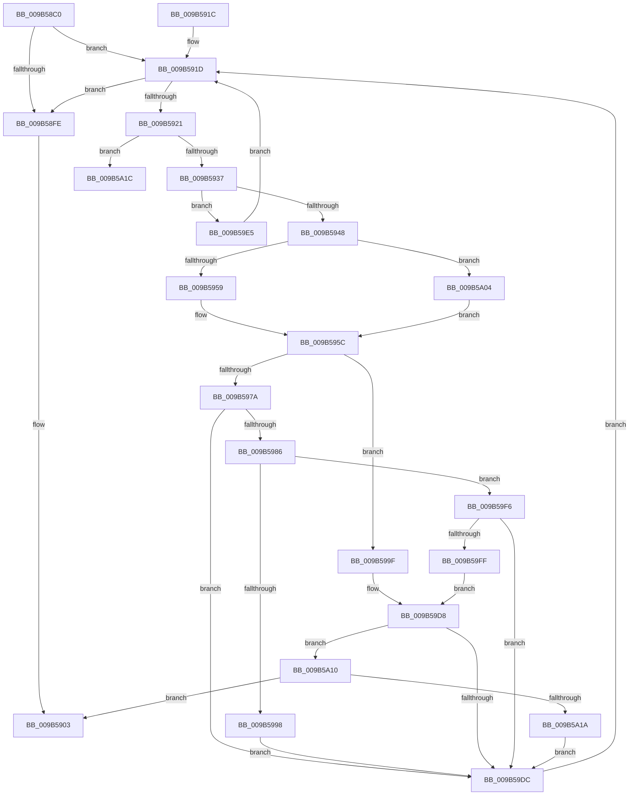

# HvpSetRangeProtection

- RVA: `0x009B58C0`–`0x009B5A39` (길이 `377` bytes)
- VA: `0x00000001409B58C0`
- 실행 섹션: `PAGE`
- PDB 이름 있음: `예`; PDB Function 태그: `아니요`
- unwind 정보 RVA: `0x0009E600`
- 디코드: `105`개 명령, `377/377` bytes 표시
- 미해석 바이트: `0` (있으면 어셈블리에 `.byte`로 보존)

> 이 문서는 커널 이미지의 기계어와 PDB 기호를 분석해 생성했습니다. 4번과 5번은 함수 원형과 자료형을 바이너리 사용 방식에서 추정한 C 해석이며 원본 소스 복구 결과는 아닙니다.

## 1. Dependencies

- 직접 호출 지점: **10**; 고유 호출 대상: **9**
- 직접 호출자로 확인된 함수: **4**
- RIP 상대 이미지 참조: **0**

### Outgoing calls
- `0x009B58EF` → [HvpGetBinContextInitialize](../../pagecmrc/BC/HvpGetBinContextInitialize_function_00BC98D0.md) (function, `0x00BC98D0`)
- `0x009B5926` → [HvpGetCellMap](../../pagecmrc/BC/HvpGetCellMap_function_00BC9710.md) (function, `0x00BC9710`)
- `0x009B594B` → [HvpMapEntryGetFreeBin](HvpMapEntryGetFreeBin_function_009B5A40.md) (function, `0x009B5A40`)
- `0x009B5964` → [HvpGetCellMap](../../pagecmrc/BC/HvpGetCellMap_function_00BC9710.md) (function, `0x00BC9710`)
- `0x009B5998` → [HvpViewMapSealRange](HvpViewMapSealRange_function_009B5A58.md) (function, `0x009B5A58`)
- `0x009B59A7` → [HvpMapEntryGetBinAddress](../../pagecmrc/BC/HvpMapEntryGetBinAddress_function_00BC9770.md) (function, `0x00BC9770`)
- `0x009B59B4` → [HvpMapEntryReleaseBinAddress](../../pagecmrc/BC/HvpMapEntryReleaseBinAddress_function_00BC9790.md) (function, `0x00BC9790`)
- `0x009B59CE` → [HvpProtectBinPartial](HvpProtectBinPartial_function_009B5D84.md) (function, `0x009B5D84`)
- `0x009B59F6` → [HvpViewMapCOWAndUnsealRange](HvpViewMapCOWAndUnsealRange_function_009B5B44.md) (function, `0x009B5B44`)
- `0x009B5A33` → [KeBugCheckEx](../../text/4F/KeBugCheckEx_function_004FD660.md) (function, `0x004FD660`)

### Direct callers
- [HvpResetPageProtection](HvpResetPageProtection_function_009B5838.md) at `0x009B5891`
- [HvpApplyLogEntryDataToFileBackedHive](HvpApplyLogEntryDataToFileBackedHive_function_009B6FF8.md) at `0x009B704E`
- [HvpPerformLogFileRecovery](HvpPerformLogFileRecovery_function_009B7994.md) at `0x009B7C66`
- [HvpAddBin](../AF/HvpAddBin_function_00AF7D48.md) at `0x00AF8489`

### Static image references
- 디코드된 RIP-relative 메모리 참조가 없습니다.

## 2. Other-region calls and transfers

- 다른 실행 섹션으로 향하는 call: **6**
  - `0x009B58EF` → [HvpGetBinContextInitialize](../../pagecmrc/BC/HvpGetBinContextInitialize_function_00BC98D0.md) (`PAGE` → `PAGECMRC`)
  - `0x009B5926` → [HvpGetCellMap](../../pagecmrc/BC/HvpGetCellMap_function_00BC9710.md) (`PAGE` → `PAGECMRC`)
  - `0x009B5964` → [HvpGetCellMap](../../pagecmrc/BC/HvpGetCellMap_function_00BC9710.md) (`PAGE` → `PAGECMRC`)
  - `0x009B59A7` → [HvpMapEntryGetBinAddress](../../pagecmrc/BC/HvpMapEntryGetBinAddress_function_00BC9770.md) (`PAGE` → `PAGECMRC`)
  - `0x009B59B4` → [HvpMapEntryReleaseBinAddress](../../pagecmrc/BC/HvpMapEntryReleaseBinAddress_function_00BC9790.md) (`PAGE` → `PAGECMRC`)
  - `0x009B5A33` → [KeBugCheckEx](../../text/4F/KeBugCheckEx_function_004FD660.md) (`PAGE` → `.text`)
- 별도 외부 분기/꼬리 이동을 확인하지 못했습니다.

## 3. Assembly (complete function range)

```asm
009B58C0  48 8B C4                        mov rax, rsp
009B58C3  48 89 58 10                     mov qword ptr [rax + 0x10], rbx
009B58C7  48 89 68 18                     mov qword ptr [rax + 0x18], rbp
009B58CB  48 89 70 20                     mov qword ptr [rax + 0x20], rsi
009B58CF  57                              push rdi
009B58D0  41 56                           push r14
009B58D2  41 57                           push r15
009B58D4  48 83 EC 30                     sub rsp, 0x30
009B58D8  48 8B E9                        mov rbp, rcx
009B58DB  45 33 FF                        xor r15d, r15d
009B58DE  48 8D 48 08                     lea rcx, [rax + 8]
009B58E2  66 44 89 78 08                  mov word ptr [rax + 8], r15w
009B58E7  45 8B F1                        mov r14d, r9d
009B58EA  41 8B F8                        mov edi, r8d
009B58ED  8B DA                           mov ebx, edx
009B58EF  E8 DC 3F 21 00                  call 0x140bc98d0
009B58F4  8B 85 A0 00 00 00               mov eax, dword ptr [rbp + 0xa0]
009B58FA  A8 11                           test al, 0x11
009B58FC  74 1F                           je 0x1409b591d
009B58FE  B8 01 00 00 00                  mov eax, 1
009B5903  48 8B 5C 24 58                  mov rbx, qword ptr [rsp + 0x58]
009B5908  48 8B 6C 24 60                  mov rbp, qword ptr [rsp + 0x60]
009B590D  48 8B 74 24 68                  mov rsi, qword ptr [rsp + 0x68]
009B5912  48 83 C4 30                     add rsp, 0x30
009B5916  41 5F                           pop r15
009B5918  41 5E                           pop r14
009B591A  5F                              pop rdi
009B591B  C3                              ret
009B591C  CC                              int3
009B591D  85 FF                           test edi, edi
009B591F  74 DD                           je 0x1409b58fe
009B5921  8B D3                           mov edx, ebx
009B5923  48 8B CD                        mov rcx, rbp
009B5926  E8 E5 3D 21 00                  call 0x140bc9710
009B592B  4C 8B D0                        mov r10, rax
009B592E  48 85 C0                        test rax, rax
009B5931  0F 84 E5 00 00 00               je 0x1409b5a1c
009B5937  4C 8B 40 08                     mov r8, qword ptr [rax + 8]
009B593B  49 F7 C0 F0 FF FF FF            test r8, -0x10
009B5942  0F 84 9D 00 00 00               je 0x1409b59e5
009B5948  48 8B C8                        mov rcx, rax
009B594B  E8 F0 00 00 00                  call 0x1409b5a40
009B5950  48 85 C0                        test rax, rax
009B5953  0F 85 AB 00 00 00               jne 0x1409b5a04
009B5959  44 8B 19                        mov r11d, dword ptr [rcx]
009B595C  8B D3                           mov edx, ebx
009B595E  48 8B CD                        mov rcx, rbp
009B5961  41 2B D3                        sub edx, r11d
009B5964  E8 A7 3D 21 00                  call 0x140bc9710
009B5969  8B 70 10                        mov esi, dword ptr [rax + 0x10]
009B596C  41 2B F3                        sub esi, r11d
009B596F  3B FE                           cmp edi, esi
009B5971  0F 42 F7                        cmovb esi, edi
009B5974  41 F6 C0 08                     test r8b, 8
009B5978  75 25                           jne 0x1409b599f
009B597A  F7 85 A0 00 00 00 00 00 02 00   test dword ptr [rbp + 0xa0], 0x20000
009B5984  74 56                           je 0x1409b59dc
009B5986  48 8D 8D E0 00 00 00            lea rcx, [rbp + 0xe0]
009B598D  44 8B C6                        mov r8d, esi
009B5990  8B D3                           mov edx, ebx
009B5992  41 83 FE 02                     cmp r14d, 2
009B5996  75 5E                           jne 0x1409b59f6
009B5998  E8 BB 00 00 00                  call 0x1409b5a58
009B599D  EB 3D                           jmp 0x1409b59dc
009B599F  4C 8D 44 24 50                  lea r8, [rsp + 0x50]
009B59A4  49 8B D2                        mov rdx, r10
009B59A7  E8 C4 3D 21 00                  call 0x140bc9770
009B59AC  4C 8D 44 24 50                  lea r8, [rsp + 0x50]
009B59B1  48 8B D0                        mov rdx, rax
009B59B4  E8 D7 3D 21 00                  call 0x140bc9790
009B59B9  41 83 FE 04                     cmp r14d, 4
009B59BD  45 8B CB                        mov r9d, r11d
009B59C0  0F 94 C1                        sete cl
009B59C3  88 4C 24 28                     mov byte ptr [rsp + 0x28], cl
009B59C7  48 8B CD                        mov rcx, rbp
009B59CA  89 74 24 20                     mov dword ptr [rsp + 0x20], esi
009B59CE  E8 B1 03 00 00                  call 0x1409b5d84
009B59D3  F7 D0                           not eax
009B59D5  C1 E8 1F                        shr eax, 0x1f
009B59D8  85 C0                           test eax, eax
009B59DA  74 34                           je 0x1409b5a10
009B59DC  2B FE                           sub edi, esi
009B59DE  03 DE                           add ebx, esi
009B59E0  E9 38 FF FF FF                  jmp 0x1409b591d
009B59E5  81 C3 00 10 00 00               add ebx, 0x1000
009B59EB  81 C7 00 F0 FF FF               add edi, 0xfffff000
009B59F1  E9 27 FF FF FF                  jmp 0x1409b591d
009B59F6  E8 49 01 00 00                  call 0x1409b5b44
009B59FB  85 C0                           test eax, eax
009B59FD  79 DD                           jns 0x1409b59dc
009B59FF  41 8B C7                        mov eax, r15d
009B5A02  EB D4                           jmp 0x1409b59d8
009B5A04  44 8B DB                        mov r11d, ebx
009B5A07  44 2B 58 14                     sub r11d, dword ptr [rax + 0x14]
009B5A0B  E9 4C FF FF FF                  jmp 0x1409b595c
009B5A10  41 83 FE 04                     cmp r14d, 4
009B5A14  0F 84 E9 FE FF FF               je 0x1409b5903
009B5A1A  EB C0                           jmp 0x1409b59dc
009B5A1C  BA 01 00 00 00                  mov edx, 1
009B5A21  44 8B CB                        mov r9d, ebx
009B5A24  4C 8B C5                        mov r8, rbp
009B5A27  48 C7 44 24 20 45 04 00 00      mov qword ptr [rsp + 0x20], 0x445
009B5A30  8D 4A 50                        lea ecx, [rdx + 0x50]
009B5A33  E8 28 7C B4 FF                  call 0x1404fd660
009B5A38  CC                              int3
```

## 4. C-style interpretation (structured pseudocode)

```c
__int64 __fastcall HvpSetRangeProtection(__int64 a1, int a2, int a3, int a4)
{
    __int64 result;
    __int64 v_r11;
    __int64 v_r15;
    __int64 v_rbx;
    __int64 v_rdi;
    __int64 v_rsi;
    __int64 v_rsp;
    unsigned __int64 v_stack_p10;
    unsigned __int64 v_stack_p18;
    unsigned __int64 v_stack_p20;
    unsigned __int8 v_stack_p28;
    unsigned __int64 v_stack_p50;

    *(unsigned __int64 *)(v_rsp + 16) = v_rbx;
    *(unsigned __int64 *)(v_rsp + 24) = v_rbp;
    *(unsigned __int64 *)(v_rsp + 32) = v_rsi;
    v_rsp = (v_rsp) - (48);
    v_r15 = 0;
    *(unsigned __int16 *)(v_rsp + 8) = 0;
    result = HvpGetBinContextInitialize(v_rsp + 8, a2, a3, a4);
    if ((((unsigned __int8)((unsigned int)(*(unsigned int *)(a1 + 160)))) & (17)) == 0) goto loc_009B591D;
loc_009B58FE:
loc_009B5903:
    v_rsp = (v_rsp) + (48);
    return 1;
loc_009B591D:
    if ((unsigned int)((unsigned int)(a3)) == 0) goto loc_009B58FE;
    result = HvpGetCellMap(v_stack_p18, (unsigned int)((unsigned int)(v_stack_p10)), a3, a4);
    if (result == 0) goto loc_009B5A1C;
    if (((*(unsigned __int64 *)(result + 8)) & (-16)) == 0) goto loc_009B59E5;
    result = HvpMapEntryGetFreeBin(result, (unsigned int)((unsigned int)(v_stack_p10)), *(unsigned __int64 *)(result + 8), a4);
    if (result != 0) goto loc_009B5A04;
loc_009B595C:
    a2 = (unsigned int)(((unsigned int)((unsigned int)(v_stack_p10))) - ((unsigned int)((unsigned int)(*(unsigned int *)(result)))));
    result = HvpGetCellMap(v_stack_p18, a2, *(unsigned __int64 *)(result + 8), a4);
    v_rsi = (unsigned int)(((unsigned int)(*(unsigned int *)(result + 16))) - ((unsigned int)((unsigned int)(*(unsigned int *)(result)))));
    if (((unsigned int)((unsigned int)(a3))) < ((unsigned int)(v_rsi))) { v_rsi = (unsigned int)((unsigned int)(a3)); }
    if ((((unsigned __int8)(*(unsigned __int64 *)(result + 8))) & (8)) != 0) goto loc_009B599F;
    if (((*(unsigned int *)(v_stack_p18 + 160)) & (0x20000ULL)) == 0) goto loc_009B59DC;
    if (((unsigned int)((unsigned int)(a4))) != 2) goto loc_009B59F6;
    result = HvpViewMapSealRange(v_stack_p18 + 224, (unsigned int)((unsigned int)(v_stack_p10)), (unsigned int)((unsigned int)(v_rsi)), a4);
    goto loc_009B59DC;
loc_009B599F:
    result = HvpMapEntryGetBinAddress(v_stack_p18 + 224, result, v_stack_p50, a4);
    result = HvpMapEntryReleaseBinAddress(v_stack_p18 + 224, result, v_stack_p50, a4);
    a1 = (((unsigned int)((unsigned int)(a4))) == 4) ? 1 : 0;
    v_stack_p28 = (unsigned __int8)(a1);
    v_stack_p20 = (unsigned int)(v_rsi);
    result = HvpProtectBinPartial(v_stack_p18, result, v_stack_p50, (unsigned int)((unsigned int)((unsigned int)(*(unsigned int *)(result)))));
    result = (unsigned int)(~(result));
    result = (unsigned int)((result) >> (31));
loc_009B59D8:
    if ((unsigned int)(result) == 0) goto loc_009B5A10;
loc_009B59DC:
    v_rdi = (unsigned int)(((unsigned int)(a3)) - ((unsigned int)(v_rsi)));
    v_rbx = (unsigned int)((v_stack_p10) + ((unsigned int)(v_rsi)));
    goto loc_009B591D;
loc_009B59E5:
    v_rbx = (unsigned int)((v_rbx) + (0x1000ULL));
    v_rdi = (unsigned int)((v_rdi) + (0xFFFFF000ULL));
    goto loc_009B591D;
loc_009B59F6:
    result = HvpViewMapCOWAndUnsealRange(v_stack_p18, result, v_stack_p50, (unsigned int)((unsigned int)((unsigned int)(*(unsigned int *)(result)))));
    if (!sign_flag) goto loc_009B59DC;
    goto loc_009B59D8;
loc_009B5A04:
    v_r11 = (unsigned int)(((unsigned int)((unsigned int)(v_rbx))) - (*(unsigned int *)(0 + 20)));
    goto loc_009B595C;
loc_009B5A10:
    if (((unsigned int)((unsigned int)(a4))) == 4) goto loc_009B5903;
    goto loc_009B59DC;
loc_009B5A1C:
    v_stack_p20 = 0x445ULL;
    result = KeBugCheckEx(1 + 80, 1, v_stack_p18, (unsigned int)((unsigned int)(v_rbx)));
    return result;
}
```

## 5. (Beta) C Style

```c
int64_t HvpSetRangeProtection(void *Arg1, int32_t Arg2, int32_t Arg3, int32_t Arg4)
{
    uint8_t *arg1 = (uint8_t *)Arg1;

    int64_t result;
    int64_t local_r11;
    int64_t local_r15;
    int64_t local_rbx;
    int64_t local_rdi;
    int64_t local_rsi;
    int64_t local_rsp;
    uint64_t v_stack_p10;
    uint64_t v_stack_p18;
    uint64_t v_stack_p20;
    uint8_t v_stack_p28;
    uint64_t v_stack_p50;

    *(uint64_t *)(local_rsp + 0x10) = local_rbx;
    *(uint64_t *)(local_rsp + 0x18) = local_rbp;
    *(uint64_t *)(local_rsp + 0x20) = local_rsi;
    local_rsp = (local_rsp) - (48);
    local_r15 = 0;
    *(uint16_t *)(local_rsp + 0x8) = 0;
    result = HvpGetBinContextInitialize(local_rsp + 8, Arg2, Arg3, Arg4);
    if ((((uint8_t)((uint32_t)(*(uint32_t *)(arg1 + 0xA0)))) & (17)) == 0) goto loc_009B591D;
loc_009B58FE:
loc_009B5903:
    local_rsp = (local_rsp) + (48);
    return 1;
loc_009B591D:
    if ((uint32_t)((uint32_t)(Arg3)) == 0) goto loc_009B58FE;
    result = HvpGetCellMap(v_stack_p18, (uint32_t)((uint32_t)(v_stack_p10)), Arg3, Arg4);
    if (result == 0) goto loc_009B5A1C;
    if (((*(uint64_t *)(result + 0x8)) & (-16)) == 0) goto loc_009B59E5;
    result = HvpMapEntryGetFreeBin(result, (uint32_t)((uint32_t)(v_stack_p10)), *(uint64_t *)(result + 0x8), Arg4);
    if (result != 0) goto loc_009B5A04;
loc_009B595C:
    Arg2 = (uint32_t)(((uint32_t)((uint32_t)(v_stack_p10))) - ((uint32_t)((uint32_t)(*(uint32_t *)(result)))));
    result = HvpGetCellMap(v_stack_p18, Arg2, *(uint64_t *)(result + 0x8), Arg4);
    local_rsi = (uint32_t)(((uint32_t)(*(uint32_t *)(result + 0x10))) - ((uint32_t)((uint32_t)(*(uint32_t *)(result)))));
    if (((uint32_t)((uint32_t)(Arg3))) < ((uint32_t)(local_rsi))) { local_rsi = (uint32_t)((uint32_t)(Arg3)); }
    if ((((uint8_t)(*(uint64_t *)(result + 0x8))) & (8)) != 0) goto loc_009B599F;
    if (((*(uint32_t *)(v_stack_p18 + 0xA0)) & (0x20000ULL)) == 0) goto loc_009B59DC;
    if (((uint32_t)((uint32_t)(Arg4))) != 2) goto loc_009B59F6;
    result = HvpViewMapSealRange(v_stack_p18 + 224, (uint32_t)((uint32_t)(v_stack_p10)), (uint32_t)((uint32_t)(local_rsi)), Arg4);
    goto loc_009B59DC;
loc_009B599F:
    result = HvpMapEntryGetBinAddress(v_stack_p18 + 224, result, v_stack_p50, Arg4);
    result = HvpMapEntryReleaseBinAddress(v_stack_p18 + 224, result, v_stack_p50, Arg4);
    Arg1 = (((uint32_t)((uint32_t)(Arg4))) == 4) ? 1 : 0;
    v_stack_p28 = (uint8_t)(Arg1);
    v_stack_p20 = (uint32_t)(local_rsi);
    result = HvpProtectBinPartial(v_stack_p18, result, v_stack_p50, (uint32_t)((uint32_t)((uint32_t)(*(uint32_t *)(result)))));
    result = (uint32_t)(~(result));
    result = (uint32_t)((result) >> (31));
loc_009B59D8:
    if ((uint32_t)(result) == 0) goto loc_009B5A10;
loc_009B59DC:
    local_rdi = (uint32_t)(((uint32_t)(Arg3)) - ((uint32_t)(local_rsi)));
    local_rbx = (uint32_t)((v_stack_p10) + ((uint32_t)(local_rsi)));
    goto loc_009B591D;
loc_009B59E5:
    local_rbx = (uint32_t)((local_rbx) + (0x1000ULL));
    local_rdi = (uint32_t)((local_rdi) + (0xFFFFF000ULL));
    goto loc_009B591D;
loc_009B59F6:
    result = HvpViewMapCOWAndUnsealRange(v_stack_p18, result, v_stack_p50, (uint32_t)((uint32_t)((uint32_t)(*(uint32_t *)(result)))));
    if (!sign_flag) goto loc_009B59DC;
    goto loc_009B59D8;
loc_009B5A04:
    local_r11 = (uint32_t)(((uint32_t)((uint32_t)(local_rbx))) - (*(uint32_t *)(0 + 0x14)));
    goto loc_009B595C;
loc_009B5A10:
    if (((uint32_t)((uint32_t)(Arg4))) == 4) goto loc_009B5903;
    goto loc_009B59DC;
loc_009B5A1C:
    v_stack_p20 = 0x445ULL;
    result = KeBugCheckEx(1 + 80, 1, v_stack_p18, (uint32_t)((uint32_t)(local_rbx)));
    return result;
}
```

### 관측된 메모리 오프셋

구조체 형식이 확인되지 않은 접근은 인자 기준의 오프셋으로만 기록했습니다.

| 기준 인자 | 오프셋 표현 | 폭 (bit) | 접근 |
|---|---:|---:|---|
| `Arg1` | `+ 0xA0` | `32` | `R` |
| `Arg1` | `+ 0xE0` | `64` | `R` |

## 6. Execution-region graph

[열기: 2D/3D 그래프와 함수 탐색 컨트롤 패널](../../../control-panel.html?section=page&rva=0x009B58C0&view=graph)

- 2D 그래프는 위에서 아래로 흐르고, 3D 그래프는 빈 공간을 드래그해 회전합니다. Shift+드래그는 이동, 휠은 확대·축소, 함수 노드 선택은 대상 보고서 이동입니다.

### Static fallback


