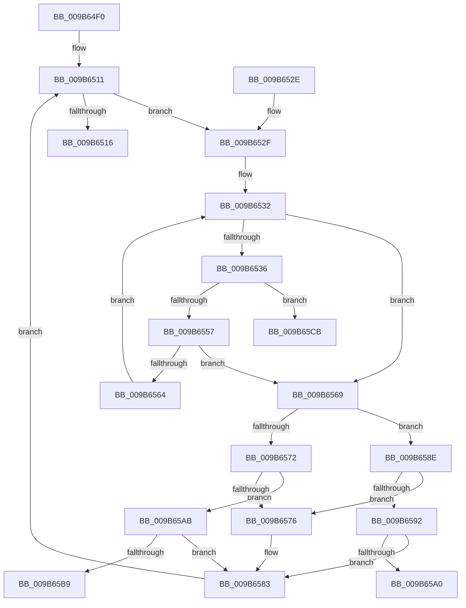

# HvpTruncateBins

- RVA: `0x009B64F0`–`0x009B65E8` (길이 `248` bytes)
- VA: `0x00000001409B64F0`
- 실행 섹션: `PAGE`
- PDB 이름 있음: `예`; PDB Function 태그: `예`
- unwind 정보 RVA: `0x0009E6F0`
- 디코드: `69`개 명령, `248/248` bytes 표시
- 미해석 바이트: `0` (있으면 어셈블리에 `.byte`로 보존)

> 이 문서는 커널 이미지의 기계어와 PDB 기호를 분석해 생성했습니다. 4번과 5번은 함수 원형과 자료형을 바이너리 사용 방식에서 추정한 C 해석이며 원본 소스 복구 결과는 아닙니다.

## 1. Dependencies

- 직접 호출 지점: **6**; 고유 호출 대상: **6**
- 직접 호출자로 확인된 함수: **1**
- RIP 상대 이미지 참조: **2**

### Outgoing calls
- `0x009B654D` → [HvpGetCellMap](../../pagecmrc/BC/HvpGetCellMap_function_00BC9710.md) (function, `0x00BC9710`)
- `0x009B655A` → [HvpMapEntryGetFreeBin](HvpMapEntryGetFreeBin_function_009B5A40.md) (function, `0x009B5A40`)
- `0x009B657E` → [HvFreeHivePartial](../A6/HvFreeHivePartial_function_00A66994.md) (function, `0x00A66994`)
- `0x009B65A0` → [CmpTestRegistryLockExclusive](../../text/66/CmpTestRegistryLockExclusive_function_0066ACC4.md) (function, `0x0066ACC4`)
- `0x009B65C0` → [ExIsResourceAcquiredExclusiveLite](../../text/40/ExIsResourceAcquiredExclusiveLite_function_0040B750.md) (function, `0x0040B750`)
- `0x009B65E2` → [KeBugCheckEx](../../text/4F/KeBugCheckEx_function_004FD660.md) (function, `0x004FD660`)

### Direct callers
- [HvStoreModifiedData](HvStoreModifiedData_function_009B4FB4.md) at `0x009B5021`

### Static image references
- `0x009B6569` → RVA `0x00EF7108` (`.data`; read)
- `0x009B65B9` → RVA `0x00EF7110` (`.data`; read)

## 2. Other-region calls and transfers

- 다른 실행 섹션으로 향하는 call: **4**
  - `0x009B654D` → [HvpGetCellMap](../../pagecmrc/BC/HvpGetCellMap_function_00BC9710.md) (`PAGE` → `PAGECMRC`)
  - `0x009B65A0` → [CmpTestRegistryLockExclusive](../../text/66/CmpTestRegistryLockExclusive_function_0066ACC4.md) (`PAGE` → `.text`)
  - `0x009B65C0` → [ExIsResourceAcquiredExclusiveLite](../../text/40/ExIsResourceAcquiredExclusiveLite_function_0040B750.md) (`PAGE` → `.text`)
  - `0x009B65E2` → [KeBugCheckEx](../../text/4F/KeBugCheckEx_function_004FD660.md) (`PAGE` → `.text`)
- call이 아닌 외부 분기/꼬리 이동: **2**
  - `0x009B65A6` → [sub_00B2DDD4](../B2/Unknown_function_00B2DDD4.md) (`tail-transfer`)
  - `0x009B65C6` → [sub_00B2DDD4](../B2/Unknown_function_00B2DDD4.md) (`tail-transfer`)

## 3. Assembly (complete function range)

```asm
009B64F0  48 89 5C 24 08                  mov qword ptr [rsp + 8], rbx
009B64F5  48 89 74 24 10                  mov qword ptr [rsp + 0x10], rsi
009B64FA  48 89 7C 24 18                  mov qword ptr [rsp + 0x18], rdi
009B64FF  41 56                           push r14
009B6501  48 83 EC 30                     sub rsp, 0x30
009B6505  48 8B F1                        mov rsi, rcx
009B6508  4C 8D B1 18 01 00 00            lea r14, [rcx + 0x118]
009B650F  33 DB                           xor ebx, ebx
009B6511  83 FB 02                        cmp ebx, 2
009B6514  7C 19                           jl 0x1409b652f
009B6516  48 8B 5C 24 40                  mov rbx, qword ptr [rsp + 0x40]
009B651B  32 C0                           xor al, al
009B651D  48 8B 74 24 48                  mov rsi, qword ptr [rsp + 0x48]
009B6522  48 8B 7C 24 50                  mov rdi, qword ptr [rsp + 0x50]
009B6527  48 83 C4 30                     add rsp, 0x30
009B652B  41 5E                           pop r14
009B652D  C3                              ret
009B652E  CC                              int3
009B652F  41 8B 3E                        mov edi, dword ptr [r14]
009B6532  85 FF                           test edi, edi
009B6534  74 33                           je 0x1409b6569
009B6536  44 8B C3                        mov r8d, ebx
009B6539  48 8B CE                        mov rcx, rsi
009B653C  41 C1 E0 1F                     shl r8d, 0x1f
009B6540  41 81 C0 00 F0 FF FF            add r8d, 0xfffff000
009B6547  44 03 C7                        add r8d, edi
009B654A  41 8B D0                        mov edx, r8d
009B654D  E8 BE 31 21 00                  call 0x140bc9710
009B6552  48 85 C0                        test rax, rax
009B6555  74 74                           je 0x1409b65cb
009B6557  48 8B C8                        mov rcx, rax
009B655A  E8 E1 F4 FF FF                  call 0x1409b5a40
009B655F  48 85 C0                        test rax, rax
009B6562  74 05                           je 0x1409b6569
009B6564  8B 78 14                        mov edi, dword ptr [rax + 0x14]
009B6567  EB C9                           jmp 0x1409b6532
009B6569  83 3D 98 0B 54 00 01            cmp dword ptr [rip + 0x540b98], 1
009B6570  74 1C                           je 0x1409b658e
009B6572  85 DB                           test ebx, ebx
009B6574  74 35                           je 0x1409b65ab
009B6576  44 8B C3                        mov r8d, ebx
009B6579  8B D7                           mov edx, edi
009B657B  48 8B CE                        mov rcx, rsi
009B657E  E8 11 04 0B 00                  call 0x140a66994
009B6583  FF C3                           inc ebx
009B6585  49 81 C6 78 02 00 00            add r14, 0x278
009B658C  EB 83                           jmp 0x1409b6511
009B658E  85 DB                           test ebx, ebx
009B6590  75 E4                           jne 0x1409b6576
009B6592  8D 87 00 00 01 00               lea eax, [rdi + 0x10000]
009B6598  3B 86 00 07 00 00               cmp eax, dword ptr [rsi + 0x700]
009B659E  77 E3                           ja 0x1409b6583
009B65A0  E8 1F 47 CB FF                  call 0x14066acc4
009B65A5  90                              nop
009B65A6  E9 29 78 17 00                  jmp 0x140b2ddd4
009B65AB  8D 87 00 00 01 00               lea eax, [rdi + 0x10000]
009B65B1  3B 86 00 07 00 00               cmp eax, dword ptr [rsi + 0x700]
009B65B7  77 CA                           ja 0x1409b6583
009B65B9  48 8B 0D 50 0B 54 00            mov rcx, qword ptr [rip + 0x540b50]
009B65C0  E8 8B 51 A5 FF                  call 0x14040b750
009B65C5  90                              nop
009B65C6  E9 09 78 17 00                  jmp 0x140b2ddd4
009B65CB  BA 01 00 00 00                  mov edx, 1
009B65D0  45 8B C8                        mov r9d, r8d
009B65D3  4C 8B C6                        mov r8, rsi
009B65D6  48 C7 44 24 20 CB 13 00 00      mov qword ptr [rsp + 0x20], 0x13cb
009B65DF  8D 4A 50                        lea ecx, [rdx + 0x50]
009B65E2  E8 79 70 B4 FF                  call 0x1404fd660
009B65E7  CC                              int3
```

## 4. C-style interpretation (structured pseudocode)

```c
__int64 __fastcall HvpTruncateBins(__int64 a1)
{
    __int64 result;
    __int64 v_r14;
    __int64 v_rbx;
    __int64 v_rsp;
    unsigned __int64 v_stack_p10;
    unsigned __int64 v_stack_p18;
    unsigned __int64 v_stack_p20;
    unsigned __int64 v_stack_p8;

    v_stack_p8 = v_rbx;
    v_stack_p10 = v_rsi;
    v_stack_p18 = v_rdi;
    v_rsp = (v_rsp) - (48);
    v_rbx = 0;
loc_009B6511:
    if (0 < 2) goto loc_009B652F;
    result = 0;
    v_rsp = (v_rsp) + (48);
    return result;
loc_009B652F:
loc_009B6532:
    if ((unsigned int)((unsigned int)(*(unsigned int *)(a1 + 280))) == 0) goto loc_009B6569;
    a3 = (unsigned int)(((unsigned int)((unsigned int)(v_stack_p8))) << (31));
    a3 = (unsigned int)((a3) + (0xFFFFF000ULL));
    a3 = (unsigned int)((a3) + ((unsigned int)((unsigned int)(*(unsigned int *)(a1 + 280)))));
    result = HvpGetCellMap(v_stack_p10, (unsigned int)((unsigned int)(a3)), a3, a4);
    if (result == 0) goto loc_009B65CB;
    result = HvpMapEntryGetFreeBin(result, (unsigned int)((unsigned int)(a3)), a3, a4);
    if (result == 0) goto loc_009B6569;
    goto loc_009B6532;
loc_009B6569:
    if ((*(unsigned int *)(v_rip + 5507992)) == 1) goto loc_009B658E;
    if ((unsigned int)(v_stack_p8) == 0) goto loc_009B65AB;
loc_009B6576:
    result = HvFreeHivePartial(v_stack_p10, (unsigned int)((unsigned int)((unsigned int)(*(unsigned int *)(result + 20)))), (unsigned int)((unsigned int)(v_stack_p8)), a4);
loc_009B6583:
    v_rbx = (unsigned int)((v_stack_p8) + 1);
    v_r14 = (a1 + 280) + (632);
    goto loc_009B6511;
loc_009B658E:
    if ((unsigned int)(v_rbx) != 0) goto loc_009B6576;
    if (((unsigned int)((unsigned int)(*(unsigned int *)(result + 20)) + 65536)) > (*(unsigned int *)(v_stack_p10 + 1792))) goto loc_009B6583;
    result = CmpTestRegistryLockExclusive(v_stack_p10, (unsigned int)((unsigned int)((unsigned int)(*(unsigned int *)(result + 20)))), (unsigned int)((unsigned int)(v_stack_p8)), a4);
loc_009B65AB:
    if (((unsigned int)((unsigned int)(*(unsigned int *)(result + 20)) + 65536)) > (*(unsigned int *)(v_stack_p10 + 1792))) goto loc_009B6583;
    result = ExIsResourceAcquiredExclusiveLite(*(unsigned __int64 *)(v_rip + 5507920), (unsigned int)((unsigned int)((unsigned int)(*(unsigned int *)(result + 20)))), (unsigned int)((unsigned int)(v_stack_p8)), a4);
loc_009B65CB:
    v_stack_p20 = 0x13CBULL;
    result = KeBugCheckEx(1 + 80, 1, v_stack_p10, (unsigned int)((unsigned int)((unsigned int)((unsigned int)(v_stack_p8)))));
    return result;
}
```

## 5. (Beta) C Style

```c
int64_t HvpTruncateBins(void *Arg1)
{
    uint8_t *arg1 = (uint8_t *)Arg1;

    int64_t result;
    int64_t local_r14;
    int64_t local_rbx;
    int64_t local_rsp;
    uint64_t v_stack_p10;
    uint64_t v_stack_p18;
    uint64_t v_stack_p20;
    uint64_t v_stack_p8;

    v_stack_p8 = local_rbx;
    v_stack_p10 = local_rsi;
    v_stack_p18 = local_rdi;
    local_rsp = (local_rsp) - (48);
    local_rbx = 0;
loc_009B6511:
    if (0 < 2) goto loc_009B652F;
    result = 0;
    local_rsp = (local_rsp) + (48);
    return result;
loc_009B652F:
loc_009B6532:
    if ((uint32_t)((uint32_t)(*(uint32_t *)(arg1 + 0x118))) == 0) goto loc_009B6569;
    a3 = (uint32_t)(((uint32_t)((uint32_t)(v_stack_p8))) << (31));
    a3 = (uint32_t)((a3) + (0xFFFFF000ULL));
    a3 = (uint32_t)((a3) + ((uint32_t)((uint32_t)(*(uint32_t *)(arg1 + 0x118)))));
    result = HvpGetCellMap(v_stack_p10, (uint32_t)((uint32_t)(a3)), a3, a4);
    if (result == 0) goto loc_009B65CB;
    result = HvpMapEntryGetFreeBin(result, (uint32_t)((uint32_t)(a3)), a3, a4);
    if (result == 0) goto loc_009B6569;
    goto loc_009B6532;
loc_009B6569:
    if ((*(uint32_t *)(v_rip + 0x540B98)) == 1) goto loc_009B658E;
    if ((uint32_t)(v_stack_p8) == 0) goto loc_009B65AB;
loc_009B6576:
    result = HvFreeHivePartial(v_stack_p10, (uint32_t)((uint32_t)((uint32_t)(*(uint32_t *)(result + 0x14)))), (uint32_t)((uint32_t)(v_stack_p8)), a4);
loc_009B6583:
    local_rbx = (uint32_t)((v_stack_p8) + 1);
    local_r14 = (Arg1 + 280) + (632);
    goto loc_009B6511;
loc_009B658E:
    if ((uint32_t)(local_rbx) != 0) goto loc_009B6576;
    if (((uint32_t)((uint32_t)(*(uint32_t *)(result + 0x14)) + 65536)) > (*(uint32_t *)(v_stack_p10 + 0x700))) goto loc_009B6583;
    result = CmpTestRegistryLockExclusive(v_stack_p10, (uint32_t)((uint32_t)((uint32_t)(*(uint32_t *)(result + 0x14)))), (uint32_t)((uint32_t)(v_stack_p8)), a4);
loc_009B65AB:
    if (((uint32_t)((uint32_t)(*(uint32_t *)(result + 0x14)) + 65536)) > (*(uint32_t *)(v_stack_p10 + 0x700))) goto loc_009B6583;
    result = ExIsResourceAcquiredExclusiveLite(*(uint64_t *)(v_rip + 0x540B50), (uint32_t)((uint32_t)((uint32_t)(*(uint32_t *)(result + 0x14)))), (uint32_t)((uint32_t)(v_stack_p8)), a4);
loc_009B65CB:
    v_stack_p20 = 0x13CBULL;
    result = KeBugCheckEx(1 + 80, 1, v_stack_p10, (uint32_t)((uint32_t)((uint32_t)((uint32_t)(v_stack_p8)))));
    return result;
}
```

### 관측된 메모리 오프셋

구조체 형식이 확인되지 않은 접근은 인자 기준의 오프셋으로만 기록했습니다.

| 기준 인자 | 오프셋 표현 | 폭 (bit) | 접근 |
|---|---:|---:|---|
| `Arg1` | `+ 0x0` | `32` | `R` |
| `Arg1` | `+ 0x118` | `64` | `R` |
| `Arg1` | `+ 0x700` | `32` | `R` |

## 6. Execution-region graph

[열기: 2D/3D 그래프와 함수 탐색 컨트롤 패널](../../../control-panel.html?section=page&rva=0x009B64F0&view=graph)

- 2D 그래프는 위에서 아래로 흐르고, 3D 그래프는 빈 공간을 드래그해 회전합니다. Shift+드래그는 이동, 휠은 확대·축소, 함수 노드 선택은 대상 보고서 이동입니다.

### Static fallback


