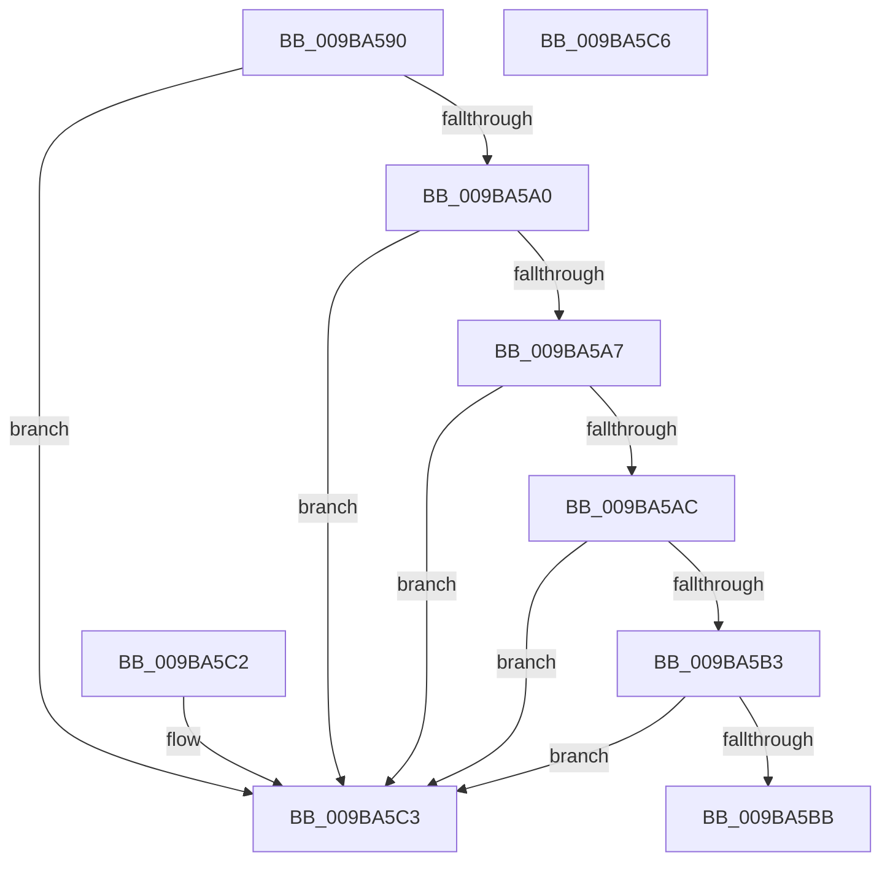

# HvpValidateLoadedBin

- RVA: `0x009BA590`–`0x009BA5C7` (길이 `55` bytes)
- VA: `0x00000001409BA590`
- 실행 섹션: `PAGE`
- PDB 이름 있음: `예`; PDB Function 태그: `아니요`
- unwind 정보 RVA: `0x000DB714`
- 디코드: `20`개 명령, `55/55` bytes 표시
- 미해석 바이트: `0` (있으면 어셈블리에 `.byte`로 보존)

> 이 문서는 커널 이미지의 기계어와 PDB 기호를 분석해 생성했습니다. 4번과 5번은 함수 원형과 자료형을 바이너리 사용 방식에서 추정한 C 해석이며 원본 소스 복구 결과는 아닙니다.

## 1. Dependencies

- 직접 호출 지점: **0**; 고유 호출 대상: **0**
- 직접 호출자로 확인된 함수: **2**
- RIP 상대 이미지 참조: **0**

### Outgoing calls
- 직접 디코드된 call 명령이 없습니다.

### Direct callers
- [HvpBuildMapForMemoryBackedHive](../7F/HvpBuildMapForMemoryBackedHive_function_007F3B4C.md) at `0x007F3C0A`
- [HvpRemapAndEnlistHiveBins](HvpRemapAndEnlistHiveBins_function_009B8E0C.md) at `0x009B9381`

### Static image references
- 디코드된 RIP-relative 메모리 참조가 없습니다.

## 2. Other-region calls and transfers

- 다른 실행 섹션으로 향하는 call: **0**
- 별도 외부 분기/꼬리 이동을 확인하지 못했습니다.

## 3. Assembly (complete function range)

```asm
009BA590  8B 41 08                        mov eax, dword ptr [rcx + 8]
009BA593  44 8B 51 04                     mov r10d, dword ptr [rcx + 4]
009BA597  45 8D 0C 02                     lea r9d, [r10 + rax]
009BA59B  45 3B C8                        cmp r9d, r8d
009BA59E  77 23                           ja 0x1409ba5c3
009BA5A0  3D 00 10 00 00                  cmp eax, 0x1000
009BA5A5  72 1C                           jb 0x1409ba5c3
009BA5A7  44 3B C8                        cmp r9d, eax
009BA5AA  72 17                           jb 0x1409ba5c3
009BA5AC  A9 FF 0F 00 00                  test eax, 0xfff
009BA5B1  75 10                           jne 0x1409ba5c3
009BA5B3  81 39 68 62 69 6E               cmp dword ptr [rcx], 0x6e696268
009BA5B9  75 08                           jne 0x1409ba5c3
009BA5BB  44 3B D2                        cmp r10d, edx
009BA5BE  0F 94 C0                        sete al
009BA5C1  C3                              ret
009BA5C2  CC                              int3
009BA5C3  32 C0                           xor al, al
009BA5C5  C3                              ret
009BA5C6  CC                              int3
```

## 4. C-style interpretation (structured pseudocode)

```c
__int64 __fastcall HvpValidateLoadedBin(__int64 a1, int a2, int a3)
{
    __int64 result;

    if (((unsigned int)((unsigned int)(*(unsigned int *)(a1 + 4)) + (unsigned int)(*(unsigned int *)(a1 + 8)) * 1)) > a3) goto loc_009BA5C3;
    if (((unsigned int)((unsigned int)(*(unsigned int *)(a1 + 8)))) < 0x1000ULL) goto loc_009BA5C3;
    if (((unsigned int)((unsigned int)(*(unsigned int *)(a1 + 4)) + (unsigned int)(*(unsigned int *)(a1 + 8)) * 1)) < ((unsigned int)((unsigned int)(*(unsigned int *)(a1 + 8))))) goto loc_009BA5C3;
    if ((((unsigned int)((unsigned int)(*(unsigned int *)(a1 + 8)))) & (0xFFFULL)) != 0) goto loc_009BA5C3;
    if ((*(unsigned int *)(a1)) != 0x6E696268ULL) goto loc_009BA5C3;
    result = (((unsigned int)((unsigned int)(*(unsigned int *)(a1 + 4)))) == a2) ? 1 : 0;
    return result;
loc_009BA5C3:
    result = 0;
    return result;
}
```

## 5. (Beta) C Style

```c
int64_t HvpValidateLoadedBin(void *Arg1, int32_t Arg2, int32_t Arg3)
{
    uint8_t *arg1 = (uint8_t *)Arg1;

    int64_t result;

    if (((uint32_t)((uint32_t)(*(uint32_t *)(arg1 + 0x4)) + (uint32_t)(*(uint32_t *)(arg1 + 0x8)) * 1)) > Arg3) goto loc_009BA5C3;
    if (((uint32_t)((uint32_t)(*(uint32_t *)(arg1 + 0x8)))) < 0x1000ULL) goto loc_009BA5C3;
    if (((uint32_t)((uint32_t)(*(uint32_t *)(arg1 + 0x4)) + (uint32_t)(*(uint32_t *)(arg1 + 0x8)) * 1)) < ((uint32_t)((uint32_t)(*(uint32_t *)(arg1 + 0x8))))) goto loc_009BA5C3;
    if ((((uint32_t)((uint32_t)(*(uint32_t *)(arg1 + 0x8)))) & (0xFFFULL)) != 0) goto loc_009BA5C3;
    if ((*(uint32_t *)(arg1)) != 0x6E696268ULL) goto loc_009BA5C3;
    result = (((uint32_t)((uint32_t)(*(uint32_t *)(arg1 + 0x4)))) == Arg2) ? 1 : 0;
    return result;
loc_009BA5C3:
    result = 0;
    return result;
}
```

### 관측된 메모리 오프셋

구조체 형식이 확인되지 않은 접근은 인자 기준의 오프셋으로만 기록했습니다.

| 기준 인자 | 오프셋 표현 | 폭 (bit) | 접근 |
|---|---:|---:|---|
| `Arg1` | `+ 0x0` | `32` | `R` |
| `Arg1` | `+ 0x4` | `32` | `R` |
| `Arg1` | `+ 0x8` | `32` | `R` |

## 6. Execution-region graph

[열기: 2D/3D 그래프와 함수 탐색 컨트롤 패널](../../../control-panel.html?section=page&rva=0x009BA590&view=graph)

- 2D 그래프는 위에서 아래로 흐르고, 3D 그래프는 빈 공간을 드래그해 회전합니다. Shift+드래그는 이동, 휠은 확대·축소, 함수 노드 선택은 대상 보고서 이동입니다.

### Static fallback


