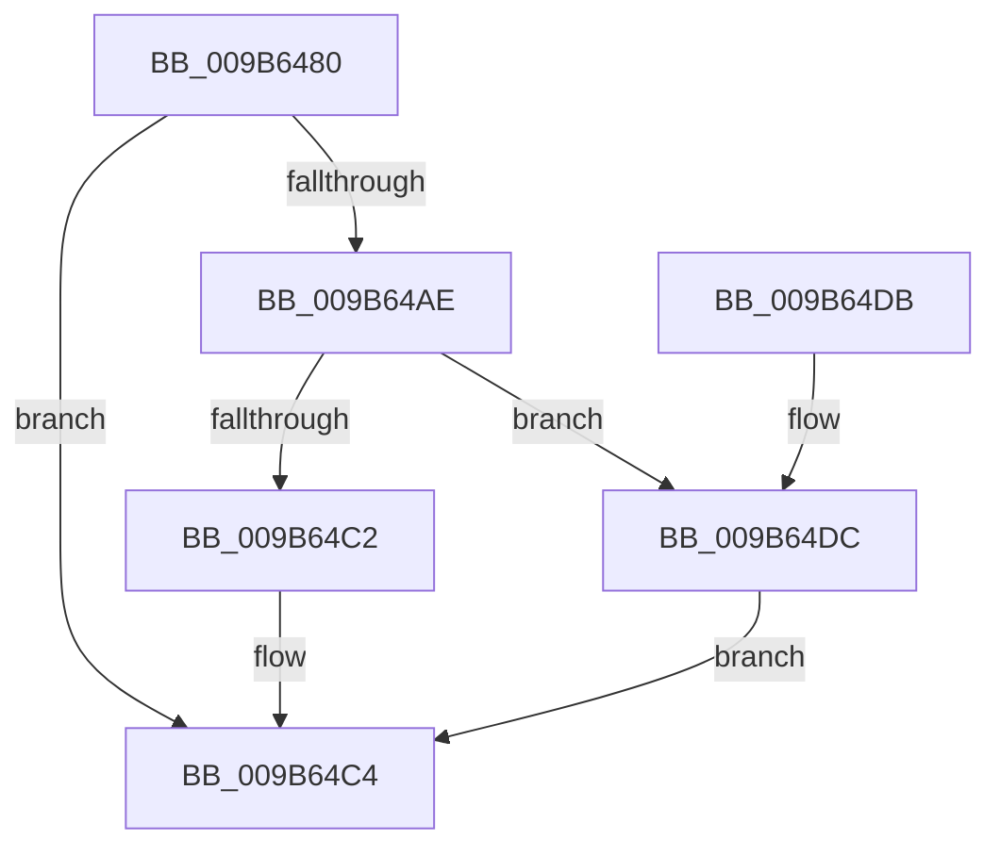

# HvpViewMapAcquireChargesAndLockViewPages

- RVA: `0x009B6480`–`0x009B64E9` (길이 `105` bytes)
- VA: `0x00000001409B6480`
- 실행 섹션: `PAGE`
- PDB 이름 있음: `예`; PDB Function 태그: `아니요`
- unwind 정보 RVA: `0x00069BF8`
- 디코드: `34`개 명령, `105/105` bytes 표시
- 미해석 바이트: `0` (있으면 어셈블리에 `.byte`로 보존)

> 이 문서는 커널 이미지의 기계어와 PDB 기호를 분석해 생성했습니다. 4번과 5번은 함수 원형과 자료형을 바이너리 사용 방식에서 추정한 C 해석이며 원본 소스 복구 결과는 아닙니다.

## 1. Dependencies

- 직접 호출 지점: **3**; 고유 호출 대상: **3**
- 직접 호출자로 확인된 함수: **1**
- RIP 상대 이미지 참조: **0**

### Outgoing calls
- `0x009B64A3` → [CmSiAcquireProcessLockedPagesCharge](../../text/47/CmSiAcquireProcessLockedPagesCharge_function_0047D714.md) (function, `0x0047D714`)
- `0x009B64B7` → [CmSiLockViewOfSection](../../text/49/CmSiLockViewOfSection_function_0049FCB8.md) (function, `0x0049FCB8`)
- `0x009B64E2` → [CmSiReleaseProcessLockedPagesCharge](../../text/47/CmSiReleaseProcessLockedPagesCharge_function_0047D81C.md) (function, `0x0047D81C`)

### Direct callers
- [HvpViewMapMakeViewRangeValid](HvpViewMapMakeViewRangeValid_function_009B5E00.md) at `0x009B5F4D`

### Static image references
- 디코드된 RIP-relative 메모리 참조가 없습니다.

## 2. Other-region calls and transfers

- 다른 실행 섹션으로 향하는 call: **3**
  - `0x009B64A3` → [CmSiAcquireProcessLockedPagesCharge](../../text/47/CmSiAcquireProcessLockedPagesCharge_function_0047D714.md) (`PAGE` → `.text`)
  - `0x009B64B7` → [CmSiLockViewOfSection](../../text/49/CmSiLockViewOfSection_function_0049FCB8.md) (`PAGE` → `.text`)
  - `0x009B64E2` → [CmSiReleaseProcessLockedPagesCharge](../../text/47/CmSiReleaseProcessLockedPagesCharge_function_0047D81C.md) (`PAGE` → `.text`)
- 별도 외부 분기/꼬리 이동을 확인하지 못했습니다.

## 3. Assembly (complete function range)

```asm
009B6480  48 89 5C 24 08                  mov qword ptr [rsp + 8], rbx
009B6485  48 89 6C 24 10                  mov qword ptr [rsp + 0x10], rbp
009B648A  48 89 74 24 18                  mov qword ptr [rsp + 0x18], rsi
009B648F  57                              push rdi
009B6490  48 83 EC 20                     sub rsp, 0x20
009B6494  48 8B F2                        mov rsi, rdx
009B6497  49 8B F9                        mov rdi, r9
009B649A  48 8B CE                        mov rcx, rsi
009B649D  49 8B D1                        mov rdx, r9
009B64A0  49 8B E8                        mov rbp, r8
009B64A3  E8 6C 72 AC FF                  call 0x14047d714
009B64A8  8B D8                           mov ebx, eax
009B64AA  85 C0                           test eax, eax
009B64AC  78 16                           js 0x1409b64c4
009B64AE  4C 8B CF                        mov r9, rdi
009B64B1  4C 8B C5                        mov r8, rbp
009B64B4  48 8B D6                        mov rdx, rsi
009B64B7  E8 FC 97 AE FF                  call 0x14049fcb8
009B64BC  8B D8                           mov ebx, eax
009B64BE  85 C0                           test eax, eax
009B64C0  78 1A                           js 0x1409b64dc
009B64C2  33 DB                           xor ebx, ebx
009B64C4  48 8B 6C 24 38                  mov rbp, qword ptr [rsp + 0x38]
009B64C9  8B C3                           mov eax, ebx
009B64CB  48 8B 5C 24 30                  mov rbx, qword ptr [rsp + 0x30]
009B64D0  48 8B 74 24 40                  mov rsi, qword ptr [rsp + 0x40]
009B64D5  48 83 C4 20                     add rsp, 0x20
009B64D9  5F                              pop rdi
009B64DA  C3                              ret
009B64DB  CC                              int3
009B64DC  48 8B D7                        mov rdx, rdi
009B64DF  48 8B CE                        mov rcx, rsi
009B64E2  E8 35 73 AC FF                  call 0x14047d81c
009B64E7  EB DB                           jmp 0x1409b64c4
```

## 4. C-style interpretation (structured pseudocode)

```c
__int64 __fastcall HvpViewMapAcquireChargesAndLockViewPages(__int64 a1, __int64 a2, __int64 a3, __int64 a4)
{
    __int64 result;
    __int64 v_rbx;
    __int64 v_rsp;
    unsigned __int64 v_stack_p10;
    unsigned __int64 v_stack_p18;
    unsigned __int64 v_stack_p8;

    v_stack_p8 = v_rbx;
    v_stack_p10 = v_rbp;
    v_stack_p18 = v_rsi;
    v_rsp = (v_rsp) - (32);
    result = CmSiAcquireProcessLockedPagesCharge(a2, a4, a3, a4);
    if (sign_flag) goto loc_009B64C4;
    result = CmSiLockViewOfSection(a2, a2, a3, a4);
    if (sign_flag) goto loc_009B64DC;
    v_rbx = 0;
loc_009B64C4:
    v_rsp = (v_rsp) + (32);
    return 0;
loc_009B64DC:
    result = CmSiReleaseProcessLockedPagesCharge(v_stack_p18, a4, a3, a4);
    goto loc_009B64C4;
}
```

## 5. (Beta) C Style

```c
int64_t HvpViewMapAcquireChargesAndLockViewPages(int64_t Arg1, int64_t Arg2, int64_t Arg3, int64_t Arg4)
{
    int64_t result;
    int64_t local_rbx;
    int64_t local_rsp;
    uint64_t v_stack_p10;
    uint64_t v_stack_p18;
    uint64_t v_stack_p8;

    v_stack_p8 = local_rbx;
    v_stack_p10 = local_rbp;
    v_stack_p18 = local_rsi;
    local_rsp = (local_rsp) - (32);
    result = CmSiAcquireProcessLockedPagesCharge(Arg2, Arg4, Arg3, Arg4);
    if (sign_flag) goto loc_009B64C4;
    result = CmSiLockViewOfSection(Arg2, Arg2, Arg3, Arg4);
    if (sign_flag) goto loc_009B64DC;
    local_rbx = 0;
loc_009B64C4:
    local_rsp = (local_rsp) + (32);
    return 0;
loc_009B64DC:
    result = CmSiReleaseProcessLockedPagesCharge(v_stack_p18, Arg4, Arg3, Arg4);
    goto loc_009B64C4;
}
```

## 6. Execution-region graph

[열기: 2D/3D 그래프와 함수 탐색 컨트롤 패널](../../../control-panel.html?section=page&rva=0x009B6480&view=graph)

- 2D 그래프는 위에서 아래로 흐르고, 3D 그래프는 빈 공간을 드래그해 회전합니다. Shift+드래그는 이동, 휠은 확대·축소, 함수 노드 선택은 대상 보고서 이동입니다.

### Static fallback


