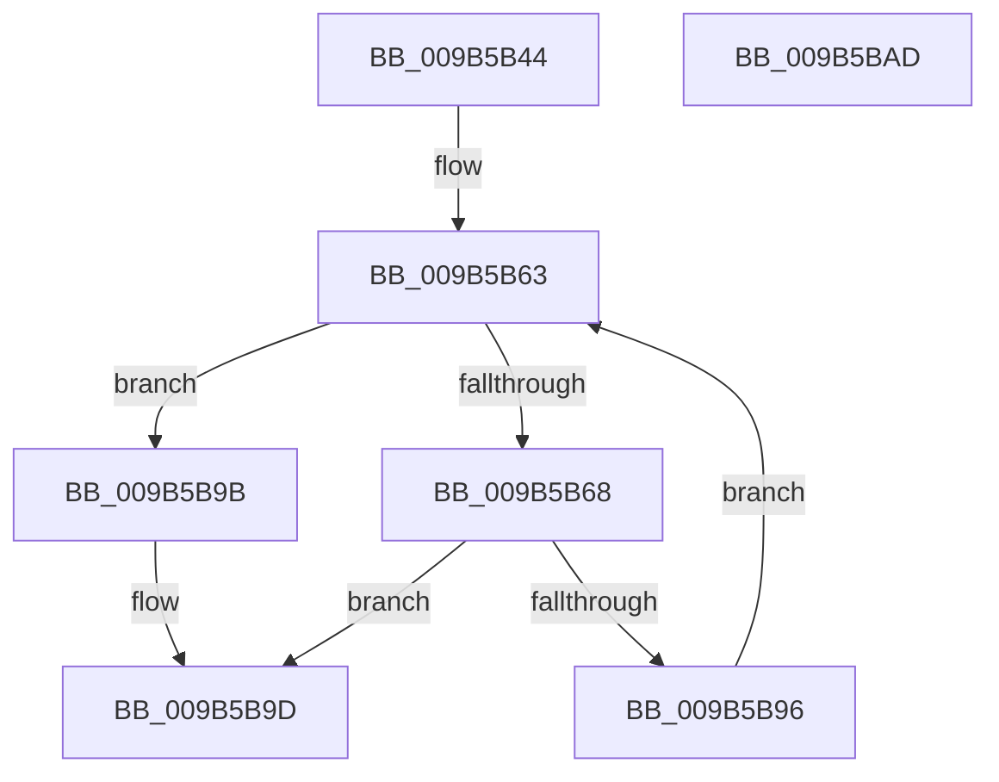

# HvpViewMapCOWAndUnsealRange

- RVA: `0x009B5B44`–`0x009B5BAE` (길이 `106` bytes)
- VA: `0x00000001409B5B44`
- 실행 섹션: `PAGE`
- PDB 이름 있음: `예`; PDB Function 태그: `아니요`
- unwind 정보 RVA: `0x00060BC4`
- 디코드: `33`개 명령, `106/106` bytes 표시
- 미해석 바이트: `0` (있으면 어셈블리에 `.byte`로 보존)

> 이 문서는 커널 이미지의 기계어와 PDB 기호를 분석해 생성했습니다. 4번과 5번은 함수 원형과 자료형을 바이너리 사용 방식에서 추정한 C 해석이며 원본 소스 복구 결과는 아닙니다.

## 1. Dependencies

- 직접 호출 지점: **2**; 고유 호출 대상: **2**
- 직접 호출자로 확인된 함수: **3**
- RIP 상대 이미지 참조: **0**

### Outgoing calls
- `0x009B5B6E` → [HvpViewMapFindViewForFileOffset](HvpViewMapFindViewForFileOffset_function_009B5CD8.md) (function, `0x009B5CD8`)
- `0x009B5B8D` → [HvpViewMapMakeViewRangeCOWByCaller](HvpViewMapMakeViewRangeCOWByCaller_function_009B5BB4.md) (function, `0x009B5BB4`)

### Direct callers
- [sub_00859517](../85/Unknown_function_00859517.md) at `0x0085966F`
- [HvpSetRangeProtection](HvpSetRangeProtection_function_009B58C0.md) at `0x009B59F6`
- [HvpAddBin](../AF/HvpAddBin_function_00AF7D48.md) at `0x00AF820F`
- [HvpAddBin](../AF/HvpAddBin_function_00AF7D48.md) at `0x00AF8325`

### Static image references
- 디코드된 RIP-relative 메모리 참조가 없습니다.

## 2. Other-region calls and transfers

- 다른 실행 섹션으로 향하는 call: **0**
- 별도 외부 분기/꼬리 이동을 확인하지 못했습니다.

## 3. Assembly (complete function range)

```asm
009B5B44  48 89 5C 24 08                  mov qword ptr [rsp + 8], rbx
009B5B49  48 89 74 24 10                  mov qword ptr [rsp + 0x10], rsi
009B5B4E  57                              push rdi
009B5B4F  48 83 EC 20                     sub rsp, 0x20
009B5B53  44 8D 92 00 10 00 00            lea r10d, [rdx + 0x1000]
009B5B5A  41 8B D8                        mov ebx, r8d
009B5B5D  49 03 DA                        add rbx, r10
009B5B60  48 8B F1                        mov rsi, rcx
009B5B63  4C 3B D3                        cmp r10, rbx
009B5B66  7D 33                           jge 0x1409b5b9b
009B5B68  49 8B D2                        mov rdx, r10
009B5B6B  48 8B CE                        mov rcx, rsi
009B5B6E  E8 65 01 00 00                  call 0x1409b5cd8
009B5B73  48 8B FB                        mov rdi, rbx
009B5B76  4D 8B C2                        mov r8, r10
009B5B79  48 8B D0                        mov rdx, rax
009B5B7C  48 8B 48 30                     mov rcx, qword ptr [rax + 0x30]
009B5B80  48 3B D9                        cmp rbx, rcx
009B5B83  48 0F 4D F9                     cmovge rdi, rcx
009B5B87  48 8B CE                        mov rcx, rsi
009B5B8A  4C 8B CF                        mov r9, rdi
009B5B8D  E8 22 00 00 00                  call 0x1409b5bb4
009B5B92  85 C0                           test eax, eax
009B5B94  78 07                           js 0x1409b5b9d
009B5B96  4C 8B D7                        mov r10, rdi
009B5B99  EB C8                           jmp 0x1409b5b63
009B5B9B  33 C0                           xor eax, eax
009B5B9D  48 8B 5C 24 30                  mov rbx, qword ptr [rsp + 0x30]
009B5BA2  48 8B 74 24 38                  mov rsi, qword ptr [rsp + 0x38]
009B5BA7  48 83 C4 20                     add rsp, 0x20
009B5BAB  5F                              pop rdi
009B5BAC  C3                              ret
009B5BAD  CC                              int3
```

## 4. C-style interpretation (structured pseudocode)

```c
__int64 __fastcall HvpViewMapCOWAndUnsealRange(__int64 a1, __int64 a2, int a3)
{
    __int64 result;
    __int64 v_rbx;
    __int64 v_rdi;
    __int64 v_rsp;
    unsigned __int64 v_stack_p10;
    unsigned __int64 v_stack_p8;

    v_stack_p8 = v_rbx;
    v_stack_p10 = v_rsi;
    v_rsp = (v_rsp) - (32);
    v_rbx = ((unsigned int)(a3)) + (a2 + 4096);
loc_009B5B63:
    if ((a2 + 4096) >= v_rbx) goto loc_009B5B9B;
    result = HvpViewMapFindViewForFileOffset(a1, a2 + 4096, a3, a4);
    v_rdi = v_rbx;
    if (v_rbx >= (*(unsigned __int64 *)(result + 48))) { v_rdi = *(unsigned __int64 *)(result + 48); }
    result = HvpViewMapMakeViewRangeCOWByCaller(a1, result, a2 + 4096, v_rdi);
    if (sign_flag) goto loc_009B5B9D;
    goto loc_009B5B63;
loc_009B5B9B:
    result = 0;
loc_009B5B9D:
    v_rsp = (v_rsp) + (32);
    return result;
}
```

## 5. (Beta) C Style

```c
int64_t HvpViewMapCOWAndUnsealRange(int64_t Arg1, void *Arg2, int32_t Arg3)
{
    uint8_t *arg2 = (uint8_t *)Arg2;

    int64_t result;
    int64_t local_rbx;
    int64_t local_rdi;
    int64_t local_rsp;
    uint64_t v_stack_p10;
    uint64_t v_stack_p8;

    v_stack_p8 = local_rbx;
    v_stack_p10 = local_rsi;
    local_rsp = (local_rsp) - (32);
    local_rbx = ((uint32_t)(Arg3)) + (Arg2 + 4096);
loc_009B5B63:
    if ((Arg2 + 4096) >= local_rbx) goto loc_009B5B9B;
    result = HvpViewMapFindViewForFileOffset(Arg1, Arg2 + 4096, Arg3, a4);
    local_rdi = local_rbx;
    if (local_rbx >= (*(uint64_t *)(result + 0x30))) { local_rdi = *(uint64_t *)(result + 0x30); }
    result = HvpViewMapMakeViewRangeCOWByCaller(Arg1, result, Arg2 + 4096, local_rdi);
    if (sign_flag) goto loc_009B5B9D;
    goto loc_009B5B63;
loc_009B5B9B:
    result = 0;
loc_009B5B9D:
    local_rsp = (local_rsp) + (32);
    return result;
}
```

### 관측된 메모리 오프셋

구조체 형식이 확인되지 않은 접근은 인자 기준의 오프셋으로만 기록했습니다.

| 기준 인자 | 오프셋 표현 | 폭 (bit) | 접근 |
|---|---:|---:|---|
| `Arg2` | `+ 0x1000` | `32` | `R` |

## 6. Execution-region graph

[열기: 2D/3D 그래프와 함수 탐색 컨트롤 패널](../../../control-panel.html?section=page&rva=0x009B5B44&view=graph)

- 2D 그래프는 위에서 아래로 흐르고, 3D 그래프는 빈 공간을 드래그해 회전합니다. Shift+드래그는 이동, 휠은 확대·축소, 함수 노드 선택은 대상 보고서 이동입니다.

### Static fallback


