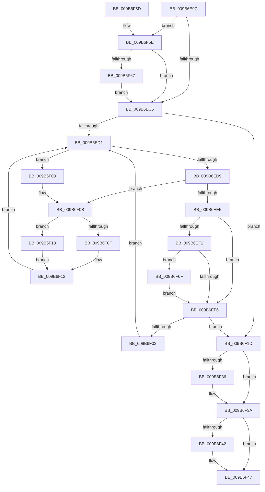

# HvpViewMapCleanup

- RVA: `0x009B6E9C`–`0x009B6F74` (길이 `216` bytes)
- VA: `0x00000001409B6E9C`
- 실행 섹션: `PAGE`
- PDB 이름 있음: `예`; PDB Function 태그: `아니요`
- unwind 정보 RVA: `0x0009E7DC`
- 디코드: `64`개 명령, `216/216` bytes 표시
- 미해석 바이트: `0` (있으면 어셈블리에 `.byte`로 보존)

> 이 문서는 커널 이미지의 기계어와 PDB 기호를 분석해 생성했습니다. 4번과 5번은 함수 원형과 자료형을 바이너리 사용 방식에서 추정한 C 해석이며 원본 소스 복구 결과는 아닙니다.

## 1. Dependencies

- 직접 호출 지점: **2**; 고유 호출 대상: **2**
- 직접 호출자로 확인된 함수: **1**
- RIP 상대 이미지 참조: **0**

### Outgoing calls
- `0x009B6EF9` → [HvpViewMapDeleteViewTreeNode](HvpViewMapDeleteViewTreeNode_function_009B6F7C.md) (function, `0x009B6F7C`)
- `0x009B6F42` → [BiZwClose](../../text/4A/BiZwClose_function_004A85DC.md) (function, `0x004A85DC`)

### Direct callers
- [HvHiveCleanup](../84/HvHiveCleanup_function_0084D918.md) at `0x0084DAC0`

### Static image references
- 디코드된 RIP-relative 메모리 참조가 없습니다.

## 2. Other-region calls and transfers

- 다른 실행 섹션으로 향하는 call: **1**
  - `0x009B6F42` → [BiZwClose](../../text/4A/BiZwClose_function_004A85DC.md) (`PAGE` → `.text`)
- 별도 외부 분기/꼬리 이동을 확인하지 못했습니다.

## 3. Assembly (complete function range)

```asm
009B6E9C  48 89 5C 24 10                  mov qword ptr [rsp + 0x10], rbx
009B6EA1  48 89 74 24 18                  mov qword ptr [rsp + 0x18], rsi
009B6EA6  48 89 7C 24 20                  mov qword ptr [rsp + 0x20], rdi
009B6EAB  41 56                           push r14
009B6EAD  48 83 EC 20                     sub rsp, 0x20
009B6EB1  48 8D 59 28                     lea rbx, [rcx + 0x28]
009B6EB5  4C 8B F1                        mov r14, rcx
009B6EB8  F6 43 08 01                     test byte ptr [rbx + 8], 1
009B6EBC  48 8B 0B                        mov rcx, qword ptr [rbx]
009B6EBF  0F 85 99 00 00 00               jne 0x1409b6f5e
009B6EC5  0F B6 73 08                     movzx esi, byte ptr [rbx + 8]
009B6EC9  83 E6 01                        and esi, 1
009B6ECC  48 85 C9                        test rcx, rcx
009B6ECF  74 4C                           je 0x1409b6f1d
009B6ED1  48 8B 01                        mov rax, qword ptr [rcx]
009B6ED4  48 85 C0                        test rax, rax
009B6ED7  75 2F                           jne 0x1409b6f08
009B6ED9  48 8D 51 08                     lea rdx, [rcx + 8]
009B6EDD  48 8B 02                        mov rax, qword ptr [rdx]
009B6EE0  48 85 C0                        test rax, rax
009B6EE3  75 26                           jne 0x1409b6f0b
009B6EE5  48 8B 79 10                     mov rdi, qword ptr [rcx + 0x10]
009B6EE9  48 83 E7 FC                     and rdi, 0xfffffffffffffffc
009B6EED  85 F6                           test esi, esi
009B6EEF  74 05                           je 0x1409b6ef6
009B6EF1  48 85 FF                        test rdi, rdi
009B6EF4  75 79                           jne 0x1409b6f6f
009B6EF6  49 8B D6                        mov rdx, r14
009B6EF9  E8 7E 00 00 00                  call 0x1409b6f7c
009B6EFE  48 85 FF                        test rdi, rdi
009B6F01  74 1A                           je 0x1409b6f1d
009B6F03  48 8B CF                        mov rcx, rdi
009B6F06  EB C9                           jmp 0x1409b6ed1
009B6F08  48 8B D1                        mov rdx, rcx
009B6F0B  85 F6                           test esi, esi
009B6F0D  74 09                           je 0x1409b6f18
009B6F0F  48 33 C8                        xor rcx, rax
009B6F12  48 83 22 00                     and qword ptr [rdx], 0
009B6F16  EB B9                           jmp 0x1409b6ed1
009B6F18  48 8B C8                        mov rcx, rax
009B6F1B  EB F5                           jmp 0x1409b6f12
009B6F1D  0F B6 43 08                     movzx eax, byte ptr [rbx + 8]
009B6F21  48 C7 03 00 00 00 00            mov qword ptr [rbx], 0
009B6F28  48 C7 43 08 00 00 00 00         mov qword ptr [rbx + 8], 0
009B6F30  0F BA E0 00                     bt eax, 0
009B6F34  73 04                           jae 0x1409b6f3a
009B6F36  C6 43 08 01                     mov byte ptr [rbx + 8], 1
009B6F3A  49 8B 0E                        mov rcx, qword ptr [r14]
009B6F3D  48 85 C9                        test rcx, rcx
009B6F40  74 05                           je 0x1409b6f47
009B6F42  E8 95 16 AF FF                  call 0x1404a85dc
009B6F47  48 8B 5C 24 38                  mov rbx, qword ptr [rsp + 0x38]
009B6F4C  48 8B 74 24 40                  mov rsi, qword ptr [rsp + 0x40]
009B6F51  48 8B 7C 24 48                  mov rdi, qword ptr [rsp + 0x48]
009B6F56  48 83 C4 20                     add rsp, 0x20
009B6F5A  41 5E                           pop r14
009B6F5C  C3                              ret
009B6F5D  CC                              int3
009B6F5E  48 85 C9                        test rcx, rcx
009B6F61  0F 84 5E FF FF FF               je 0x1409b6ec5
009B6F67  48 33 CB                        xor rcx, rbx
009B6F6A  E9 56 FF FF FF                  jmp 0x1409b6ec5
009B6F6F  48 33 F9                        xor rdi, rcx
009B6F72  EB 82                           jmp 0x1409b6ef6
```

## 4. C-style interpretation (structured pseudocode)

```c
__int64 __fastcall HvpViewMapCleanup(__int64 a1)
{
    __int64 result;
    __int64 v_rdi;
    __int64 v_rsi;
    __int64 v_rsp;
    unsigned __int64 v_stack_p10;
    unsigned __int64 v_stack_p18;
    unsigned __int64 v_stack_p20;

    v_stack_p10 = v_rbx;
    v_stack_p18 = v_rsi;
    v_stack_p20 = v_rdi;
    v_rsp = (v_rsp) - (32);
    if (((*(unsigned __int8 *)(a1 + 40 + 8)) & (1)) != 0) goto loc_009B6F5E;
loc_009B6EC5:
    v_rsi = (unsigned int)((*(unsigned __int8 *)(a1 + 40 + 8)) & (1));
    if (*(unsigned __int64 *)(a1 + 40) == 0) goto loc_009B6F1D;
loc_009B6ED1:
    if (*(unsigned __int64 *)(*(unsigned __int64 *)(a1 + 40)) != 0) goto loc_009B6F08;
    if (*(unsigned __int64 *)(*(unsigned __int64 *)(a1 + 40) + 8) != 0) goto loc_009B6F0B;
    v_rdi = (*(unsigned __int64 *)(*(unsigned __int64 *)(a1 + 40) + 16)) & (-4);
    if ((unsigned int)(v_rsi) == 0) goto loc_009B6EF6;
    if (v_rdi != 0) goto loc_009B6F6F;
loc_009B6EF6:
    result = HvpViewMapDeleteViewTreeNode(*(unsigned __int64 *)(a1 + 40), a1, a3, a4);
    if (v_rdi == 0) goto loc_009B6F1D;
    goto loc_009B6ED1;
loc_009B6F08:
loc_009B6F0B:
    if ((unsigned int)(v_rsi) == 0) goto loc_009B6F18;
    a1 = (v_rdi) ^ (result);
loc_009B6F12:
    goto loc_009B6ED1;
loc_009B6F18:
    goto loc_009B6F12;
loc_009B6F1D:
    *(unsigned __int64 *)(a1 + 40) = 0;
    *(unsigned __int64 *)(a1 + 40 + 8) = 0;
    if (!(condition_is_above_or_equal)) {
        *(unsigned __int8 *)(a1 + 40 + 8) = 1;
    }
    result = *(unsigned __int8 *)(a1 + 40 + 8);
    if (*(unsigned __int64 *)(a1) != 0) {
        result = BiZwClose(*(unsigned __int64 *)(a1), v_rdi, a3, a4);
    }
    v_rsp = (v_rsp) + (32);
    return result;
loc_009B6F5E:
    if (*(unsigned __int64 *)(a1) == 0) goto loc_009B6EC5;
    a1 = (*(unsigned __int64 *)(a1)) ^ (v_stack_p10);
    goto loc_009B6EC5;
loc_009B6F6F:
    v_rdi = (v_stack_p20) ^ (a1);
    goto loc_009B6EF6;
}
```

## 5. (Beta) C Style

```c
int64_t HvpViewMapCleanup(void *Arg1)
{
    uint8_t *arg1 = (uint8_t *)Arg1;

    int64_t result;
    int64_t local_rdi;
    int64_t local_rsi;
    int64_t local_rsp;
    uint64_t v_stack_p10;
    uint64_t v_stack_p18;
    uint64_t v_stack_p20;

    v_stack_p10 = local_rbx;
    v_stack_p18 = local_rsi;
    v_stack_p20 = local_rdi;
    local_rsp = (local_rsp) - (32);
    if (((*(uint8_t *)(arg1 + 0x28 + 0x8)) & (1)) != 0) goto loc_009B6F5E;
loc_009B6EC5:
    local_rsi = (uint32_t)((*(uint8_t *)(arg1 + 0x28 + 0x8)) & (1));
    if (*(uint64_t *)(arg1 + 0x28) == 0) goto loc_009B6F1D;
loc_009B6ED1:
    if (*(uint64_t *)(*(uint64_t *)(arg1 + 0x28)) != 0) goto loc_009B6F08;
    if (*(uint64_t *)(*(uint64_t *)(arg1 + 0x28) + 0x8) != 0) goto loc_009B6F0B;
    local_rdi = (*(uint64_t *)(*(uint64_t *)(arg1 + 0x28) + 0x10)) & (-4);
    if ((uint32_t)(local_rsi) == 0) goto loc_009B6EF6;
    if (local_rdi != 0) goto loc_009B6F6F;
loc_009B6EF6:
    result = HvpViewMapDeleteViewTreeNode(*(uint64_t *)(arg1 + 0x28), Arg1, a3, a4);
    if (local_rdi == 0) goto loc_009B6F1D;
    goto loc_009B6ED1;
loc_009B6F08:
loc_009B6F0B:
    if ((uint32_t)(local_rsi) == 0) goto loc_009B6F18;
    Arg1 = (local_rdi) ^ (result);
loc_009B6F12:
    goto loc_009B6ED1;
loc_009B6F18:
    goto loc_009B6F12;
loc_009B6F1D:
    *(uint64_t *)(arg1 + 0x28) = 0;
    *(uint64_t *)(arg1 + 0x28 + 0x8) = 0;
    if (!(condition_is_above_or_equal)) {
        *(uint8_t *)(arg1 + 0x28 + 0x8) = 1;
    }
    result = *(uint8_t *)(arg1 + 0x28 + 0x8);
    if (*(uint64_t *)(arg1) != 0) {
        result = BiZwClose(*(uint64_t *)(arg1), local_rdi, a3, a4);
    }
    local_rsp = (local_rsp) + (32);
    return result;
loc_009B6F5E:
    if (*(uint64_t *)(arg1) == 0) goto loc_009B6EC5;
    Arg1 = (*(uint64_t *)(arg1)) ^ (v_stack_p10);
    goto loc_009B6EC5;
loc_009B6F6F:
    local_rdi = (v_stack_p20) ^ (Arg1);
    goto loc_009B6EF6;
}
```

### 관측된 메모리 오프셋

구조체 형식이 확인되지 않은 접근은 인자 기준의 오프셋으로만 기록했습니다.

| 기준 인자 | 오프셋 표현 | 폭 (bit) | 접근 |
|---|---:|---:|---|
| `Arg1` | `+ 0x0` | `64` | `R` |
| `Arg1` | `+ 0x0` | `64` | `W` |
| `Arg1` | `+ 0x8` | `8` | `R` |
| `Arg1` | `+ 0x8` | `8` | `W` |
| `Arg1` | `+ 0x8` | `64` | `W` |
| `Arg1` | `+ 0x28` | `64` | `R` |

## 6. Execution-region graph

[열기: 2D/3D 그래프와 함수 탐색 컨트롤 패널](../../../control-panel.html?section=page&rva=0x009B6E9C&view=graph)

- 2D 그래프는 위에서 아래로 흐르고, 3D 그래프는 빈 공간을 드래그해 회전합니다. Shift+드래그는 이동, 휠은 확대·축소, 함수 노드 선택은 대상 보고서 이동입니다.

### Static fallback


