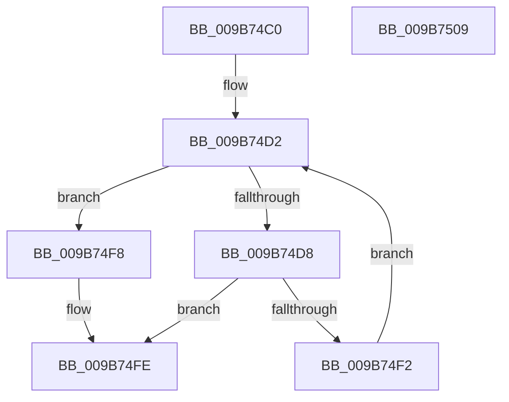

# HvpViewMapConvertLockedPagesToCOWByPolicy

- RVA: `0x009B74C0`–`0x009B750A` (길이 `74` bytes)
- VA: `0x00000001409B74C0`
- 실행 섹션: `PAGE`
- PDB 이름 있음: `예`; PDB Function 태그: `아니요`
- unwind 정보 RVA: `0x0005CAAC`
- 디코드: `24`개 명령, `74/74` bytes 표시
- 미해석 바이트: `0` (있으면 어셈블리에 `.byte`로 보존)

> 이 문서는 커널 이미지의 기계어와 PDB 기호를 분석해 생성했습니다. 4번과 5번은 함수 원형과 자료형을 바이너리 사용 방식에서 추정한 C 해석이며 원본 소스 복구 결과는 아닙니다.

## 1. Dependencies

- 직접 호출 지점: **2**; 고유 호출 대상: **2**
- 직접 호출자로 확인된 함수: **1**
- RIP 상대 이미지 참조: **0**

### Outgoing calls
- `0x009B74DB` → [HvpViewMapFindViewForFileOffset](HvpViewMapFindViewForFileOffset_function_009B5CD8.md) (function, `0x009B5CD8`)
- `0x009B74E9` → [HvpMappedViewConvertLockedPagesToCOWByPolicy](HvpMappedViewConvertLockedPagesToCOWByPolicy_function_009B7510.md) (function, `0x009B7510`)

### Direct callers
- [CmpDoLocalizeNextHive](CmpDoLocalizeNextHive_function_009B7400.md) at `0x009B7449`

### Static image references
- 디코드된 RIP-relative 메모리 참조가 없습니다.

## 2. Other-region calls and transfers

- 다른 실행 섹션으로 향하는 call: **0**
- 별도 외부 분기/꼬리 이동을 확인하지 못했습니다.

## 3. Assembly (complete function range)

```asm
009B74C0  48 89 5C 24 08                  mov qword ptr [rsp + 8], rbx
009B74C5  57                              push rdi
009B74C6  48 83 EC 20                     sub rsp, 0x20
009B74CA  48 8B D9                        mov rbx, rcx
009B74CD  BA 00 10 00 00                  mov edx, 0x1000
009B74D2  48 3B 53 08                     cmp rdx, qword ptr [rbx + 8]
009B74D6  7D 20                           jge 0x1409b74f8
009B74D8  48 8B CB                        mov rcx, rbx
009B74DB  E8 F8 E7 FF FF                  call 0x1409b5cd8
009B74E0  48 8B D0                        mov rdx, rax
009B74E3  48 8B CB                        mov rcx, rbx
009B74E6  48 8B F8                        mov rdi, rax
009B74E9  E8 22 00 00 00                  call 0x1409b7510
009B74EE  85 C0                           test eax, eax
009B74F0  78 0C                           js 0x1409b74fe
009B74F2  48 8B 57 30                     mov rdx, qword ptr [rdi + 0x30]
009B74F6  EB DA                           jmp 0x1409b74d2
009B74F8  83 63 20 FB                     and dword ptr [rbx + 0x20], 0xfffffffb
009B74FC  33 C0                           xor eax, eax
009B74FE  48 8B 5C 24 30                  mov rbx, qword ptr [rsp + 0x30]
009B7503  48 83 C4 20                     add rsp, 0x20
009B7507  5F                              pop rdi
009B7508  C3                              ret
009B7509  CC                              int3
```

## 4. C-style interpretation (structured pseudocode)

```c
__int64 __fastcall HvpViewMapConvertLockedPagesToCOWByPolicy(__int64 a1)
{
    __int64 result;
    __int64 v_rsp;
    unsigned __int64 v_stack_p8;

    v_stack_p8 = v_rbx;
    v_rsp = (v_rsp) - (32);
loc_009B74D2:
    if (((unsigned int)(0x1000ULL)) >= (*(unsigned __int64 *)(a1 + 8))) goto loc_009B74F8;
    result = HvpViewMapFindViewForFileOffset(a1, (unsigned int)(0x1000ULL), a3, a4);
    result = HvpMappedViewConvertLockedPagesToCOWByPolicy(a1, result, a3, a4);
    if (sign_flag) goto loc_009B74FE;
    goto loc_009B74D2;
loc_009B74F8:
    result = 0;
loc_009B74FE:
    v_rsp = (v_rsp) + (32);
    return result;
}
```

## 5. (Beta) C Style

```c
int64_t HvpViewMapConvertLockedPagesToCOWByPolicy(void *Arg1)
{
    uint8_t *arg1 = (uint8_t *)Arg1;

    int64_t result;
    int64_t local_rsp;
    uint64_t v_stack_p8;

    v_stack_p8 = local_rbx;
    local_rsp = (local_rsp) - (32);
loc_009B74D2:
    if (((uint32_t)(0x1000ULL)) >= (*(uint64_t *)(arg1 + 0x8))) goto loc_009B74F8;
    result = HvpViewMapFindViewForFileOffset(Arg1, (uint32_t)(0x1000ULL), a3, a4);
    result = HvpMappedViewConvertLockedPagesToCOWByPolicy(Arg1, result, a3, a4);
    if (sign_flag) goto loc_009B74FE;
    goto loc_009B74D2;
loc_009B74F8:
    result = 0;
loc_009B74FE:
    local_rsp = (local_rsp) + (32);
    return result;
}
```

### 관측된 메모리 오프셋

구조체 형식이 확인되지 않은 접근은 인자 기준의 오프셋으로만 기록했습니다.

| 기준 인자 | 오프셋 표현 | 폭 (bit) | 접근 |
|---|---:|---:|---|
| `Arg1` | `+ 0x8` | `64` | `R` |
| `Arg1` | `+ 0x20` | `32` | `R/W` |

## 6. Execution-region graph

[열기: 2D/3D 그래프와 함수 탐색 컨트롤 패널](../../../control-panel.html?section=page&rva=0x009B74C0&view=graph)

- 2D 그래프는 위에서 아래로 흐르고, 3D 그래프는 빈 공간을 드래그해 회전합니다. Shift+드래그는 이동, 휠은 확대·축소, 함수 노드 선택은 대상 보고서 이동입니다.

### Static fallback


