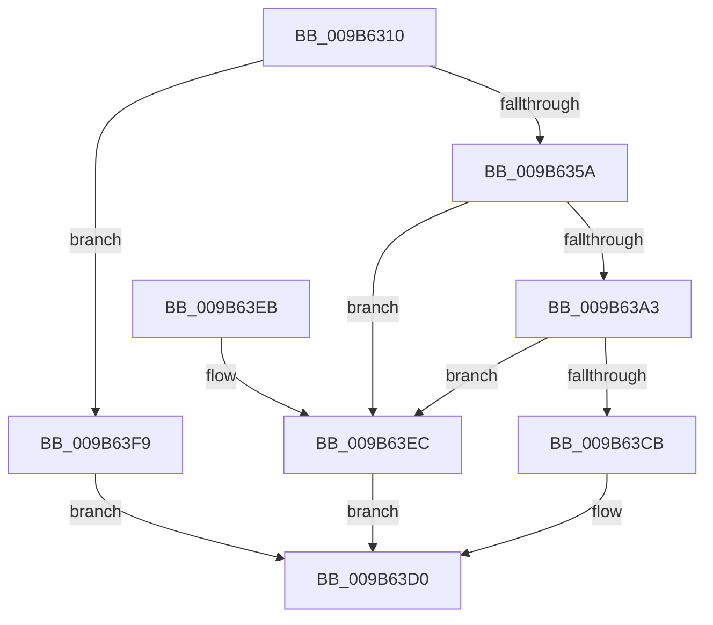

# HvpViewMapCreateView

- RVA: `0x009B6310`–`0x009B6400` (길이 `240` bytes)
- VA: `0x00000001409B6310`
- 실행 섹션: `PAGE`
- PDB 이름 있음: `예`; PDB Function 태그: `아니요`
- unwind 정보 RVA: `0x0009E6D4`
- 디코드: `74`개 명령, `240/240` bytes 표시
- 미해석 바이트: `0` (있으면 어셈블리에 `.byte`로 보존)

> 이 문서는 커널 이미지의 기계어와 PDB 기호를 분석해 생성했습니다. 4번과 5번은 함수 원형과 자료형을 바이너리 사용 방식에서 추정한 C 해석이며 원본 소스 복구 결과는 아닙니다.

## 1. Dependencies

- 직접 호출 지점: **5**; 고유 호출 대상: **5**
- 직접 호출자로 확인된 함수: **2**
- RIP 상대 이미지 참조: **0**

### Outgoing calls
- `0x009B6349` → [CmSiAllocateMemory](../../text/49/CmSiAllocateMemory_function_00490C18.md) (function, `0x00490C18`)
- `0x009B6363` → [memset](../../text/6C/memset_function_006C6C40.md) (function, `0x006C6C40`)
- `0x009B6398` → [CmSiMapViewOfSection](../../text/49/CmSiMapViewOfSection_function_00498A0C.md) (function, `0x00498A0C`)
- `0x009B63C0` → [CmSiProtectViewOfSection](../../text/47/CmSiProtectViewOfSection_function_004746B8.md) (function, `0x004746B8`)
- `0x009B63F2` → [HvpViewMapFreeView](HvpViewMapFreeView_function_009B6F9C.md) (function, `0x009B6F9C`)

### Direct callers
- [HvpViewMapCreateViewsForRegion](HvpViewMapCreateViewsForRegion_function_009B6094.md) at `0x009B6120`
- [HvpViewMapPromoteRangeToMapping](HvpViewMapPromoteRangeToMapping_function_009B94C8.md) at `0x009B956A`

### Static image references
- 디코드된 RIP-relative 메모리 참조가 없습니다.

## 2. Other-region calls and transfers

- 다른 실행 섹션으로 향하는 call: **4**
  - `0x009B6349` → [CmSiAllocateMemory](../../text/49/CmSiAllocateMemory_function_00490C18.md) (`PAGE` → `.text`)
  - `0x009B6363` → [memset](../../text/6C/memset_function_006C6C40.md) (`PAGE` → `.text`)
  - `0x009B6398` → [CmSiMapViewOfSection](../../text/49/CmSiMapViewOfSection_function_00498A0C.md) (`PAGE` → `.text`)
  - `0x009B63C0` → [CmSiProtectViewOfSection](../../text/47/CmSiProtectViewOfSection_function_004746B8.md) (`PAGE` → `.text`)
- 별도 외부 분기/꼬리 이동을 확인하지 못했습니다.

## 3. Assembly (complete function range)

```asm
009B6310  48 89 5C 24 08                  mov qword ptr [rsp + 8], rbx
009B6315  48 89 6C 24 18                  mov qword ptr [rsp + 0x18], rbp
009B631A  56                              push rsi
009B631B  57                              push rdi
009B631C  41 54                           push r12
009B631E  41 56                           push r14
009B6320  41 57                           push r15
009B6322  48 83 EC 40                     sub rsp, 0x40
009B6326  83 64 24 78 00                  and dword ptr [rsp + 0x78], 0
009B632B  41 8B D8                        mov ebx, r8d
009B632E  2B DA                           sub ebx, edx
009B6330  4C 8B F2                        mov r14, rdx
009B6333  48 8B F1                        mov rsi, rcx
009B6336  48 C1 EB 0C                     shr rbx, 0xc
009B633A  BA 43 4D 38 35                  mov edx, 0x35384d43
009B633F  4D 8B F9                        mov r15, r9
009B6342  49 8B E8                        mov rbp, r8
009B6345  48 8D 4B 48                     lea rcx, [rbx + 0x48]
009B6349  E8 CA A8 AD FF                  call 0x140490c18
009B634E  48 8B F8                        mov rdi, rax
009B6351  48 85 C0                        test rax, rax
009B6354  0F 84 9F 00 00 00               je 0x1409b63f9
009B635A  4C 8D 43 48                     lea r8, [rbx + 0x48]
009B635E  33 D2                           xor edx, edx
009B6360  48 8B C8                        mov rcx, rax
009B6363  E8 D8 08 D1 FF                  call 0x1406c6c40
009B6368  48 89 6F 20                     mov qword ptr [rdi + 0x20], rbp
009B636C  4C 8D 67 38                     lea r12, [rdi + 0x38]
009B6370  4C 89 77 18                     mov qword ptr [rdi + 0x18], r14
009B6374  49 2B EE                        sub rbp, r14
009B6377  8B 46 20                        mov eax, dword ptr [rsi + 0x20]
009B637A  4C 8B CD                        mov r9, rbp
009B637D  48 8B 56 18                     mov rdx, qword ptr [rsi + 0x18]
009B6381  F7 D0                           not eax
009B6383  48 8B 0E                        mov rcx, qword ptr [rsi]
009B6386  83 E0 01                        and eax, 1
009B6389  C1 E0 0D                        shl eax, 0xd
009B638C  4D 8B C6                        mov r8, r14
009B638F  4C 89 64 24 30                  mov qword ptr [rsp + 0x30], r12
009B6394  89 44 24 20                     mov dword ptr [rsp + 0x20], eax
009B6398  E8 6F 26 AE FF                  call 0x140498a0c
009B639D  8B D8                           mov ebx, eax
009B639F  85 C0                           test eax, eax
009B63A1  78 49                           js 0x1409b63ec
009B63A3  4D 8B 04 24                     mov r8, qword ptr [r12]
009B63A7  48 8D 44 24 78                  lea rax, [rsp + 0x78]
009B63AC  48 8B 56 18                     mov rdx, qword ptr [rsi + 0x18]
009B63B0  4C 8B CD                        mov r9, rbp
009B63B3  48 89 44 24 28                  mov qword ptr [rsp + 0x28], rax
009B63B8  C7 44 24 20 01 00 00 00         mov dword ptr [rsp + 0x20], 1
009B63C0  E8 F3 E2 AB FF                  call 0x1404746b8
009B63C5  8B D8                           mov ebx, eax
009B63C7  85 C0                           test eax, eax
009B63C9  78 21                           js 0x1409b63ec
009B63CB  49 89 3F                        mov qword ptr [r15], rdi
009B63CE  33 DB                           xor ebx, ebx
009B63D0  4C 8D 5C 24 40                  lea r11, [rsp + 0x40]
009B63D5  8B C3                           mov eax, ebx
009B63D7  49 8B 5B 30                     mov rbx, qword ptr [r11 + 0x30]
009B63DB  49 8B 6B 40                     mov rbp, qword ptr [r11 + 0x40]
009B63DF  49 8B E3                        mov rsp, r11
009B63E2  41 5F                           pop r15
009B63E4  41 5E                           pop r14
009B63E6  41 5C                           pop r12
009B63E8  5F                              pop rdi
009B63E9  5E                              pop rsi
009B63EA  C3                              ret
009B63EB  CC                              int3
009B63EC  48 8B D7                        mov rdx, rdi
009B63EF  48 8B CE                        mov rcx, rsi
009B63F2  E8 A5 0B 00 00                  call 0x1409b6f9c
009B63F7  EB D7                           jmp 0x1409b63d0
009B63F9  BB 9A 00 00 C0                  mov ebx, 0xc000009a
009B63FE  EB D0                           jmp 0x1409b63d0
```

## 4. C-style interpretation (structured pseudocode)

```c
__int64 __fastcall HvpViewMapCreateView(__int64 a1, __int64 a2, __int64 a3, __int64 a4)
{
    __int64 result;
    __int64 v_rbp;
    __int64 v_rbx;
    __int64 v_rsp;
    unsigned __int64 v_stack_m28;
    unsigned __int64 v_stack_m38;
    unsigned __int64 v_stack_m40;
    unsigned int v_stack_m48;
    unsigned int v_stack_p10;
    unsigned __int64 v_stack_p18;
    unsigned __int64 v_stack_p8;

    v_stack_p8 = v_rbx;
    v_stack_p18 = v_rbp;
    v_rsp = (v_rsp) - (64);
    v_rbx = (unsigned int)(((unsigned int)((unsigned int)(a3))) - ((unsigned int)(a2)));
    v_rbx = (v_rbx) >> (12);
    result = CmSiAllocateMemory(v_rbx + 72, (unsigned int)(0x35384D43ULL), a3, a4);
    if (result == 0) goto loc_009B63F9;
    a2 = 0;
    result = memset(result, a2, v_rbx + 72, a4);
    *(unsigned __int64 *)(result + 32) = a3;
    *(unsigned __int64 *)(result + 24) = 0;
    v_rbp = (a3) - (0);
    result = (unsigned int)(~((unsigned int)(*(unsigned int *)(a1 + 32))));
    result = (unsigned int)((result) & (1));
    result = (unsigned int)((result) << (13));
    v_stack_m38 = result + 56;
    v_stack_m48 = (unsigned int)(result);
    result = CmSiMapViewOfSection(*(unsigned __int64 *)(a1), *(unsigned __int64 *)(a1 + 24), 0, v_rbp);
    if (sign_flag) goto loc_009B63EC;
    v_stack_m40 = v_stack_p10;
    v_stack_m48 = 1;
    result = CmSiProtectViewOfSection(*(unsigned __int64 *)(a1), *(unsigned __int64 *)(a1 + 24), *(unsigned __int64 *)(result + 56), v_rbp);
    if (sign_flag) goto loc_009B63EC;
    *(unsigned __int64 *)(a4) = result;
    v_rbx = 0;
loc_009B63D0:
    return 0;
loc_009B63EC:
    result = HvpViewMapFreeView(a1, result, *(unsigned __int64 *)(result + 56), v_rbp);
    goto loc_009B63D0;
loc_009B63F9:
    goto loc_009B63D0;
}
```

## 5. (Beta) C Style

```c
int64_t HvpViewMapCreateView(void *Arg1, int64_t Arg2, int64_t Arg3, void *Arg4)
{
    uint8_t *arg1 = (uint8_t *)Arg1;
    uint8_t *arg4 = (uint8_t *)Arg4;

    int64_t result;
    int64_t local_rbp;
    int64_t local_rbx;
    int64_t local_rsp;
    uint64_t v_stack_m28;
    uint64_t v_stack_m38;
    uint64_t v_stack_m40;
    uint32_t v_stack_m48;
    uint32_t v_stack_p10;
    uint64_t v_stack_p18;
    uint64_t v_stack_p8;

    v_stack_p8 = local_rbx;
    v_stack_p18 = local_rbp;
    local_rsp = (local_rsp) - (64);
    local_rbx = (uint32_t)(((uint32_t)((uint32_t)(Arg3))) - ((uint32_t)(Arg2)));
    local_rbx = (local_rbx) >> (12);
    result = CmSiAllocateMemory(local_rbx + 72, (uint32_t)(0x35384D43ULL), Arg3, Arg4);
    if (result == 0) goto loc_009B63F9;
    Arg2 = 0;
    result = memset(result, Arg2, local_rbx + 72, Arg4);
    *(uint64_t *)(result + 0x20) = Arg3;
    *(uint64_t *)(result + 0x18) = 0;
    local_rbp = (Arg3) - (0);
    result = (uint32_t)(~((uint32_t)(*(uint32_t *)(arg1 + 0x20))));
    result = (uint32_t)((result) & (1));
    result = (uint32_t)((result) << (13));
    v_stack_m38 = result + 56;
    v_stack_m48 = (uint32_t)(result);
    result = CmSiMapViewOfSection(*(uint64_t *)(arg1), *(uint64_t *)(arg1 + 0x18), 0, local_rbp);
    if (sign_flag) goto loc_009B63EC;
    v_stack_m40 = v_stack_p10;
    v_stack_m48 = 1;
    result = CmSiProtectViewOfSection(*(uint64_t *)(arg1), *(uint64_t *)(arg1 + 0x18), *(uint64_t *)(result + 0x38), local_rbp);
    if (sign_flag) goto loc_009B63EC;
    *(uint64_t *)(arg4) = result;
    local_rbx = 0;
loc_009B63D0:
    return 0;
loc_009B63EC:
    result = HvpViewMapFreeView(Arg1, result, *(uint64_t *)(result + 0x38), local_rbp);
    goto loc_009B63D0;
loc_009B63F9:
    goto loc_009B63D0;
}
```

### 관측된 메모리 오프셋

구조체 형식이 확인되지 않은 접근은 인자 기준의 오프셋으로만 기록했습니다.

| 기준 인자 | 오프셋 표현 | 폭 (bit) | 접근 |
|---|---:|---:|---|
| `Arg1` | `+ 0x0` | `64` | `R` |
| `Arg1` | `+ 0x18` | `64` | `R` |
| `Arg1` | `+ 0x20` | `32` | `R` |
| `Arg4` | `+ 0x0` | `64` | `W` |

## 6. Execution-region graph

[열기: 2D/3D 그래프와 함수 탐색 컨트롤 패널](../../../control-panel.html?section=page&rva=0x009B6310&view=graph)

- 2D 그래프는 위에서 아래로 흐르고, 3D 그래프는 빈 공간을 드래그해 회전합니다. Shift+드래그는 이동, 휠은 확대·축소, 함수 노드 선택은 대상 보고서 이동입니다.

### Static fallback


