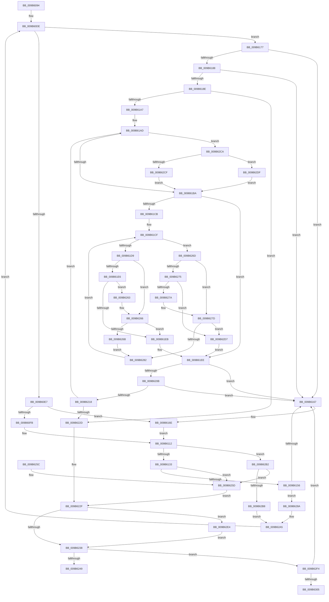

# HvpViewMapCreateViewsForRegion

- RVA: `0x009B6094`–`0x009B630A` (길이 `630` bytes)
- VA: `0x00000001409B6094`
- 실행 섹션: `PAGE`
- PDB 이름 있음: `예`; PDB Function 태그: `예`
- unwind 정보 RVA: `0x0009E6A8`
- 디코드: `186`개 명령, `630/630` bytes 표시
- 미해석 바이트: `0` (있으면 어셈블리에 `.byte`로 보존)

> 이 문서는 커널 이미지의 기계어와 PDB 기호를 분석해 생성했습니다. 4번과 5번은 함수 원형과 자료형을 바이너리 사용 방식에서 추정한 C 해석이며 원본 소스 복구 결과는 아닙니다.

## 1. Dependencies

- 직접 호출 지점: **6**; 고유 호출 대상: **6**
- 직접 호출자로 확인된 함수: **2**
- RIP 상대 이미지 참조: **0**

### Outgoing calls
- `0x009B60D0` → [CmSiGetMemoryAllocationGranularity](../../text/4B/CmSiGetMemoryAllocationGranularity_function_004B2CB8.md) (function, `0x004B2CB8`)
- `0x009B6107` → [HvpDetermineFinalViewReservationEnd](HvpDetermineFinalViewReservationEnd_function_009B6B44.md) (function, `0x009B6B44`)
- `0x009B6120` → [HvpViewMapCreateView](HvpViewMapCreateView_function_009B6310.md) (function, `0x009B6310`)
- `0x009B6147` → [HvpViewMapMakeViewRangeValid](HvpViewMapMakeViewRangeValid_function_009B5E00.md) (function, `0x009B5E00`)
- `0x009B61F4` → [RtlRbInsertNodeEx](../../text/2E/RtlRbInsertNodeEx_function_002E4570.md) (function, `0x002E4570`)
- `0x009B62EA` → [HvpViewMapFreeView](HvpViewMapFreeView_function_009B6F9C.md) (function, `0x009B6F9C`)

### Direct callers
- [HvpViewMapExtendStorage](HvpViewMapExtendStorage_function_009B4EF8.md) at `0x009B4F9D`
- [HvpViewMapStart](HvpViewMapStart_function_009B98E0.md) at `0x009B996A`

### Static image references
- 디코드된 RIP-relative 메모리 참조가 없습니다.

## 2. Other-region calls and transfers

- 다른 실행 섹션으로 향하는 call: **2**
  - `0x009B60D0` → [CmSiGetMemoryAllocationGranularity](../../text/4B/CmSiGetMemoryAllocationGranularity_function_004B2CB8.md) (`PAGE` → `.text`)
  - `0x009B61F4` → [RtlRbInsertNodeEx](../../text/2E/RtlRbInsertNodeEx_function_002E4570.md) (`PAGE` → `.text`)
- call이 아닌 외부 분기/꼬리 이동: **1**
  - `0x009B6305` → [sub_00B2DD90 + 0x20](../B2/Unknown_function_00B2DD90.md) (`tail-transfer`)

## 3. Assembly (complete function range)

```asm
009B6094  44 88 4C 24 20                  mov byte ptr [rsp + 0x20], r9b
009B6099  48 89 4C 24 08                  mov qword ptr [rsp + 8], rcx
009B609E  55                              push rbp
009B609F  53                              push rbx
009B60A0  56                              push rsi
009B60A1  57                              push rdi
009B60A2  41 54                           push r12
009B60A4  41 55                           push r13
009B60A6  41 56                           push r14
009B60A8  41 57                           push r15
009B60AA  48 8B EC                        mov rbp, rsp
009B60AD  48 83 EC 48                     sub rsp, 0x48
009B60B1  48 8D 45 E8                     lea rax, [rbp - 0x18]
009B60B5  33 DB                           xor ebx, ebx
009B60B7  48 89 45 F0                     mov qword ptr [rbp - 0x10], rax
009B60BB  4D 8B E0                        mov r12, r8
009B60BE  48 8D 45 E8                     lea rax, [rbp - 0x18]
009B60C2  48 89 5D 50                     mov qword ptr [rbp + 0x50], rbx
009B60C6  48 89 45 E8                     mov qword ptr [rbp - 0x18], rax
009B60CA  4C 8B FA                        mov r15, rdx
009B60CD  4C 8B F1                        mov r14, rcx
009B60D0  E8 E3 CB AF FF                  call 0x1404b2cb8
009B60D5  48 89 45 58                     mov qword ptr [rbp + 0x58], rax
009B60D9  BE 00 00 20 00                  mov esi, 0x200000
009B60DE  4D 3B FC                        cmp r15, r12
009B60E1  0F 8D 90 00 00 00               jge 0x1409b6177
009B60E7  48 8B D8                        mov rbx, rax
009B60EA  49 8B C4                        mov rax, r12
009B60ED  48 F7 DB                        neg rbx
009B60F0  49 23 DF                        and rbx, r15
009B60F3  48 2B C3                        sub rax, rbx
009B60F6  48 3B F0                        cmp rsi, rax
009B60F9  7E 73                           jle 0x1409b616e
009B60FB  4C 8B CE                        mov r9, rsi
009B60FE  4D 8B C4                        mov r8, r12
009B6101  48 8B D3                        mov rdx, rbx
009B6104  49 8B CE                        mov rcx, r14
009B6107  E8 38 0A 00 00                  call 0x1409b6b44
009B610C  4C 8B F0                        mov r14, rax
009B610F  4D 8B EC                        mov r13, r12
009B6112  48 8B 4D 48                     mov rcx, qword ptr [rbp + 0x48]
009B6116  4C 8D 4D 50                     lea r9, [rbp + 0x50]
009B611A  4D 8B C6                        mov r8, r14
009B611D  48 8B D3                        mov rdx, rbx
009B6120  E8 EB 01 00 00                  call 0x1409b6310
009B6125  48 8B 5D 50                     mov rbx, qword ptr [rbp + 0x50]
009B6129  8B F8                           mov edi, eax
009B612B  85 C0                           test eax, eax
009B612D  0F 88 7F 01 00 00               js 0x1409b62b2
009B6133  8A 45 60                        mov al, byte ptr [rbp + 0x60]
009B6136  4D 8B CD                        mov r9, r13
009B6139  48 8B 4D 48                     mov rcx, qword ptr [rbp + 0x48]
009B613D  4D 8B C7                        mov r8, r15
009B6140  48 8B D3                        mov rdx, rbx
009B6143  88 44 24 20                     mov byte ptr [rsp + 0x20], al
009B6147  E8 B4 FC FF FF                  call 0x1409b5e00
009B614C  8B F8                           mov edi, eax
009B614E  85 C0                           test eax, eax
009B6150  0F 88 07 01 00 00               js 0x1409b625d
009B6156  48 8B 45 F0                     mov rax, qword ptr [rbp - 0x10]
009B615A  48 8D 4D E8                     lea rcx, [rbp - 0x18]
009B615E  48 39 08                        cmp qword ptr [rax], rcx
009B6161  0F 84 23 01 00 00               je 0x1409b628a
009B6167  B9 03 00 00 00                  mov ecx, 3
009B616C  CD 29                           int 0x29
009B616E  4C 8D 34 1E                     lea r14, [rsi + rbx]
009B6172  4D 8B EE                        mov r13, r14
009B6175  EB 9B                           jmp 0x1409b6112
009B6177  48 8B 4D E8                     mov rcx, qword ptr [rbp - 0x18]
009B617B  48 8D 55 E8                     lea rdx, [rbp - 0x18]
009B617F  48 8B 01                        mov rax, qword ptr [rcx]
009B6182  48 39 51 08                     cmp qword ptr [rcx + 8], rdx
009B6186  75 DF                           jne 0x1409b6167
009B6188  48 39 48 08                     cmp qword ptr [rax + 8], rcx
009B618C  75 D9                           jne 0x1409b6167
009B618E  48 89 45 E8                     mov qword ptr [rbp - 0x18], rax
009B6192  48 8D 55 E8                     lea rdx, [rbp - 0x18]
009B6196  48 89 50 08                     mov qword ptr [rax + 8], rdx
009B619A  48 8D 45 E8                     lea rax, [rbp - 0x18]
009B619E  48 3B C8                        cmp rcx, rax
009B61A1  0F 84 86 00 00 00               je 0x1409b622d
009B61A7  49 8D 7E 28                     lea rdi, [r14 + 0x28]
009B61AB  33 DB                           xor ebx, ebx
009B61AD  F6 47 08 01                     test byte ptr [rdi + 8], 1
009B61B1  48 8B 17                        mov rdx, qword ptr [rdi]
009B61B4  0F 85 10 01 00 00               jne 0x1409b62ca
009B61BA  44 0F B6 4F 08                  movzx r9d, byte ptr [rdi + 8]
009B61BF  45 32 C0                        xor r8b, r8b
009B61C2  41 83 E1 01                     and r9d, 1
009B61C6  48 85 D2                        test rdx, rdx
009B61C9  74 23                           je 0x1409b61ee
009B61CB  4C 8B 41 28                     mov r8, qword ptr [rcx + 0x28]
009B61CF  4C 3B 42 28                     cmp r8, qword ptr [rdx + 0x28]
009B61D3  0F 8C 94 00 00 00               jl 0x1409b626d
009B61D9  48 8B 42 08                     mov rax, qword ptr [rdx + 8]
009B61DD  45 85 C9                        test r9d, r9d
009B61E0  0F 84 80 00 00 00               je 0x1409b6266
009B61E6  48 85 C0                        test rax, rax
009B61E9  75 78                           jne 0x1409b6263
009B61EB  41 B0 01                        mov r8b, 1
009B61EE  4C 8B C9                        mov r9, rcx
009B61F1  48 8B CF                        mov rcx, rdi
009B61F4  E8 77 E3 92 FF                  call 0x1402e4570
009B61F9  48 8B 4D E8                     mov rcx, qword ptr [rbp - 0x18]
009B61FD  48 8D 45 E8                     lea rax, [rbp - 0x18]
009B6201  48 39 41 08                     cmp qword ptr [rcx + 8], rax
009B6205  0F 85 5C FF FF FF               jne 0x1409b6167
009B620B  48 8B 01                        mov rax, qword ptr [rcx]
009B620E  48 39 48 08                     cmp qword ptr [rax + 8], rcx
009B6212  0F 85 4F FF FF FF               jne 0x1409b6167
009B6218  48 89 45 E8                     mov qword ptr [rbp - 0x18], rax
009B621C  48 8D 55 E8                     lea rdx, [rbp - 0x18]
009B6220  48 89 50 08                     mov qword ptr [rax + 8], rdx
009B6224  48 8D 45 E8                     lea rax, [rbp - 0x18]
009B6228  48 3B C8                        cmp rcx, rax
009B622B  75 80                           jne 0x1409b61ad
009B622D  33 FF                           xor edi, edi
009B622F  48 85 DB                        test rbx, rbx
009B6232  0F 85 AC 00 00 00               jne 0x1409b62e4
009B6238  48 8B 45 E8                     mov rax, qword ptr [rbp - 0x18]
009B623C  48 8D 4D E8                     lea rcx, [rbp - 0x18]
009B6240  48 3B C1                        cmp rax, rcx
009B6243  0F 85 AB 00 00 00               jne 0x1409b62f4
009B6249  8B C7                           mov eax, edi
009B624B  48 83 C4 48                     add rsp, 0x48
009B624F  41 5F                           pop r15
009B6251  41 5E                           pop r14
009B6253  41 5D                           pop r13
009B6255  41 5C                           pop r12
009B6257  5F                              pop rdi
009B6258  5E                              pop rsi
009B6259  5B                              pop rbx
009B625A  5D                              pop rbp
009B625B  C3                              ret
009B625C  CC                              int3
009B625D  4C 8B 75 48                     mov r14, qword ptr [rbp + 0x48]
009B6261  EB CC                           jmp 0x1409b622f
009B6263  48 33 C2                        xor rax, rdx
009B6266  48 85 C0                        test rax, rax
009B6269  74 80                           je 0x1409b61eb
009B626B  EB 15                           jmp 0x1409b6282
009B626D  48 8B 02                        mov rax, qword ptr [rdx]
009B6270  45 85 C9                        test r9d, r9d
009B6273  74 08                           je 0x1409b627d
009B6275  48 85 C0                        test rax, rax
009B6278  74 5D                           je 0x1409b62d7
009B627A  48 33 C2                        xor rax, rdx
009B627D  48 85 C0                        test rax, rax
009B6280  74 55                           je 0x1409b62d7
009B6282  48 8B D0                        mov rdx, rax
009B6285  E9 45 FF FF FF                  jmp 0x1409b61cf
009B628A  48 89 43 08                     mov qword ptr [rbx + 8], rax
009B628E  48 8D 4D E8                     lea rcx, [rbp - 0x18]
009B6292  48 89 0B                        mov qword ptr [rbx], rcx
009B6295  4D 8B FE                        mov r15, r14
009B6298  48 89 18                        mov qword ptr [rax], rbx
009B629B  48 89 5D F0                     mov qword ptr [rbp - 0x10], rbx
009B629F  33 DB                           xor ebx, ebx
009B62A1  48 89 5D 50                     mov qword ptr [rbp + 0x50], rbx
009B62A5  48 8B 45 58                     mov rax, qword ptr [rbp + 0x58]
009B62A9  4C 8B 75 48                     mov r14, qword ptr [rbp + 0x48]
009B62AD  E9 2C FE FF FF                  jmp 0x1409b60de
009B62B2  48 3B 75 58                     cmp rsi, qword ptr [rbp + 0x58]
009B62B6  7E A5                           jle 0x1409b625d
009B62B8  48 8B C6                        mov rax, rsi
009B62BB  B9 02 00 00 00                  mov ecx, 2
009B62C0  48 99                           cqo
009B62C2  48 F7 F9                        idiv rcx
009B62C5  48 8B F0                        mov rsi, rax
009B62C8  EB DB                           jmp 0x1409b62a5
009B62CA  48 85 D2                        test rdx, rdx
009B62CD  74 10                           je 0x1409b62df
009B62CF  48 33 D7                        xor rdx, rdi
009B62D2  E9 E3 FE FF FF                  jmp 0x1409b61ba
009B62D7  45 32 C0                        xor r8b, r8b
009B62DA  E9 0F FF FF FF                  jmp 0x1409b61ee
009B62DF  E9 D6 FE FF FF                  jmp 0x1409b61ba
009B62E4  48 8B D3                        mov rdx, rbx
009B62E7  49 8B CE                        mov rcx, r14
009B62EA  E8 AD 0C 00 00                  call 0x1409b6f9c
009B62EF  E9 44 FF FF FF                  jmp 0x1409b6238
009B62F4  48 8B 08                        mov rcx, qword ptr [rax]
009B62F7  48 8D 55 E8                     lea rdx, [rbp - 0x18]
009B62FB  48 39 50 08                     cmp qword ptr [rax + 8], rdx
009B62FF  0F 85 62 FE FF FF               jne 0x1409b6167
009B6305  E9 A6 7A 17 00                  jmp 0x140b2ddb0
```

## 4. C-style interpretation (structured pseudocode)

```c
__int64 __fastcall HvpViewMapCreateViewsForRegion(__int64 a1, __int64 a2, __int64 a3, unsigned __int8 a4)
{
    __int64 result;
    __int64 v_rbx;
    __int64 v_rdi;
    __int64 v_rsp;
    unsigned __int64 v_stack_m50;
    unsigned __int64 v_stack_m58;
    unsigned __int8 v_stack_m68;
    unsigned __int64 v_stack_p10;
    unsigned __int64 v_stack_p18;
    unsigned __int8 v_stack_p20;
    unsigned __int64 v_stack_p8;

    v_stack_p20 = a4;
    v_stack_p8 = a1;
    v_rsp = (v_rsp) - (72);
    v_rbx = 0;
    v_stack_m50 = v_stack_m58;
    v_stack_p10 = 0;
    v_stack_m58 = v_stack_m58;
    result = CmSiGetMemoryAllocationGranularity(a1, a2, a3, a4);
    v_stack_p18 = result;
loc_009B60DE:
    if (a2 >= a3) goto loc_009B6177;
    v_rbx = -(result);
    v_rbx = (v_rbx) & (a2);
    result = (a3) - (v_rbx);
    if (((unsigned int)(0x200000ULL)) <= result) goto loc_009B616E;
    result = HvpDetermineFinalViewReservationEnd(a1, v_rbx, a3, (unsigned int)(0x200000ULL));
loc_009B6112:
    result = HvpViewMapCreateView(v_stack_p8, v_rbx, result, v_stack_p10);
    if (sign_flag) goto loc_009B62B2;
    v_stack_m68 = (unsigned __int8)(v_stack_p20);
    result = HvpViewMapMakeViewRangeValid(v_stack_p8, v_stack_p10, a2, a3);
    if (sign_flag) goto loc_009B625D;
    if ((*(unsigned __int64 *)(v_stack_m50)) == v_stack_m58) goto loc_009B628A;
loc_009B6167:
loc_009B616E:
    goto loc_009B6112;
loc_009B6177:
    if ((*(unsigned __int64 *)(v_stack_m58 + 8)) != v_stack_m58) goto loc_009B6167;
    if ((*(unsigned __int64 *)(*(unsigned __int64 *)(v_stack_m58) + 8)) != v_stack_m58) goto loc_009B6167;
    v_stack_m58 = *(unsigned __int64 *)(v_stack_m58);
    *(unsigned __int64 *)(*(unsigned __int64 *)(v_stack_m58) + 8) = v_stack_m58;
    if (v_stack_m58 == v_stack_m58) goto loc_009B622D;
    v_rbx = 0;
loc_009B61AD:
    if (((*(unsigned __int8 *)((unsigned int)(0x200000ULL) + v_stack_p10 * 1 + 40 + 8)) & (1)) != 0) goto loc_009B62CA;
loc_009B61BA:
    a3 = 0;
    a4 = (unsigned int)((*(unsigned __int8 *)((unsigned int)(0x200000ULL) + v_stack_p10 * 1 + 40 + 8)) & (1));
    if (*(unsigned __int64 *)((unsigned int)(0x200000ULL) + v_stack_p10 * 1 + 40) == 0) goto loc_009B61EE;
loc_009B61CF:
    if ((*(unsigned __int64 *)(v_stack_m58 + 40)) < (*(unsigned __int64 *)(*(unsigned __int64 *)((unsigned int)(0x200000ULL) + v_stack_p10 * 1 + 40) + 40))) goto loc_009B626D;
    if (a4 == 0) goto loc_009B6266;
    if (*(unsigned __int64 *)(*(unsigned __int64 *)((unsigned int)(0x200000ULL) + v_stack_p10 * 1 + 40) + 8) != 0) goto loc_009B6263;
loc_009B61EB:
loc_009B61EE:
    result = RtlRbInsertNodeEx((unsigned int)(0x200000ULL) + v_stack_p10 * 1 + 40, *(unsigned __int64 *)((unsigned int)(0x200000ULL) + v_stack_p10 * 1 + 40), 1, v_stack_m58);
    if ((*(unsigned __int64 *)(v_stack_m58 + 8)) != v_stack_m58) goto loc_009B6167;
    if ((*(unsigned __int64 *)(*(unsigned __int64 *)(v_stack_m58) + 8)) != v_stack_m58) goto loc_009B6167;
    v_stack_m58 = *(unsigned __int64 *)(v_stack_m58);
    *(unsigned __int64 *)(*(unsigned __int64 *)(v_stack_m58) + 8) = v_stack_m58;
    if (v_stack_m58 != v_stack_m58) goto loc_009B61AD;
loc_009B622D:
    v_rdi = 0;
loc_009B622F:
    if (0 != 0) goto loc_009B62E4;
loc_009B6238:
    if (v_stack_m58 != v_stack_m58) goto loc_009B62F4;
    v_rsp = (v_rsp) + (72);
    return 0;
loc_009B625D:
    goto loc_009B622F;
loc_009B6263:
    result = (0) ^ (v_stack_m58);
loc_009B6266:
    if (result == 0) goto loc_009B61EB;
    goto loc_009B6282;
loc_009B626D:
    if ((unsigned int)(v_stack_m58) == 0) goto loc_009B627D;
    if (*(unsigned __int64 *)(v_stack_m58) == 0) goto loc_009B62D7;
    result = (*(unsigned __int64 *)(v_stack_m58)) ^ (v_stack_m58);
loc_009B627D:
    if (result == 0) goto loc_009B62D7;
loc_009B6282:
    goto loc_009B61CF;
loc_009B628A:
    *(unsigned __int64 *)(v_rbx + 8) = result;
    *(unsigned __int64 *)(v_rbx) = v_stack_m58;
    *(unsigned __int64 *)(result) = 0;
    v_stack_m50 = 0;
    v_rbx = 0;
    v_stack_p10 = 0;
loc_009B62A5:
    goto loc_009B60DE;
loc_009B62B2:
    if (((unsigned int)(0x200000ULL)) <= v_stack_p18) goto loc_009B625D;
    goto loc_009B62A5;
loc_009B62CA:
    if (result == 0) goto loc_009B62DF;
    a2 = (result) ^ (0);
    goto loc_009B61BA;
loc_009B62D7:
    a3 = 0;
    goto loc_009B61EE;
loc_009B62DF:
    goto loc_009B61BA;
loc_009B62E4:
    result = HvpViewMapFreeView(v_stack_p8, 0, a3, v_stack_m58);
    goto loc_009B6238;
loc_009B62F4:
    if ((*(unsigned __int64 *)(result + 8)) != v_stack_m58) goto loc_009B6167;
}
```

## 5. (Beta) C Style

```c
int64_t HvpViewMapCreateViewsForRegion(int64_t Arg1, int64_t Arg2, int64_t Arg3, uint8_t Arg4)
{
    int64_t result;
    int64_t local_rbx;
    int64_t local_rdi;
    int64_t local_rsp;
    uint64_t v_stack_m50;
    uint64_t v_stack_m58;
    uint8_t v_stack_m68;
    uint64_t v_stack_p10;
    uint64_t v_stack_p18;
    uint8_t v_stack_p20;
    uint64_t v_stack_p8;

    v_stack_p20 = Arg4;
    v_stack_p8 = Arg1;
    local_rsp = (local_rsp) - (72);
    local_rbx = 0;
    v_stack_m50 = v_stack_m58;
    v_stack_p10 = 0;
    v_stack_m58 = v_stack_m58;
    result = CmSiGetMemoryAllocationGranularity(Arg1, Arg2, Arg3, Arg4);
    v_stack_p18 = result;
loc_009B60DE:
    if (Arg2 >= Arg3) goto loc_009B6177;
    local_rbx = -(result);
    local_rbx = (local_rbx) & (Arg2);
    result = (Arg3) - (local_rbx);
    if (((uint32_t)(0x200000ULL)) <= result) goto loc_009B616E;
    result = HvpDetermineFinalViewReservationEnd(Arg1, local_rbx, Arg3, (uint32_t)(0x200000ULL));
loc_009B6112:
    result = HvpViewMapCreateView(v_stack_p8, local_rbx, result, v_stack_p10);
    if (sign_flag) goto loc_009B62B2;
    v_stack_m68 = (uint8_t)(v_stack_p20);
    result = HvpViewMapMakeViewRangeValid(v_stack_p8, v_stack_p10, Arg2, Arg3);
    if (sign_flag) goto loc_009B625D;
    if ((*(uint64_t *)(v_stack_m50)) == v_stack_m58) goto loc_009B628A;
loc_009B6167:
loc_009B616E:
    goto loc_009B6112;
loc_009B6177:
    if ((*(uint64_t *)(v_stack_m58 + 0x8)) != v_stack_m58) goto loc_009B6167;
    if ((*(uint64_t *)(*(uint64_t *)(v_stack_m58) + 0x8)) != v_stack_m58) goto loc_009B6167;
    v_stack_m58 = *(uint64_t *)(v_stack_m58);
    *(uint64_t *)(*(uint64_t *)(v_stack_m58) + 0x8) = v_stack_m58;
    if (v_stack_m58 == v_stack_m58) goto loc_009B622D;
    local_rbx = 0;
loc_009B61AD:
    if (((*(uint8_t *)((uint32_t)(0x200000ULL) + v_stack_p10 * 1 + 0x28 + 0x8)) & (1)) != 0) goto loc_009B62CA;
loc_009B61BA:
    Arg3 = 0;
    Arg4 = (uint32_t)((*(uint8_t *)((uint32_t)(0x200000ULL) + v_stack_p10 * 1 + 0x28 + 0x8)) & (1));
    if (*(uint64_t *)((uint32_t)(0x200000ULL) + v_stack_p10 * 1 + 0x28) == 0) goto loc_009B61EE;
loc_009B61CF:
    if ((*(uint64_t *)(v_stack_m58 + 0x28)) < (*(uint64_t *)(*(uint64_t *)((uint32_t)(0x200000ULL) + v_stack_p10 * 1 + 0x28) + 0x28))) goto loc_009B626D;
    if (Arg4 == 0) goto loc_009B6266;
    if (*(uint64_t *)(*(uint64_t *)((uint32_t)(0x200000ULL) + v_stack_p10 * 1 + 0x28) + 0x8) != 0) goto loc_009B6263;
loc_009B61EB:
loc_009B61EE:
    result = RtlRbInsertNodeEx((uint32_t)(0x200000ULL) + v_stack_p10 * 1 + 40, *(uint64_t *)((uint32_t)(0x200000ULL) + v_stack_p10 * 1 + 0x28), 1, v_stack_m58);
    if ((*(uint64_t *)(v_stack_m58 + 0x8)) != v_stack_m58) goto loc_009B6167;
    if ((*(uint64_t *)(*(uint64_t *)(v_stack_m58) + 0x8)) != v_stack_m58) goto loc_009B6167;
    v_stack_m58 = *(uint64_t *)(v_stack_m58);
    *(uint64_t *)(*(uint64_t *)(v_stack_m58) + 0x8) = v_stack_m58;
    if (v_stack_m58 != v_stack_m58) goto loc_009B61AD;
loc_009B622D:
    local_rdi = 0;
loc_009B622F:
    if (0 != 0) goto loc_009B62E4;
loc_009B6238:
    if (v_stack_m58 != v_stack_m58) goto loc_009B62F4;
    local_rsp = (local_rsp) + (72);
    return 0;
loc_009B625D:
    goto loc_009B622F;
loc_009B6263:
    result = (0) ^ (v_stack_m58);
loc_009B6266:
    if (result == 0) goto loc_009B61EB;
    goto loc_009B6282;
loc_009B626D:
    if ((uint32_t)(v_stack_m58) == 0) goto loc_009B627D;
    if (*(uint64_t *)(v_stack_m58) == 0) goto loc_009B62D7;
    result = (*(uint64_t *)(v_stack_m58)) ^ (v_stack_m58);
loc_009B627D:
    if (result == 0) goto loc_009B62D7;
loc_009B6282:
    goto loc_009B61CF;
loc_009B628A:
    *(uint64_t *)(local_rbx + 0x8) = result;
    *(uint64_t *)(local_rbx) = v_stack_m58;
    *(uint64_t *)(result) = 0;
    v_stack_m50 = 0;
    local_rbx = 0;
    v_stack_p10 = 0;
loc_009B62A5:
    goto loc_009B60DE;
loc_009B62B2:
    if (((uint32_t)(0x200000ULL)) <= v_stack_p18) goto loc_009B625D;
    goto loc_009B62A5;
loc_009B62CA:
    if (result == 0) goto loc_009B62DF;
    Arg2 = (result) ^ (0);
    goto loc_009B61BA;
loc_009B62D7:
    Arg3 = 0;
    goto loc_009B61EE;
loc_009B62DF:
    goto loc_009B61BA;
loc_009B62E4:
    result = HvpViewMapFreeView(v_stack_p8, 0, Arg3, v_stack_m58);
    goto loc_009B6238;
loc_009B62F4:
    if ((*(uint64_t *)(result + 0x8)) != v_stack_m58) goto loc_009B6167;
}
```

## 6. Execution-region graph

[열기: 2D/3D 그래프와 함수 탐색 컨트롤 패널](../../../control-panel.html?section=page&rva=0x009B6094&view=graph)

- 2D 그래프는 위에서 아래로 흐르고, 3D 그래프는 빈 공간을 드래그해 회전합니다. Shift+드래그는 이동, 휠은 확대·축소, 함수 노드 선택은 대상 보고서 이동입니다.

### Static fallback


