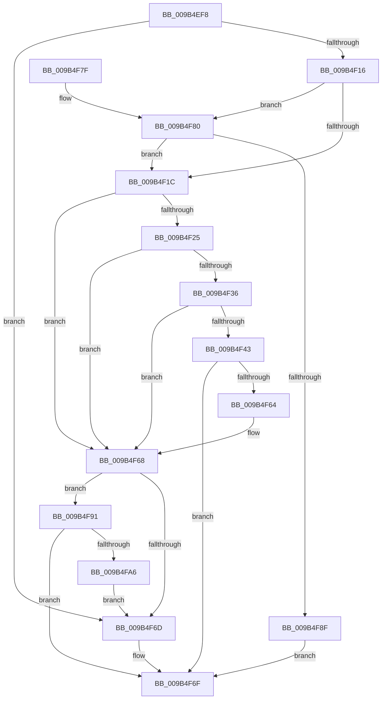

# HvpViewMapExtendStorage

- RVA: `0x009B4EF8`–`0x009B4FAC` (길이 `180` bytes)
- VA: `0x00000001409B4EF8`
- 실행 섹션: `PAGE`
- PDB 이름 있음: `예`; PDB Function 태그: `아니요`
- unwind 정보 RVA: `0x0009E58C`
- 디코드: `57`개 명령, `180/180` bytes 표시
- 미해석 바이트: `0` (있으면 어셈블리에 `.byte`로 보존)

> 이 문서는 커널 이미지의 기계어와 PDB 기호를 분석해 생성했습니다. 4번과 5번은 함수 원형과 자료형을 바이너리 사용 방식에서 추정한 C 해석이며 원본 소스 복구 결과는 아닙니다.

## 1. Dependencies

- 직접 호출 지점: **4**; 고유 호출 대상: **4**
- 직접 호출자로 확인된 함수: **2**
- RIP 상대 이미지 참조: **0**

### Outgoing calls
- `0x009B4F2C` → [HvpViewMapFindViewForFileOffset](HvpViewMapFindViewForFileOffset_function_009B5CD8.md) (function, `0x009B5CD8`)
- `0x009B4F5B` → [HvpViewMapMakeViewRangeValid](HvpViewMapMakeViewRangeValid_function_009B5E00.md) (function, `0x009B5E00`)
- `0x009B4F86` → [CmSiExtendSection](../../text/4B/CmSiExtendSection_function_004BDE64.md) (function, `0x004BDE64`)
- `0x009B4F9D` → [HvpViewMapCreateViewsForRegion](HvpViewMapCreateViewsForRegion_function_009B6094.md) (function, `0x009B6094`)

### Direct callers
- [HvpPerformLogFileRecovery](HvpPerformLogFileRecovery_function_009B7994.md) at `0x009B7A54`
- [HvpAddBin](../AF/HvpAddBin_function_00AF7D48.md) at `0x00AF806B`

### Static image references
- 디코드된 RIP-relative 메모리 참조가 없습니다.

## 2. Other-region calls and transfers

- 다른 실행 섹션으로 향하는 call: **1**
  - `0x009B4F86` → [CmSiExtendSection](../../text/4B/CmSiExtendSection_function_004BDE64.md) (`PAGE` → `.text`)
- 별도 외부 분기/꼬리 이동을 확인하지 못했습니다.

## 3. Assembly (complete function range)

```asm
009B4EF8  48 89 5C 24 08                  mov qword ptr [rsp + 8], rbx
009B4EFD  48 89 74 24 10                  mov qword ptr [rsp + 0x10], rsi
009B4F02  57                              push rdi
009B4F03  48 83 EC 30                     sub rsp, 0x30
009B4F07  8D B2 00 10 00 00               lea esi, [rdx + 0x1000]
009B4F0D  48 8B F9                        mov rdi, rcx
009B4F10  48 39 71 08                     cmp qword ptr [rcx + 8], rsi
009B4F14  7D 57                           jge 0x1409b4f6d
009B4F16  48 3B 71 10                     cmp rsi, qword ptr [rcx + 0x10]
009B4F1A  7F 64                           jg 0x1409b4f80
009B4F1C  48 8B 5F 08                     mov rbx, qword ptr [rdi + 8]
009B4F20  48 85 DB                        test rbx, rbx
009B4F23  74 43                           je 0x1409b4f68
009B4F25  48 8D 53 FF                     lea rdx, [rbx - 1]
009B4F29  48 8B CF                        mov rcx, rdi
009B4F2C  E8 A7 0D 00 00                  call 0x1409b5cd8
009B4F31  48 85 C0                        test rax, rax
009B4F34  74 32                           je 0x1409b4f68
009B4F36  4C 8B 40 30                     mov r8, qword ptr [rax + 0x30]
009B4F3A  48 8B 48 20                     mov rcx, qword ptr [rax + 0x20]
009B4F3E  4C 3B C1                        cmp r8, rcx
009B4F41  7D 25                           jge 0x1409b4f68
009B4F43  48 3B CE                        cmp rcx, rsi
009B4F46  C6 44 24 20 00                  mov byte ptr [rsp + 0x20], 0
009B4F4B  48 8B DE                        mov rbx, rsi
009B4F4E  48 8B D0                        mov rdx, rax
009B4F51  48 0F 4E D9                     cmovle rbx, rcx
009B4F55  48 8B CF                        mov rcx, rdi
009B4F58  4C 8B CB                        mov r9, rbx
009B4F5B  E8 A0 0E 00 00                  call 0x1409b5e00
009B4F60  85 C0                           test eax, eax
009B4F62  78 0B                           js 0x1409b4f6f
009B4F64  48 89 5F 08                     mov qword ptr [rdi + 8], rbx
009B4F68  48 3B DE                        cmp rbx, rsi
009B4F6B  7C 24                           jl 0x1409b4f91
009B4F6D  33 C0                           xor eax, eax
009B4F6F  48 8B 5C 24 40                  mov rbx, qword ptr [rsp + 0x40]
009B4F74  48 8B 74 24 48                  mov rsi, qword ptr [rsp + 0x48]
009B4F79  48 83 C4 30                     add rsp, 0x30
009B4F7D  5F                              pop rdi
009B4F7E  C3                              ret
009B4F7F  CC                              int3
009B4F80  48 8B 09                        mov rcx, qword ptr [rcx]
009B4F83  48 8B D6                        mov rdx, rsi
009B4F86  E8 D9 8E B0 FF                  call 0x1404bde64
009B4F8B  85 C0                           test eax, eax
009B4F8D  79 8D                           jns 0x1409b4f1c
009B4F8F  EB DE                           jmp 0x1409b4f6f
009B4F91  45 33 C9                        xor r9d, r9d
009B4F94  4C 8B C6                        mov r8, rsi
009B4F97  48 8B D3                        mov rdx, rbx
009B4F9A  48 8B CF                        mov rcx, rdi
009B4F9D  E8 F2 10 00 00                  call 0x1409b6094
009B4FA2  85 C0                           test eax, eax
009B4FA4  78 C9                           js 0x1409b4f6f
009B4FA6  48 89 77 08                     mov qword ptr [rdi + 8], rsi
009B4FAA  EB C1                           jmp 0x1409b4f6d
```

## 4. C-style interpretation (structured pseudocode)

```c
__int64 __fastcall HvpViewMapExtendStorage(__int64 a1, __int64 a2)
{
    __int64 result;
    __int64 v_rbx;
    __int64 v_rsp;
    unsigned __int8 v_stack_m18;
    unsigned __int64 v_stack_p10;
    unsigned __int64 v_stack_p8;

    v_stack_p8 = v_rbx;
    v_stack_p10 = v_rsi;
    v_rsp = (v_rsp) - (48);
    if ((*(unsigned __int64 *)(a1 + 8)) >= (a2 + 4096)) goto loc_009B4F6D;
    if ((a2 + 4096) > (*(unsigned __int64 *)(a1 + 16))) goto loc_009B4F80;
loc_009B4F1C:
    if (*(unsigned __int64 *)(a1 + 8) == 0) goto loc_009B4F68;
    result = HvpViewMapFindViewForFileOffset(a1, *(unsigned __int64 *)(a1 + 8) - 1, a3, a4);
    if (result == 0) goto loc_009B4F68;
    if ((*(unsigned __int64 *)(result + 48)) >= (*(unsigned __int64 *)(result + 32))) goto loc_009B4F68;
    v_stack_m18 = 0;
    v_rbx = a2 + 4096;
    if ((*(unsigned __int64 *)(result + 32)) <= (a2 + 4096)) { v_rbx = *(unsigned __int64 *)(result + 32); }
    result = HvpViewMapMakeViewRangeValid(a1, result, *(unsigned __int64 *)(result + 48), v_rbx);
    if (sign_flag) goto loc_009B4F6F;
    *(unsigned __int64 *)(a1 + 8) = v_rbx;
loc_009B4F68:
    if (v_rbx < (a2 + 4096)) goto loc_009B4F91;
loc_009B4F6D:
    result = 0;
loc_009B4F6F:
    v_rsp = (v_rsp) + (48);
    return result;
loc_009B4F80:
    result = CmSiExtendSection(*(unsigned __int64 *)(a1), v_stack_p10, *(unsigned __int64 *)(result + 48), v_rbx);
    if (!sign_flag) goto loc_009B4F1C;
    goto loc_009B4F6F;
loc_009B4F91:
    a4 = 0;
    result = HvpViewMapCreateViewsForRegion(a1, v_stack_p8, v_stack_p10, a4);
    if (sign_flag) goto loc_009B4F6F;
    *(unsigned __int64 *)(a1 + 8) = v_stack_p10;
    goto loc_009B4F6D;
}
```

## 5. (Beta) C Style

```c
int64_t HvpViewMapExtendStorage(void *Arg1, void *Arg2)
{
    uint8_t *arg1 = (uint8_t *)Arg1;
    uint8_t *arg2 = (uint8_t *)Arg2;

    int64_t result;
    int64_t local_rbx;
    int64_t local_rsp;
    uint8_t v_stack_m18;
    uint64_t v_stack_p10;
    uint64_t v_stack_p8;

    v_stack_p8 = local_rbx;
    v_stack_p10 = local_rsi;
    local_rsp = (local_rsp) - (48);
    if ((*(uint64_t *)(arg1 + 0x8)) >= (Arg2 + 4096)) goto loc_009B4F6D;
    if ((Arg2 + 4096) > (*(uint64_t *)(arg1 + 0x10))) goto loc_009B4F80;
loc_009B4F1C:
    if (*(uint64_t *)(arg1 + 0x8) == 0) goto loc_009B4F68;
    result = HvpViewMapFindViewForFileOffset(Arg1, *(uint64_t *)(arg1 + 0x8) - 1, a3, a4);
    if (result == 0) goto loc_009B4F68;
    if ((*(uint64_t *)(result + 0x30)) >= (*(uint64_t *)(result + 0x20))) goto loc_009B4F68;
    v_stack_m18 = 0;
    local_rbx = Arg2 + 4096;
    if ((*(uint64_t *)(result + 0x20)) <= (Arg2 + 4096)) { local_rbx = *(uint64_t *)(result + 0x20); }
    result = HvpViewMapMakeViewRangeValid(Arg1, result, *(uint64_t *)(result + 0x30), local_rbx);
    if (sign_flag) goto loc_009B4F6F;
    *(uint64_t *)(arg1 + 0x8) = local_rbx;
loc_009B4F68:
    if (local_rbx < (Arg2 + 4096)) goto loc_009B4F91;
loc_009B4F6D:
    result = 0;
loc_009B4F6F:
    local_rsp = (local_rsp) + (48);
    return result;
loc_009B4F80:
    result = CmSiExtendSection(*(uint64_t *)(arg1), v_stack_p10, *(uint64_t *)(result + 0x30), local_rbx);
    if (!sign_flag) goto loc_009B4F1C;
    goto loc_009B4F6F;
loc_009B4F91:
    a4 = 0;
    result = HvpViewMapCreateViewsForRegion(Arg1, v_stack_p8, v_stack_p10, a4);
    if (sign_flag) goto loc_009B4F6F;
    *(uint64_t *)(arg1 + 0x8) = v_stack_p10;
    goto loc_009B4F6D;
}
```

### 관측된 메모리 오프셋

구조체 형식이 확인되지 않은 접근은 인자 기준의 오프셋으로만 기록했습니다.

| 기준 인자 | 오프셋 표현 | 폭 (bit) | 접근 |
|---|---:|---:|---|
| `Arg1` | `+ 0x0` | `64` | `R` |
| `Arg1` | `+ 0x8` | `64` | `R` |
| `Arg1` | `+ 0x8` | `64` | `W` |
| `Arg1` | `+ 0x10` | `64` | `R` |
| `Arg2` | `+ 0x1000` | `32` | `R` |

## 6. Execution-region graph

[열기: 2D/3D 그래프와 함수 탐색 컨트롤 패널](../../../control-panel.html?section=page&rva=0x009B4EF8&view=graph)

- 2D 그래프는 위에서 아래로 흐르고, 3D 그래프는 빈 공간을 드래그해 회전합니다. Shift+드래그는 이동, 휠은 확대·축소, 함수 노드 선택은 대상 보고서 이동입니다.

### Static fallback


