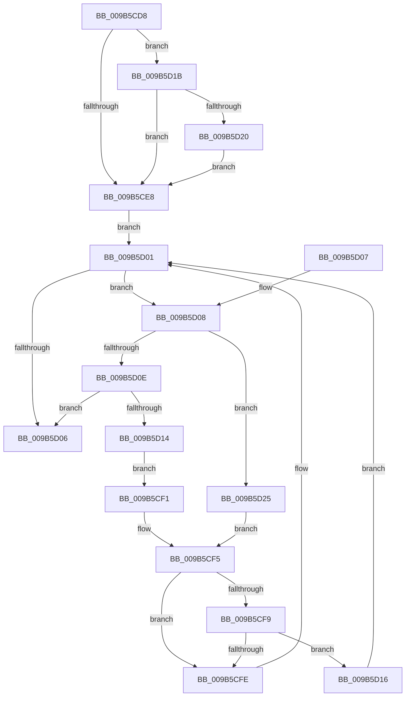

# HvpViewMapFindViewForFileOffset

- RVA: `0x009B5CD8`–`0x009B5D2A` (길이 `82` bytes)
- VA: `0x00000001409B5CD8`
- 실행 섹션: `PAGE`
- PDB 이름 있음: `예`; PDB Function 태그: `아니요`
- unwind 정보 RVA: `0x000DB714`
- 디코드: `31`개 명령, `82/82` bytes 표시
- 미해석 바이트: `0` (있으면 어셈블리에 `.byte`로 보존)

> 이 문서는 커널 이미지의 기계어와 PDB 기호를 분석해 생성했습니다. 4번과 5번은 함수 원형과 자료형을 바이너리 사용 방식에서 추정한 C 해석이며 원본 소스 복구 결과는 아닙니다.

## 1. Dependencies

- 직접 호출 지점: **0**; 고유 호출 대상: **0**
- 직접 호출자로 확인된 함수: **8**
- RIP 상대 이미지 참조: **0**

### Outgoing calls
- 직접 디코드된 call 명령이 없습니다.

### Direct callers
- [HvpViewMapShrinkStorage](../7E/HvpViewMapShrinkStorage_function_007EEE1C.md) at `0x007EEE65`
- [HvpViewMapExtendStorage](HvpViewMapExtendStorage_function_009B4EF8.md) at `0x009B4F2C`
- [HvpViewMapUnCOWAndSealRange](HvpViewMapUnCOWAndSealRange_function_009B542C.md) at `0x009B5456`
- [HvpViewMapSealRange](HvpViewMapSealRange_function_009B5A58.md) at `0x009B5A82`
- [HvpViewMapCOWAndUnsealRange](HvpViewMapCOWAndUnsealRange_function_009B5B44.md) at `0x009B5B6E`
- [HvpViewMapConvertLockedPagesToCOWByPolicy](HvpViewMapConvertLockedPagesToCOWByPolicy_function_009B74C0.md) at `0x009B74DB`
- [HvpViewMapPromoteRangeToMapping](HvpViewMapPromoteRangeToMapping_function_009B94C8.md) at `0x009B9513`
- [HvpViewMapPromoteRangeToMapping](HvpViewMapPromoteRangeToMapping_function_009B94C8.md) at `0x009B95B0`
- [HvpViewMapPromoteRangeToMapping](HvpViewMapPromoteRangeToMapping_function_009B94C8.md) at `0x009B9756`
- [HvpViewMapPromoteRangeToMapping](HvpViewMapPromoteRangeToMapping_function_009B94C8.md) at `0x009B9786`
- [HvpViewMapAdjustFlag](../AC/HvpViewMapAdjustFlag_function_00ACDDA4.md) at `0x00ACDDF6`

### Static image references
- 디코드된 RIP-relative 메모리 참조가 없습니다.

## 2. Other-region calls and transfers

- 다른 실행 섹션으로 향하는 call: **0**
- 별도 외부 분기/꼬리 이동을 확인하지 못했습니다.

## 3. Assembly (complete function range)

```asm
009B5CD8  48 83 C1 28                     add rcx, 0x28
009B5CDC  4C 8B C2                        mov r8, rdx
009B5CDF  F6 41 08 01                     test byte ptr [rcx + 8], 1
009B5CE3  48 8B 01                        mov rax, qword ptr [rcx]
009B5CE6  75 33                           jne 0x1409b5d1b
009B5CE8  0F B6 51 08                     movzx edx, byte ptr [rcx + 8]
009B5CEC  83 E2 01                        and edx, 1
009B5CEF  EB 10                           jmp 0x1409b5d01
009B5CF1  48 8B 48 08                     mov rcx, qword ptr [rax + 8]
009B5CF5  85 D2                           test edx, edx
009B5CF7  74 05                           je 0x1409b5cfe
009B5CF9  48 85 C9                        test rcx, rcx
009B5CFC  75 18                           jne 0x1409b5d16
009B5CFE  48 8B C1                        mov rax, rcx
009B5D01  48 85 C0                        test rax, rax
009B5D04  75 02                           jne 0x1409b5d08
009B5D06  C3                              ret
009B5D07  CC                              int3
009B5D08  4C 3B 40 28                     cmp r8, qword ptr [rax + 0x28]
009B5D0C  7C 17                           jl 0x1409b5d25
009B5D0E  4C 3B 40 30                     cmp r8, qword ptr [rax + 0x30]
009B5D12  7C F2                           jl 0x1409b5d06
009B5D14  EB DB                           jmp 0x1409b5cf1
009B5D16  48 33 C1                        xor rax, rcx
009B5D19  EB E6                           jmp 0x1409b5d01
009B5D1B  48 85 C0                        test rax, rax
009B5D1E  74 C8                           je 0x1409b5ce8
009B5D20  48 33 C1                        xor rax, rcx
009B5D23  EB C3                           jmp 0x1409b5ce8
009B5D25  48 8B 08                        mov rcx, qword ptr [rax]
009B5D28  EB CB                           jmp 0x1409b5cf5
```

## 4. C-style interpretation (structured pseudocode)

```c
__int64 __fastcall HvpViewMapFindViewForFileOffset(__int64 a1, __int64 a2)
{
    __int64 result;

    a1 = (a1) + (40);
    if (((*(unsigned __int8 *)(a1 + 8)) & (1)) != 0) goto loc_009B5D1B;
loc_009B5CE8:
    a2 = (unsigned int)((*(unsigned __int8 *)(a1 + 8)) & (1));
    goto loc_009B5D01;
loc_009B5CF1:
loc_009B5CF5:
    if ((unsigned int)(a2) == 0) goto loc_009B5CFE;
    if (*(unsigned __int64 *)(*(unsigned __int64 *)(a1) + 8) != 0) goto loc_009B5D16;
loc_009B5CFE:
loc_009B5D01:
    if (*(unsigned __int64 *)(*(unsigned __int64 *)(a1) + 8) != 0) goto loc_009B5D08;
loc_009B5D06:
    return *(unsigned __int64 *)(*(unsigned __int64 *)(a1) + 8);
loc_009B5D08:
    if (a2 < (*(unsigned __int64 *)(*(unsigned __int64 *)(*(unsigned __int64 *)(a1) + 8) + 40))) goto loc_009B5D25;
    if (a2 < (*(unsigned __int64 *)(*(unsigned __int64 *)(*(unsigned __int64 *)(a1) + 8) + 48))) goto loc_009B5D06;
    goto loc_009B5CF1;
loc_009B5D16:
    result = (*(unsigned __int64 *)(*(unsigned __int64 *)(a1) + 8)) ^ (*(unsigned __int64 *)(*(unsigned __int64 *)(a1) + 8));
    goto loc_009B5D01;
loc_009B5D1B:
    if (result == 0) goto loc_009B5CE8;
    result = (result) ^ (*(unsigned __int64 *)(*(unsigned __int64 *)(a1) + 8));
    goto loc_009B5CE8;
loc_009B5D25:
    goto loc_009B5CF5;
}
```

## 5. (Beta) C Style

```c
int64_t HvpViewMapFindViewForFileOffset(void *Arg1, int64_t Arg2)
{
    uint8_t *arg1 = (uint8_t *)Arg1;

    int64_t result;

    Arg1 = (Arg1) + (40);
    if (((*(uint8_t *)(arg1 + 0x8)) & (1)) != 0) goto loc_009B5D1B;
loc_009B5CE8:
    Arg2 = (uint32_t)((*(uint8_t *)(arg1 + 0x8)) & (1));
    goto loc_009B5D01;
loc_009B5CF1:
loc_009B5CF5:
    if ((uint32_t)(Arg2) == 0) goto loc_009B5CFE;
    if (*(uint64_t *)(*(uint64_t *)(arg1) + 0x8) != 0) goto loc_009B5D16;
loc_009B5CFE:
loc_009B5D01:
    if (*(uint64_t *)(*(uint64_t *)(arg1) + 0x8) != 0) goto loc_009B5D08;
loc_009B5D06:
    return *(uint64_t *)(*(uint64_t *)(arg1) + 0x8);
loc_009B5D08:
    if (Arg2 < (*(uint64_t *)(*(uint64_t *)(*(uint64_t *)(arg1) + 0x8) + 0x28))) goto loc_009B5D25;
    if (Arg2 < (*(uint64_t *)(*(uint64_t *)(*(uint64_t *)(arg1) + 0x8) + 0x30))) goto loc_009B5D06;
    goto loc_009B5CF1;
loc_009B5D16:
    result = (*(uint64_t *)(*(uint64_t *)(arg1) + 0x8)) ^ (*(uint64_t *)(*(uint64_t *)(arg1) + 0x8));
    goto loc_009B5D01;
loc_009B5D1B:
    if (result == 0) goto loc_009B5CE8;
    result = (result) ^ (*(uint64_t *)(*(uint64_t *)(arg1) + 0x8));
    goto loc_009B5CE8;
loc_009B5D25:
    goto loc_009B5CF5;
}
```

### 관측된 메모리 오프셋

구조체 형식이 확인되지 않은 접근은 인자 기준의 오프셋으로만 기록했습니다.

| 기준 인자 | 오프셋 표현 | 폭 (bit) | 접근 |
|---|---:|---:|---|
| `Arg1` | `+ 0x0` | `64` | `R` |
| `Arg1` | `+ 0x8` | `8` | `R` |

## 6. Execution-region graph

[열기: 2D/3D 그래프와 함수 탐색 컨트롤 패널](../../../control-panel.html?section=page&rva=0x009B5CD8&view=graph)

- 2D 그래프는 위에서 아래로 흐르고, 3D 그래프는 빈 공간을 드래그해 회전합니다. Shift+드래그는 이동, 휠은 확대·축소, 함수 노드 선택은 대상 보고서 이동입니다.

### Static fallback


