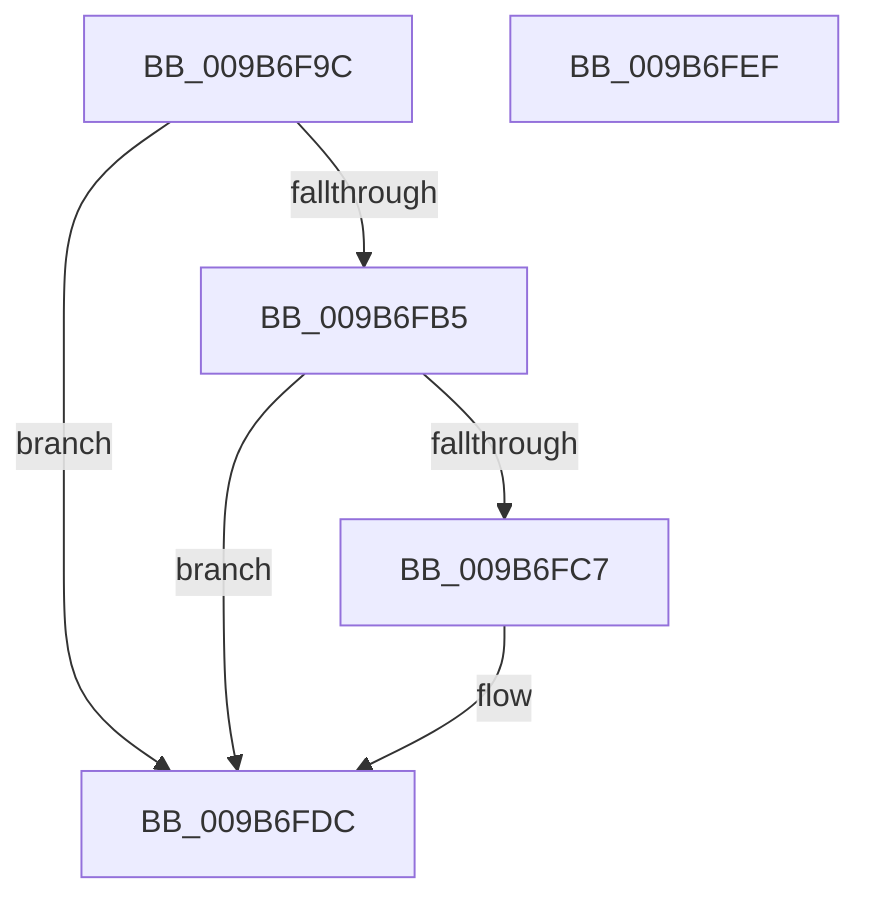

# HvpViewMapFreeView

- RVA: `0x009B6F9C`–`0x009B6FF0` (길이 `84` bytes)
- VA: `0x00000001409B6F9C`
- 실행 섹션: `PAGE`
- PDB 이름 있음: `예`; PDB Function 태그: `아니요`
- unwind 정보 RVA: `0x0005CAAC`
- 디코드: `25`개 명령, `84/84` bytes 표시
- 미해석 바이트: `0` (있으면 어셈블리에 `.byte`로 보존)

> 이 문서는 커널 이미지의 기계어와 PDB 기호를 분석해 생성했습니다. 4번과 5번은 함수 원형과 자료형을 바이너리 사용 방식에서 추정한 C 해석이며 원본 소스 복구 결과는 아닙니다.

## 1. Dependencies

- 직접 호출 지점: **4**; 고유 호출 대상: **4**
- 직접 호출자로 확인된 함수: **6**
- RIP 상대 이미지 참조: **0**

### Outgoing calls
- `0x009B6FB9` → [CmSiUnmapViewOfSection](../../text/4A/CmSiUnmapViewOfSection_function_004A4738.md) (function, `0x004A4738`)
- `0x009B6FC7` → [CmSiGetPageSize](../../text/4B/CmSiGetPageSize_function_004B7BF0.md) (function, `0x004B7BF0`)
- `0x009B6FD7` → [CmSiReleaseProcessLockedPagesCharge](../../text/47/CmSiReleaseProcessLockedPagesCharge_function_0047D81C.md) (function, `0x0047D81C`)
- `0x009B6FDF` → [CmSiFreeMemory](../../text/47/CmSiFreeMemory_function_00475D80.md) (function, `0x00475D80`)

### Direct callers
- [HvpViewMapShrinkStorage](../7E/HvpViewMapShrinkStorage_function_007EEE1C.md) at `0x007EEEE1`
- [HvpViewMapCreateViewsForRegion](HvpViewMapCreateViewsForRegion_function_009B6094.md) at `0x009B62EA`
- [HvpViewMapCreateView](HvpViewMapCreateView_function_009B6310.md) at `0x009B63F2`
- [HvpViewMapDeleteViewTreeNode](HvpViewMapDeleteViewTreeNode_function_009B6F7C.md) at `0x009B6F89`
- [HvpViewMapPromoteRangeToMapping](HvpViewMapPromoteRangeToMapping_function_009B94C8.md) at `0x009B96F2`
- [HvpViewMapPromoteRangeToMapping](HvpViewMapPromoteRangeToMapping_function_009B94C8.md) at `0x009B97CE`
- [sub_00B2DD90](../B2/Unknown_function_00B2DD90.md) at `0x00B2DD96`

### Static image references
- 디코드된 RIP-relative 메모리 참조가 없습니다.

## 2. Other-region calls and transfers

- 다른 실행 섹션으로 향하는 call: **4**
  - `0x009B6FB9` → [CmSiUnmapViewOfSection](../../text/4A/CmSiUnmapViewOfSection_function_004A4738.md) (`PAGE` → `.text`)
  - `0x009B6FC7` → [CmSiGetPageSize](../../text/4B/CmSiGetPageSize_function_004B7BF0.md) (`PAGE` → `.text`)
  - `0x009B6FD7` → [CmSiReleaseProcessLockedPagesCharge](../../text/47/CmSiReleaseProcessLockedPagesCharge_function_0047D81C.md) (`PAGE` → `.text`)
  - `0x009B6FDF` → [CmSiFreeMemory](../../text/47/CmSiFreeMemory_function_00475D80.md) (`PAGE` → `.text`)
- 별도 외부 분기/꼬리 이동을 확인하지 못했습니다.

## 3. Assembly (complete function range)

```asm
009B6F9C  48 89 5C 24 08                  mov qword ptr [rsp + 8], rbx
009B6FA1  57                              push rdi
009B6FA2  48 83 EC 20                     sub rsp, 0x20
009B6FA6  4C 8B 42 38                     mov r8, qword ptr [rdx + 0x38]
009B6FAA  48 8B DA                        mov rbx, rdx
009B6FAD  48 8B F9                        mov rdi, rcx
009B6FB0  4D 85 C0                        test r8, r8
009B6FB3  74 27                           je 0x1409b6fdc
009B6FB5  48 8B 51 18                     mov rdx, qword ptr [rcx + 0x18]
009B6FB9  E8 7A D7 AE FF                  call 0x1404a4738
009B6FBE  48 8B 4B 40                     mov rcx, qword ptr [rbx + 0x40]
009B6FC2  48 85 C9                        test rcx, rcx
009B6FC5  74 15                           je 0x1409b6fdc
009B6FC7  E8 24 0C B0 FF                  call 0x1404b7bf0
009B6FCC  48 0F AF C1                     imul rax, rcx
009B6FD0  48 8B 4F 18                     mov rcx, qword ptr [rdi + 0x18]
009B6FD4  48 8B D0                        mov rdx, rax
009B6FD7  E8 40 68 AC FF                  call 0x14047d81c
009B6FDC  48 8B CB                        mov rcx, rbx
009B6FDF  E8 9C ED AB FF                  call 0x140475d80
009B6FE4  48 8B 5C 24 30                  mov rbx, qword ptr [rsp + 0x30]
009B6FE9  48 83 C4 20                     add rsp, 0x20
009B6FED  5F                              pop rdi
009B6FEE  C3                              ret
009B6FEF  CC                              int3
```

## 4. C-style interpretation (structured pseudocode)

```c
__int64 __fastcall HvpViewMapFreeView(__int64 a1, __int64 a2)
{
    __int64 result;
    __int64 v_rsp;
    unsigned __int64 v_stack_p8;

    v_stack_p8 = v_rbx;
    v_rsp = (v_rsp) - (32);
    if (*(unsigned __int64 *)(a2 + 56) == 0) goto loc_009B6FDC;
    result = CmSiUnmapViewOfSection(a1, *(unsigned __int64 *)(a1 + 24), *(unsigned __int64 *)(a2 + 56), a4);
    if (*(unsigned __int64 *)(a2 + 64) != 0) {
        result = CmSiGetPageSize(*(unsigned __int64 *)(a2 + 64), *(unsigned __int64 *)(a1 + 24), *(unsigned __int64 *)(a2 + 56), a4);
        result = (result) * (*(unsigned __int64 *)(a2 + 64));
        a1 = *(unsigned __int64 *)(a1 + 24);
        a2 = result;
        result = CmSiReleaseProcessLockedPagesCharge(a1, a2, *(unsigned __int64 *)(a2 + 56), a4);
    }
    result = CmSiFreeMemory(a2, a2, *(unsigned __int64 *)(a2 + 56), a4);
    v_rsp = (v_rsp) + (32);
    return result;
}
```

## 5. (Beta) C Style

```c
int64_t HvpViewMapFreeView(void *Arg1, void *Arg2)
{
    uint8_t *arg1 = (uint8_t *)Arg1;
    uint8_t *arg2 = (uint8_t *)Arg2;

    int64_t result;
    int64_t local_rsp;
    uint64_t v_stack_p8;

    v_stack_p8 = local_rbx;
    local_rsp = (local_rsp) - (32);
    if (*(uint64_t *)(arg2 + 0x38) == 0) goto loc_009B6FDC;
    result = CmSiUnmapViewOfSection(Arg1, *(uint64_t *)(arg1 + 0x18), *(uint64_t *)(arg2 + 0x38), a4);
    if (*(uint64_t *)(arg2 + 0x40) != 0) {
        result = CmSiGetPageSize(*(uint64_t *)(arg2 + 0x40), *(uint64_t *)(arg1 + 0x18), *(uint64_t *)(arg2 + 0x38), a4);
        result = (result) * (*(uint64_t *)(arg2 + 0x40));
        Arg1 = *(uint64_t *)(arg1 + 0x18);
        Arg2 = result;
        result = CmSiReleaseProcessLockedPagesCharge(Arg1, Arg2, *(uint64_t *)(arg2 + 0x38), a4);
    }
    result = CmSiFreeMemory(Arg2, Arg2, *(uint64_t *)(arg2 + 0x38), a4);
    local_rsp = (local_rsp) + (32);
    return result;
}
```

### 관측된 메모리 오프셋

구조체 형식이 확인되지 않은 접근은 인자 기준의 오프셋으로만 기록했습니다.

| 기준 인자 | 오프셋 표현 | 폭 (bit) | 접근 |
|---|---:|---:|---|
| `Arg1` | `+ 0x18` | `64` | `R` |
| `Arg2` | `+ 0x38` | `64` | `R` |
| `Arg2` | `+ 0x40` | `64` | `R` |

## 6. Execution-region graph

[열기: 2D/3D 그래프와 함수 탐색 컨트롤 패널](../../../control-panel.html?section=page&rva=0x009B6F9C&view=graph)

- 2D 그래프는 위에서 아래로 흐르고, 3D 그래프는 빈 공간을 드래그해 회전합니다. Shift+드래그는 이동, 휠은 확대·축소, 함수 노드 선택은 대상 보고서 이동입니다.

### Static fallback


