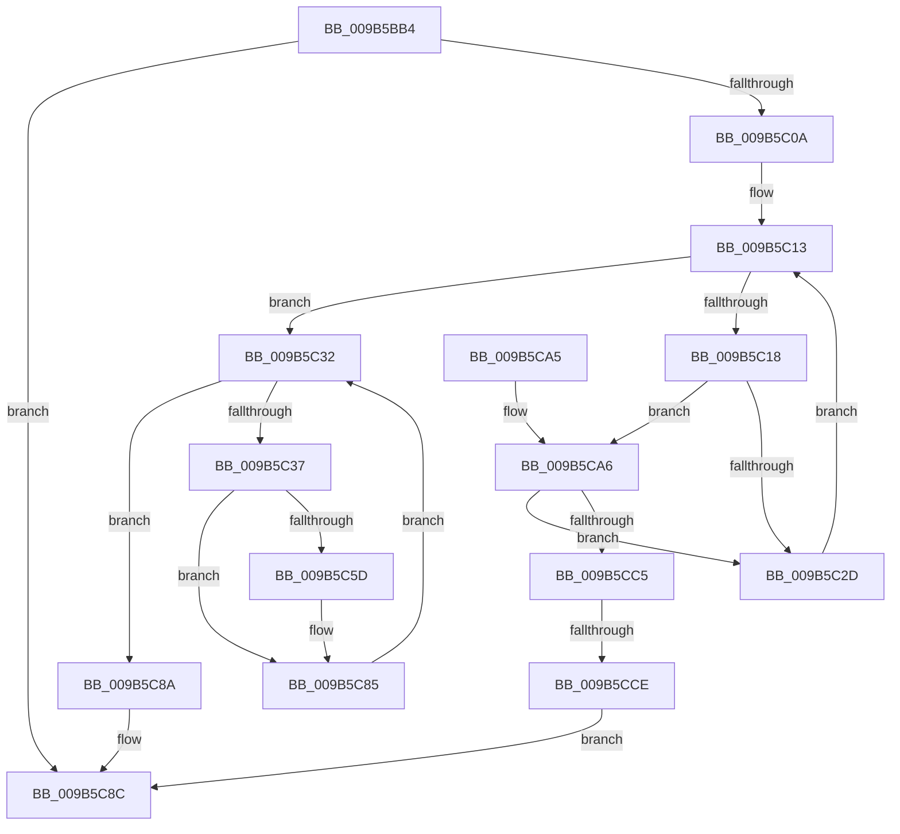

# HvpViewMapMakeViewRangeCOWByCaller

- RVA: `0x009B5BB4`–`0x009B5CD0` (길이 `284` bytes)
- VA: `0x00000001409B5BB4`
- 실행 섹션: `PAGE`
- PDB 이름 있음: `예`; PDB Function 태그: `예`
- unwind 정보 RVA: `0x0009E630`
- 디코드: `87`개 명령, `284/284` bytes 표시
- 미해석 바이트: `0` (있으면 어셈블리에 `.byte`로 보존)

> 이 문서는 커널 이미지의 기계어와 PDB 기호를 분석해 생성했습니다. 4번과 5번은 함수 원형과 자료형을 바이너리 사용 방식에서 추정한 C 해석이며 원본 소스 복구 결과는 아닙니다.

## 1. Dependencies

- 직접 호출 지점: **4**; 고유 호출 대상: **4**
- 직접 호출자로 확인된 함수: **2**
- RIP 상대 이미지 참조: **0**

### Outgoing calls
- `0x009B5BFB` → [CmSiProtectViewOfSection](../../text/47/CmSiProtectViewOfSection_function_004746B8.md) (function, `0x004746B8`)
- `0x009B5C67` → [CmSiUnlockViewOfSection](../../text/49/CmSiUnlockViewOfSection_function_0049A5A8.md) (function, `0x0049A5A8`)
- `0x009B5C72` → [CmSiReleaseProcessLockedPagesCharge](../../text/47/CmSiReleaseProcessLockedPagesCharge_function_0047D81C.md) (function, `0x0047D81C`)
- `0x009B5CB6` → [HvpViewMapTouchPages](HvpViewMapTouchPages_function_009B5D30.md) (function, `0x009B5D30`)

### Direct callers
- [HvpViewMapMigrateCOWData](../7E/HvpViewMapMigrateCOWData_function_007EEC0C.md) at `0x007EED00`
- [HvpViewMapCOWAndUnsealRange](HvpViewMapCOWAndUnsealRange_function_009B5B44.md) at `0x009B5B8D`

### Static image references
- 디코드된 RIP-relative 메모리 참조가 없습니다.

## 2. Other-region calls and transfers

- 다른 실행 섹션으로 향하는 call: **3**
  - `0x009B5BFB` → [CmSiProtectViewOfSection](../../text/47/CmSiProtectViewOfSection_function_004746B8.md) (`PAGE` → `.text`)
  - `0x009B5C67` → [CmSiUnlockViewOfSection](../../text/49/CmSiUnlockViewOfSection_function_0049A5A8.md) (`PAGE` → `.text`)
  - `0x009B5C72` → [CmSiReleaseProcessLockedPagesCharge](../../text/47/CmSiReleaseProcessLockedPagesCharge_function_0047D81C.md) (`PAGE` → `.text`)
- call이 아닌 외부 분기/꼬리 이동: **1**
  - `0x009B5CC8` → [sub_00B2DD4A](../B2/Unknown_function_00B2DD4A.md) (`tail-transfer`)

## 3. Assembly (complete function range)

```asm
009B5BB4  48 8B C4                        mov rax, rsp
009B5BB7  48 89 58 10                     mov qword ptr [rax + 0x10], rbx
009B5BBB  48 89 68 18                     mov qword ptr [rax + 0x18], rbp
009B5BBF  56                              push rsi
009B5BC0  57                              push rdi
009B5BC1  41 54                           push r12
009B5BC3  41 56                           push r14
009B5BC5  41 57                           push r15
009B5BC7  48 83 EC 30                     sub rsp, 0x30
009B5BCB  83 60 08 00                     and dword ptr [rax + 8], 0
009B5BCF  48 8D 40 08                     lea rax, [rax + 8]
009B5BD3  49 8B F8                        mov rdi, r8
009B5BD6  48 89 44 24 28                  mov qword ptr [rsp + 0x28], rax
009B5BDB  4C 2B 42 18                     sub r8, qword ptr [rdx + 0x18]
009B5BDF  4D 8B F1                        mov r14, r9
009B5BE2  4C 03 42 38                     add r8, qword ptr [rdx + 0x38]
009B5BE6  48 8B F2                        mov rsi, rdx
009B5BE9  48 8B 51 18                     mov rdx, qword ptr [rcx + 0x18]
009B5BED  4C 2B CF                        sub r9, rdi
009B5BF0  4C 8B F9                        mov r15, rcx
009B5BF3  C7 44 24 20 08 00 00 00         mov dword ptr [rsp + 0x20], 8
009B5BFB  E8 B8 EA AB FF                  call 0x1404746b8
009B5C00  8B E8                           mov ebp, eax
009B5C02  85 C0                           test eax, eax
009B5C04  0F 88 82 00 00 00               js 0x1409b5c8c
009B5C0A  48 8B DF                        mov rbx, rdi
009B5C0D  41 BC 00 10 00 00               mov r12d, 0x1000
009B5C13  49 3B DE                        cmp rbx, r14
009B5C16  7D 1A                           jge 0x1409b5c32
009B5C18  48 8B 56 18                     mov rdx, qword ptr [rsi + 0x18]
009B5C1C  48 8B C3                        mov rax, rbx
009B5C1F  48 2B C2                        sub rax, rdx
009B5C22  48 C1 E8 0C                     shr rax, 0xc
009B5C26  F6 44 30 48 02                  test byte ptr [rax + rsi + 0x48], 2
009B5C2B  74 79                           je 0x1409b5ca6
009B5C2D  49 03 DC                        add rbx, r12
009B5C30  EB E1                           jmp 0x1409b5c13
009B5C32  49 3B FE                        cmp rdi, r14
009B5C35  7D 53                           jge 0x1409b5c8a
009B5C37  48 8B 46 18                     mov rax, qword ptr [rsi + 0x18]
009B5C3B  48 8B EF                        mov rbp, rdi
009B5C3E  48 2B E8                        sub rbp, rax
009B5C41  4C 8B C7                        mov r8, rdi
009B5C44  4C 2B C0                        sub r8, rax
009B5C47  48 C1 ED 0C                     shr rbp, 0xc
009B5C4B  4C 03 46 38                     add r8, qword ptr [rsi + 0x38]
009B5C4F  8A 44 2E 48                     mov al, byte ptr [rsi + rbp + 0x48]
009B5C53  0C 0A                           or al, 0xa
009B5C55  88 44 2E 48                     mov byte ptr [rsi + rbp + 0x48], al
009B5C59  A8 10                           test al, 0x10
009B5C5B  74 28                           je 0x1409b5c85
009B5C5D  49 8B 5F 18                     mov rbx, qword ptr [r15 + 0x18]
009B5C61  4D 8B CC                        mov r9, r12
009B5C64  48 8B D3                        mov rdx, rbx
009B5C67  E8 3C 49 AE FF                  call 0x14049a5a8
009B5C6C  49 8B D4                        mov rdx, r12
009B5C6F  48 8B CB                        mov rcx, rbx
009B5C72  E8 A5 7B AC FF                  call 0x14047d81c
009B5C77  80 64 2E 48 EF                  and byte ptr [rsi + rbp + 0x48], 0xef
009B5C7C  48 FF 4E 40                     dec qword ptr [rsi + 0x40]
009B5C80  80 4C 2E 48 04                  or byte ptr [rsi + rbp + 0x48], 4
009B5C85  49 03 FC                        add rdi, r12
009B5C88  EB A8                           jmp 0x1409b5c32
009B5C8A  33 ED                           xor ebp, ebp
009B5C8C  48 8B 5C 24 68                  mov rbx, qword ptr [rsp + 0x68]
009B5C91  8B C5                           mov eax, ebp
009B5C93  48 8B 6C 24 70                  mov rbp, qword ptr [rsp + 0x70]
009B5C98  48 83 C4 30                     add rsp, 0x30
009B5C9C  41 5F                           pop r15
009B5C9E  41 5E                           pop r14
009B5CA0  41 5C                           pop r12
009B5CA2  5F                              pop rdi
009B5CA3  5E                              pop rsi
009B5CA4  C3                              ret
009B5CA5  CC                              int3
009B5CA6  48 8B CB                        mov rcx, rbx
009B5CA9  41 B0 01                        mov r8b, 1
009B5CAC  48 2B CA                        sub rcx, rdx
009B5CAF  49 8B D4                        mov rdx, r12
009B5CB2  48 03 4E 38                     add rcx, qword ptr [rsi + 0x38]
009B5CB6  E8 75 00 00 00                  call 0x1409b5d30
009B5CBB  8B E8                           mov ebp, eax
009B5CBD  85 C0                           test eax, eax
009B5CBF  0F 89 68 FF FF FF               jns 0x1409b5c2d
009B5CC5  49 3B FE                        cmp rdi, r14
009B5CC8  0F 8C 7C 80 17 00               jl 0x140b2dd4a
009B5CCE  EB BC                           jmp 0x1409b5c8c
```

## 4. C-style interpretation (structured pseudocode)

```c
__int64 __fastcall HvpViewMapMakeViewRangeCOWByCaller(__int64 a1, __int64 a2, __int64 a3, __int64 a4)
{
    __int64 result;
    __int64 v_rbp;
    __int64 v_rbx;
    __int64 v_rdi;
    __int64 v_rsp;
    unsigned __int64 v_stack_m30;
    unsigned int v_stack_m38;
    unsigned __int64 v_stack_p10;
    unsigned __int64 v_stack_p18;

    *(unsigned __int64 *)(v_rsp + 16) = v_rbx;
    *(unsigned __int64 *)(v_rsp + 24) = v_rbp;
    v_rsp = (v_rsp) - (48);
    v_stack_m30 = v_rsp + 8;
    a3 = (a3) - (*(unsigned __int64 *)(a2 + 24));
    a3 = (a3) + (*(unsigned __int64 *)(a2 + 56));
    a4 = (a4) - (a3);
    v_stack_m38 = 8;
    result = CmSiProtectViewOfSection(a1, *(unsigned __int64 *)(a1 + 24), a3, a4);
    if (sign_flag) goto loc_009B5C8C;
loc_009B5C13:
    if (a3 >= a4) goto loc_009B5C32;
    result = (a3) - (*(unsigned __int64 *)(a2 + 24));
    result = (result) >> (12);
    if (((*(unsigned __int8 *)(result + a2 * 1 + 72)) & (2)) == 0) goto loc_009B5CA6;
loc_009B5C2D:
    v_rbx = (a3) + ((unsigned int)(0x1000ULL));
    goto loc_009B5C13;
loc_009B5C32:
    if (a3 >= a4) goto loc_009B5C8A;
    v_rbp = (a3) - (*(unsigned __int64 *)(a2 + 24));
    a3 = (a3) - (*(unsigned __int64 *)(a2 + 24));
    v_rbp = (v_rbp) >> (12);
    a3 = (a3) + (*(unsigned __int64 *)(a2 + 56));
    result = (unsigned __int8)((*(unsigned __int8 *)(a2 + v_rbp * 1 + 72)) | (10));
    *(unsigned __int8 *)(a2 + v_rbp * 1 + 72) = (unsigned __int8)(result);
    if ((((unsigned __int8)(result)) & (16)) != 0) {
        v_rbx = *(unsigned __int64 *)(a1 + 24);
        a4 = (unsigned int)(0x1000ULL);
        a2 = v_rbx;
        result = CmSiUnlockViewOfSection(a1, a2, a3, a4);
        a2 = (unsigned int)(0x1000ULL);
        a1 = v_rbx;
        result = CmSiReleaseProcessLockedPagesCharge(a1, a2, a3, a4);
    }
    v_rdi = (a3) + ((unsigned int)(0x1000ULL));
    goto loc_009B5C32;
loc_009B5C8A:
    v_rbp = 0;
loc_009B5C8C:
    v_rsp = (v_rsp) + (48);
    return 0;
loc_009B5CA6:
    a1 = (v_stack_p10) - (a2);
    a1 = (a1) + (*(unsigned __int64 *)(a2 + 56));
    result = HvpViewMapTouchPages(a1, (unsigned int)(0x1000ULL), 1, a4);
    if (!sign_flag) goto loc_009B5C2D;
    goto loc_009B5C8C;
}
```

## 5. (Beta) C Style

```c
int64_t HvpViewMapMakeViewRangeCOWByCaller(void *Arg1, void *Arg2, int64_t Arg3, int64_t Arg4)
{
    uint8_t *arg1 = (uint8_t *)Arg1;
    uint8_t *arg2 = (uint8_t *)Arg2;

    int64_t result;
    int64_t local_rbp;
    int64_t local_rbx;
    int64_t local_rdi;
    int64_t local_rsp;
    uint64_t v_stack_m30;
    uint32_t v_stack_m38;
    uint64_t v_stack_p10;
    uint64_t v_stack_p18;

    *(uint64_t *)(local_rsp + 0x10) = local_rbx;
    *(uint64_t *)(local_rsp + 0x18) = local_rbp;
    local_rsp = (local_rsp) - (48);
    v_stack_m30 = local_rsp + 8;
    Arg3 = (Arg3) - (*(uint64_t *)(arg2 + 0x18));
    Arg3 = (Arg3) + (*(uint64_t *)(arg2 + 0x38));
    Arg4 = (Arg4) - (Arg3);
    v_stack_m38 = 8;
    result = CmSiProtectViewOfSection(Arg1, *(uint64_t *)(arg1 + 0x18), Arg3, Arg4);
    if (sign_flag) goto loc_009B5C8C;
loc_009B5C13:
    if (Arg3 >= Arg4) goto loc_009B5C32;
    result = (Arg3) - (*(uint64_t *)(arg2 + 0x18));
    result = (result) >> (12);
    if (((*(uint8_t *)(result + arg2 * 1 + 0x48)) & (2)) == 0) goto loc_009B5CA6;
loc_009B5C2D:
    local_rbx = (Arg3) + ((uint32_t)(0x1000ULL));
    goto loc_009B5C13;
loc_009B5C32:
    if (Arg3 >= Arg4) goto loc_009B5C8A;
    local_rbp = (Arg3) - (*(uint64_t *)(arg2 + 0x18));
    Arg3 = (Arg3) - (*(uint64_t *)(arg2 + 0x18));
    local_rbp = (local_rbp) >> (12);
    Arg3 = (Arg3) + (*(uint64_t *)(arg2 + 0x38));
    result = (uint8_t)((*(uint8_t *)(arg2 + local_rbp * 1 + 0x48)) | (10));
    *(uint8_t *)(arg2 + local_rbp * 1 + 0x48) = (uint8_t)(result);
    if ((((uint8_t)(result)) & (16)) != 0) {
        local_rbx = *(uint64_t *)(arg1 + 0x18);
        Arg4 = (uint32_t)(0x1000ULL);
        Arg2 = local_rbx;
        result = CmSiUnlockViewOfSection(Arg1, Arg2, Arg3, Arg4);
        Arg2 = (uint32_t)(0x1000ULL);
        Arg1 = local_rbx;
        result = CmSiReleaseProcessLockedPagesCharge(Arg1, Arg2, Arg3, Arg4);
    }
    local_rdi = (Arg3) + ((uint32_t)(0x1000ULL));
    goto loc_009B5C32;
loc_009B5C8A:
    local_rbp = 0;
loc_009B5C8C:
    local_rsp = (local_rsp) + (48);
    return 0;
loc_009B5CA6:
    Arg1 = (v_stack_p10) - (Arg2);
    Arg1 = (Arg1) + (*(uint64_t *)(arg2 + 0x38));
    result = HvpViewMapTouchPages(Arg1, (uint32_t)(0x1000ULL), 1, Arg4);
    if (!sign_flag) goto loc_009B5C2D;
    goto loc_009B5C8C;
}
```

### 관측된 메모리 오프셋

구조체 형식이 확인되지 않은 접근은 인자 기준의 오프셋으로만 기록했습니다.

| 기준 인자 | 오프셋 표현 | 폭 (bit) | 접근 |
|---|---:|---:|---|
| `Arg1` | `+ 0x18` | `64` | `R` |
| `Arg2` | `+ 0x18` | `64` | `R` |
| `Arg2` | `+ 0x38` | `64` | `R` |
| `Arg2` | `+ 0x40` | `64` | `R/W` |
| `Arg2` | `+ 0x48 + rbp*1` | `8` | `R` |
| `Arg2` | `+ 0x48 + rbp*1` | `8` | `R/W` |
| `Arg2` | `+ 0x48 + rbp*1` | `8` | `W` |

## 6. Execution-region graph

[열기: 2D/3D 그래프와 함수 탐색 컨트롤 패널](../../../control-panel.html?section=page&rva=0x009B5BB4&view=graph)

- 2D 그래프는 위에서 아래로 흐르고, 3D 그래프는 빈 공간을 드래그해 회전합니다. Shift+드래그는 이동, 휠은 확대·축소, 함수 노드 선택은 대상 보고서 이동입니다.

### Static fallback


