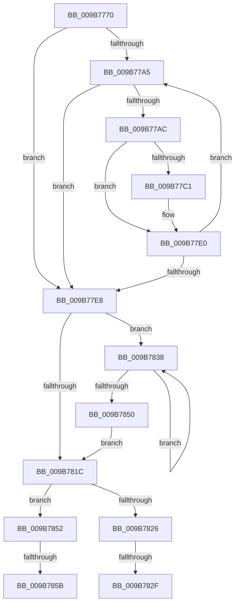

# HvpViewMapMakeViewRangeInvalid

- RVA: `0x009B7770`–`0x009B786A` (길이 `250` bytes)
- VA: `0x00000001409B7770`
- 실행 섹션: `PAGE`
- PDB 이름 있음: `예`; PDB Function 태그: `예`
- unwind 정보 RVA: `0x0009E89C`
- 디코드: `69`개 명령, `250/250` bytes 표시
- 미해석 바이트: `0` (있으면 어셈블리에 `.byte`로 보존)

> 이 문서는 커널 이미지의 기계어와 PDB 기호를 분석해 생성했습니다. 4번과 5번은 함수 원형과 자료형을 바이너리 사용 방식에서 추정한 C 해석이며 원본 소스 복구 결과는 아닙니다.

## 1. Dependencies

- 직접 호출 지점: **2**; 고유 호출 대상: **2**
- 직접 호출자로 확인된 함수: **2**
- RIP 상대 이미지 참조: **0**

### Outgoing calls
- `0x009B77D2` → [HvpViewMapReleaseChargesAndUnlockViewPages](HvpViewMapReleaseChargesAndUnlockViewPages_function_009B7870.md) (function, `0x009B7870`)
- `0x009B780F` → [CmSiProtectViewOfSection](../../text/47/CmSiProtectViewOfSection_function_004746B8.md) (function, `0x004746B8`)

### Direct callers
- [HvpViewMapShrinkStorage](../7E/HvpViewMapShrinkStorage_function_007EEE1C.md) at `0x007EEE7D`
- [HvpViewMapPromoteRangeToMapping](HvpViewMapPromoteRangeToMapping_function_009B94C8.md) at `0x009B95FD`
- [HvpViewMapPromoteRangeToMapping](HvpViewMapPromoteRangeToMapping_function_009B94C8.md) at `0x009B963F`

### Static image references
- 디코드된 RIP-relative 메모리 참조가 없습니다.

## 2. Other-region calls and transfers

- 다른 실행 섹션으로 향하는 call: **1**
  - `0x009B780F` → [CmSiProtectViewOfSection](../../text/47/CmSiProtectViewOfSection_function_004746B8.md) (`PAGE` → `.text`)
- call이 아닌 외부 분기/꼬리 이동: **4**
  - `0x009B7829` → [sub_00B2DE50 + 0x4](../B2/Unknown_function_00B2DE50.md) (`tail-transfer`)
  - `0x009B7833` → [sub_00B2DE50 + 0x4](../B2/Unknown_function_00B2DE50.md) (`tail-transfer`)
  - `0x009B7855` → [sub_00B2DE50](../B2/Unknown_function_00B2DE50.md) (`tail-transfer`)
  - `0x009B7865` → [sub_00B2DE50 + 0x4](../B2/Unknown_function_00B2DE50.md) (`tail-transfer`)

## 3. Assembly (complete function range)

```asm
009B7770  48 89 5C 24 10                  mov qword ptr [rsp + 0x10], rbx
009B7775  48 89 6C 24 18                  mov qword ptr [rsp + 0x18], rbp
009B777A  56                              push rsi
009B777B  57                              push rdi
009B777C  41 55                           push r13
009B777E  41 56                           push r14
009B7780  41 57                           push r15
009B7782  48 83 EC 30                     sub rsp, 0x30
009B7786  83 64 24 60 00                  and dword ptr [rsp + 0x60], 0
009B778B  49 8B F9                        mov rdi, r9
009B778E  49 8B F0                        mov rsi, r8
009B7791  48 8B DA                        mov rbx, rdx
009B7794  4C 8B F9                        mov r15, rcx
009B7797  4D 8B F0                        mov r14, r8
009B779A  41 BD 00 10 00 00               mov r13d, 0x1000
009B77A0  4D 3B C1                        cmp r8, r9
009B77A3  7D 43                           jge 0x1409b77e8
009B77A5  48 83 7B 40 00                  cmp qword ptr [rbx + 0x40], 0
009B77AA  74 3C                           je 0x1409b77e8
009B77AC  48 8B 4B 18                     mov rcx, qword ptr [rbx + 0x18]
009B77B0  49 8B EE                        mov rbp, r14
009B77B3  48 2B E9                        sub rbp, rcx
009B77B6  48 C1 ED 0C                     shr rbp, 0xc
009B77BA  F6 44 2B 48 10                  test byte ptr [rbx + rbp + 0x48], 0x10
009B77BF  74 1F                           je 0x1409b77e0
009B77C1  4C 8B 43 38                     mov r8, qword ptr [rbx + 0x38]
009B77C5  4D 8B CD                        mov r9, r13
009B77C8  49 8B 57 18                     mov rdx, qword ptr [r15 + 0x18]
009B77CC  4C 2B C1                        sub r8, rcx
009B77CF  4D 03 C6                        add r8, r14
009B77D2  E8 99 00 00 00                  call 0x1409b7870
009B77D7  80 64 2B 48 EF                  and byte ptr [rbx + rbp + 0x48], 0xef
009B77DC  48 FF 4B 40                     dec qword ptr [rbx + 0x40]
009B77E0  4D 03 F5                        add r14, r13
009B77E3  4C 3B F7                        cmp r14, rdi
009B77E6  7C BD                           jl 0x1409b77a5
009B77E8  4C 8B 43 38                     mov r8, qword ptr [rbx + 0x38]
009B77EC  48 8D 44 24 60                  lea rax, [rsp + 0x60]
009B77F1  4C 2B 43 18                     sub r8, qword ptr [rbx + 0x18]
009B77F5  4C 8B CF                        mov r9, rdi
009B77F8  49 8B 57 18                     mov rdx, qword ptr [r15 + 0x18]
009B77FC  4C 03 C6                        add r8, rsi
009B77FF  48 89 44 24 28                  mov qword ptr [rsp + 0x28], rax
009B7804  4C 2B CE                        sub r9, rsi
009B7807  C7 44 24 20 01 00 00 80         mov dword ptr [rsp + 0x20], 0x80000001
009B780F  E8 A4 CE AB FF                  call 0x1404746b8
009B7814  48 8B CE                        mov rcx, rsi
009B7817  48 3B F7                        cmp rsi, rdi
009B781A  7C 1C                           jl 0x1409b7838
009B781C  48 8B 43 30                     mov rax, qword ptr [rbx + 0x30]
009B7820  48 39 73 28                     cmp qword ptr [rbx + 0x28], rsi
009B7824  74 2C                           je 0x1409b7852
009B7826  48 3B C7                        cmp rax, rdi
009B7829  0F 85 25 66 17 00               jne 0x140b2de54
009B782F  48 89 73 30                     mov qword ptr [rbx + 0x30], rsi
009B7833  E9 1C 66 17 00                  jmp 0x140b2de54
009B7838  48 8B C1                        mov rax, rcx
009B783B  49 03 CD                        add rcx, r13
009B783E  48 2B 43 18                     sub rax, qword ptr [rbx + 0x18]
009B7842  48 C1 E8 0C                     shr rax, 0xc
009B7846  C6 44 18 48 00                  mov byte ptr [rax + rbx + 0x48], 0
009B784B  48 3B CF                        cmp rcx, rdi
009B784E  7C E8                           jl 0x1409b7838
009B7850  EB CA                           jmp 0x1409b781c
009B7852  48 3B C7                        cmp rax, rdi
009B7855  0F 85 F5 65 17 00               jne 0x140b2de50
009B785B  48 83 63 28 00                  and qword ptr [rbx + 0x28], 0
009B7860  48 83 63 30 00                  and qword ptr [rbx + 0x30], 0
009B7865  E9 EA 65 17 00                  jmp 0x140b2de54
```

## 4. C-style interpretation (structured pseudocode)

```c
__int64 __fastcall HvpViewMapMakeViewRangeInvalid(__int64 a1, __int64 a2, __int64 a3, __int64 a4)
{
    __int64 result;
    __int64 v_r14;
    __int64 v_rbp;
    __int64 v_rsp;
    unsigned __int64 v_stack_m30;
    unsigned int v_stack_m38;
    unsigned __int64 v_stack_p10;
    unsigned __int64 v_stack_p18;
    unsigned int v_stack_p8;

    v_stack_p10 = v_rbx;
    v_stack_p18 = v_rbp;
    v_rsp = (v_rsp) - (48);
    if (a3 >= a4) goto loc_009B77E8;
loc_009B77A5:
    if ((*(unsigned __int64 *)(a2 + 64)) == 0) goto loc_009B77E8;
    v_rbp = (a3) - (*(unsigned __int64 *)(a2 + 24));
    v_rbp = (v_rbp) >> (12);
    if (((*(unsigned __int8 *)(a2 + v_rbp * 1 + 72)) & (16)) != 0) {
        a3 = *(unsigned __int64 *)(a2 + 56);
        a4 = (unsigned int)(0x1000ULL);
        a2 = *(unsigned __int64 *)(a1 + 24);
        a3 = (a3) - (*(unsigned __int64 *)(a2 + 24));
        a3 = (a3) + (a3);
        result = HvpViewMapReleaseChargesAndUnlockViewPages(*(unsigned __int64 *)(a2 + 24), a2, a3, a4);
    }
    v_r14 = (a3) + ((unsigned int)(0x1000ULL));
    if (v_r14 < a4) goto loc_009B77A5;
loc_009B77E8:
    a3 = (*(unsigned __int64 *)(a2 + 56)) - (*(unsigned __int64 *)(a2 + 24));
    a3 = (a3) + (a3);
    v_stack_m30 = v_stack_p8;
    a4 = (a4) - (a3);
    v_stack_m38 = 0x80000001ULL;
    result = CmSiProtectViewOfSection(*(unsigned __int64 *)(a2 + 24), *(unsigned __int64 *)(a1 + 24), a3, a4);
    if (a3 < a4) goto loc_009B7838;
loc_009B781C:
    if ((*(unsigned __int64 *)(a2 + 40)) == a3) goto loc_009B7852;
    *(unsigned __int64 *)(a2 + 48) = a3;
loc_009B7838:
    a1 = (a3) + ((unsigned int)(0x1000ULL));
    result = (a3) - (*(unsigned __int64 *)(a2 + 24));
    result = (result) >> (12);
    *(unsigned __int8 *)(result + a2 * 1 + 72) = 0;
    if (a1 < a4) goto loc_009B7838;
    goto loc_009B781C;
loc_009B7852:
}
```

## 5. (Beta) C Style

```c
int64_t HvpViewMapMakeViewRangeInvalid(void *Arg1, void *Arg2, int64_t Arg3, int64_t Arg4)
{
    uint8_t *arg1 = (uint8_t *)Arg1;
    uint8_t *arg2 = (uint8_t *)Arg2;

    int64_t result;
    int64_t local_r14;
    int64_t local_rbp;
    int64_t local_rsp;
    uint64_t v_stack_m30;
    uint32_t v_stack_m38;
    uint64_t v_stack_p10;
    uint64_t v_stack_p18;
    uint32_t v_stack_p8;

    v_stack_p10 = local_rbx;
    v_stack_p18 = local_rbp;
    local_rsp = (local_rsp) - (48);
    if (Arg3 >= Arg4) goto loc_009B77E8;
loc_009B77A5:
    if ((*(uint64_t *)(arg2 + 0x40)) == 0) goto loc_009B77E8;
    local_rbp = (Arg3) - (*(uint64_t *)(arg2 + 0x18));
    local_rbp = (local_rbp) >> (12);
    if (((*(uint8_t *)(arg2 + local_rbp * 1 + 0x48)) & (16)) != 0) {
        Arg3 = *(uint64_t *)(arg2 + 0x38);
        Arg4 = (uint32_t)(0x1000ULL);
        Arg2 = *(uint64_t *)(arg1 + 0x18);
        Arg3 = (Arg3) - (*(uint64_t *)(arg2 + 0x18));
        Arg3 = (Arg3) + (Arg3);
        result = HvpViewMapReleaseChargesAndUnlockViewPages(*(uint64_t *)(arg2 + 0x18), Arg2, Arg3, Arg4);
    }
    local_r14 = (Arg3) + ((uint32_t)(0x1000ULL));
    if (local_r14 < Arg4) goto loc_009B77A5;
loc_009B77E8:
    Arg3 = (*(uint64_t *)(arg2 + 0x38)) - (*(uint64_t *)(arg2 + 0x18));
    Arg3 = (Arg3) + (Arg3);
    v_stack_m30 = v_stack_p8;
    Arg4 = (Arg4) - (Arg3);
    v_stack_m38 = 0x80000001ULL;
    result = CmSiProtectViewOfSection(*(uint64_t *)(arg2 + 0x18), *(uint64_t *)(arg1 + 0x18), Arg3, Arg4);
    if (Arg3 < Arg4) goto loc_009B7838;
loc_009B781C:
    if ((*(uint64_t *)(arg2 + 0x28)) == Arg3) goto loc_009B7852;
    *(uint64_t *)(arg2 + 0x30) = Arg3;
loc_009B7838:
    Arg1 = (Arg3) + ((uint32_t)(0x1000ULL));
    result = (Arg3) - (*(uint64_t *)(arg2 + 0x18));
    result = (result) >> (12);
    *(uint8_t *)(result + arg2 * 1 + 0x48) = 0;
    if (Arg1 < Arg4) goto loc_009B7838;
    goto loc_009B781C;
loc_009B7852:
}
```

### 관측된 메모리 오프셋

구조체 형식이 확인되지 않은 접근은 인자 기준의 오프셋으로만 기록했습니다.

| 기준 인자 | 오프셋 표현 | 폭 (bit) | 접근 |
|---|---:|---:|---|
| `Arg1` | `+ 0x18` | `64` | `R` |
| `Arg2` | `+ 0x18` | `64` | `R` |
| `Arg2` | `+ 0x28` | `64` | `R` |
| `Arg2` | `+ 0x28` | `64` | `R/W` |
| `Arg2` | `+ 0x30` | `64` | `R` |
| `Arg2` | `+ 0x30` | `64` | `R/W` |
| `Arg2` | `+ 0x30` | `64` | `W` |
| `Arg2` | `+ 0x38` | `64` | `R` |
| `Arg2` | `+ 0x40` | `64` | `R` |
| `Arg2` | `+ 0x40` | `64` | `R/W` |
| `Arg2` | `+ 0x48 + rbp*1` | `8` | `R` |
| `Arg2` | `+ 0x48 + rbp*1` | `8` | `R/W` |

## 6. Execution-region graph

[열기: 2D/3D 그래프와 함수 탐색 컨트롤 패널](../../../control-panel.html?section=page&rva=0x009B7770&view=graph)

- 2D 그래프는 위에서 아래로 흐르고, 3D 그래프는 빈 공간을 드래그해 회전합니다. Shift+드래그는 이동, 휠은 확대·축소, 함수 노드 선택은 대상 보고서 이동입니다.

### Static fallback


