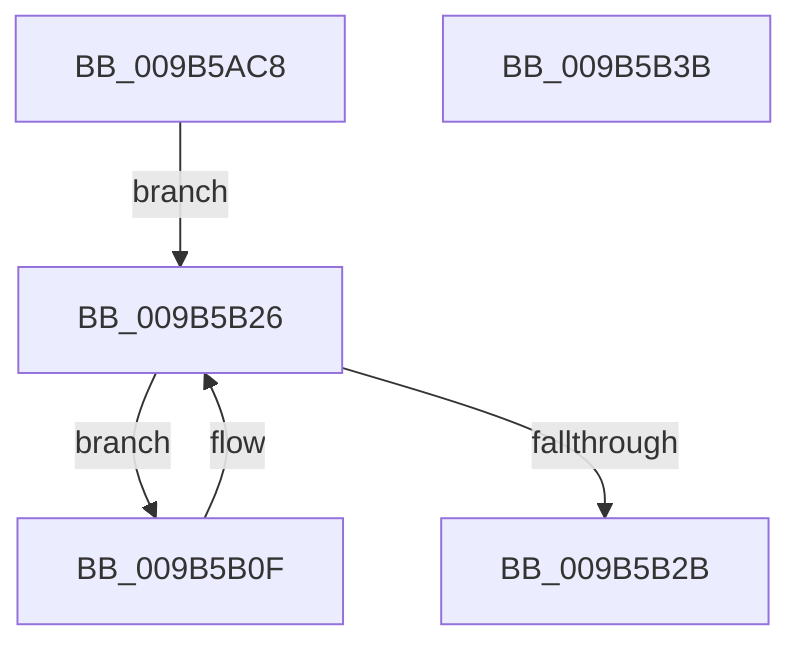

# HvpViewMapMakeViewRangeReadOnly

- RVA: `0x009B5AC8`–`0x009B5B3C` (길이 `116` bytes)
- VA: `0x00000001409B5AC8`
- 실행 섹션: `PAGE`
- PDB 이름 있음: `예`; PDB Function 태그: `아니요`
- unwind 정보 RVA: `0x0009E61C`
- 디코드: `32`개 명령, `116/116` bytes 표시
- 미해석 바이트: `0` (있으면 어셈블리에 `.byte`로 보존)

> 이 문서는 커널 이미지의 기계어와 PDB 기호를 분석해 생성했습니다. 4번과 5번은 함수 원형과 자료형을 바이너리 사용 방식에서 추정한 C 해석이며 원본 소스 복구 결과는 아닙니다.

## 1. Dependencies

- 직접 호출 지점: **1**; 고유 호출 대상: **1**
- 직접 호출자로 확인된 함수: **2**
- RIP 상대 이미지 참조: **0**

### Outgoing calls
- `0x009B5B08` → [CmSiProtectViewOfSection](../../text/47/CmSiProtectViewOfSection_function_004746B8.md) (function, `0x004746B8`)

### Direct callers
- [HvpViewMapMigrateCOWData](../7E/HvpViewMapMigrateCOWData_function_007EEC0C.md) at `0x007EEDE9`
- [HvpViewMapSealRange](HvpViewMapSealRange_function_009B5A58.md) at `0x009B5AA1`

### Static image references
- 디코드된 RIP-relative 메모리 참조가 없습니다.

## 2. Other-region calls and transfers

- 다른 실행 섹션으로 향하는 call: **1**
  - `0x009B5B08` → [CmSiProtectViewOfSection](../../text/47/CmSiProtectViewOfSection_function_004746B8.md) (`PAGE` → `.text`)
- 별도 외부 분기/꼬리 이동을 확인하지 못했습니다.

## 3. Assembly (complete function range)

```asm
009B5AC8  48 8B C4                        mov rax, rsp
009B5ACB  48 89 58 10                     mov qword ptr [rax + 0x10], rbx
009B5ACF  48 89 70 18                     mov qword ptr [rax + 0x18], rsi
009B5AD3  57                              push rdi
009B5AD4  48 83 EC 30                     sub rsp, 0x30
009B5AD8  83 60 08 00                     and dword ptr [rax + 8], 0
009B5ADC  48 8D 40 08                     lea rax, [rax + 8]
009B5AE0  49 8B D8                        mov rbx, r8
009B5AE3  48 89 44 24 28                  mov qword ptr [rsp + 0x28], rax
009B5AE8  49 8B F1                        mov rsi, r9
009B5AEB  C7 44 24 20 02 00 00 00         mov dword ptr [rsp + 0x20], 2
009B5AF3  4D 2B C8                        sub r9, r8
009B5AF6  48 8B FA                        mov rdi, rdx
009B5AF9  4C 8B 42 38                     mov r8, qword ptr [rdx + 0x38]
009B5AFD  4C 2B 42 18                     sub r8, qword ptr [rdx + 0x18]
009B5B01  48 8B 51 18                     mov rdx, qword ptr [rcx + 0x18]
009B5B05  4C 03 C3                        add r8, rbx
009B5B08  E8 AB EB AB FF                  call 0x1404746b8
009B5B0D  EB 17                           jmp 0x1409b5b26
009B5B0F  48 8B C3                        mov rax, rbx
009B5B12  48 2B 47 18                     sub rax, qword ptr [rdi + 0x18]
009B5B16  48 C1 E8 0C                     shr rax, 0xc
009B5B1A  80 64 38 48 F7                  and byte ptr [rax + rdi + 0x48], 0xf7
009B5B1F  48 81 C3 00 10 00 00            add rbx, 0x1000
009B5B26  48 3B DE                        cmp rbx, rsi
009B5B29  7C E4                           jl 0x1409b5b0f
009B5B2B  48 8B 5C 24 48                  mov rbx, qword ptr [rsp + 0x48]
009B5B30  48 8B 74 24 50                  mov rsi, qword ptr [rsp + 0x50]
009B5B35  48 83 C4 30                     add rsp, 0x30
009B5B39  5F                              pop rdi
009B5B3A  C3                              ret
009B5B3B  CC                              int3
```

## 4. C-style interpretation (structured pseudocode)

```c
__int64 __fastcall HvpViewMapMakeViewRangeReadOnly(__int64 a1, __int64 a2, __int64 a3, __int64 a4)
{
    __int64 result;
    __int64 v_rbx;
    __int64 v_rsp;
    unsigned __int64 v_stack_m10;
    unsigned int v_stack_m18;
    unsigned __int64 v_stack_p10;
    unsigned __int64 v_stack_p18;

    *(unsigned __int64 *)(v_rsp + 16) = v_rbx;
    *(unsigned __int64 *)(v_rsp + 24) = v_rsi;
    v_rsp = (v_rsp) - (48);
    v_stack_m10 = v_rsp + 8;
    v_stack_m18 = 2;
    a4 = (a4) - (a3);
    a3 = (*(unsigned __int64 *)(a2 + 56)) - (*(unsigned __int64 *)(a2 + 24));
    a3 = (a3) + (a3);
    result = CmSiProtectViewOfSection(a1, *(unsigned __int64 *)(a1 + 24), a3, a4);
    goto loc_009B5B26;
loc_009B5B0F:
    result = (a3) - (*(unsigned __int64 *)(a2 + 24));
    result = (result) >> (12);
    v_rbx = (a3) + (0x1000ULL);
loc_009B5B26:
    if (v_rbx < a4) goto loc_009B5B0F;
    v_rsp = (v_rsp) + (48);
    return result;
}
```

## 5. (Beta) C Style

```c
int64_t HvpViewMapMakeViewRangeReadOnly(void *Arg1, void *Arg2, int64_t Arg3, int64_t Arg4)
{
    uint8_t *arg1 = (uint8_t *)Arg1;
    uint8_t *arg2 = (uint8_t *)Arg2;

    int64_t result;
    int64_t local_rbx;
    int64_t local_rsp;
    uint64_t v_stack_m10;
    uint32_t v_stack_m18;
    uint64_t v_stack_p10;
    uint64_t v_stack_p18;

    *(uint64_t *)(local_rsp + 0x10) = local_rbx;
    *(uint64_t *)(local_rsp + 0x18) = local_rsi;
    local_rsp = (local_rsp) - (48);
    v_stack_m10 = local_rsp + 8;
    v_stack_m18 = 2;
    Arg4 = (Arg4) - (Arg3);
    Arg3 = (*(uint64_t *)(arg2 + 0x38)) - (*(uint64_t *)(arg2 + 0x18));
    Arg3 = (Arg3) + (Arg3);
    result = CmSiProtectViewOfSection(Arg1, *(uint64_t *)(arg1 + 0x18), Arg3, Arg4);
    goto loc_009B5B26;
loc_009B5B0F:
    result = (Arg3) - (*(uint64_t *)(arg2 + 0x18));
    result = (result) >> (12);
    local_rbx = (Arg3) + (0x1000ULL);
loc_009B5B26:
    if (local_rbx < Arg4) goto loc_009B5B0F;
    local_rsp = (local_rsp) + (48);
    return result;
}
```

### 관측된 메모리 오프셋

구조체 형식이 확인되지 않은 접근은 인자 기준의 오프셋으로만 기록했습니다.

| 기준 인자 | 오프셋 표현 | 폭 (bit) | 접근 |
|---|---:|---:|---|
| `Arg1` | `+ 0x18` | `64` | `R` |
| `Arg2` | `+ 0x18` | `64` | `R` |
| `Arg2` | `+ 0x38` | `64` | `R` |

## 6. Execution-region graph

[열기: 2D/3D 그래프와 함수 탐색 컨트롤 패널](../../../control-panel.html?section=page&rva=0x009B5AC8&view=graph)

- 2D 그래프는 위에서 아래로 흐르고, 3D 그래프는 빈 공간을 드래그해 회전합니다. Shift+드래그는 이동, 휠은 확대·축소, 함수 노드 선택은 대상 보고서 이동입니다.

### Static fallback


