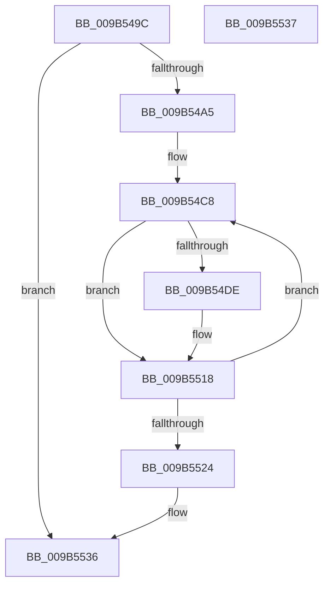

# HvpViewMapMakeViewRangeUnCOWByCaller

- RVA: `0x009B549C`–`0x009B5538` (길이 `156` bytes)
- VA: `0x00000001409B549C`
- 실행 섹션: `PAGE`
- PDB 이름 있음: `예`; PDB Function 태그: `아니요`
- unwind 정보 RVA: `0x0009E5CC`
- 디코드: `46`개 명령, `156/156` bytes 표시
- 미해석 바이트: `0` (있으면 어셈블리에 `.byte`로 보존)

> 이 문서는 커널 이미지의 기계어와 PDB 기호를 분석해 생성했습니다. 4번과 5번은 함수 원형과 자료형을 바이너리 사용 방식에서 추정한 C 해석이며 원본 소스 복구 결과는 아닙니다.

## 1. Dependencies

- 직접 호출 지점: **1**; 고유 호출 대상: **1**
- 직접 호출자로 확인된 함수: **1**
- RIP 상대 이미지 참조: **0**

### Outgoing calls
- `0x009B550E` → [CmSiProtectViewOfSection](../../text/47/CmSiProtectViewOfSection_function_004746B8.md) (function, `0x004746B8`)

### Direct callers
- [HvpViewMapUnCOWAndSealRange](HvpViewMapUnCOWAndSealRange_function_009B542C.md) at `0x009B5475`

### Static image references
- 디코드된 RIP-relative 메모리 참조가 없습니다.

## 2. Other-region calls and transfers

- 다른 실행 섹션으로 향하는 call: **1**
  - `0x009B550E` → [CmSiProtectViewOfSection](../../text/47/CmSiProtectViewOfSection_function_004746B8.md) (`PAGE` → `.text`)
- 별도 외부 분기/꼬리 이동을 확인하지 못했습니다.

## 3. Assembly (complete function range)

```asm
009B549C  4D 3B C1                        cmp r8, r9
009B549F  0F 8D 91 00 00 00               jge 0x1409b5536
009B54A5  48 89 5C 24 08                  mov qword ptr [rsp + 8], rbx
009B54AA  48 89 6C 24 10                  mov qword ptr [rsp + 0x10], rbp
009B54AF  56                              push rsi
009B54B0  57                              push rdi
009B54B1  41 56                           push r14
009B54B3  48 83 EC 30                     sub rsp, 0x30
009B54B7  83 64 24 60 00                  and dword ptr [rsp + 0x60], 0
009B54BC  49 8B E9                        mov rbp, r9
009B54BF  49 8B D8                        mov rbx, r8
009B54C2  48 8B F2                        mov rsi, rdx
009B54C5  4C 8B F1                        mov r14, rcx
009B54C8  48 8B 56 18                     mov rdx, qword ptr [rsi + 0x18]
009B54CC  48 8B FB                        mov rdi, rbx
009B54CF  48 2B FA                        sub rdi, rdx
009B54D2  48 C1 EF 0C                     shr rdi, 0xc
009B54D6  8A 44 37 48                     mov al, byte ptr [rdi + rsi + 0x48]
009B54DA  A8 02                           test al, 2
009B54DC  74 3A                           je 0x1409b5518
009B54DE  4C 8B 46 38                     mov r8, qword ptr [rsi + 0x38]
009B54E2  48 8D 4C 24 60                  lea rcx, [rsp + 0x60]
009B54E7  F6 D0                           not al
009B54E9  48 89 4C 24 28                  mov qword ptr [rsp + 0x28], rcx
009B54EE  0F B6 C0                        movzx eax, al
009B54F1  4C 2B C2                        sub r8, rdx
009B54F4  49 8B 56 18                     mov rdx, qword ptr [r14 + 0x18]
009B54F8  83 E0 FC                        and eax, 0xfffffffc
009B54FB  C1 E0 1D                        shl eax, 0x1d
009B54FE  4C 03 C3                        add r8, rbx
009B5501  83 C8 02                        or eax, 2
009B5504  41 B9 00 10 00 00               mov r9d, 0x1000
009B550A  89 44 24 20                     mov dword ptr [rsp + 0x20], eax
009B550E  E8 A5 F1 AB FF                  call 0x1404746b8
009B5513  80 64 37 48 F5                  and byte ptr [rdi + rsi + 0x48], 0xf5
009B5518  48 81 C3 00 10 00 00            add rbx, 0x1000
009B551F  48 3B DD                        cmp rbx, rbp
009B5522  7C A4                           jl 0x1409b54c8
009B5524  48 8B 5C 24 50                  mov rbx, qword ptr [rsp + 0x50]
009B5529  48 8B 6C 24 58                  mov rbp, qword ptr [rsp + 0x58]
009B552E  48 83 C4 30                     add rsp, 0x30
009B5532  41 5E                           pop r14
009B5534  5F                              pop rdi
009B5535  5E                              pop rsi
009B5536  C3                              ret
009B5537  CC                              int3
```

## 4. C-style interpretation (structured pseudocode)

```c
__int64 __fastcall HvpViewMapMakeViewRangeUnCOWByCaller(__int64 a1, __int64 a2, __int64 a3, __int64 a4)
{
    __int64 result;
    __int64 v_rbx;
    __int64 v_rdi;
    __int64 v_rsp;
    unsigned __int64 v_stack_m20;
    unsigned int v_stack_m28;
    unsigned __int64 v_stack_p10;
    unsigned int v_stack_p18;
    unsigned __int64 v_stack_p8;

    if (a3 >= a4) goto loc_009B5536;
    v_stack_p8 = v_rbx;
    v_stack_p10 = v_rbp;
    v_rsp = (v_rsp) - (48);
loc_009B54C8:
    v_rdi = (a3) - (*(unsigned __int64 *)(a2 + 24));
    v_rdi = (v_rdi) >> (12);
    result = *(unsigned __int8 *)(v_rdi + a2 * 1 + 72);
    if ((((unsigned __int8)(*(unsigned __int8 *)(v_rdi + a2 * 1 + 72))) & (2)) != 0) {
        a3 = *(unsigned __int64 *)(a2 + 56);
        a1 = v_stack_p18;
        result = (unsigned __int8)(~(*(unsigned __int8 *)(v_rdi + a2 * 1 + 72)));
        v_stack_m20 = a1;
        result = (unsigned __int8)(result);
        a3 = (a3) - (*(unsigned __int64 *)(a2 + 24));
        a2 = *(unsigned __int64 *)(a1 + 24);
        result = (unsigned int)((result) & (0xFFFFFFFCULL));
        result = (unsigned int)((result) << (29));
        a3 = (a3) + (a3);
        result = (unsigned int)((result) | (2));
        a4 = 0x1000ULL;
        v_stack_m28 = (unsigned int)(result);
        result = CmSiProtectViewOfSection(a1, a2, a3, a4);
    }
    v_rbx = (a3) + (0x1000ULL);
    if (v_rbx < a4) goto loc_009B54C8;
    v_rsp = (v_rsp) + (48);
loc_009B5536:
    return result;
}
```

## 5. (Beta) C Style

```c
int64_t HvpViewMapMakeViewRangeUnCOWByCaller(void *Arg1, void *Arg2, int64_t Arg3, int64_t Arg4)
{
    uint8_t *arg1 = (uint8_t *)Arg1;
    uint8_t *arg2 = (uint8_t *)Arg2;

    int64_t result;
    int64_t local_rbx;
    int64_t local_rdi;
    int64_t local_rsp;
    uint64_t v_stack_m20;
    uint32_t v_stack_m28;
    uint64_t v_stack_p10;
    uint32_t v_stack_p18;
    uint64_t v_stack_p8;

    if (Arg3 >= Arg4) goto loc_009B5536;
    v_stack_p8 = local_rbx;
    v_stack_p10 = local_rbp;
    local_rsp = (local_rsp) - (48);
loc_009B54C8:
    local_rdi = (Arg3) - (*(uint64_t *)(arg2 + 0x18));
    local_rdi = (local_rdi) >> (12);
    result = *(uint8_t *)(local_rdi + arg2 * 1 + 0x48);
    if ((((uint8_t)(*(uint8_t *)(local_rdi + arg2 * 1 + 0x48))) & (2)) != 0) {
        Arg3 = *(uint64_t *)(arg2 + 0x38);
        Arg1 = v_stack_p18;
        result = (uint8_t)(~(*(uint8_t *)(local_rdi + arg2 * 1 + 0x48)));
        v_stack_m20 = Arg1;
        result = (uint8_t)(result);
        Arg3 = (Arg3) - (*(uint64_t *)(arg2 + 0x18));
        Arg2 = *(uint64_t *)(arg1 + 0x18);
        result = (uint32_t)((result) & (0xFFFFFFFCULL));
        result = (uint32_t)((result) << (29));
        Arg3 = (Arg3) + (Arg3);
        result = (uint32_t)((result) | (2));
        Arg4 = 0x1000ULL;
        v_stack_m28 = (uint32_t)(result);
        result = CmSiProtectViewOfSection(Arg1, Arg2, Arg3, Arg4);
    }
    local_rbx = (Arg3) + (0x1000ULL);
    if (local_rbx < Arg4) goto loc_009B54C8;
    local_rsp = (local_rsp) + (48);
loc_009B5536:
    return result;
}
```

### 관측된 메모리 오프셋

구조체 형식이 확인되지 않은 접근은 인자 기준의 오프셋으로만 기록했습니다.

| 기준 인자 | 오프셋 표현 | 폭 (bit) | 접근 |
|---|---:|---:|---|
| `Arg1` | `+ 0x18` | `64` | `R` |
| `Arg2` | `+ 0x18` | `64` | `R` |
| `Arg2` | `+ 0x38` | `64` | `R` |

## 6. Execution-region graph

[열기: 2D/3D 그래프와 함수 탐색 컨트롤 패널](../../../control-panel.html?section=page&rva=0x009B549C&view=graph)

- 2D 그래프는 위에서 아래로 흐르고, 3D 그래프는 빈 공간을 드래그해 회전합니다. Shift+드래그는 이동, 휠은 확대·축소, 함수 노드 선택은 대상 보고서 이동입니다.

### Static fallback


