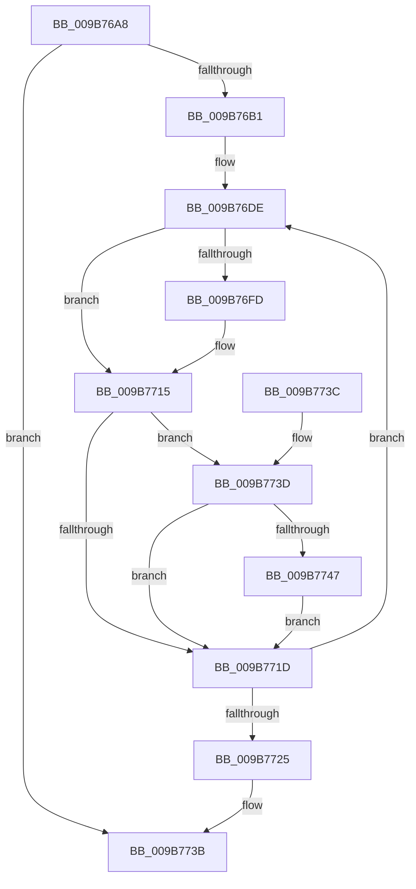

# HvpViewMapMakeViewRangeUnCOWByPolicy

- RVA: `0x009B76A8`–`0x009B776A` (길이 `194` bytes)
- VA: `0x00000001409B76A8`
- 실행 섹션: `PAGE`
- PDB 이름 있음: `예`; PDB Function 태그: `아니요`
- unwind 정보 RVA: `0x0009E880`
- 디코드: `59`개 명령, `194/194` bytes 표시
- 미해석 바이트: `0` (있으면 어셈블리에 `.byte`로 보존)

> 이 문서는 커널 이미지의 기계어와 PDB 기호를 분석해 생성했습니다. 4번과 5번은 함수 원형과 자료형을 바이너리 사용 방식에서 추정한 C 해석이며 원본 소스 복구 결과는 아닙니다.

## 1. Dependencies

- 직접 호출 지점: **2**; 고유 호출 대상: **2**
- 직접 호출자로 확인된 함수: **1**
- RIP 상대 이미지 참조: **0**

### Outgoing calls
- `0x009B7707` → [HvpViewMapReleaseChargesAndUnlockViewPages](HvpViewMapReleaseChargesAndUnlockViewPages_function_009B7870.md) (function, `0x009B7870`)
- `0x009B7763` → [CmSiProtectViewOfSection](../../text/47/CmSiProtectViewOfSection_function_004746B8.md) (function, `0x004746B8`)

### Direct callers
- [HvpViewMapAdjustFlag](../AC/HvpViewMapAdjustFlag_function_00ACDDA4.md) at `0x00ACDE0C`

### Static image references
- 디코드된 RIP-relative 메모리 참조가 없습니다.

## 2. Other-region calls and transfers

- 다른 실행 섹션으로 향하는 call: **1**
  - `0x009B7763` → [CmSiProtectViewOfSection](../../text/47/CmSiProtectViewOfSection_function_004746B8.md) (`PAGE` → `.text`)
- 별도 외부 분기/꼬리 이동을 확인하지 못했습니다.

## 3. Assembly (complete function range)

```asm
009B76A8  4D 3B C1                        cmp r8, r9
009B76AB  0F 8D 8A 00 00 00               jge 0x1409b773b
009B76B1  48 89 5C 24 08                  mov qword ptr [rsp + 8], rbx
009B76B6  48 89 6C 24 10                  mov qword ptr [rsp + 0x10], rbp
009B76BB  56                              push rsi
009B76BC  57                              push rdi
009B76BD  41 54                           push r12
009B76BF  41 56                           push r14
009B76C1  41 57                           push r15
009B76C3  48 83 EC 30                     sub rsp, 0x30
009B76C7  83 64 24 70 00                  and dword ptr [rsp + 0x70], 0
009B76CC  4D 8B F1                        mov r14, r9
009B76CF  49 8B D8                        mov rbx, r8
009B76D2  48 8B FA                        mov rdi, rdx
009B76D5  4C 8B F9                        mov r15, rcx
009B76D8  41 BC 00 10 00 00               mov r12d, 0x1000
009B76DE  48 8B 47 18                     mov rax, qword ptr [rdi + 0x18]
009B76E2  48 8B F3                        mov rsi, rbx
009B76E5  48 2B F0                        sub rsi, rax
009B76E8  48 8B EB                        mov rbp, rbx
009B76EB  48 2B E8                        sub rbp, rax
009B76EE  48 C1 EE 0C                     shr rsi, 0xc
009B76F2  48 03 6F 38                     add rbp, qword ptr [rdi + 0x38]
009B76F6  F6 44 3E 48 10                  test byte ptr [rsi + rdi + 0x48], 0x10
009B76FB  74 18                           je 0x1409b7715
009B76FD  49 8B 57 18                     mov rdx, qword ptr [r15 + 0x18]
009B7701  4D 8B CC                        mov r9, r12
009B7704  4C 8B C5                        mov r8, rbp
009B7707  E8 64 01 00 00                  call 0x1409b7870
009B770C  80 64 3E 48 EF                  and byte ptr [rsi + rdi + 0x48], 0xef
009B7711  48 FF 4F 40                     dec qword ptr [rdi + 0x40]
009B7715  8A 44 3E 48                     mov al, byte ptr [rsi + rdi + 0x48]
009B7719  A8 04                           test al, 4
009B771B  75 20                           jne 0x1409b773d
009B771D  49 03 DC                        add rbx, r12
009B7720  49 3B DE                        cmp rbx, r14
009B7723  7C B9                           jl 0x1409b76de
009B7725  48 8B 5C 24 60                  mov rbx, qword ptr [rsp + 0x60]
009B772A  48 8B 6C 24 68                  mov rbp, qword ptr [rsp + 0x68]
009B772F  48 83 C4 30                     add rsp, 0x30
009B7733  41 5F                           pop r15
009B7735  41 5E                           pop r14
009B7737  41 5C                           pop r12
009B7739  5F                              pop rdi
009B773A  5E                              pop rsi
009B773B  C3                              ret
009B773C  CC                              int3
009B773D  24 FB                           and al, 0xfb
009B773F  88 44 3E 48                     mov byte ptr [rsi + rdi + 0x48], al
009B7743  A8 02                           test al, 2
009B7745  75 D6                           jne 0x1409b771d
009B7747  49 8B 57 18                     mov rdx, qword ptr [r15 + 0x18]
009B774B  48 8D 44 24 70                  lea rax, [rsp + 0x70]
009B7750  48 89 44 24 28                  mov qword ptr [rsp + 0x28], rax
009B7755  4D 8B CC                        mov r9, r12
009B7758  4C 8B C5                        mov r8, rbp
009B775B  C7 44 24 20 02 00 00 80         mov dword ptr [rsp + 0x20], 0x80000002
009B7763  E8 50 CF AB FF                  call 0x1404746b8
009B7768  EB B3                           jmp 0x1409b771d
```

## 4. C-style interpretation (structured pseudocode)

```c
__int64 __fastcall HvpViewMapMakeViewRangeUnCOWByPolicy(__int64 a1, __int64 a2, __int64 a3, __int64 a4)
{
    __int64 result;
    __int64 v_rbp;
    __int64 v_rbx;
    __int64 v_rsi;
    __int64 v_rsp;
    unsigned __int64 v_stack_p10;
    unsigned int v_stack_p18;
    unsigned int v_stack_p20;
    unsigned __int64 v_stack_p28;
    unsigned __int64 v_stack_p70;
    unsigned __int64 v_stack_p8;

    if (a3 >= a4) goto loc_009B773B;
    v_stack_p8 = v_rbx;
    v_stack_p10 = v_rbp;
    v_rsp = (v_rsp) - (48);
loc_009B76DE:
    v_rsi = (a3) - (*(unsigned __int64 *)(a2 + 24));
    v_rbp = (a3) - (*(unsigned __int64 *)(a2 + 24));
    v_rsi = (v_rsi) >> (12);
    v_rbp = (v_rbp) + (*(unsigned __int64 *)(a2 + 56));
    result = *(unsigned __int64 *)(a2 + 24);
    if (((*(unsigned __int8 *)(v_rsi + a2 * 1 + 72)) & (16)) != 0) {
        a2 = *(unsigned __int64 *)(a1 + 24);
        a4 = (unsigned int)(0x1000ULL);
        a3 = v_rbp;
        result = HvpViewMapReleaseChargesAndUnlockViewPages(a1, a2, a3, a4);
    }
    if ((((unsigned __int8)(*(unsigned __int8 *)(v_rsi + a2 * 1 + 72))) & (4)) != 0) goto loc_009B773D;
loc_009B771D:
    v_rbx = (a3) + ((unsigned int)(0x1000ULL));
    if (v_rbx < a4) goto loc_009B76DE;
    v_rsp = (v_rsp) + (48);
loc_009B773B:
    return *(unsigned __int8 *)(v_rsi + a2 * 1 + 72);
loc_009B773D:
    result = (unsigned __int8)((*(unsigned __int8 *)(v_rsi + a2 * 1 + 72)) & (251));
    *(unsigned __int8 *)(v_rsi + a2 * 1 + 72) = (unsigned __int8)(result);
    if ((((unsigned __int8)(result)) & (2)) != 0) goto loc_009B771D;
    v_stack_p28 = v_stack_p70;
    v_stack_p20 = 0x80000002ULL;
    result = CmSiProtectViewOfSection(a1, *(unsigned __int64 *)(a1 + 24), v_stack_p10, (unsigned int)(0x1000ULL));
    goto loc_009B771D;
}
```

## 5. (Beta) C Style

```c
int64_t HvpViewMapMakeViewRangeUnCOWByPolicy(void *Arg1, void *Arg2, int64_t Arg3, int64_t Arg4)
{
    uint8_t *arg1 = (uint8_t *)Arg1;
    uint8_t *arg2 = (uint8_t *)Arg2;

    int64_t result;
    int64_t local_rbp;
    int64_t local_rbx;
    int64_t local_rsi;
    int64_t local_rsp;
    uint64_t v_stack_p10;
    uint32_t v_stack_p18;
    uint32_t v_stack_p20;
    uint64_t v_stack_p28;
    uint64_t v_stack_p70;
    uint64_t v_stack_p8;

    if (Arg3 >= Arg4) goto loc_009B773B;
    v_stack_p8 = local_rbx;
    v_stack_p10 = local_rbp;
    local_rsp = (local_rsp) - (48);
loc_009B76DE:
    local_rsi = (Arg3) - (*(uint64_t *)(arg2 + 0x18));
    local_rbp = (Arg3) - (*(uint64_t *)(arg2 + 0x18));
    local_rsi = (local_rsi) >> (12);
    local_rbp = (local_rbp) + (*(uint64_t *)(arg2 + 0x38));
    result = *(uint64_t *)(arg2 + 0x18);
    if (((*(uint8_t *)(local_rsi + arg2 * 1 + 0x48)) & (16)) != 0) {
        Arg2 = *(uint64_t *)(arg1 + 0x18);
        Arg4 = (uint32_t)(0x1000ULL);
        Arg3 = local_rbp;
        result = HvpViewMapReleaseChargesAndUnlockViewPages(Arg1, Arg2, Arg3, Arg4);
    }
    if ((((uint8_t)(*(uint8_t *)(local_rsi + arg2 * 1 + 0x48))) & (4)) != 0) goto loc_009B773D;
loc_009B771D:
    local_rbx = (Arg3) + ((uint32_t)(0x1000ULL));
    if (local_rbx < Arg4) goto loc_009B76DE;
    local_rsp = (local_rsp) + (48);
loc_009B773B:
    return *(uint8_t *)(local_rsi + arg2 * 1 + 0x48);
loc_009B773D:
    result = (uint8_t)((*(uint8_t *)(local_rsi + arg2 * 1 + 0x48)) & (251));
    *(uint8_t *)(local_rsi + arg2 * 1 + 0x48) = (uint8_t)(result);
    if ((((uint8_t)(result)) & (2)) != 0) goto loc_009B771D;
    v_stack_p28 = v_stack_p70;
    v_stack_p20 = 0x80000002ULL;
    result = CmSiProtectViewOfSection(Arg1, *(uint64_t *)(arg1 + 0x18), v_stack_p10, (uint32_t)(0x1000ULL));
    goto loc_009B771D;
}
```

### 관측된 메모리 오프셋

구조체 형식이 확인되지 않은 접근은 인자 기준의 오프셋으로만 기록했습니다.

| 기준 인자 | 오프셋 표현 | 폭 (bit) | 접근 |
|---|---:|---:|---|
| `Arg1` | `+ 0x18` | `64` | `R` |
| `Arg2` | `+ 0x18` | `64` | `R` |
| `Arg2` | `+ 0x38` | `64` | `R` |
| `Arg2` | `+ 0x40` | `64` | `R/W` |

## 6. Execution-region graph

[열기: 2D/3D 그래프와 함수 탐색 컨트롤 패널](../../../control-panel.html?section=page&rva=0x009B76A8&view=graph)

- 2D 그래프는 위에서 아래로 흐르고, 3D 그래프는 빈 공간을 드래그해 회전합니다. Shift+드래그는 이동, 휠은 확대·축소, 함수 노드 선택은 대상 보고서 이동입니다.

### Static fallback


