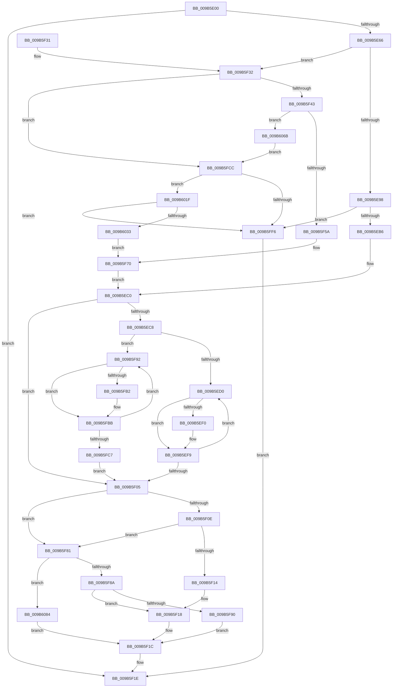

# HvpViewMapMakeViewRangeValid

- RVA: `0x009B5E00`–`0x009B608D` (길이 `653` bytes)
- VA: `0x00000001409B5E00`
- 실행 섹션: `PAGE`
- PDB 이름 있음: `예`; PDB Function 태그: `아니요`
- unwind 정보 RVA: `0x0009E68C`
- 디코드: `173`개 명령, `653/653` bytes 표시
- 미해석 바이트: `0` (있으면 어셈블리에 `.byte`로 보존)

> 이 문서는 커널 이미지의 기계어와 PDB 기호를 분석해 생성했습니다. 4번과 5번은 함수 원형과 자료형을 바이너리 사용 방식에서 추정한 C 해석이며 원본 소스 복구 결과는 아닙니다.

## 1. Dependencies

- 직접 호출 지점: **8**; 고유 호출 대상: **4**
- 직접 호출자로 확인된 함수: **3**
- RIP 상대 이미지 참조: **0**

### Outgoing calls
- `0x009B5E57` → [CmSiProtectViewOfSection](../../text/47/CmSiProtectViewOfSection_function_004746B8.md) (function, `0x004746B8`)
- `0x009B5E70` → [CmSiPrefetchVirtualMemoryRange](../../text/49/CmSiPrefetchVirtualMemoryRange_function_00494BEC.md) (function, `0x00494BEC`)
- `0x009B5EA1` → [HvpViewMapTouchPages](HvpViewMapTouchPages_function_009B5D30.md) (function, `0x009B5D30`)
- `0x009B5F4D` → [HvpViewMapAcquireChargesAndLockViewPages](HvpViewMapAcquireChargesAndLockViewPages_function_009B6480.md) (function, `0x009B6480`)
- `0x009B5FEB` → [CmSiProtectViewOfSection](../../text/47/CmSiProtectViewOfSection_function_004746B8.md) (function, `0x004746B8`)
- `0x009B6015` → [CmSiProtectViewOfSection](../../text/47/CmSiProtectViewOfSection_function_004746B8.md) (function, `0x004746B8`)
- `0x009B6028` → [HvpViewMapTouchPages](HvpViewMapTouchPages_function_009B5D30.md) (function, `0x009B5D30`)
- `0x009B6052` → [CmSiProtectViewOfSection](../../text/47/CmSiProtectViewOfSection_function_004746B8.md) (function, `0x004746B8`)

### Direct callers
- [HvpViewMapExtendStorage](HvpViewMapExtendStorage_function_009B4EF8.md) at `0x009B4F5B`
- [HvpViewMapCreateViewsForRegion](HvpViewMapCreateViewsForRegion_function_009B6094.md) at `0x009B6147`
- [HvpViewMapPromoteRangeToMapping](HvpViewMapPromoteRangeToMapping_function_009B94C8.md) at `0x009B958E`

### Static image references
- 디코드된 RIP-relative 메모리 참조가 없습니다.

## 2. Other-region calls and transfers

- 다른 실행 섹션으로 향하는 call: **5**
  - `0x009B5E57` → [CmSiProtectViewOfSection](../../text/47/CmSiProtectViewOfSection_function_004746B8.md) (`PAGE` → `.text`)
  - `0x009B5E70` → [CmSiPrefetchVirtualMemoryRange](../../text/49/CmSiPrefetchVirtualMemoryRange_function_00494BEC.md) (`PAGE` → `.text`)
  - `0x009B5FEB` → [CmSiProtectViewOfSection](../../text/47/CmSiProtectViewOfSection_function_004746B8.md) (`PAGE` → `.text`)
  - `0x009B6015` → [CmSiProtectViewOfSection](../../text/47/CmSiProtectViewOfSection_function_004746B8.md) (`PAGE` → `.text`)
  - `0x009B6052` → [CmSiProtectViewOfSection](../../text/47/CmSiProtectViewOfSection_function_004746B8.md) (`PAGE` → `.text`)
- 별도 외부 분기/꼬리 이동을 확인하지 못했습니다.

## 3. Assembly (complete function range)

```asm
009B5E00  48 8B C4                        mov rax, rsp
009B5E03  48 89 48 08                     mov qword ptr [rax + 8], rcx
009B5E07  53                              push rbx
009B5E08  55                              push rbp
009B5E09  56                              push rsi
009B5E0A  57                              push rdi
009B5E0B  41 54                           push r12
009B5E0D  41 55                           push r13
009B5E0F  41 56                           push r14
009B5E11  41 57                           push r15
009B5E13  48 83 EC 38                     sub rsp, 0x38
009B5E17  48 8B 6A 38                     mov rbp, qword ptr [rdx + 0x38]
009B5E1B  4C 8D 69 18                     lea r13, [rcx + 0x18]
009B5E1F  48 2B 6A 18                     sub rbp, qword ptr [rdx + 0x18]
009B5E23  49 8B F9                        mov rdi, r9
009B5E26  83 60 18 00                     and dword ptr [rax + 0x18], 0
009B5E2A  48 8D 40 18                     lea rax, [rax + 0x18]
009B5E2E  49 2B F8                        sub rdi, r8
009B5E31  48 89 44 24 28                  mov qword ptr [rsp + 0x28], rax
009B5E36  49 03 E8                        add rbp, r8
009B5E39  C7 44 24 20 02 00 00 00         mov dword ptr [rsp + 0x20], 2
009B5E41  4D 8B F1                        mov r14, r9
009B5E44  4D 8B F8                        mov r15, r8
009B5E47  48 8B DA                        mov rbx, rdx
009B5E4A  4C 8B C5                        mov r8, rbp
009B5E4D  49 8B 55 00                     mov rdx, qword ptr [r13]
009B5E51  4C 8B CF                        mov r9, rdi
009B5E54  4C 8B E1                        mov r12, rcx
009B5E57  E8 5C E8 AB FF                  call 0x1404746b8
009B5E5C  8B F0                           mov esi, eax
009B5E5E  85 C0                           test eax, eax
009B5E60  0F 88 B8 00 00 00               js 0x1409b5f1e
009B5E66  49 8B 4D 00                     mov rcx, qword ptr [r13]
009B5E6A  4C 8B C7                        mov r8, rdi
009B5E6D  48 8B D5                        mov rdx, rbp
009B5E70  E8 77 ED AD FF                  call 0x140494bec
009B5E75  49 83 C4 20                     add r12, 0x20
009B5E79  40 32 F6                        xor sil, sil
009B5E7C  40 88 B4 24 88 00 00 00         mov byte ptr [rsp + 0x88], sil
009B5E84  4C 89 A4 24 98 00 00 00         mov qword ptr [rsp + 0x98], r12
009B5E8C  41 8B 04 24                     mov eax, dword ptr [r12]
009B5E90  A8 02                           test al, 2
009B5E92  0F 85 9A 00 00 00               jne 0x1409b5f32
009B5E98  45 33 C0                        xor r8d, r8d
009B5E9B  48 8B D7                        mov rdx, rdi
009B5E9E  48 8B CD                        mov rcx, rbp
009B5EA1  E8 8A FE FF FF                  call 0x1409b5d30
009B5EA6  4D 8B D4                        mov r10, r12
009B5EA9  4D 8B E5                        mov r12, r13
009B5EAC  8B F0                           mov esi, eax
009B5EAE  85 C0                           test eax, eax
009B5EB0  0F 88 40 01 00 00               js 0x1409b5ff6
009B5EB6  8A 84 24 88 00 00 00            mov al, byte ptr [rsp + 0x88]
009B5EBD  4D 8B CA                        mov r9, r10
009B5EC0  49 8B CF                        mov rcx, r15
009B5EC3  4D 3B FE                        cmp r15, r14
009B5EC6  7D 3D                           jge 0x1409b5f05
009B5EC8  84 C0                           test al, al
009B5ECA  0F 84 C2 00 00 00               je 0x1409b5f92
009B5ED0  48 8B D1                        mov rdx, rcx
009B5ED3  48 2B 53 18                     sub rdx, qword ptr [rbx + 0x18]
009B5ED7  48 C1 EA 0C                     shr rdx, 0xc
009B5EDB  44 8A 44 1A 48                  mov r8b, byte ptr [rdx + rbx + 0x48]
009B5EE0  41 8A C0                        mov al, r8b
009B5EE3  0C 01                           or al, 1
009B5EE5  88 44 1A 48                     mov byte ptr [rdx + rbx + 0x48], al
009B5EE9  41 8B 01                        mov eax, dword ptr [r9]
009B5EEC  A8 02                           test al, 2
009B5EEE  74 09                           je 0x1409b5ef9
009B5EF0  41 80 C8 11                     or r8b, 0x11
009B5EF4  44 88 44 1A 48                  mov byte ptr [rdx + rbx + 0x48], r8b
009B5EF9  48 81 C1 00 10 00 00            add rcx, 0x1000
009B5F00  49 3B CE                        cmp rcx, r14
009B5F03  7C CB                           jl 0x1409b5ed0
009B5F05  48 8B 43 28                     mov rax, qword ptr [rbx + 0x28]
009B5F09  48 85 C0                        test rax, rax
009B5F0C  75 73                           jne 0x1409b5f81
009B5F0E  48 39 43 30                     cmp qword ptr [rbx + 0x30], rax
009B5F12  75 6D                           jne 0x1409b5f81
009B5F14  4C 89 7B 28                     mov qword ptr [rbx + 0x28], r15
009B5F18  4C 89 73 30                     mov qword ptr [rbx + 0x30], r14
009B5F1C  33 F6                           xor esi, esi
009B5F1E  8B C6                           mov eax, esi
009B5F20  48 83 C4 38                     add rsp, 0x38
009B5F24  41 5F                           pop r15
009B5F26  41 5E                           pop r14
009B5F28  41 5D                           pop r13
009B5F2A  41 5C                           pop r12
009B5F2C  5F                              pop rdi
009B5F2D  5E                              pop rsi
009B5F2E  5D                              pop rbp
009B5F2F  5B                              pop rbx
009B5F30  C3                              ret
009B5F31  CC                              int3
009B5F32  4D 8B E5                        mov r12, r13
009B5F35  40 38 B4 24 A0 00 00 00         cmp byte ptr [rsp + 0xa0], sil
009B5F3D  0F 84 89 00 00 00               je 0x1409b5fcc
009B5F43  49 8B 55 00                     mov rdx, qword ptr [r13]
009B5F47  4C 8B CF                        mov r9, rdi
009B5F4A  4C 8B C5                        mov r8, rbp
009B5F4D  E8 2E 05 00 00                  call 0x1409b6480
009B5F52  85 C0                           test eax, eax
009B5F54  0F 88 11 01 00 00               js 0x1409b606b
009B5F5A  4C 8B 8C 24 98 00 00 00         mov r9, qword ptr [rsp + 0x98]
009B5F62  B0 01                           mov al, 1
009B5F64  48 C1 EF 0C                     shr rdi, 0xc
009B5F68  48 01 7B 40                     add qword ptr [rbx + 0x40], rdi
009B5F6C  41 83 09 04                     or dword ptr [r9], 4
009B5F70  4C 8B 94 24 80 00 00 00         mov r10, qword ptr [rsp + 0x80]
009B5F78  49 83 C2 20                     add r10, 0x20
009B5F7C  E9 3F FF FF FF                  jmp 0x1409b5ec0
009B5F81  49 3B C6                        cmp rax, r14
009B5F84  0F 84 FA 00 00 00               je 0x1409b6084
009B5F8A  4C 39 7B 30                     cmp qword ptr [rbx + 0x30], r15
009B5F8E  74 88                           je 0x1409b5f18
009B5F90  EB 8A                           jmp 0x1409b5f1c
009B5F92  48 8B D1                        mov rdx, rcx
009B5F95  48 2B 53 18                     sub rdx, qword ptr [rbx + 0x18]
009B5F99  48 C1 EA 0C                     shr rdx, 0xc
009B5F9D  44 8A 44 1A 48                  mov r8b, byte ptr [rdx + rbx + 0x48]
009B5FA2  41 8A C0                        mov al, r8b
009B5FA5  0C 01                           or al, 1
009B5FA7  88 44 1A 48                     mov byte ptr [rdx + rbx + 0x48], al
009B5FAB  41 8B 02                        mov eax, dword ptr [r10]
009B5FAE  A8 02                           test al, 2
009B5FB0  74 09                           je 0x1409b5fbb
009B5FB2  41 80 C8 05                     or r8b, 5
009B5FB6  44 88 44 1A 48                  mov byte ptr [rdx + rbx + 0x48], r8b
009B5FBB  48 81 C1 00 10 00 00            add rcx, 0x1000
009B5FC2  49 3B CE                        cmp rcx, r14
009B5FC5  7C CB                           jl 0x1409b5f92
009B5FC7  E9 39 FF FF FF                  jmp 0x1409b5f05
009B5FCC  49 8B 55 00                     mov rdx, qword ptr [r13]
009B5FD0  48 8D 84 24 90 00 00 00         lea rax, [rsp + 0x90]
009B5FD8  48 89 44 24 28                  mov qword ptr [rsp + 0x28], rax
009B5FDD  4C 8B CF                        mov r9, rdi
009B5FE0  4C 8B C5                        mov r8, rbp
009B5FE3  C7 44 24 20 08 00 00 00         mov dword ptr [rsp + 0x20], 8
009B5FEB  E8 C8 E6 AB FF                  call 0x1404746b8
009B5FF0  8B F0                           mov esi, eax
009B5FF2  85 C0                           test eax, eax
009B5FF4  79 29                           jns 0x1409b601f
009B5FF6  49 8B 14 24                     mov rdx, qword ptr [r12]
009B5FFA  48 8D 84 24 90 00 00 00         lea rax, [rsp + 0x90]
009B6002  48 89 44 24 28                  mov qword ptr [rsp + 0x28], rax
009B6007  4C 8B CF                        mov r9, rdi
009B600A  4C 8B C5                        mov r8, rbp
009B600D  C7 44 24 20 01 00 00 80         mov dword ptr [rsp + 0x20], 0x80000001
009B6015  E8 9E E6 AB FF                  call 0x1404746b8
009B601A  E9 FF FE FF FF                  jmp 0x1409b5f1e
009B601F  41 B0 01                        mov r8b, 1
009B6022  48 8B D7                        mov rdx, rdi
009B6025  48 8B CD                        mov rcx, rbp
009B6028  E8 03 FD FF FF                  call 0x1409b5d30
009B602D  8B F0                           mov esi, eax
009B602F  85 C0                           test eax, eax
009B6031  78 C3                           js 0x1409b5ff6
009B6033  49 8B 55 00                     mov rdx, qword ptr [r13]
009B6037  48 8D 84 24 90 00 00 00         lea rax, [rsp + 0x90]
009B603F  48 89 44 24 28                  mov qword ptr [rsp + 0x28], rax
009B6044  4C 8B CF                        mov r9, rdi
009B6047  4C 8B C5                        mov r8, rbp
009B604A  C7 44 24 20 02 00 00 00         mov dword ptr [rsp + 0x20], 2
009B6052  E8 61 E6 AB FF                  call 0x1404746b8
009B6057  8A 84 24 88 00 00 00            mov al, byte ptr [rsp + 0x88]
009B605E  4C 8B 8C 24 98 00 00 00         mov r9, qword ptr [rsp + 0x98]
009B6066  E9 05 FF FF FF                  jmp 0x1409b5f70
009B606B  4C 8B A4 24 80 00 00 00         mov r12, qword ptr [rsp + 0x80]
009B6073  49 83 C4 18                     add r12, 0x18
009B6077  40 88 B4 24 88 00 00 00         mov byte ptr [rsp + 0x88], sil
009B607F  E9 48 FF FF FF                  jmp 0x1409b5fcc
009B6084  4C 89 7B 28                     mov qword ptr [rbx + 0x28], r15
009B6088  E9 8F FE FF FF                  jmp 0x1409b5f1c
```

## 4. C-style interpretation (structured pseudocode)

```c
__int64 __fastcall HvpViewMapMakeViewRangeValid(__int64 a1, __int64 a2, __int64 a3, __int64 a4, unsigned __int8 a5)
{
    __int64 result;
    __int64 v_r10;
    __int64 v_r12;
    __int64 v_rbp;
    __int64 v_rdi;
    __int64 v_rsi;
    __int64 v_rsp;
    unsigned __int64 v_stack_m50;
    unsigned int v_stack_m58;
    unsigned __int8 v_stack_p10;
    unsigned __int64 v_stack_p20;
    unsigned __int64 v_stack_p28;
    unsigned __int64 v_stack_p80;
    unsigned __int8 v_stack_p88;
    unsigned __int64 v_stack_p90;
    unsigned __int64 v_stack_p98;

    *(unsigned __int64 *)(v_rsp + 8) = a1;
    v_rsp = (v_rsp) - (56);
    v_rbp = (*(unsigned __int64 *)(a2 + 56)) - (*(unsigned __int64 *)(a2 + 24));
    v_rdi = (a4) - (a3);
    v_stack_m50 = v_rsp + 24;
    v_rbp = (v_rbp) + (a3);
    v_stack_m58 = 2;
    result = CmSiProtectViewOfSection(a1, *(unsigned __int64 *)(a1 + 24), v_rbp, v_rdi);
    if (sign_flag) goto loc_009B5F1E;
    result = CmSiPrefetchVirtualMemoryRange(*(unsigned __int64 *)(a1 + 24), v_rbp, v_rdi, v_rdi);
    v_r12 = (a1) + (32);
    v_rsi = 0;
    v_stack_p10 = 0;
    v_stack_p20 = v_r12;
    if ((((unsigned __int8)((unsigned int)(*(unsigned int *)(v_r12)))) & (2)) != 0) goto loc_009B5F32;
    a3 = 0;
    result = HvpViewMapTouchPages(v_rbp, v_rdi, a3, v_rdi);
    if (sign_flag) goto loc_009B5FF6;
loc_009B5EC0:
    if (0 >= a4) goto loc_009B5F05;
    if ((unsigned __int8)(v_stack_p10) == 0) goto loc_009B5F92;
loc_009B5ED0:
    a2 = (0) - (*(unsigned __int64 *)(a2 + 24));
    a2 = (a2) >> (12);
    result = (unsigned __int8)(((unsigned __int8)(*(unsigned __int8 *)(a2 + a2 * 1 + 72))) | (1));
    *(unsigned __int8 *)(a2 + a2 * 1 + 72) = (unsigned __int8)(result);
    if ((((unsigned __int8)((unsigned int)(*(unsigned int *)(v_r12)))) & (2)) != 0) {
        a3 = (unsigned __int8)((*(unsigned __int8 *)(a2 + a2 * 1 + 72)) | (17));
        *(unsigned __int8 *)(a2 + a2 * 1 + 72) = (unsigned __int8)(a3);
    }
    a1 = (0) + (0x1000ULL);
    if (a1 < a4) goto loc_009B5ED0;
loc_009B5F05:
    if (*(unsigned __int64 *)(a2 + 40) != 0) goto loc_009B5F81;
    if ((*(unsigned __int64 *)(a2 + 48)) != (*(unsigned __int64 *)(a2 + 40))) goto loc_009B5F81;
    *(unsigned __int64 *)(a2 + 40) = a3;
loc_009B5F18:
    *(unsigned __int64 *)(a2 + 48) = a4;
loc_009B5F1C:
    v_rsi = 0;
loc_009B5F1E:
    v_rsp = (v_rsp) + (56);
    return 0;
loc_009B5F32:
    if (a5 == 0) goto loc_009B5FCC;
    result = HvpViewMapAcquireChargesAndLockViewPages(a1, *(unsigned __int64 *)(a1 + 24), v_rbp, v_rdi);
    if (sign_flag) goto loc_009B606B;
    v_rdi = (v_rdi) >> (12);
loc_009B5F70:
    v_r10 = (v_stack_p80) + (32);
    goto loc_009B5EC0;
loc_009B5F81:
    if (1 == a4) goto loc_009B6084;
    if ((*(unsigned __int64 *)(a2 + 48)) == a3) goto loc_009B5F18;
    goto loc_009B5F1C;
loc_009B5F92:
    a2 = (a1) - (*(unsigned __int64 *)(a2 + 24));
    a2 = (a2) >> (12);
    result = (unsigned __int8)(((unsigned __int8)(*(unsigned __int8 *)(a2 + a2 * 1 + 72))) | (1));
    *(unsigned __int8 *)(a2 + a2 * 1 + 72) = (unsigned __int8)(result);
    if ((((unsigned __int8)((unsigned int)(*(unsigned int *)(v_r10)))) & (2)) != 0) {
        a3 = (unsigned __int8)((*(unsigned __int8 *)(a2 + a2 * 1 + 72)) | (5));
        *(unsigned __int8 *)(a2 + a2 * 1 + 72) = (unsigned __int8)(a3);
    }
    a1 = (a1) + (0x1000ULL);
    if (a1 < a4) goto loc_009B5F92;
    goto loc_009B5F05;
loc_009B5FCC:
    v_stack_p28 = v_stack_p90;
    v_stack_p20 = 8;
    result = CmSiProtectViewOfSection(a1, *(unsigned __int64 *)(a1 + 24), v_rbp, v_rdi);
    if (!sign_flag) goto loc_009B601F;
loc_009B5FF6:
    v_stack_p28 = v_stack_p90;
    v_stack_p20 = 0x80000001ULL;
    result = CmSiProtectViewOfSection(a1, *(unsigned __int64 *)(a1 + 24), v_rbp, v_rdi);
    goto loc_009B5F1E;
loc_009B601F:
    result = HvpViewMapTouchPages(v_rbp, v_rdi, 1, v_rdi);
    if (sign_flag) goto loc_009B5FF6;
    v_stack_p28 = v_stack_p90;
    v_stack_p20 = 2;
    result = CmSiProtectViewOfSection(v_rbp, *(unsigned __int64 *)(a1 + 24), v_rbp, v_rdi);
    goto loc_009B5F70;
loc_009B606B:
    v_r12 = (v_stack_p80) + (24);
    v_stack_p88 = (unsigned __int8)((unsigned int)((unsigned int)(result)));
    goto loc_009B5FCC;
loc_009B6084:
    *(unsigned __int64 *)(a2 + 40) = a3;
    goto loc_009B5F1C;
}
```

## 5. (Beta) C Style

```c
int64_t HvpViewMapMakeViewRangeValid(void *Arg1, void *Arg2, int64_t Arg3, int64_t Arg4, uint8_t Arg5)
{
    uint8_t *arg1 = (uint8_t *)Arg1;
    uint8_t *arg2 = (uint8_t *)Arg2;

    int64_t result;
    int64_t local_r10;
    int64_t local_r12;
    int64_t local_rbp;
    int64_t local_rdi;
    int64_t local_rsi;
    int64_t local_rsp;
    uint64_t v_stack_m50;
    uint32_t v_stack_m58;
    uint8_t v_stack_p10;
    uint64_t v_stack_p20;
    uint64_t v_stack_p28;
    uint64_t v_stack_p80;
    uint8_t v_stack_p88;
    uint64_t v_stack_p90;
    uint64_t v_stack_p98;

    *(void **)(local_rsp + 0x8) = Arg1;
    local_rsp = (local_rsp) - (56);
    local_rbp = (*(uint64_t *)(arg2 + 0x38)) - (*(uint64_t *)(arg2 + 0x18));
    local_rdi = (Arg4) - (Arg3);
    v_stack_m50 = local_rsp + 24;
    local_rbp = (local_rbp) + (Arg3);
    v_stack_m58 = 2;
    result = CmSiProtectViewOfSection(Arg1, *(uint64_t *)(arg1 + 0x18), local_rbp, local_rdi);
    if (sign_flag) goto loc_009B5F1E;
    result = CmSiPrefetchVirtualMemoryRange(*(uint64_t *)(arg1 + 0x18), local_rbp, local_rdi, local_rdi);
    local_r12 = (Arg1) + (32);
    local_rsi = 0;
    v_stack_p10 = 0;
    v_stack_p20 = local_r12;
    if ((((uint8_t)((uint32_t)(*(uint32_t *)(local_r12)))) & (2)) != 0) goto loc_009B5F32;
    Arg3 = 0;
    result = HvpViewMapTouchPages(local_rbp, local_rdi, Arg3, local_rdi);
    if (sign_flag) goto loc_009B5FF6;
loc_009B5EC0:
    if (0 >= Arg4) goto loc_009B5F05;
    if ((uint8_t)(v_stack_p10) == 0) goto loc_009B5F92;
loc_009B5ED0:
    Arg2 = (0) - (*(uint64_t *)(arg2 + 0x18));
    Arg2 = (Arg2) >> (12);
    result = (uint8_t)(((uint8_t)(*(uint8_t *)(arg2 + arg2 * 1 + 0x48))) | (1));
    *(uint8_t *)(arg2 + arg2 * 1 + 0x48) = (uint8_t)(result);
    if ((((uint8_t)((uint32_t)(*(uint32_t *)(local_r12)))) & (2)) != 0) {
        Arg3 = (uint8_t)((*(uint8_t *)(arg2 + arg2 * 1 + 0x48)) | (17));
        *(uint8_t *)(arg2 + arg2 * 1 + 0x48) = (uint8_t)(Arg3);
    }
    Arg1 = (0) + (0x1000ULL);
    if (Arg1 < Arg4) goto loc_009B5ED0;
loc_009B5F05:
    if (*(uint64_t *)(arg2 + 0x28) != 0) goto loc_009B5F81;
    if ((*(uint64_t *)(arg2 + 0x30)) != (*(uint64_t *)(arg2 + 0x28))) goto loc_009B5F81;
    *(uint64_t *)(arg2 + 0x28) = Arg3;
loc_009B5F18:
    *(uint64_t *)(arg2 + 0x30) = Arg4;
loc_009B5F1C:
    local_rsi = 0;
loc_009B5F1E:
    local_rsp = (local_rsp) + (56);
    return 0;
loc_009B5F32:
    if (Arg5 == 0) goto loc_009B5FCC;
    result = HvpViewMapAcquireChargesAndLockViewPages(Arg1, *(uint64_t *)(arg1 + 0x18), local_rbp, local_rdi);
    if (sign_flag) goto loc_009B606B;
    local_rdi = (local_rdi) >> (12);
loc_009B5F70:
    local_r10 = (v_stack_p80) + (32);
    goto loc_009B5EC0;
loc_009B5F81:
    if (1 == Arg4) goto loc_009B6084;
    if ((*(uint64_t *)(arg2 + 0x30)) == Arg3) goto loc_009B5F18;
    goto loc_009B5F1C;
loc_009B5F92:
    Arg2 = (Arg1) - (*(uint64_t *)(arg2 + 0x18));
    Arg2 = (Arg2) >> (12);
    result = (uint8_t)(((uint8_t)(*(uint8_t *)(arg2 + arg2 * 1 + 0x48))) | (1));
    *(uint8_t *)(arg2 + arg2 * 1 + 0x48) = (uint8_t)(result);
    if ((((uint8_t)((uint32_t)(*(uint32_t *)(local_r10)))) & (2)) != 0) {
        Arg3 = (uint8_t)((*(uint8_t *)(arg2 + arg2 * 1 + 0x48)) | (5));
        *(uint8_t *)(arg2 + arg2 * 1 + 0x48) = (uint8_t)(Arg3);
    }
    Arg1 = (Arg1) + (0x1000ULL);
    if (Arg1 < Arg4) goto loc_009B5F92;
    goto loc_009B5F05;
loc_009B5FCC:
    v_stack_p28 = v_stack_p90;
    v_stack_p20 = 8;
    result = CmSiProtectViewOfSection(Arg1, *(uint64_t *)(arg1 + 0x18), local_rbp, local_rdi);
    if (!sign_flag) goto loc_009B601F;
loc_009B5FF6:
    v_stack_p28 = v_stack_p90;
    v_stack_p20 = 0x80000001ULL;
    result = CmSiProtectViewOfSection(Arg1, *(uint64_t *)(arg1 + 0x18), local_rbp, local_rdi);
    goto loc_009B5F1E;
loc_009B601F:
    result = HvpViewMapTouchPages(local_rbp, local_rdi, 1, local_rdi);
    if (sign_flag) goto loc_009B5FF6;
    v_stack_p28 = v_stack_p90;
    v_stack_p20 = 2;
    result = CmSiProtectViewOfSection(local_rbp, *(uint64_t *)(arg1 + 0x18), local_rbp, local_rdi);
    goto loc_009B5F70;
loc_009B606B:
    local_r12 = (v_stack_p80) + (24);
    v_stack_p88 = (uint8_t)((uint32_t)((uint32_t)(result)));
    goto loc_009B5FCC;
loc_009B6084:
    *(uint64_t *)(arg2 + 0x28) = Arg3;
    goto loc_009B5F1C;
}
```

### 관측된 메모리 오프셋

구조체 형식이 확인되지 않은 접근은 인자 기준의 오프셋으로만 기록했습니다.

| 기준 인자 | 오프셋 표현 | 폭 (bit) | 접근 |
|---|---:|---:|---|
| `Arg1` | `+ 0x0` | `32` | `R` |
| `Arg1` | `+ 0x0` | `64` | `R` |
| `Arg1` | `+ 0x18` | `64` | `R` |
| `Arg2` | `+ 0x18` | `64` | `R` |
| `Arg2` | `+ 0x28` | `64` | `R` |
| `Arg2` | `+ 0x28` | `64` | `W` |
| `Arg2` | `+ 0x30` | `64` | `R` |
| `Arg2` | `+ 0x30` | `64` | `W` |
| `Arg2` | `+ 0x38` | `64` | `R` |
| `Arg2` | `+ 0x40` | `64` | `R/W` |

## 6. Execution-region graph

[열기: 2D/3D 그래프와 함수 탐색 컨트롤 패널](../../../control-panel.html?section=page&rva=0x009B5E00&view=graph)

- 2D 그래프는 위에서 아래로 흐르고, 3D 그래프는 빈 공간을 드래그해 회전합니다. Shift+드래그는 이동, 휠은 확대·축소, 함수 노드 선택은 대상 보고서 이동입니다.

### Static fallback


