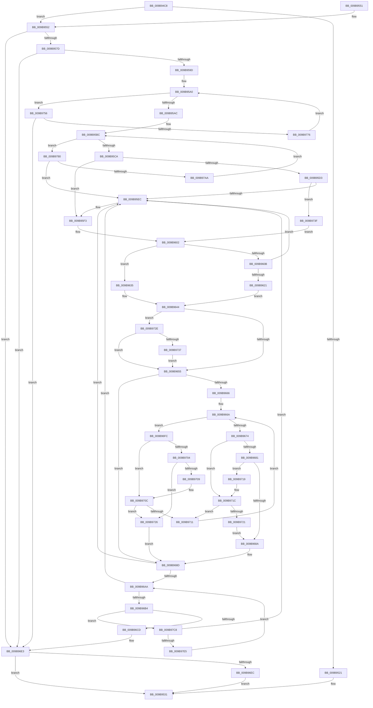

# HvpViewMapPromoteRangeToMapping

- RVA: `0x009B94C8`–`0x009B97ED` (길이 `805` bytes)
- VA: `0x00000001409B94C8`
- 실행 섹션: `PAGE`
- PDB 이름 있음: `예`; PDB Function 태그: `아니요`
- unwind 정보 RVA: `0x0009EA08`
- 디코드: `220`개 명령, `805/805` bytes 표시
- 미해석 바이트: `0` (있으면 어셈블리에 `.byte`로 보존)

> 이 문서는 커널 이미지의 기계어와 PDB 기호를 분석해 생성했습니다. 4번과 5번은 함수 원형과 자료형을 바이너리 사용 방식에서 추정한 C 해석이며 원본 소스 복구 결과는 아닙니다.

## 1. Dependencies

- 직접 호출 지점: **16**; 고유 호출 대상: **9**
- 직접 호출자로 확인된 함수: **2**
- RIP 상대 이미지 참조: **0**

### Outgoing calls
- `0x009B9513` → [HvpViewMapFindViewForFileOffset](HvpViewMapFindViewForFileOffset_function_009B5CD8.md) (function, `0x009B5CD8`)
- `0x009B9552` → [CmSiGetMemoryAllocationGranularity](../../text/4B/CmSiGetMemoryAllocationGranularity_function_004B2CB8.md) (function, `0x004B2CB8`)
- `0x009B956A` → [HvpViewMapCreateView](HvpViewMapCreateView_function_009B6310.md) (function, `0x009B6310`)
- `0x009B958E` → [HvpViewMapMakeViewRangeValid](HvpViewMapMakeViewRangeValid_function_009B5E00.md) (function, `0x009B5E00`)
- `0x009B95B0` → [HvpViewMapFindViewForFileOffset](HvpViewMapFindViewForFileOffset_function_009B5CD8.md) (function, `0x009B5CD8`)
- `0x009B95D6` → [RtlRbRemoveNode](../../text/2E/RtlRbRemoveNode_function_002E4C10.md) (function, `0x002E4C10`)
- `0x009B95FD` → [HvpViewMapMakeViewRangeInvalid](HvpViewMapMakeViewRangeInvalid_function_009B7770.md) (function, `0x009B7770`)
- `0x009B960F` → [RtlRbRemoveNode](../../text/2E/RtlRbRemoveNode_function_002E4C10.md) (function, `0x002E4C10`)
- `0x009B963F` → [HvpViewMapMakeViewRangeInvalid](HvpViewMapMakeViewRangeInvalid_function_009B7770.md) (function, `0x009B7770`)
- `0x009B9690` → [RtlRbInsertNodeEx](../../text/2E/RtlRbInsertNodeEx_function_002E4570.md) (function, `0x002E4570`)
- `0x009B96F2` → [HvpViewMapFreeView](HvpViewMapFreeView_function_009B6F9C.md) (function, `0x009B6F9C`)
- `0x009B9756` → [HvpViewMapFindViewForFileOffset](HvpViewMapFindViewForFileOffset_function_009B5CD8.md) (function, `0x009B5CD8`)
- `0x009B9767` → [HvpViewMapMigrateCOWData](../7E/HvpViewMapMigrateCOWData_function_007EEC0C.md) (function, `0x007EEC0C`)
- `0x009B9786` → [HvpViewMapFindViewForFileOffset](HvpViewMapFindViewForFileOffset_function_009B5CD8.md) (function, `0x009B5CD8`)
- `0x009B9794` → [RtlRbRemoveNode](../../text/2E/RtlRbRemoveNode_function_002E4C10.md) (function, `0x002E4C10`)
- `0x009B97CE` → [HvpViewMapFreeView](HvpViewMapFreeView_function_009B6F9C.md) (function, `0x009B6F9C`)

### Direct callers
- [HvpRemapAndEnlistHiveBins](HvpRemapAndEnlistHiveBins_function_009B8E0C.md) at `0x009B9211`
- [HvpAddBin](../AF/HvpAddBin_function_00AF7D48.md) at `0x00AF81EF`
- [HvpAddBin](../AF/HvpAddBin_function_00AF7D48.md) at `0x00AF8306`

### Static image references
- 디코드된 RIP-relative 메모리 참조가 없습니다.

## 2. Other-region calls and transfers

- 다른 실행 섹션으로 향하는 call: **5**
  - `0x009B9552` → [CmSiGetMemoryAllocationGranularity](../../text/4B/CmSiGetMemoryAllocationGranularity_function_004B2CB8.md) (`PAGE` → `.text`)
  - `0x009B95D6` → [RtlRbRemoveNode](../../text/2E/RtlRbRemoveNode_function_002E4C10.md) (`PAGE` → `.text`)
  - `0x009B960F` → [RtlRbRemoveNode](../../text/2E/RtlRbRemoveNode_function_002E4C10.md) (`PAGE` → `.text`)
  - `0x009B9690` → [RtlRbInsertNodeEx](../../text/2E/RtlRbInsertNodeEx_function_002E4570.md) (`PAGE` → `.text`)
  - `0x009B9794` → [RtlRbRemoveNode](../../text/2E/RtlRbRemoveNode_function_002E4C10.md) (`PAGE` → `.text`)
- 별도 외부 분기/꼬리 이동을 확인하지 못했습니다.

## 3. Assembly (complete function range)

```asm
009B94C8  48 8B C4                        mov rax, rsp
009B94CB  48 89 58 08                     mov qword ptr [rax + 8], rbx
009B94CF  48 89 70 10                     mov qword ptr [rax + 0x10], rsi
009B94D3  48 89 78 18                     mov qword ptr [rax + 0x18], rdi
009B94D7  4C 89 48 20                     mov qword ptr [rax + 0x20], r9
009B94DB  55                              push rbp
009B94DC  41 54                           push r12
009B94DE  41 55                           push r13
009B94E0  41 56                           push r14
009B94E2  41 57                           push r15
009B94E4  48 8B EC                        mov rbp, rsp
009B94E7  48 83 EC 50                     sub rsp, 0x50
009B94EB  48 83 65 E0 00                  and qword ptr [rbp - 0x20], 0
009B94F0  44 8D AA 00 10 00 00            lea r13d, [rdx + 0x1000]
009B94F7  48 8D 45 E8                     lea rax, [rbp - 0x18]
009B94FB  45 8B F8                        mov r15d, r8d
009B94FE  48 89 45 F0                     mov qword ptr [rbp - 0x10], rax
009B9502  41 8B D5                        mov edx, r13d
009B9505  48 8D 45 E8                     lea rax, [rbp - 0x18]
009B9509  4C 8B F1                        mov r14, rcx
009B950C  48 89 45 E8                     mov qword ptr [rbp - 0x18], rax
009B9510  4D 03 FD                        add r15, r13
009B9513  E8 C0 C7 FF FF                  call 0x1409b5cd8
009B9518  48 8B F8                        mov rdi, rax
009B951B  4C 39 78 30                     cmp qword ptr [rax + 0x30], r15
009B951F  7C 31                           jl 0x1409b9552
009B9521  48 8B 40 38                     mov rax, qword ptr [rax + 0x38]
009B9525  48 2B 47 18                     sub rax, qword ptr [rdi + 0x18]
009B9529  49 03 C5                        add rax, r13
009B952C  49 89 01                        mov qword ptr [r9], rax
009B952F  33 DB                           xor ebx, ebx
009B9531  4C 8D 5C 24 50                  lea r11, [rsp + 0x50]
009B9536  8B C3                           mov eax, ebx
009B9538  49 8B 5B 30                     mov rbx, qword ptr [r11 + 0x30]
009B953C  49 8B 73 38                     mov rsi, qword ptr [r11 + 0x38]
009B9540  49 8B 7B 40                     mov rdi, qword ptr [r11 + 0x40]
009B9544  49 8B E3                        mov rsp, r11
009B9547  41 5F                           pop r15
009B9549  41 5E                           pop r14
009B954B  41 5D                           pop r13
009B954D  41 5C                           pop r12
009B954F  5D                              pop rbp
009B9550  C3                              ret
009B9551  CC                              int3
009B9552  E8 61 97 AF FF                  call 0x1404b2cb8
009B9557  48 F7 D8                        neg rax
009B955A  4C 8D 4D E0                     lea r9, [rbp - 0x20]
009B955E  49 23 C5                        and rax, r13
009B9561  4D 8B C7                        mov r8, r15
009B9564  48 8B D0                        mov rdx, rax
009B9567  49 8B CE                        mov rcx, r14
009B956A  E8 A1 CD FF FF                  call 0x1409b6310
009B956F  48 8B 75 E0                     mov rsi, qword ptr [rbp - 0x20]
009B9573  8B D8                           mov ebx, eax
009B9575  85 C0                           test eax, eax
009B9577  0F 88 66 01 00 00               js 0x1409b96e3
009B957D  4D 8B CF                        mov r9, r15
009B9580  C6 44 24 20 00                  mov byte ptr [rsp + 0x20], 0
009B9585  4D 8B C5                        mov r8, r13
009B9588  48 8B D6                        mov rdx, rsi
009B958B  49 8B CE                        mov rcx, r14
009B958E  E8 6D C8 FF FF                  call 0x1409b5e00
009B9593  8B D8                           mov ebx, eax
009B9595  85 C0                           test eax, eax
009B9597  0F 88 46 01 00 00               js 0x1409b96e3
009B959D  49 8B D5                        mov rdx, r13
009B95A0  49 8B CE                        mov rcx, r14
009B95A3  49 3B D7                        cmp rdx, r15
009B95A6  0F 8C AA 01 00 00               jl 0x1409b9756
009B95AC  49 8D 57 FF                     lea rdx, [r15 - 1]
009B95B0  E8 23 C7 FF FF                  call 0x1409b5cd8
009B95B5  48 8B D8                        mov rbx, rax
009B95B8  48 8B 47 30                     mov rax, qword ptr [rdi + 0x30]
009B95BC  4D 8D 4E 28                     lea r9, [r14 + 0x28]
009B95C0  48 3B 43 28                     cmp rax, qword ptr [rbx + 0x28]
009B95C4  0F 8C B6 01 00 00               jl 0x1409b9780
009B95CA  48 8B D7                        mov rdx, rdi
009B95CD  4C 39 6F 28                     cmp qword ptr [rdi + 0x28], r13
009B95D1  75 20                           jne 0x1409b95f3
009B95D3  49 8B C9                        mov rcx, r9
009B95D6  E8 35 B6 92 FF                  call 0x1402e4c10
009B95DB  48 8B 45 F0                     mov rax, qword ptr [rbp - 0x10]
009B95DF  48 8D 4D E8                     lea rcx, [rbp - 0x18]
009B95E3  48 39 08                        cmp qword ptr [rax], rcx
009B95E6  0F 84 53 01 00 00               je 0x1409b973f
009B95EC  B9 03 00 00 00                  mov ecx, 3
009B95F1  CD 29                           int 0x29
009B95F3  4C 8B 4F 30                     mov r9, qword ptr [rdi + 0x30]
009B95F7  4D 8B C5                        mov r8, r13
009B95FA  49 8B CE                        mov rcx, r14
009B95FD  E8 6E E1 FF FF                  call 0x1409b7770
009B9602  48 8B D3                        mov rdx, rbx
009B9605  4C 39 7B 30                     cmp qword ptr [rbx + 0x30], r15
009B9609  75 2A                           jne 0x1409b9635
009B960B  49 8D 4E 28                     lea rcx, [r14 + 0x28]
009B960F  E8 FC B5 92 FF                  call 0x1402e4c10
009B9614  48 8B 45 F0                     mov rax, qword ptr [rbp - 0x10]
009B9618  48 8D 4D E8                     lea rcx, [rbp - 0x18]
009B961C  48 39 08                        cmp qword ptr [rax], rcx
009B961F  75 CB                           jne 0x1409b95ec
009B9621  48 89 43 08                     mov qword ptr [rbx + 8], rax
009B9625  48 8D 4D E8                     lea rcx, [rbp - 0x18]
009B9629  48 89 0B                        mov qword ptr [rbx], rcx
009B962C  48 89 18                        mov qword ptr [rax], rbx
009B962F  48 89 5D F0                     mov qword ptr [rbp - 0x10], rbx
009B9633  EB 0F                           jmp 0x1409b9644
009B9635  4C 8B 43 28                     mov r8, qword ptr [rbx + 0x28]
009B9639  4D 8B CF                        mov r9, r15
009B963C  49 8B CE                        mov rcx, r14
009B963F  E8 2C E1 FF FF                  call 0x1409b7770
009B9644  49 8D 4E 28                     lea rcx, [r14 + 0x28]
009B9648  F6 41 08 01                     test byte ptr [rcx + 8], 1
009B964C  48 8B 11                        mov rdx, qword ptr [rcx]
009B964F  0F 85 D9 00 00 00               jne 0x1409b972e
009B9655  44 0F B6 49 08                  movzx r9d, byte ptr [rcx + 8]
009B965A  45 32 C0                        xor r8b, r8b
009B965D  41 83 E1 01                     and r9d, 1
009B9661  48 85 D2                        test rdx, rdx
009B9664  74 27                           je 0x1409b968d
009B9666  4C 8B 46 28                     mov r8, qword ptr [rsi + 0x28]
009B966A  4C 3B 42 28                     cmp r8, qword ptr [rdx + 0x28]
009B966E  0F 8C 88 00 00 00               jl 0x1409b96fc
009B9674  48 8B 42 08                     mov rax, qword ptr [rdx + 8]
009B9678  45 85 C9                        test r9d, r9d
009B967B  0F 84 9B 00 00 00               je 0x1409b971c
009B9681  48 85 C0                        test rax, rax
009B9684  0F 85 8F 00 00 00               jne 0x1409b9719
009B968A  41 B0 01                        mov r8b, 1
009B968D  4C 8B CE                        mov r9, rsi
009B9690  E8 DB AE 92 FF                  call 0x1402e4570
009B9695  48 8B 45 E8                     mov rax, qword ptr [rbp - 0x18]
009B9699  48 8D 55 E8                     lea rdx, [rbp - 0x18]
009B969D  48 8B 08                        mov rcx, qword ptr [rax]
009B96A0  48 39 50 08                     cmp qword ptr [rax + 8], rdx
009B96A4  0F 85 42 FF FF FF               jne 0x1409b95ec
009B96AA  48 39 41 08                     cmp qword ptr [rcx + 8], rax
009B96AE  0F 85 38 FF FF FF               jne 0x1409b95ec
009B96B4  48 89 4D E8                     mov qword ptr [rbp - 0x18], rcx
009B96B8  48 8D 55 E8                     lea rdx, [rbp - 0x18]
009B96BC  48 89 51 08                     mov qword ptr [rcx + 8], rdx
009B96C0  48 8D 4D E8                     lea rcx, [rbp - 0x18]
009B96C4  48 3B C1                        cmp rax, rcx
009B96C7  0F 85 FB 00 00 00               jne 0x1409b97c8
009B96CD  48 8B 4E 38                     mov rcx, qword ptr [rsi + 0x38]
009B96D1  33 DB                           xor ebx, ebx
009B96D3  48 2B 4E 18                     sub rcx, qword ptr [rsi + 0x18]
009B96D7  48 8B 45 48                     mov rax, qword ptr [rbp + 0x48]
009B96DB  49 03 CD                        add rcx, r13
009B96DE  33 F6                           xor esi, esi
009B96E0  48 89 08                        mov qword ptr [rax], rcx
009B96E3  48 85 F6                        test rsi, rsi
009B96E6  0F 84 45 FE FF FF               je 0x1409b9531
009B96EC  48 8B D6                        mov rdx, rsi
009B96EF  49 8B CE                        mov rcx, r14
009B96F2  E8 A5 D8 FF FF                  call 0x1409b6f9c
009B96F7  E9 35 FE FF FF                  jmp 0x1409b9531
009B96FC  48 8B 02                        mov rax, qword ptr [rdx]
009B96FF  45 85 C9                        test r9d, r9d
009B9702  74 08                           je 0x1409b970c
009B9704  48 85 C0                        test rax, rax
009B9707  74 1D                           je 0x1409b9726
009B9709  48 33 C2                        xor rax, rdx
009B970C  48 85 C0                        test rax, rax
009B970F  74 15                           je 0x1409b9726
009B9711  48 8B D0                        mov rdx, rax
009B9714  E9 51 FF FF FF                  jmp 0x1409b966a
009B9719  48 33 C2                        xor rax, rdx
009B971C  48 85 C0                        test rax, rax
009B971F  75 F0                           jne 0x1409b9711
009B9721  E9 64 FF FF FF                  jmp 0x1409b968a
009B9726  45 32 C0                        xor r8b, r8b
009B9729  E9 5F FF FF FF                  jmp 0x1409b968d
009B972E  48 85 D2                        test rdx, rdx
009B9731  0F 84 1E FF FF FF               je 0x1409b9655
009B9737  48 33 D1                        xor rdx, rcx
009B973A  E9 16 FF FF FF                  jmp 0x1409b9655
009B973F  48 89 47 08                     mov qword ptr [rdi + 8], rax
009B9743  48 8D 4D E8                     lea rcx, [rbp - 0x18]
009B9747  48 89 0F                        mov qword ptr [rdi], rcx
009B974A  48 89 38                        mov qword ptr [rax], rdi
009B974D  48 89 7D F0                     mov qword ptr [rbp - 0x10], rdi
009B9751  E9 AC FE FF FF                  jmp 0x1409b9602
009B9756  E8 7D C5 FF FF                  call 0x1409b5cd8
009B975B  4C 8B C0                        mov r8, rax
009B975E  48 8B D6                        mov rdx, rsi
009B9761  49 8B CE                        mov rcx, r14
009B9764  4C 8B E0                        mov r12, rax
009B9767  E8 A0 54 E3 FF                  call 0x1407eec0c
009B976C  8B D8                           mov ebx, eax
009B976E  85 C0                           test eax, eax
009B9770  0F 88 6D FF FF FF               js 0x1409b96e3
009B9776  49 8B 54 24 30                  mov rdx, qword ptr [r12 + 0x30]
009B977B  E9 20 FE FF FF                  jmp 0x1409b95a0
009B9780  48 8B D0                        mov rdx, rax
009B9783  49 8B CE                        mov rcx, r14
009B9786  E8 4D C5 FF FF                  call 0x1409b5cd8
009B978B  48 8B D0                        mov rdx, rax
009B978E  49 8B C9                        mov rcx, r9
009B9791  4C 8B E0                        mov r12, rax
009B9794  E8 77 B4 92 FF                  call 0x1402e4c10
009B9799  48 8B 45 F0                     mov rax, qword ptr [rbp - 0x10]
009B979D  48 8D 4D E8                     lea rcx, [rbp - 0x18]
009B97A1  48 39 08                        cmp qword ptr [rax], rcx
009B97A4  0F 85 42 FE FF FF               jne 0x1409b95ec
009B97AA  49 89 44 24 08                  mov qword ptr [r12 + 8], rax
009B97AF  48 8D 4D E8                     lea rcx, [rbp - 0x18]
009B97B3  49 89 0C 24                     mov qword ptr [r12], rcx
009B97B7  4C 89 20                        mov qword ptr [rax], r12
009B97BA  4C 89 65 F0                     mov qword ptr [rbp - 0x10], r12
009B97BE  49 8B 44 24 30                  mov rax, qword ptr [r12 + 0x30]
009B97C3  E9 F4 FD FF FF                  jmp 0x1409b95bc
009B97C8  48 8B D0                        mov rdx, rax
009B97CB  49 8B CE                        mov rcx, r14
009B97CE  E8 C9 D7 FF FF                  call 0x1409b6f9c
009B97D3  48 8B 45 E8                     mov rax, qword ptr [rbp - 0x18]
009B97D7  48 8D 4D E8                     lea rcx, [rbp - 0x18]
009B97DB  48 39 48 08                     cmp qword ptr [rax + 8], rcx
009B97DF  0F 85 07 FE FF FF               jne 0x1409b95ec
009B97E5  48 8B 08                        mov rcx, qword ptr [rax]
009B97E8  E9 BD FE FF FF                  jmp 0x1409b96aa
```

## 4. C-style interpretation (structured pseudocode)

```c
__int64 __fastcall HvpViewMapPromoteRangeToMapping(__int64 a1, __int64 a2, int a3, __int64 a4)
{
    __int64 result;
    __int64 v_r15;
    __int64 v_rbx;
    __int64 v_rsi;
    __int64 v_rsp;
    unsigned __int64 v_stack_m28;
    unsigned __int8 v_stack_m30;
    unsigned __int64 v_stack_m38;
    unsigned __int64 v_stack_m40;
    unsigned __int64 v_stack_m48;
    unsigned __int64 v_stack_p20;

    *(unsigned __int64 *)(v_rsp + 8) = v_rbx;
    *(unsigned __int64 *)(v_rsp + 16) = v_rsi;
    *(unsigned __int64 *)(v_rsp + 24) = v_rdi;
    *(unsigned __int64 *)(v_rsp + 32) = a4;
    v_rsp = (v_rsp) - (80);
    v_stack_m38 = v_stack_m40;
    v_stack_m40 = v_stack_m40;
    v_r15 = ((unsigned int)(a3)) + (a2 + 4096);
    result = HvpViewMapFindViewForFileOffset(a1, (unsigned int)((unsigned int)(a2 + 4096)), a3, a4);
    if ((*(unsigned __int64 *)(result + 48)) < v_r15) goto loc_009B9552;
    result = (*(unsigned __int64 *)(result + 56)) - (*(unsigned __int64 *)(result + 24));
    result = (result) + (a2 + 4096);
    *(unsigned __int64 *)(a4) = result;
    v_rbx = 0;
loc_009B9531:
    return 0;
loc_009B9552:
    result = CmSiGetMemoryAllocationGranularity(a1, (unsigned int)((unsigned int)(a2 + 4096)), a3, a4);
    result = -(result);
    result = (result) & (a2 + 4096);
    result = HvpViewMapCreateView(a1, result, v_r15, v_stack_m48);
    if (sign_flag) goto loc_009B96E3;
    v_stack_m30 = 0;
    result = HvpViewMapMakeViewRangeValid(a1, v_stack_m48, a2 + 4096, v_r15);
    if (sign_flag) goto loc_009B96E3;
loc_009B95A0:
    if ((a2 + 4096) < v_r15) goto loc_009B9756;
    result = HvpViewMapFindViewForFileOffset(a1, v_r15 - 1, a2 + 4096, v_r15);
loc_009B95BC:
    if ((*(unsigned __int64 *)(*(unsigned __int64 *)(v_stack_m28 + 64) + 48)) < (*(unsigned __int64 *)(result + 40))) goto loc_009B9780;
    if ((*(unsigned __int64 *)(*(unsigned __int64 *)(v_stack_m28 + 64) + 40)) != (a2 + 4096)) goto loc_009B95F3;
    result = RtlRbRemoveNode(a1 + 40, *(unsigned __int64 *)(v_stack_m28 + 64), a2 + 4096, a1 + 40);
    if ((*(unsigned __int64 *)(v_stack_m38)) == v_stack_m40) goto loc_009B973F;
loc_009B95EC:
loc_009B95F3:
    result = HvpViewMapMakeViewRangeInvalid(a1, *(unsigned __int64 *)(v_stack_m28 + 64), a2 + 4096, *(unsigned __int64 *)(*(unsigned __int64 *)(v_stack_m28 + 64) + 48));
loc_009B9602:
    if ((*(unsigned __int64 *)(result + 48)) != v_r15) goto loc_009B9635;
    result = RtlRbRemoveNode(a1 + 40, result, a2 + 4096, *(unsigned __int64 *)(*(unsigned __int64 *)(v_stack_m28 + 64) + 48));
    if ((*(unsigned __int64 *)(v_stack_m38)) != v_stack_m40) goto loc_009B95EC;
    *(unsigned __int64 *)(result + 8) = v_stack_m38;
    *(unsigned __int64 *)(result) = v_stack_m40;
    *(unsigned __int64 *)(v_stack_m38) = result;
    v_stack_m38 = result;
    goto loc_009B9644;
loc_009B9635:
    result = HvpViewMapMakeViewRangeInvalid(a1, result, *(unsigned __int64 *)(result + 40), v_r15);
loc_009B9644:
    if (((*(unsigned __int8 *)(a1 + 40 + 8)) & (1)) != 0) goto loc_009B972E;
loc_009B9655:
    a3 = 0;
    a4 = (unsigned int)((*(unsigned __int8 *)(a1 + 40 + 8)) & (1));
    if (*(unsigned __int64 *)(a1 + 40) == 0) goto loc_009B968D;
loc_009B966A:
    if ((*(unsigned __int64 *)(v_stack_m48 + 40)) < (*(unsigned __int64 *)(*(unsigned __int64 *)(a1 + 40) + 40))) goto loc_009B96FC;
    if ((unsigned int)(a4) == 0) goto loc_009B971C;
    if (*(unsigned __int64 *)(*(unsigned __int64 *)(a1 + 40) + 8) != 0) goto loc_009B9719;
loc_009B968A:
loc_009B968D:
    result = RtlRbInsertNodeEx(a1 + 40, *(unsigned __int64 *)(a1 + 40), 1, v_stack_m48);
    if ((*(unsigned __int64 *)(v_stack_m40 + 8)) != v_stack_m40) goto loc_009B95EC;
loc_009B96AA:
    if ((*(unsigned __int64 *)(*(unsigned __int64 *)(v_stack_m40) + 8)) != v_stack_m40) goto loc_009B95EC;
    v_stack_m40 = *(unsigned __int64 *)(v_stack_m40);
    *(unsigned __int64 *)(*(unsigned __int64 *)(v_stack_m40) + 8) = v_stack_m40;
    if (v_stack_m40 != v_stack_m40) goto loc_009B97C8;
    v_rbx = 0;
    a1 = (*(unsigned __int64 *)(v_stack_m48 + 56)) - (*(unsigned __int64 *)(v_stack_m48 + 24));
    a1 = (a1) + (a2 + 4096);
    v_rsi = 0;
    *(unsigned __int64 *)(v_stack_p20) = a1;
loc_009B96E3:
    if (0 == 0) goto loc_009B9531;
    result = HvpViewMapFreeView(a1, 0, 1, v_stack_m48);
    goto loc_009B9531;
loc_009B96FC:
    if ((unsigned int)(v_stack_m48) == 0) goto loc_009B970C;
    if (*(unsigned __int64 *)(0) == 0) goto loc_009B9726;
    result = (*(unsigned __int64 *)(0)) ^ (0);
loc_009B970C:
    if (result == 0) goto loc_009B9726;
loc_009B9711:
    goto loc_009B966A;
loc_009B9719:
    result = (result) ^ (result);
loc_009B971C:
    if (result != 0) goto loc_009B9711;
    goto loc_009B968A;
loc_009B9726:
    a3 = 0;
    goto loc_009B968D;
loc_009B972E:
    if (result == 0) goto loc_009B9655;
    a2 = (result) ^ (a1);
    goto loc_009B9655;
loc_009B973F:
    *(unsigned __int64 *)(*(unsigned __int64 *)(v_stack_m28 + 64) + 8) = result;
    *(unsigned __int64 *)(*(unsigned __int64 *)(v_stack_m28 + 64)) = v_stack_m40;
    *(unsigned __int64 *)(result) = *(unsigned __int64 *)(v_stack_m28 + 64);
    v_stack_m38 = *(unsigned __int64 *)(v_stack_m28 + 64);
    goto loc_009B9602;
loc_009B9756:
    result = HvpViewMapFindViewForFileOffset(v_stack_m40, a2, a3, v_stack_m48);
    result = HvpViewMapMigrateCOWData(a1, 0, result, v_stack_m48);
    if (sign_flag) goto loc_009B96E3;
    goto loc_009B95A0;
loc_009B9780:
    result = HvpViewMapFindViewForFileOffset(a1, result, result, v_stack_m48);
    result = RtlRbRemoveNode(v_stack_m48, result, result, v_stack_m48);
    if ((*(unsigned __int64 *)(v_stack_m38)) != v_stack_m40) goto loc_009B95EC;
    *(unsigned __int64 *)(result + 8) = v_stack_m38;
    *(unsigned __int64 *)(result) = v_stack_m40;
    *(unsigned __int64 *)(v_stack_m38) = result;
    v_stack_m38 = result;
    goto loc_009B95BC;
loc_009B97C8:
    result = HvpViewMapFreeView(a1, *(unsigned __int64 *)(result + 48), result, v_stack_m48);
    if ((*(unsigned __int64 *)(v_stack_m40 + 8)) != v_stack_m40) goto loc_009B95EC;
    goto loc_009B96AA;
}
```

## 5. (Beta) C Style

```c
int64_t HvpViewMapPromoteRangeToMapping(void *Arg1, void *Arg2, void *Arg3, int64_t Arg4)
{
    uint8_t *arg1 = (uint8_t *)Arg1;
    uint8_t *arg2 = (uint8_t *)Arg2;
    uint8_t *arg3 = (uint8_t *)Arg3;

    int64_t result;
    int64_t local_r15;
    int64_t local_rbx;
    int64_t local_rsi;
    int64_t local_rsp;
    uint64_t v_stack_m28;
    uint8_t v_stack_m30;
    uint64_t v_stack_m38;
    uint64_t v_stack_m40;
    uint64_t v_stack_m48;
    uint64_t v_stack_p20;

    *(uint64_t *)(local_rsp + 0x8) = local_rbx;
    *(uint64_t *)(local_rsp + 0x10) = local_rsi;
    *(uint64_t *)(local_rsp + 0x18) = local_rdi;
    *(uint64_t *)(local_rsp + 0x20) = Arg4;
    local_rsp = (local_rsp) - (80);
    v_stack_m38 = v_stack_m40;
    v_stack_m40 = v_stack_m40;
    local_r15 = ((uint32_t)(Arg3)) + (Arg2 + 4096);
    result = HvpViewMapFindViewForFileOffset(Arg1, (uint32_t)((uint32_t)(Arg2 + 4096)), Arg3, Arg4);
    if ((*(uint64_t *)(result + 0x30)) < local_r15) goto loc_009B9552;
    result = (*(uint64_t *)(result + 0x38)) - (*(uint64_t *)(result + 0x18));
    result = (result) + (Arg2 + 4096);
    *(uint64_t *)(Arg4) = result;
    local_rbx = 0;
loc_009B9531:
    return 0;
loc_009B9552:
    result = CmSiGetMemoryAllocationGranularity(Arg1, (uint32_t)((uint32_t)(Arg2 + 4096)), Arg3, Arg4);
    result = -(result);
    result = (result) & (Arg2 + 4096);
    result = HvpViewMapCreateView(Arg1, result, local_r15, v_stack_m48);
    if (sign_flag) goto loc_009B96E3;
    v_stack_m30 = 0;
    result = HvpViewMapMakeViewRangeValid(Arg1, v_stack_m48, Arg2 + 4096, local_r15);
    if (sign_flag) goto loc_009B96E3;
loc_009B95A0:
    if ((Arg2 + 4096) < local_r15) goto loc_009B9756;
    result = HvpViewMapFindViewForFileOffset(Arg1, local_r15 - 1, Arg2 + 4096, local_r15);
loc_009B95BC:
    if ((*(uint64_t *)(*(uint64_t *)(v_stack_m28 + 0x40) + 0x30)) < (*(uint64_t *)(result + 0x28))) goto loc_009B9780;
    if ((*(uint64_t *)(*(uint64_t *)(v_stack_m28 + 0x40) + 0x28)) != (Arg2 + 4096)) goto loc_009B95F3;
    result = RtlRbRemoveNode(Arg1 + 40, *(uint64_t *)(v_stack_m28 + 0x40), Arg2 + 4096, Arg1 + 40);
    if ((*(uint64_t *)(v_stack_m38)) == v_stack_m40) goto loc_009B973F;
loc_009B95EC:
loc_009B95F3:
    result = HvpViewMapMakeViewRangeInvalid(Arg1, *(uint64_t *)(v_stack_m28 + 0x40), Arg2 + 4096, *(uint64_t *)(*(uint64_t *)(v_stack_m28 + 0x40) + 0x30));
loc_009B9602:
    if ((*(uint64_t *)(result + 0x30)) != local_r15) goto loc_009B9635;
    result = RtlRbRemoveNode(Arg1 + 40, result, Arg2 + 4096, *(uint64_t *)(*(uint64_t *)(v_stack_m28 + 0x40) + 0x30));
    if ((*(uint64_t *)(v_stack_m38)) != v_stack_m40) goto loc_009B95EC;
    *(uint64_t *)(result + 0x8) = v_stack_m38;
    *(uint64_t *)(result) = v_stack_m40;
    *(uint64_t *)(v_stack_m38) = result;
    v_stack_m38 = result;
    goto loc_009B9644;
loc_009B9635:
    result = HvpViewMapMakeViewRangeInvalid(Arg1, result, *(uint64_t *)(result + 0x28), local_r15);
loc_009B9644:
    if (((*(uint8_t *)(arg1 + 0x28 + 0x8)) & (1)) != 0) goto loc_009B972E;
loc_009B9655:
    Arg3 = 0;
    Arg4 = (uint32_t)((*(uint8_t *)(arg1 + 0x28 + 0x8)) & (1));
    if (*(uint64_t *)(arg1 + 0x28) == 0) goto loc_009B968D;
loc_009B966A:
    if ((*(uint64_t *)(v_stack_m48 + 0x28)) < (*(uint64_t *)(*(uint64_t *)(arg1 + 0x28) + 0x28))) goto loc_009B96FC;
    if ((uint32_t)(Arg4) == 0) goto loc_009B971C;
    if (*(uint64_t *)(*(uint64_t *)(arg1 + 0x28) + 0x8) != 0) goto loc_009B9719;
loc_009B968A:
loc_009B968D:
    result = RtlRbInsertNodeEx(Arg1 + 40, *(uint64_t *)(arg1 + 0x28), 1, v_stack_m48);
    if ((*(uint64_t *)(v_stack_m40 + 0x8)) != v_stack_m40) goto loc_009B95EC;
loc_009B96AA:
    if ((*(uint64_t *)(*(uint64_t *)(v_stack_m40) + 0x8)) != v_stack_m40) goto loc_009B95EC;
    v_stack_m40 = *(uint64_t *)(v_stack_m40);
    *(uint64_t *)(*(uint64_t *)(v_stack_m40) + 0x8) = v_stack_m40;
    if (v_stack_m40 != v_stack_m40) goto loc_009B97C8;
    local_rbx = 0;
    Arg1 = (*(uint64_t *)(v_stack_m48 + 0x38)) - (*(uint64_t *)(v_stack_m48 + 0x18));
    Arg1 = (Arg1) + (Arg2 + 4096);
    local_rsi = 0;
    *(void **)(v_stack_p20) = Arg1;
loc_009B96E3:
    if (0 == 0) goto loc_009B9531;
    result = HvpViewMapFreeView(Arg1, 0, 1, v_stack_m48);
    goto loc_009B9531;
loc_009B96FC:
    if ((uint32_t)(v_stack_m48) == 0) goto loc_009B970C;
    if (*(uint64_t *)(0) == 0) goto loc_009B9726;
    result = (*(uint64_t *)(0)) ^ (0);
loc_009B970C:
    if (result == 0) goto loc_009B9726;
loc_009B9711:
    goto loc_009B966A;
loc_009B9719:
    result = (result) ^ (result);
loc_009B971C:
    if (result != 0) goto loc_009B9711;
    goto loc_009B968A;
loc_009B9726:
    Arg3 = 0;
    goto loc_009B968D;
loc_009B972E:
    if (result == 0) goto loc_009B9655;
    Arg2 = (result) ^ (Arg1);
    goto loc_009B9655;
loc_009B973F:
    *(uint64_t *)(*(uint64_t *)(v_stack_m28 + 0x40) + 0x8) = result;
    *(uint64_t *)(*(uint64_t *)(v_stack_m28 + 0x40)) = v_stack_m40;
    *(uint64_t *)(result) = *(uint64_t *)(v_stack_m28 + 0x40);
    v_stack_m38 = *(uint64_t *)(v_stack_m28 + 0x40);
    goto loc_009B9602;
loc_009B9756:
    result = HvpViewMapFindViewForFileOffset(v_stack_m40, Arg2, Arg3, v_stack_m48);
    result = HvpViewMapMigrateCOWData(Arg1, 0, result, v_stack_m48);
    if (sign_flag) goto loc_009B96E3;
    goto loc_009B95A0;
loc_009B9780:
    result = HvpViewMapFindViewForFileOffset(Arg1, result, result, v_stack_m48);
    result = RtlRbRemoveNode(v_stack_m48, result, result, v_stack_m48);
    if ((*(uint64_t *)(v_stack_m38)) != v_stack_m40) goto loc_009B95EC;
    *(uint64_t *)(result + 0x8) = v_stack_m38;
    *(uint64_t *)(result) = v_stack_m40;
    *(uint64_t *)(v_stack_m38) = result;
    v_stack_m38 = result;
    goto loc_009B95BC;
loc_009B97C8:
    result = HvpViewMapFreeView(Arg1, *(uint64_t *)(result + 0x30), result, v_stack_m48);
    if ((*(uint64_t *)(v_stack_m40 + 0x8)) != v_stack_m40) goto loc_009B95EC;
    goto loc_009B96AA;
}
```

### 관측된 메모리 오프셋

구조체 형식이 확인되지 않은 접근은 인자 기준의 오프셋으로만 기록했습니다.

| 기준 인자 | 오프셋 표현 | 폭 (bit) | 접근 |
|---|---:|---:|---|
| `Arg1` | `+ 0x0` | `64` | `R` |
| `Arg1` | `+ 0x8` | `8` | `R` |
| `Arg1` | `+ 0x28` | `64` | `R` |
| `Arg2` | `+ 0x1000` | `32` | `R` |
| `Arg3` | `- 0x1` | `64` | `R` |

## 6. Execution-region graph

[열기: 2D/3D 그래프와 함수 탐색 컨트롤 패널](../../../control-panel.html?section=page&rva=0x009B94C8&view=graph)

- 2D 그래프는 위에서 아래로 흐르고, 3D 그래프는 빈 공간을 드래그해 회전합니다. Shift+드래그는 이동, 휠은 확대·축소, 함수 노드 선택은 대상 보고서 이동입니다.

### Static fallback


