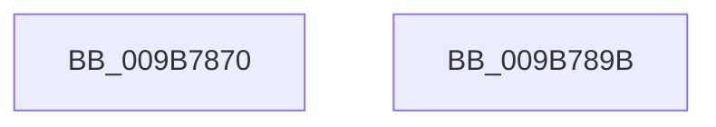

# HvpViewMapReleaseChargesAndUnlockViewPages

- RVA: `0x009B7870`–`0x009B789C` (길이 `44` bytes)
- VA: `0x00000001409B7870`
- 실행 섹션: `PAGE`
- PDB 이름 있음: `예`; PDB Function 태그: `아니요`
- unwind 정보 RVA: `0x0005CAAC`
- 디코드: `14`개 명령, `44/44` bytes 표시
- 미해석 바이트: `0` (있으면 어셈블리에 `.byte`로 보존)

> 이 문서는 커널 이미지의 기계어와 PDB 기호를 분석해 생성했습니다. 4번과 5번은 함수 원형과 자료형을 바이너리 사용 방식에서 추정한 C 해석이며 원본 소스 복구 결과는 아닙니다.

## 1. Dependencies

- 직접 호출 지점: **2**; 고유 호출 대상: **2**
- 직접 호출자로 확인된 함수: **3**
- RIP 상대 이미지 참조: **0**

### Outgoing calls
- `0x009B7880` → [CmSiUnlockViewOfSection](../../text/49/CmSiUnlockViewOfSection_function_0049A5A8.md) (function, `0x0049A5A8`)
- `0x009B788B` → [CmSiReleaseProcessLockedPagesCharge](../../text/47/CmSiReleaseProcessLockedPagesCharge_function_0047D81C.md) (function, `0x0047D81C`)

### Direct callers
- [HvpMappedViewConvertRegionFromLockedToCOWByPolicy](HvpMappedViewConvertRegionFromLockedToCOWByPolicy_function_009B75B8.md) at `0x009B7653`
- [HvpViewMapMakeViewRangeUnCOWByPolicy](HvpViewMapMakeViewRangeUnCOWByPolicy_function_009B76A8.md) at `0x009B7707`
- [HvpViewMapMakeViewRangeInvalid](HvpViewMapMakeViewRangeInvalid_function_009B7770.md) at `0x009B77D2`

### Static image references
- 디코드된 RIP-relative 메모리 참조가 없습니다.

## 2. Other-region calls and transfers

- 다른 실행 섹션으로 향하는 call: **2**
  - `0x009B7880` → [CmSiUnlockViewOfSection](../../text/49/CmSiUnlockViewOfSection_function_0049A5A8.md) (`PAGE` → `.text`)
  - `0x009B788B` → [CmSiReleaseProcessLockedPagesCharge](../../text/47/CmSiReleaseProcessLockedPagesCharge_function_0047D81C.md) (`PAGE` → `.text`)
- 별도 외부 분기/꼬리 이동을 확인하지 못했습니다.

## 3. Assembly (complete function range)

```asm
009B7870  48 89 5C 24 08                  mov qword ptr [rsp + 8], rbx
009B7875  57                              push rdi
009B7876  48 83 EC 20                     sub rsp, 0x20
009B787A  49 8B F9                        mov rdi, r9
009B787D  48 8B DA                        mov rbx, rdx
009B7880  E8 23 2D AE FF                  call 0x14049a5a8
009B7885  48 8B D7                        mov rdx, rdi
009B7888  48 8B CB                        mov rcx, rbx
009B788B  E8 8C 5F AC FF                  call 0x14047d81c
009B7890  48 8B 5C 24 30                  mov rbx, qword ptr [rsp + 0x30]
009B7895  48 83 C4 20                     add rsp, 0x20
009B7899  5F                              pop rdi
009B789A  C3                              ret
009B789B  CC                              int3
```

## 4. C-style interpretation (structured pseudocode)

```c
__int64 __fastcall HvpViewMapReleaseChargesAndUnlockViewPages(__int64 a1, __int64 a2, __int64 a3, __int64 a4)
{
    __int64 result;
    __int64 v_rsp;
    unsigned __int64 v_stack_p8;

    v_stack_p8 = v_rbx;
    v_rsp = (v_rsp) - (32);
    result = CmSiUnlockViewOfSection(a1, a2, a3, a4);
    result = CmSiReleaseProcessLockedPagesCharge(a2, a4, a3, a4);
    v_rsp = (v_rsp) + (32);
    return result;
}
```

## 5. (Beta) C Style

```c
int64_t HvpViewMapReleaseChargesAndUnlockViewPages(int64_t Arg1, int64_t Arg2, int64_t Arg3, int64_t Arg4)
{
    int64_t result;
    int64_t local_rsp;
    uint64_t v_stack_p8;

    v_stack_p8 = local_rbx;
    local_rsp = (local_rsp) - (32);
    result = CmSiUnlockViewOfSection(Arg1, Arg2, Arg3, Arg4);
    result = CmSiReleaseProcessLockedPagesCharge(Arg2, Arg4, Arg3, Arg4);
    local_rsp = (local_rsp) + (32);
    return result;
}
```

## 6. Execution-region graph

[열기: 2D/3D 그래프와 함수 탐색 컨트롤 패널](../../../control-panel.html?section=page&rva=0x009B7870&view=graph)

- 2D 그래프는 위에서 아래로 흐르고, 3D 그래프는 빈 공간을 드래그해 회전합니다. Shift+드래그는 이동, 휠은 확대·축소, 함수 노드 선택은 대상 보고서 이동입니다.

### Static fallback


