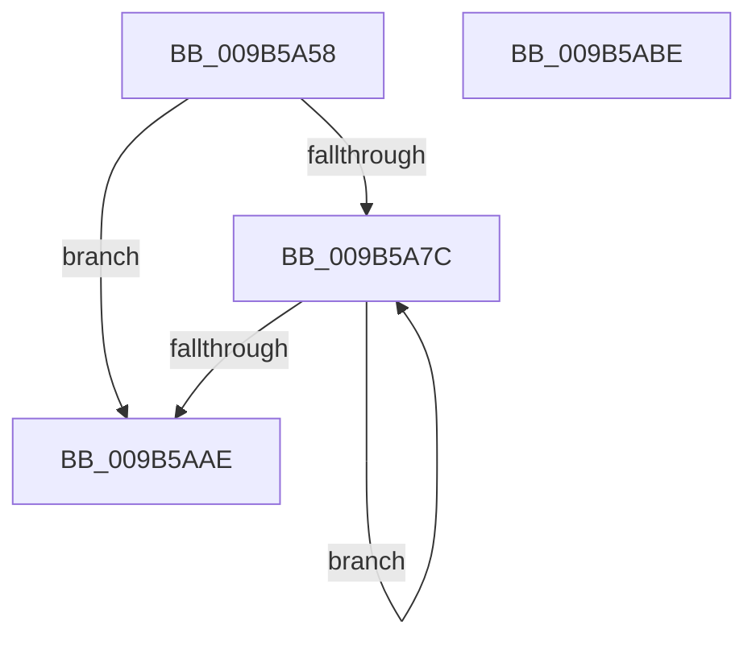

# HvpViewMapSealRange

- RVA: `0x009B5A58`–`0x009B5ABF` (길이 `103` bytes)
- VA: `0x00000001409B5A58`
- 실행 섹션: `PAGE`
- PDB 이름 있음: `예`; PDB Function 태그: `아니요`
- unwind 정보 RVA: `0x00060BC4`
- 디코드: `31`개 명령, `103/103` bytes 표시
- 미해석 바이트: `0` (있으면 어셈블리에 `.byte`로 보존)

> 이 문서는 커널 이미지의 기계어와 PDB 기호를 분석해 생성했습니다. 4번과 5번은 함수 원형과 자료형을 바이너리 사용 방식에서 추정한 C 해석이며 원본 소스 복구 결과는 아닙니다.

## 1. Dependencies

- 직접 호출 지점: **2**; 고유 호출 대상: **2**
- 직접 호출자로 확인된 함수: **1**
- RIP 상대 이미지 참조: **0**

### Outgoing calls
- `0x009B5A82` → [HvpViewMapFindViewForFileOffset](HvpViewMapFindViewForFileOffset_function_009B5CD8.md) (function, `0x009B5CD8`)
- `0x009B5AA1` → [HvpViewMapMakeViewRangeReadOnly](HvpViewMapMakeViewRangeReadOnly_function_009B5AC8.md) (function, `0x009B5AC8`)

### Direct callers
- [HvpSetRangeProtection](HvpSetRangeProtection_function_009B58C0.md) at `0x009B5998`

### Static image references
- 디코드된 RIP-relative 메모리 참조가 없습니다.

## 2. Other-region calls and transfers

- 다른 실행 섹션으로 향하는 call: **0**
- 별도 외부 분기/꼬리 이동을 확인하지 못했습니다.

## 3. Assembly (complete function range)

```asm
009B5A58  48 89 5C 24 08                  mov qword ptr [rsp + 8], rbx
009B5A5D  48 89 74 24 10                  mov qword ptr [rsp + 0x10], rsi
009B5A62  57                              push rdi
009B5A63  48 83 EC 20                     sub rsp, 0x20
009B5A67  44 8D 92 00 10 00 00            lea r10d, [rdx + 0x1000]
009B5A6E  41 8B F8                        mov edi, r8d
009B5A71  49 03 FA                        add rdi, r10
009B5A74  48 8B F1                        mov rsi, rcx
009B5A77  4C 3B D7                        cmp r10, rdi
009B5A7A  73 32                           jae 0x1409b5aae
009B5A7C  49 8B D2                        mov rdx, r10
009B5A7F  48 8B CE                        mov rcx, rsi
009B5A82  E8 51 02 00 00                  call 0x1409b5cd8
009B5A87  48 8B DF                        mov rbx, rdi
009B5A8A  4D 8B C2                        mov r8, r10
009B5A8D  48 8B D0                        mov rdx, rax
009B5A90  48 8B 48 30                     mov rcx, qword ptr [rax + 0x30]
009B5A94  48 3B F9                        cmp rdi, rcx
009B5A97  48 0F 4D D9                     cmovge rbx, rcx
009B5A9B  48 8B CE                        mov rcx, rsi
009B5A9E  4C 8B CB                        mov r9, rbx
009B5AA1  E8 22 00 00 00                  call 0x1409b5ac8
009B5AA6  4C 8B D3                        mov r10, rbx
009B5AA9  48 3B DF                        cmp rbx, rdi
009B5AAC  7C CE                           jl 0x1409b5a7c
009B5AAE  48 8B 5C 24 30                  mov rbx, qword ptr [rsp + 0x30]
009B5AB3  48 8B 74 24 38                  mov rsi, qword ptr [rsp + 0x38]
009B5AB8  48 83 C4 20                     add rsp, 0x20
009B5ABC  5F                              pop rdi
009B5ABD  C3                              ret
009B5ABE  CC                              int3
```

## 4. C-style interpretation (structured pseudocode)

```c
__int64 __fastcall HvpViewMapSealRange(__int64 a1, __int64 a2, int a3)
{
    __int64 result;
    __int64 v_rbx;
    __int64 v_rdi;
    __int64 v_rsp;
    unsigned __int64 v_stack_p10;
    unsigned __int64 v_stack_p8;

    v_stack_p8 = v_rbx;
    v_stack_p10 = v_rsi;
    v_rsp = (v_rsp) - (32);
    v_rdi = ((unsigned int)(a3)) + (a2 + 4096);
    if ((a2 + 4096) >= v_rdi) goto loc_009B5AAE;
loc_009B5A7C:
    result = HvpViewMapFindViewForFileOffset(a1, a2 + 4096, a3, a4);
    v_rbx = v_rdi;
    if (v_rdi >= (*(unsigned __int64 *)(result + 48))) { v_rbx = *(unsigned __int64 *)(result + 48); }
    result = HvpViewMapMakeViewRangeReadOnly(a1, result, a2 + 4096, v_rbx);
    if (v_rbx < v_rdi) goto loc_009B5A7C;
loc_009B5AAE:
    v_rsp = (v_rsp) + (32);
    return result;
}
```

## 5. (Beta) C Style

```c
int64_t HvpViewMapSealRange(int64_t Arg1, void *Arg2, int32_t Arg3)
{
    uint8_t *arg2 = (uint8_t *)Arg2;

    int64_t result;
    int64_t local_rbx;
    int64_t local_rdi;
    int64_t local_rsp;
    uint64_t v_stack_p10;
    uint64_t v_stack_p8;

    v_stack_p8 = local_rbx;
    v_stack_p10 = local_rsi;
    local_rsp = (local_rsp) - (32);
    local_rdi = ((uint32_t)(Arg3)) + (Arg2 + 4096);
    if ((Arg2 + 4096) >= local_rdi) goto loc_009B5AAE;
loc_009B5A7C:
    result = HvpViewMapFindViewForFileOffset(Arg1, Arg2 + 4096, Arg3, a4);
    local_rbx = local_rdi;
    if (local_rdi >= (*(uint64_t *)(result + 0x30))) { local_rbx = *(uint64_t *)(result + 0x30); }
    result = HvpViewMapMakeViewRangeReadOnly(Arg1, result, Arg2 + 4096, local_rbx);
    if (local_rbx < local_rdi) goto loc_009B5A7C;
loc_009B5AAE:
    local_rsp = (local_rsp) + (32);
    return result;
}
```

### 관측된 메모리 오프셋

구조체 형식이 확인되지 않은 접근은 인자 기준의 오프셋으로만 기록했습니다.

| 기준 인자 | 오프셋 표현 | 폭 (bit) | 접근 |
|---|---:|---:|---|
| `Arg2` | `+ 0x1000` | `32` | `R` |

## 6. Execution-region graph

[열기: 2D/3D 그래프와 함수 탐색 컨트롤 패널](../../../control-panel.html?section=page&rva=0x009B5A58&view=graph)

- 2D 그래프는 위에서 아래로 흐르고, 3D 그래프는 빈 공간을 드래그해 회전합니다. Shift+드래그는 이동, 휠은 확대·축소, 함수 노드 선택은 대상 보고서 이동입니다.

### Static fallback


