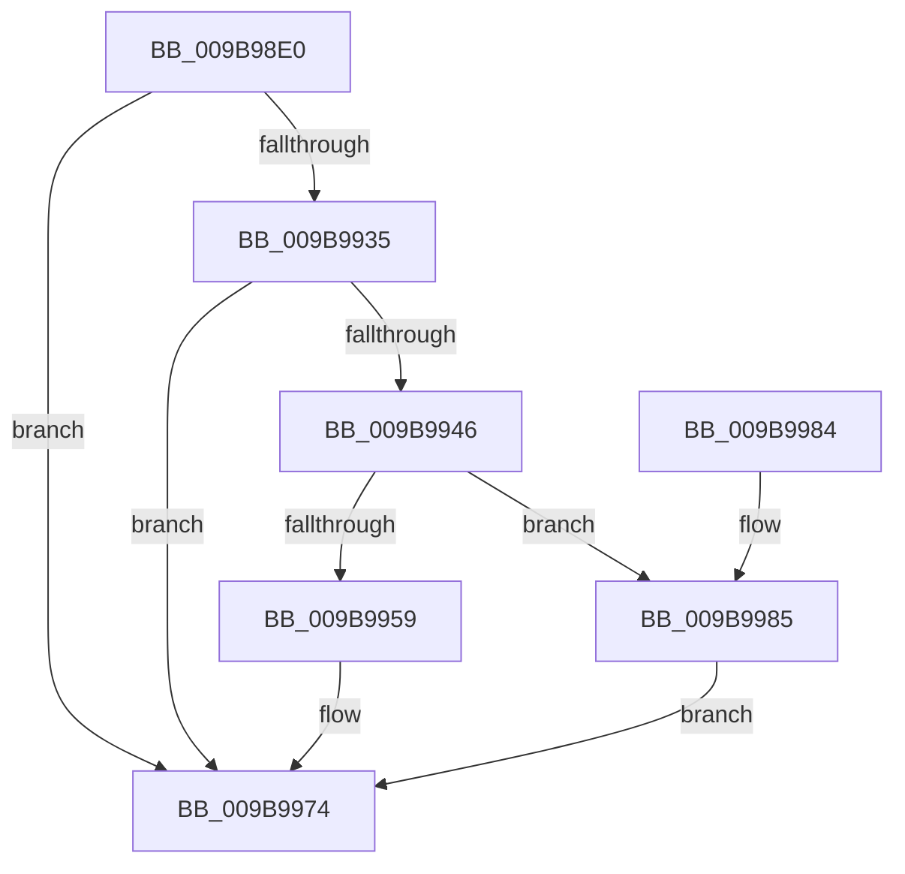

# HvpViewMapStart

- RVA: `0x009B98E0`–`0x009B998C` (길이 `172` bytes)
- VA: `0x00000001409B98E0`
- 실행 섹션: `PAGE`
- PDB 이름 있음: `예`; PDB Function 태그: `아니요`
- unwind 정보 RVA: `0x0009EA3C`
- 디코드: `51`개 명령, `172/172` bytes 표시
- 미해석 바이트: `0` (있으면 어셈블리에 `.byte`로 보존)

> 이 문서는 커널 이미지의 기계어와 PDB 기호를 분석해 생성했습니다. 4번과 5번은 함수 원형과 자료형을 바이너리 사용 방식에서 추정한 C 해석이며 원본 소스 복구 결과는 아닙니다.

## 1. Dependencies

- 직접 호출 지점: **3**; 고유 호출 대상: **3**
- 직접 호출자로 확인된 함수: **2**
- RIP 상대 이미지 참조: **0**

### Outgoing calls
- `0x009B992C` → [CmSiCreateSectionForFile](../../text/49/CmSiCreateSectionForFile_function_0049F14C.md) (function, `0x0049F14C`)
- `0x009B993D` → [CmSiGetSectionLength](../../text/49/CmSiGetSectionLength_function_0049CE50.md) (function, `0x0049CE50`)
- `0x009B996A` → [HvpViewMapCreateViewsForRegion](HvpViewMapCreateViewsForRegion_function_009B6094.md) (function, `0x009B6094`)

### Direct callers
- [HvHiveStartEmptyClone](../7E/HvHiveStartEmptyClone_function_007EF050.md) at `0x007EF204`
- [HvLoadHive](HvLoadHive_function_009B8138.md) at `0x009B82EE`

### Static image references
- 디코드된 RIP-relative 메모리 참조가 없습니다.

## 2. Other-region calls and transfers

- 다른 실행 섹션으로 향하는 call: **2**
  - `0x009B992C` → [CmSiCreateSectionForFile](../../text/49/CmSiCreateSectionForFile_function_0049F14C.md) (`PAGE` → `.text`)
  - `0x009B993D` → [CmSiGetSectionLength](../../text/49/CmSiGetSectionLength_function_0049CE50.md) (`PAGE` → `.text`)
- 별도 외부 분기/꼬리 이동을 확인하지 못했습니다.

## 3. Assembly (complete function range)

```asm
009B98E0  4C 8B DC                        mov r11, rsp
009B98E3  49 89 5B 10                     mov qword ptr [r11 + 0x10], rbx
009B98E7  49 89 73 18                     mov qword ptr [r11 + 0x18], rsi
009B98EB  57                              push rdi
009B98EC  48 83 EC 30                     sub rsp, 0x30
009B98F0  8B 44 24 60                     mov eax, dword ptr [rsp + 0x60]
009B98F4  4C 8B D2                        mov r10, rdx
009B98F7  89 41 20                        mov dword ptr [rcx + 0x20], eax
009B98FA  41 8B F8                        mov edi, r8d
009B98FD  24 01                           and al, 1
009B98FF  4C 89 49 18                     mov qword ptr [rcx + 0x18], r9
009B9903  0F B6 C0                        movzx eax, al
009B9906  33 F6                           xor esi, esi
009B9908  44 8B C0                        mov r8d, eax
009B990B  49 89 73 08                     mov qword ptr [r11 + 8], rsi
009B990F  41 83 F0 01                     xor r8d, 1
009B9913  4D 89 53 E8                     mov qword ptr [r11 - 0x18], r10
009B9917  F6 D8                           neg al
009B9919  48 8B D9                        mov rbx, rcx
009B991C  1B D2                           sbb edx, edx
009B991E  83 E2 EE                        and edx, 0xffffffee
009B9921  46 8D 04 45 02 00 00 00         lea r8d, [r8*2 + 2]
009B9929  83 C2 17                        add edx, 0x17
009B992C  E8 1B 58 AE FF                  call 0x14049f14c
009B9931  85 C0                           test eax, eax
009B9933  78 3F                           js 0x1409b9974
009B9935  48 8B 0B                        mov rcx, qword ptr [rbx]
009B9938  48 8D 54 24 40                  lea rdx, [rsp + 0x40]
009B993D  E8 0E 35 AE FF                  call 0x14049ce50
009B9942  85 C0                           test eax, eax
009B9944  78 2E                           js 0x1409b9974
009B9946  48 8B 44 24 40                  mov rax, qword ptr [rsp + 0x40]
009B994B  BA 00 10 00 00                  mov edx, 0x1000
009B9950  48 89 43 10                     mov qword ptr [rbx + 0x10], rax
009B9954  48 3B C2                        cmp rax, rdx
009B9957  7C 2C                           jl 0x1409b9985
009B9959  44 8D 87 00 10 00 00            lea r8d, [rdi + 0x1000]
009B9960  41 B1 01                        mov r9b, 1
009B9963  48 8B CB                        mov rcx, rbx
009B9966  4C 89 43 08                     mov qword ptr [rbx + 8], r8
009B996A  E8 25 C7 FF FF                  call 0x1409b6094
009B996F  85 C0                           test eax, eax
009B9971  0F 49 C6                        cmovns eax, esi
009B9974  48 8B 5C 24 48                  mov rbx, qword ptr [rsp + 0x48]
009B9979  48 8B 74 24 50                  mov rsi, qword ptr [rsp + 0x50]
009B997E  48 83 C4 30                     add rsp, 0x30
009B9982  5F                              pop rdi
009B9983  C3                              ret
009B9984  CC                              int3
009B9985  B8 4C 01 00 C0                  mov eax, 0xc000014c
009B998A  EB E8                           jmp 0x1409b9974
```

## 4. C-style interpretation (structured pseudocode)

```c
__int64 __fastcall HvpViewMapStart(__int64 a1, __int64 a2, int a3, __int64 a4, unsigned int a5)
{
    __int64 result;
    __int64 v_rsi;
    __int64 v_rsp;
    unsigned __int64 v_stack_p10;
    unsigned __int64 v_stack_p18;
    unsigned __int64 v_stack_p8;

    *(unsigned __int64 *)(v_rsp + 16) = v_rbx;
    *(unsigned __int64 *)(v_rsp + 24) = v_rsi;
    v_rsp = (v_rsp) - (48);
    *(unsigned int *)(a1 + 32) = (unsigned int)((unsigned int)(a5));
    result = (unsigned __int8)(((unsigned int)(a5)) & (1));
    *(unsigned __int64 *)(a1 + 24) = a4;
    v_rsi = 0;
    *(unsigned __int64 *)(v_rsp + 8) = 0;
    a3 = (unsigned int)(((unsigned int)((unsigned int)((unsigned __int8)(result)))) ^ (1));
    *(unsigned __int64 *)(v_rsp - 24) = a2;
    result = (unsigned __int8)(-((unsigned __int8)(result)));
    a2 = (unsigned int)((a2) & (0xFFFFFFEEULL));
    a2 = (unsigned int)((a2) + (23));
    result = CmSiCreateSectionForFile(a1, a2, a3 * 2 + 2, a4);
    if (sign_flag) goto loc_009B9974;
    result = CmSiGetSectionLength(*(unsigned __int64 *)(a1), v_stack_p8, a3 * 2 + 2, a4);
    if (sign_flag) goto loc_009B9974;
    *(unsigned __int64 *)(a1 + 16) = v_stack_p8;
    if (v_stack_p8 < ((unsigned int)(0x1000ULL))) goto loc_009B9985;
    *(unsigned __int64 *)(a1 + 8) = (unsigned int)(a3) + 4096;
    result = HvpViewMapCreateViewsForRegion(a1, (unsigned int)(0x1000ULL), (unsigned int)(a3) + 4096, 1);
    if (!sign_flag) { result = 0; }
loc_009B9974:
    v_rsp = (v_rsp) + (48);
    return result;
loc_009B9985:
    goto loc_009B9974;
}
```

## 5. (Beta) C Style

```c
int64_t HvpViewMapStart(void *Arg1, int64_t Arg2, void *Arg3, int64_t Arg4, uint32_t Arg5)
{
    uint8_t *arg1 = (uint8_t *)Arg1;
    uint8_t *arg3 = (uint8_t *)Arg3;

    int64_t result;
    int64_t local_rsi;
    int64_t local_rsp;
    uint64_t v_stack_p10;
    uint64_t v_stack_p18;
    uint64_t v_stack_p8;

    *(uint64_t *)(local_rsp + 0x10) = local_rbx;
    *(uint64_t *)(local_rsp + 0x18) = local_rsi;
    local_rsp = (local_rsp) - (48);
    *(uint32_t *)(arg1 + 0x20) = (uint32_t)((uint32_t)(Arg5));
    result = (uint8_t)(((uint32_t)(Arg5)) & (1));
    *(uint64_t *)(arg1 + 0x18) = Arg4;
    local_rsi = 0;
    *(uint64_t *)(local_rsp + 0x8) = 0;
    Arg3 = (uint32_t)(((uint32_t)((uint32_t)((uint8_t)(result)))) ^ (1));
    *(uint64_t *)(local_rsp - 0x18) = Arg2;
    result = (uint8_t)(-((uint8_t)(result)));
    Arg2 = (uint32_t)((Arg2) & (0xFFFFFFEEULL));
    Arg2 = (uint32_t)((Arg2) + (23));
    result = CmSiCreateSectionForFile(Arg1, Arg2, Arg3 * 2 + 2, Arg4);
    if (sign_flag) goto loc_009B9974;
    result = CmSiGetSectionLength(*(uint64_t *)(arg1), v_stack_p8, Arg3 * 2 + 2, Arg4);
    if (sign_flag) goto loc_009B9974;
    *(uint64_t *)(arg1 + 0x10) = v_stack_p8;
    if (v_stack_p8 < ((uint32_t)(0x1000ULL))) goto loc_009B9985;
    *(uint64_t *)(arg1 + 0x8) = (uint32_t)(Arg3) + 4096;
    result = HvpViewMapCreateViewsForRegion(Arg1, (uint32_t)(0x1000ULL), (uint32_t)(Arg3) + 4096, 1);
    if (!sign_flag) { result = 0; }
loc_009B9974:
    local_rsp = (local_rsp) + (48);
    return result;
loc_009B9985:
    goto loc_009B9974;
}
```

### 관측된 메모리 오프셋

구조체 형식이 확인되지 않은 접근은 인자 기준의 오프셋으로만 기록했습니다.

| 기준 인자 | 오프셋 표현 | 폭 (bit) | 접근 |
|---|---:|---:|---|
| `Arg1` | `+ 0x0` | `64` | `R` |
| `Arg1` | `+ 0x8` | `64` | `W` |
| `Arg1` | `+ 0x10` | `64` | `W` |
| `Arg1` | `+ 0x18` | `64` | `W` |
| `Arg1` | `+ 0x20` | `32` | `W` |
| `Arg3` | `+ 0x1000` | `32` | `R` |

## 6. Execution-region graph

[열기: 2D/3D 그래프와 함수 탐색 컨트롤 패널](../../../control-panel.html?section=page&rva=0x009B98E0&view=graph)

- 2D 그래프는 위에서 아래로 흐르고, 3D 그래프는 빈 공간을 드래그해 회전합니다. Shift+드래그는 이동, 휠은 확대·축소, 함수 노드 선택은 대상 보고서 이동입니다.

### Static fallback


