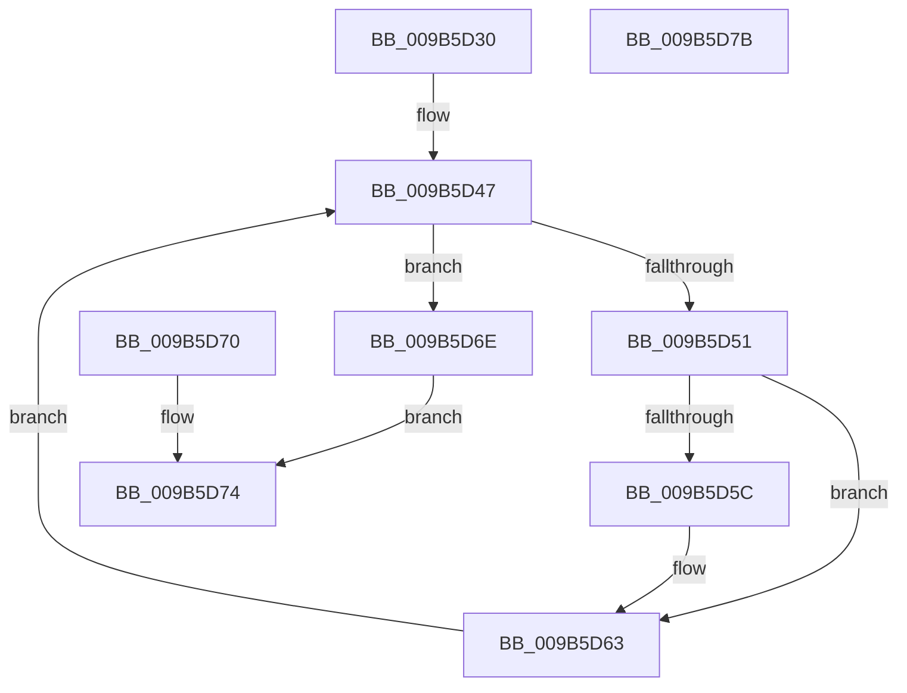

# HvpViewMapTouchPages

- RVA: `0x009B5D30`–`0x009B5D7C` (길이 `76` bytes)
- VA: `0x00000001409B5D30`
- 실행 섹션: `PAGE`
- PDB 이름 있음: `예`; PDB Function 태그: `아니요`
- unwind 정보 RVA: `0x0009E65C`
- 디코드: `22`개 명령, `76/76` bytes 표시
- 미해석 바이트: `0` (있으면 어셈블리에 `.byte`로 보존)

> 이 문서는 커널 이미지의 기계어와 PDB 기호를 분석해 생성했습니다. 4번과 5번은 함수 원형과 자료형을 바이너리 사용 방식에서 추정한 C 해석이며 원본 소스 복구 결과는 아닙니다.

## 1. Dependencies

- 직접 호출 지점: **0**; 고유 호출 대상: **0**
- 직접 호출자로 확인된 함수: **3**
- RIP 상대 이미지 참조: **0**

### Outgoing calls
- 직접 디코드된 call 명령이 없습니다.

### Direct callers
- [HvpViewMapMakeViewRangeCOWByCaller](HvpViewMapMakeViewRangeCOWByCaller_function_009B5BB4.md) at `0x009B5CB6`
- [HvpViewMapMakeViewRangeValid](HvpViewMapMakeViewRangeValid_function_009B5E00.md) at `0x009B5EA1`
- [HvpViewMapMakeViewRangeValid](HvpViewMapMakeViewRangeValid_function_009B5E00.md) at `0x009B6028`
- [HvpMappedViewConvertRegionFromLockedToCOWByPolicy](HvpMappedViewConvertRegionFromLockedToCOWByPolicy_function_009B75B8.md) at `0x009B7620`

### Static image references
- 디코드된 RIP-relative 메모리 참조가 없습니다.

## 2. Other-region calls and transfers

- 다른 실행 섹션으로 향하는 call: **0**
- 별도 외부 분기/꼬리 이동을 확인하지 못했습니다.

## 3. Assembly (complete function range)

```asm
009B5D30  48 83 EC 38                     sub rsp, 0x38
009B5D34  C7 44 24 20 06 00 00 C0         mov dword ptr [rsp + 0x20], 0xc0000006
009B5D3C  48 89 4C 24 28                  mov qword ptr [rsp + 0x28], rcx
009B5D41  4C 8D 0C 11                     lea r9, [rcx + rdx]
009B5D45  33 C9                           xor ecx, ecx
009B5D47  48 8B 44 24 28                  mov rax, qword ptr [rsp + 0x28]
009B5D4C  49 3B C1                        cmp rax, r9
009B5D4F  73 1D                           jae 0x1409b5d6e
009B5D51  8A 10                           mov dl, byte ptr [rax]
009B5D53  88 54 24 40                     mov byte ptr [rsp + 0x40], dl
009B5D57  45 84 C0                        test r8b, r8b
009B5D5A  74 07                           je 0x1409b5d63
009B5D5C  48 8B 44 24 28                  mov rax, qword ptr [rsp + 0x28]
009B5D61  88 10                           mov byte ptr [rax], dl
009B5D63  48 81 44 24 28 00 10 00 00      add qword ptr [rsp + 0x28], 0x1000
009B5D6C  EB D9                           jmp 0x1409b5d47
009B5D6E  EB 04                           jmp 0x1409b5d74
009B5D70  8B 4C 24 20                     mov ecx, dword ptr [rsp + 0x20]
009B5D74  8B C1                           mov eax, ecx
009B5D76  48 83 C4 38                     add rsp, 0x38
009B5D7A  C3                              ret
009B5D7B  CC                              int3
```

## 4. C-style interpretation (structured pseudocode)

```c
__int64 __fastcall HvpViewMapTouchPages(__int64 a1, __int64 a2, unsigned __int8 a3)
{
    __int64 result;
    __int64 v_rsp;
    unsigned __int64 v_stack_m10;
    unsigned int v_stack_m18;
    unsigned __int8 v_stack_p8;

    v_rsp = (v_rsp) - (56);
    v_stack_m18 = 0xC0000006ULL;
    v_stack_m10 = a1;
    a1 = 0;
loc_009B5D47:
    if (v_stack_m10 >= (a1 + a2 * 1)) goto loc_009B5D6E;
    v_stack_p8 = (unsigned __int8)(*(unsigned __int8 *)(v_stack_m10));
    result = v_stack_m10;
    if (a3 != 0) {
        result = v_stack_m10;
        *(unsigned __int8 *)(result) = (unsigned __int8)(*(unsigned __int8 *)(v_stack_m10));
    }
    goto loc_009B5D47;
loc_009B5D6E:
    goto loc_009B5D74;
loc_009B5D74:
    v_rsp = (v_rsp) + (56);
    return 0;
}
```

## 5. (Beta) C Style

```c
int64_t HvpViewMapTouchPages(void *Arg1, int64_t Arg2, uint8_t Arg3)
{
    uint8_t *arg1 = (uint8_t *)Arg1;

    int64_t result;
    int64_t local_rsp;
    uint64_t v_stack_m10;
    uint32_t v_stack_m18;
    uint8_t v_stack_p8;

    local_rsp = (local_rsp) - (56);
    v_stack_m18 = 0xC0000006ULL;
    v_stack_m10 = Arg1;
    Arg1 = 0;
loc_009B5D47:
    if (v_stack_m10 >= (Arg1 + Arg2 * 1)) goto loc_009B5D6E;
    v_stack_p8 = (uint8_t)(*(uint8_t *)(v_stack_m10));
    result = v_stack_m10;
    if (Arg3 != 0) {
        result = v_stack_m10;
        *(uint8_t *)(result) = (uint8_t)(*(uint8_t *)(v_stack_m10));
    }
    goto loc_009B5D47;
loc_009B5D6E:
    goto loc_009B5D74;
loc_009B5D74:
    local_rsp = (local_rsp) + (56);
    return 0;
}
```

### 관측된 메모리 오프셋

구조체 형식이 확인되지 않은 접근은 인자 기준의 오프셋으로만 기록했습니다.

| 기준 인자 | 오프셋 표현 | 폭 (bit) | 접근 |
|---|---:|---:|---|
| `Arg1` | `+ 0x0 + rdx*1` | `64` | `R` |

## 6. Execution-region graph

[열기: 2D/3D 그래프와 함수 탐색 컨트롤 패널](../../../control-panel.html?section=page&rva=0x009B5D30&view=graph)

- 2D 그래프는 위에서 아래로 흐르고, 3D 그래프는 빈 공간을 드래그해 회전합니다. Shift+드래그는 이동, 휠은 확대·축소, 함수 노드 선택은 대상 보고서 이동입니다.

### Static fallback


