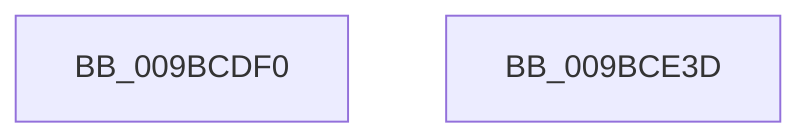

# IopThreadStart

- RVA: `0x009BCDF0`–`0x009BCE3E` (길이 `78` bytes)
- VA: `0x00000001409BCDF0`
- 실행 섹션: `PAGE`
- PDB 이름 있음: `예`; PDB Function 태그: `아니요`
- unwind 정보 RVA: `0x0006C2A4`
- 디코드: `19`개 명령, `78/78` bytes 표시
- 미해석 바이트: `0` (있으면 어셈블리에 `.byte`로 보존)

> 이 문서는 커널 이미지의 기계어와 PDB 기호를 분석해 생성했습니다. 4번과 5번은 함수 원형과 자료형을 바이너리 사용 방식에서 추정한 C 해석이며 원본 소스 복구 결과는 아닙니다.

## 1. Dependencies

- 직접 호출 지점: **4**; 고유 호출 대상: **4**
- 직접 호출자로 확인된 함수: **0**
- RIP 상대 이미지 참조: **0**

### Outgoing calls
- `0x009BCE09` → [ExFreePoolWithTag](../../poolcode/B8/ExFreePoolWithTag_function_00B82870.md) (function, `0x00B82870`)
- `0x009BCE22` → [guard_dispatch_icall](../../text/6B/guard_dispatch_icall_function_006BAAD0.md) (function, `0x006BAAD0`)
- `0x009BCE2C` → [ObfDereferenceObject](../../text/2F/ObfDereferenceObject_function_002F9350.md) (function, `0x002F9350`)
- `0x009BCE33` → [PsTerminateSystemThread](PsTerminateSystemThread_function_009BCE50.md) (function, `0x009BCE50`)

### Direct callers
- 이 함수 시작 RVA로 연결되는 직접 call은 확인되지 않았습니다. 간접 호출은 완전히 역산할 수 없습니다.

### Static image references
- 디코드된 RIP-relative 메모리 참조가 없습니다.

## 2. Other-region calls and transfers

- 다른 실행 섹션으로 향하는 call: **3**
  - `0x009BCE09` → [ExFreePoolWithTag](../../poolcode/B8/ExFreePoolWithTag_function_00B82870.md) (`PAGE` → `POOLCODE`)
  - `0x009BCE22` → [guard_dispatch_icall](../../text/6B/guard_dispatch_icall_function_006BAAD0.md) (`PAGE` → `.text`)
  - `0x009BCE2C` → [ObfDereferenceObject](../../text/2F/ObfDereferenceObject_function_002F9350.md) (`PAGE` → `.text`)
- 별도 외부 분기/꼬리 이동을 확인하지 못했습니다.

## 3. Assembly (complete function range)

```asm
009BCDF0  48 83 EC 58                     sub rsp, 0x58
009BCDF4  0F 10 01                        movups xmm0, xmmword ptr [rcx]
009BCDF7  33 D2                           xor edx, edx
009BCDF9  0F 11 44 24 20                  movups xmmword ptr [rsp + 0x20], xmm0
009BCDFE  F2 0F 10 41 10                  movsd xmm0, qword ptr [rcx + 0x10]
009BCE03  F2 0F 11 44 24 40               movsd qword ptr [rsp + 0x40], xmm0
009BCE09  E8 62 5A 1C 00                  call 0x140b82870
009BCE0E  0F 10 4C 24 20                  movups xmm1, xmmword ptr [rsp + 0x20]
009BCE13  48 8B 4C 24 40                  mov rcx, qword ptr [rsp + 0x40]
009BCE18  66 0F 73 D9 08                  psrldq xmm1, 8
009BCE1D  66 48 0F 7E C8                  movq rax, xmm1
009BCE22  E8 A9 DC CF FF                  call 0x1406baad0
009BCE27  48 8B 4C 24 20                  mov rcx, qword ptr [rsp + 0x20]
009BCE2C  E8 1F C5 93 FF                  call 0x1402f9350
009BCE31  33 C9                           xor ecx, ecx
009BCE33  E8 18 00 00 00                  call 0x1409bce50
009BCE38  48 83 C4 58                     add rsp, 0x58
009BCE3C  C3                              ret
009BCE3D  CC                              int3
```

## 4. C-style interpretation (structured pseudocode)

```c
__int64 __fastcall IopThreadStart(__int64 a1, int a2)
{
    __int64 result;
    __int64 v_rsp;
    unsigned __int64 v_stack_m18;
    unsigned __int64 v_stack_m38;

    v_rsp = (v_rsp) - (88);
    a2 = 0;
    v_stack_m38 = v_xmm0;
    v_stack_m18 = v_xmm0;
    result = ExFreePoolWithTag(a1, a2, a3, a4);
    result = guard_dispatch_icall(v_stack_m18, a2, a3, a4);
    result = ObfDereferenceObject(v_stack_m38, a2, a3, a4);
    a1 = 0;
    result = PsTerminateSystemThread(a1, a2, a3, a4);
    v_rsp = (v_rsp) + (88);
    return result;
}
```

## 5. (Beta) C Style

```c
int64_t IopThreadStart(void *Arg1, int32_t Arg2)
{
    uint8_t *arg1 = (uint8_t *)Arg1;

    int64_t result;
    int64_t local_rsp;
    uint64_t v_stack_m18;
    uint64_t v_stack_m38;

    local_rsp = (local_rsp) - (88);
    Arg2 = 0;
    v_stack_m38 = v_xmm0;
    v_stack_m18 = v_xmm0;
    result = ExFreePoolWithTag(Arg1, Arg2, a3, a4);
    result = guard_dispatch_icall(v_stack_m18, Arg2, a3, a4);
    result = ObfDereferenceObject(v_stack_m38, Arg2, a3, a4);
    Arg1 = 0;
    result = PsTerminateSystemThread(Arg1, Arg2, a3, a4);
    local_rsp = (local_rsp) + (88);
    return result;
}
```

### 관측된 메모리 오프셋

구조체 형식이 확인되지 않은 접근은 인자 기준의 오프셋으로만 기록했습니다.

| 기준 인자 | 오프셋 표현 | 폭 (bit) | 접근 |
|---|---:|---:|---|
| `Arg1` | `+ 0x0` | `128` | `R` |
| `Arg1` | `+ 0x10` | `64` | `R` |

## 6. Execution-region graph

[열기: 2D/3D 그래프와 함수 탐색 컨트롤 패널](../../../control-panel.html?section=page&rva=0x009BCDF0&view=graph)

- 2D 그래프는 위에서 아래로 흐르고, 3D 그래프는 빈 공간을 드래그해 회전합니다. Shift+드래그는 이동, 휠은 확대·축소, 함수 노드 선택은 대상 보고서 이동입니다.

### Static fallback


