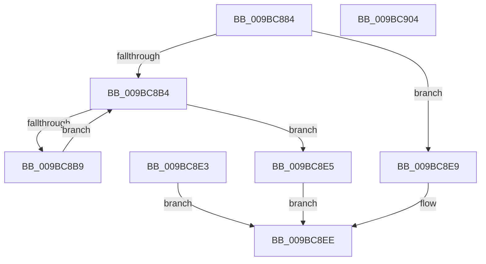

# KeDebugReadEnclaveMemory

- RVA: `0x009BC884`–`0x009BC905` (길이 `129` bytes)
- VA: `0x00000001409BC884`
- 실행 섹션: `PAGE`
- PDB 이름 있음: `예`; PDB Function 태그: `아니요`
- unwind 정보 RVA: `0x0009F064`
- 디코드: `37`개 명령, `129/129` bytes 표시
- 미해석 바이트: `0` (있으면 어셈블리에 `.byte`로 보존)

> 이 문서는 커널 이미지의 기계어와 PDB 기호를 분석해 생성했습니다. 4번과 5번은 함수 원형과 자료형을 바이너리 사용 방식에서 추정한 C 해석이며 원본 소스 복구 결과는 아닙니다.

## 1. Dependencies

- 직접 호출 지점: **1**; 고유 호출 대상: **1**
- 직접 호출자로 확인된 함수: **2**
- RIP 상대 이미지 참조: **1**

### Outgoing calls
- `0x009BC8C4` → [KiEnclsDebugRead](../../text/6B/KiEnclsDebugRead_function_006B1C00.md) (function, `0x006B1C00`)

### Direct callers
- [MiDbgReadWriteEnclave](MiDbgReadWriteEnclave_function_009BC580.md) at `0x009BC60C`
- [MiDbgReadWriteEnclaveUnaligned](MiDbgReadWriteEnclaveUnaligned_function_009BC7CC.md) at `0x009BC814`

### Static image references
- `0x009BC8A9` → RVA `0x00FC6B30` (`ALMOSTRO`; read)

## 2. Other-region calls and transfers

- 다른 실행 섹션으로 향하는 call: **1**
  - `0x009BC8C4` → [KiEnclsDebugRead](../../text/6B/KiEnclsDebugRead_function_006B1C00.md) (`PAGE` → `.text`)
- 별도 외부 분기/꼬리 이동을 확인하지 못했습니다.

## 3. Assembly (complete function range)

```asm
009BC884  48 89 5C 24 08                  mov qword ptr [rsp + 8], rbx
009BC889  48 89 74 24 10                  mov qword ptr [rsp + 0x10], rsi
009BC88E  48 89 7C 24 18                  mov qword ptr [rsp + 0x18], rdi
009BC893  41 56                           push r14
009BC895  48 83 EC 30                     sub rsp, 0x30
009BC899  4D 8B F1                        mov r14, r9
009BC89C  49 8B D8                        mov rbx, r8
009BC89F  48 8B FA                        mov rdi, rdx
009BC8A2  48 8B F1                        mov rsi, rcx
009BC8A5  49 83 21 00                     and qword ptr [r9], 0
009BC8A9  48 0F BA 25 7E A2 60 00 28      bt qword ptr [rip + 0x60a27e], 0x28
009BC8B2  73 35                           jae 0x1409bc8e9
009BC8B4  48 85 DB                        test rbx, rbx
009BC8B7  74 2C                           je 0x1409bc8e5
009BC8B9  45 33 C9                        xor r9d, r9d
009BC8BC  4C 8B C6                        mov r8, rsi
009BC8BF  33 D2                           xor edx, edx
009BC8C1  8D 4A 04                        lea ecx, [rdx + 4]
009BC8C4  E8 37 53 CF FF                  call 0x1406b1c00
009BC8C9  48 89 44 24 20                  mov qword ptr [rsp + 0x20], rax
009BC8CE  48 89 07                        mov qword ptr [rdi], rax
009BC8D1  48 83 C6 08                     add rsi, 8
009BC8D5  48 83 C7 08                     add rdi, 8
009BC8D9  48 83 EB 08                     sub rbx, 8
009BC8DD  49 83 06 08                     add qword ptr [r14], 8
009BC8E1  EB D1                           jmp 0x1409bc8b4
009BC8E3  EB 09                           jmp 0x1409bc8ee
009BC8E5  33 C0                           xor eax, eax
009BC8E7  EB 05                           jmp 0x1409bc8ee
009BC8E9  B8 BB 00 00 C0                  mov eax, 0xc00000bb
009BC8EE  48 8B 5C 24 40                  mov rbx, qword ptr [rsp + 0x40]
009BC8F3  48 8B 74 24 48                  mov rsi, qword ptr [rsp + 0x48]
009BC8F8  48 8B 7C 24 50                  mov rdi, qword ptr [rsp + 0x50]
009BC8FD  48 83 C4 30                     add rsp, 0x30
009BC901  41 5E                           pop r14
009BC903  C3                              ret
009BC904  CC                              int3
```

## 4. C-style interpretation (structured pseudocode)

```c
__int64 __fastcall KeDebugReadEnclaveMemory(__int64 a1, __int64 a2, __int64 a3, __int64 a4)
{
    __int64 result;
    __int64 v_rbx;
    __int64 v_rdi;
    __int64 v_rsi;
    __int64 v_rsp;
    unsigned __int64 v_stack_m18;
    unsigned __int64 v_stack_p10;
    unsigned __int64 v_stack_p18;
    unsigned __int64 v_stack_p8;

    v_stack_p8 = v_rbx;
    v_stack_p10 = v_rsi;
    v_stack_p18 = v_rdi;
    v_rsp = (v_rsp) - (48);
    if (condition_is_above_or_equal) goto loc_009BC8E9;
loc_009BC8B4:
    if (a3 == 0) goto loc_009BC8E5;
    a4 = 0;
    a2 = 0;
    result = KiEnclsDebugRead(a2 + 4, a2, a1, a4);
    v_stack_m18 = result;
    *(unsigned __int64 *)(a2) = result;
    v_rsi = (a1) + (8);
    v_rdi = (a2) + (8);
    v_rbx = (a3) - (8);
    goto loc_009BC8B4;
loc_009BC8E5:
    result = 0;
    goto loc_009BC8EE;
loc_009BC8E9:
loc_009BC8EE:
    v_rsp = (v_rsp) + (48);
    return (unsigned int)(0xC00000BBULL);
}
```

## 5. (Beta) C Style

```c
int64_t KeDebugReadEnclaveMemory(int64_t Arg1, void *Arg2, int64_t Arg3, void *Arg4)
{
    uint8_t *arg2 = (uint8_t *)Arg2;
    uint8_t *arg4 = (uint8_t *)Arg4;

    int64_t result;
    int64_t local_rbx;
    int64_t local_rdi;
    int64_t local_rsi;
    int64_t local_rsp;
    uint64_t v_stack_m18;
    uint64_t v_stack_p10;
    uint64_t v_stack_p18;
    uint64_t v_stack_p8;

    v_stack_p8 = local_rbx;
    v_stack_p10 = local_rsi;
    v_stack_p18 = local_rdi;
    local_rsp = (local_rsp) - (48);
    if (condition_is_above_or_equal) goto loc_009BC8E9;
loc_009BC8B4:
    if (Arg3 == 0) goto loc_009BC8E5;
    Arg4 = 0;
    Arg2 = 0;
    result = KiEnclsDebugRead(Arg2 + 4, Arg2, Arg1, Arg4);
    v_stack_m18 = result;
    *(uint64_t *)(arg2) = result;
    local_rsi = (Arg1) + (8);
    local_rdi = (Arg2) + (8);
    local_rbx = (Arg3) - (8);
    goto loc_009BC8B4;
loc_009BC8E5:
    result = 0;
    goto loc_009BC8EE;
loc_009BC8E9:
loc_009BC8EE:
    local_rsp = (local_rsp) + (48);
    return (uint32_t)(0xC00000BBULL);
}
```

### 관측된 메모리 오프셋

구조체 형식이 확인되지 않은 접근은 인자 기준의 오프셋으로만 기록했습니다.

| 기준 인자 | 오프셋 표현 | 폭 (bit) | 접근 |
|---|---:|---:|---|
| `Arg2` | `+ 0x0` | `64` | `W` |
| `Arg4` | `+ 0x0` | `64` | `R/W` |

## 6. Execution-region graph

[열기: 2D/3D 그래프와 함수 탐색 컨트롤 패널](../../../control-panel.html?section=page&rva=0x009BC884&view=graph)

- 2D 그래프는 위에서 아래로 흐르고, 3D 그래프는 빈 공간을 드래그해 회전합니다. Shift+드래그는 이동, 휠은 확대·축소, 함수 노드 선택은 대상 보고서 이동입니다.

### Static fallback


