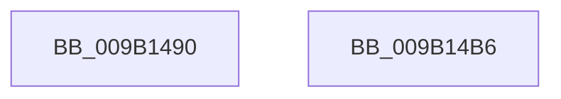

# LOCK_CM_RM_LIST

- RVA: `0x009B1490`–`0x009B14B7` (길이 `39` bytes)
- VA: `0x00000001409B1490`
- 실행 섹션: `PAGE`
- PDB 이름 있음: `예`; PDB Function 태그: `아니요`
- unwind 정보 RVA: `0x0005C788`
- 디코드: `9`개 명령, `39/39` bytes 표시
- 미해석 바이트: `0` (있으면 어셈블리에 `.byte`로 보존)

> 이 문서는 커널 이미지의 기계어와 PDB 기호를 분석해 생성했습니다. 4번과 5번은 함수 원형과 자료형을 바이너리 사용 방식에서 추정한 C 해석이며 원본 소스 복구 결과는 아닙니다.

## 1. Dependencies

- 직접 호출 지점: **1**; 고유 호출 대상: **1**
- 직접 호출자로 확인된 함수: **3**
- RIP 상대 이미지 참조: **1**

### Outgoing calls
- `0x009B14AC` → [ExAcquireFastMutexUnsafe](../../text/3F/ExAcquireFastMutexUnsafe_function_003F3720.md) (function, `0x003F3720`)

### Direct callers
- [CmpInitCmRM](../87/CmpInitCmRM_function_0087C700.md) at `0x0087D0D4`
- [CmpRunDownCmRM](CmpRunDownCmRM_function_009B062C.md) at `0x009B06C0`
- [CmpIsCmRm](CmpIsCmRm_function_009B1E78.md) at `0x009B1E8C`

### Static image references
- `0x009B149D` → RVA `0x00EF5660` (`.data`; read)

## 2. Other-region calls and transfers

- 다른 실행 섹션으로 향하는 call: **1**
  - `0x009B14AC` → [ExAcquireFastMutexUnsafe](../../text/3F/ExAcquireFastMutexUnsafe_function_003F3720.md) (`PAGE` → `.text`)
- 별도 외부 분기/꼬리 이동을 확인하지 못했습니다.

## 3. Assembly (complete function range)

```asm
009B1490  48 83 EC 28                     sub rsp, 0x28
009B1494  65 48 8B 04 25 88 01 00 00      mov rax, qword ptr gs:[0x188]
009B149D  48 8D 0D BC 41 54 00            lea rcx, [rip + 0x5441bc]
009B14A4  66 FF 88 E4 01 00 00            dec word ptr [rax + 0x1e4]
009B14AB  90                              nop
009B14AC  E8 6F 22 A4 FF                  call 0x1403f3720
009B14B1  48 83 C4 28                     add rsp, 0x28
009B14B5  C3                              ret
009B14B6  CC                              int3
```

## 4. C-style interpretation (structured pseudocode)

```c
__int64 __fastcall LOCK_CM_RM_LIST(void)
{
    __int64 result;
    __int64 v_rsp;

    v_rsp = (v_rsp) - (40);
    result = ExAcquireFastMutexUnsafe(v_rip + 5521852, a2, a3, a4);
    v_rsp = (v_rsp) + (40);
    return result;
}
```

## 5. (Beta) C Style

```c
void LOCK_CM_RM_LIST(void)
{
    int64_t result;
    int64_t local_rsp;

    local_rsp = (local_rsp) - (40);
    result = ExAcquireFastMutexUnsafe(v_rip + 5521852, a2, a3, a4);
    local_rsp = (local_rsp) + (40);
    return result;
}
```

## 6. Execution-region graph

[열기: 2D/3D 그래프와 함수 탐색 컨트롤 패널](../../../control-panel.html?section=page&rva=0x009B1490&view=graph)

- 2D 그래프는 위에서 아래로 흐르고, 3D 그래프는 빈 공간을 드래그해 회전합니다. Shift+드래그는 이동, 휠은 확대·축소, 함수 노드 선택은 대상 보고서 이동입니다.

### Static fallback


