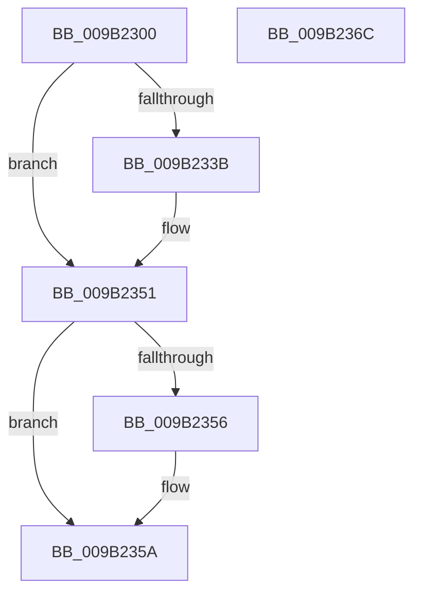

# LOCK_HIVE_LOAD

- RVA: `0x009B2300`–`0x009B236D` (길이 `109` bytes)
- VA: `0x00000001409B2300`
- 실행 섹션: `PAGE`
- PDB 이름 있음: `예`; PDB Function 태그: `아니요`
- unwind 정보 RVA: `0x0005CAAC`
- 디코드: `26`개 명령, `109/109` bytes 표시
- 미해석 바이트: `0` (있으면 어셈블리에 `.byte`로 보존)

> 이 문서는 커널 이미지의 기계어와 PDB 기호를 분석해 생성했습니다. 4번과 5번은 함수 원형과 자료형을 바이너리 사용 방식에서 추정한 C 해석이며 원본 소스 복구 결과는 아닙니다.

## 1. Dependencies

- 직접 호출 지점: **2**; 고유 호출 대상: **2**
- 직접 호출자로 확인된 함수: **14**
- RIP 상대 이미지 참조: **3**

### Outgoing calls
- `0x009B2327` → [KeAbPreAcquire](../../text/21/KeAbPreAcquire_function_00210230.md) (function, `0x00210230`)
- `0x009B234C` → [ExfAcquirePushLockExclusiveEx](../../text/20/ExfAcquirePushLockExclusiveEx_function_0020FC90.md) (function, `0x0020FC90`)

### Direct callers
- [CmpTryToRundownHive](../../text/2A/CmpTryToRundownHive_function_002A4A60.md) at `0x002A4ADB`
- [CmpTryToRundownHive](../../text/2A/CmpTryToRundownHive_function_002A4A60.md) at `0x002A4BB6`
- [CmpLoadKeyCommon](../../text/46/CmpLoadKeyCommon_function_0046E9F8.md) at `0x0046EA8C`
- [CmpLoadKeyCommon](../../text/46/CmpLoadKeyCommon_function_0046E9F8.md) at `0x0046ED40`
- [CmShutdownSystem1](../../text/66/CmShutdownSystem1_function_0066A5B0.md) at `0x0066A5F8`
- [CmShutdownSystem1](../../text/66/CmShutdownSystem1_function_0066A5B0.md) at `0x0066A651`
- [CmShutdownSystem2](../../text/66/CmShutdownSystem2_function_0066A7FC.md) at `0x0066A856`
- [sub_006DAE8A](../../text/6D/Unknown_function_006DAE8A.md) at `0x006DAE8A`
- [sub_006DAE8A](../../text/6D/Unknown_function_006DAE8A.md) at `0x006DAE96`
- [CmpLazyCommitWorker](../7E/CmpLazyCommitWorker_function_007EE030.md) at `0x007EE07E`
- [CmpDoFlushNextHive](../84/CmpDoFlushNextHive_function_0084C7C0.md) at `0x0084C852`
- [CmLoadAppKey](../87/CmLoadAppKey_function_00876FFC.md) at `0x00877748`
- [CmLoadAppKey](../87/CmLoadAppKey_function_00876FFC.md) at `0x00877AD5`
- [CmReleaseLoadKeyContext](../87/CmReleaseLoadKeyContext_function_00877C88.md) at `0x00877CAE`
- [CmpPerformUnloadKey](../9A/CmpPerformUnloadKey_function_009AFA28.md) at `0x009AFAA6`
- [CmpPerformUnloadKey](../9A/CmpPerformUnloadKey_function_009AFA28.md) at `0x009AFC8F`
- [CmpPerformUnloadKey](../9A/CmpPerformUnloadKey_function_009AFA28.md) at `0x009AFD7E`
- [CmpPerformUnloadKey](../9A/CmpPerformUnloadKey_function_009AFA28.md) at `0x009AFE8C`
- [CmpPerformUnloadKey](../9A/CmpPerformUnloadKey_function_009AFA28.md) at `0x009AFED0`
- [CmKtmNotification](CmKtmNotification_function_009B1950.md) at `0x009B1A73`
- [CmpLateUnloadHiveWorker](CmpLateUnloadHiveWorker_function_009B20D0.md) at `0x009B2153`
- [CmpResolveHiveLoadConflict](../A9/CmpResolveHiveLoadConflict_function_00A9E78C.md) at `0x00A9E893`
- [sub_00B179DA](../B1/Unknown_function_00B179DA.md) at `0x00B17A93`

### Static image references
- `0x009B2313` → RVA `0x00EF7C78` (`.data`; read)
- `0x009B232C` → RVA `0x00EF7C78` (`.data`; read/write)
- `0x009B235F` → RVA `0x00FD8220` (`PAGEDATA`; write)

## 2. Other-region calls and transfers

- 다른 실행 섹션으로 향하는 call: **2**
  - `0x009B2327` → [KeAbPreAcquire](../../text/21/KeAbPreAcquire_function_00210230.md) (`PAGE` → `.text`)
  - `0x009B234C` → [ExfAcquirePushLockExclusiveEx](../../text/20/ExfAcquirePushLockExclusiveEx_function_0020FC90.md) (`PAGE` → `.text`)
- 별도 외부 분기/꼬리 이동을 확인하지 못했습니다.

## 3. Assembly (complete function range)

```asm
009B2300  48 89 5C 24 08                  mov qword ptr [rsp + 8], rbx
009B2305  57                              push rdi
009B2306  48 83 EC 20                     sub rsp, 0x20
009B230A  65 48 8B 3C 25 88 01 00 00      mov rdi, qword ptr gs:[0x188]
009B2313  48 8D 0D 5E 59 54 00            lea rcx, [rip + 0x54595e]
009B231A  45 33 C0                        xor r8d, r8d
009B231D  33 D2                           xor edx, edx
009B231F  66 FF 8F E4 01 00 00            dec word ptr [rdi + 0x1e4]
009B2326  90                              nop
009B2327  E8 04 DF 85 FF                  call 0x140210230
009B232C  F0 48 0F BA 2D 42 59 54 00 00   lock bts qword ptr [rip + 0x545942], 0
009B2336  48 8B D8                        mov rbx, rax
009B2339  73 16                           jae 0x1409b2351
009B233B  4C 8D 05 36 59 54 00            lea r8, [rip + 0x545936]
009B2342  48 8B D0                        mov rdx, rax
009B2345  48 8D 0D 2C 59 54 00            lea rcx, [rip + 0x54592c]
009B234C  E8 3F D9 85 FF                  call 0x14020fc90
009B2351  48 85 DB                        test rbx, rbx
009B2354  74 04                           je 0x1409b235a
009B2356  C6 43 0A 01                     mov byte ptr [rbx + 0xa], 1
009B235A  48 8B 5C 24 30                  mov rbx, qword ptr [rsp + 0x30]
009B235F  48 89 3D BA 5E 62 00            mov qword ptr [rip + 0x625eba], rdi
009B2366  48 83 C4 20                     add rsp, 0x20
009B236A  5F                              pop rdi
009B236B  C3                              ret
009B236C  CC                              int3
```

## 4. C-style interpretation (structured pseudocode)

```c
__int64 __fastcall LOCK_HIVE_LOAD(__int64 a1, int a2, int a3)
{
    __int64 result;
    __int64 v_rsp;
    unsigned __int64 v_stack_p8;

    v_stack_p8 = v_rbx;
    v_rsp = (v_rsp) - (32);
    a3 = 0;
    a2 = 0;
    result = KeAbPreAcquire(v_rip + 5527902, a2, a3, a4);
    if (!(condition_is_above_or_equal)) {
        a3 = v_rip + 5527862;
        a2 = result;
        a1 = v_rip + 5527852;
        result = ExfAcquirePushLockExclusiveEx(a1, a2, a3, a4);
    }
    if (result != 0) {
        *(unsigned __int8 *)(result + 10) = 1;
    }
    *(unsigned __int64 *)(v_rip + 6446778) = *(unsigned __int64 *)(gs_base + (0 + 392));
    v_rsp = (v_rsp) + (32);
    return result;
}
```

## 5. (Beta) C Style

```c
int64_t LOCK_HIVE_LOAD(int64_t Arg1, int32_t Arg2, int32_t Arg3)
{
    int64_t result;
    int64_t local_rsp;
    uint64_t v_stack_p8;

    v_stack_p8 = local_rbx;
    local_rsp = (local_rsp) - (32);
    Arg3 = 0;
    Arg2 = 0;
    result = KeAbPreAcquire(v_rip + 5527902, Arg2, Arg3, a4);
    if (!(condition_is_above_or_equal)) {
        Arg3 = v_rip + 5527862;
        Arg2 = result;
        Arg1 = v_rip + 5527852;
        result = ExfAcquirePushLockExclusiveEx(Arg1, Arg2, Arg3, a4);
    }
    if (result != 0) {
        *(uint8_t *)(result + 0xA) = 1;
    }
    *(uint64_t *)(v_rip + 0x625EBA) = *(uint64_t *)(gs_base + (0 + 0x188));
    local_rsp = (local_rsp) + (32);
    return result;
}
```

## 6. Execution-region graph

[열기: 2D/3D 그래프와 함수 탐색 컨트롤 패널](../../../control-panel.html?section=page&rva=0x009B2300&view=graph)

- 2D 그래프는 위에서 아래로 흐르고, 3D 그래프는 빈 공간을 드래그해 회전합니다. Shift+드래그는 이동, 휠은 확대·축소, 함수 노드 선택은 대상 보고서 이동입니다.

### Static fallback


