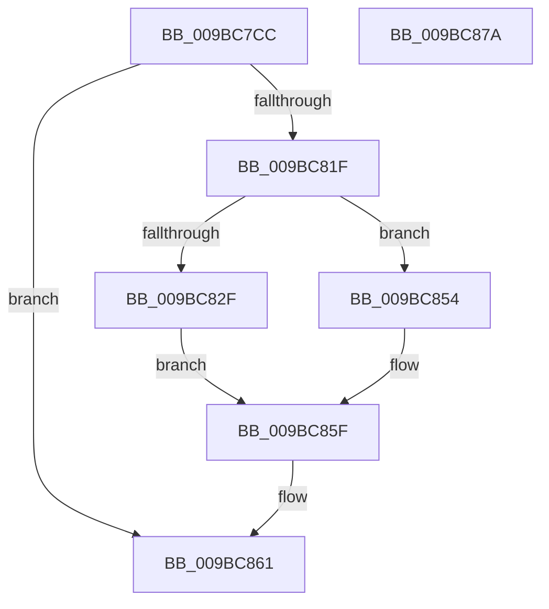

# MiDbgReadWriteEnclaveUnaligned

- RVA: `0x009BC7CC`–`0x009BC87B` (길이 `175` bytes)
- VA: `0x00000001409BC7CC`
- 실행 섹션: `PAGE`
- PDB 이름 있음: `예`; PDB Function 태그: `아니요`
- unwind 정보 RVA: `0x0009F048`
- 디코드: `53`개 명령, `175/175` bytes 표시
- 미해석 바이트: `0` (있으면 어셈블리에 `.byte`로 보존)

> 이 문서는 커널 이미지의 기계어와 PDB 기호를 분석해 생성했습니다. 4번과 5번은 함수 원형과 자료형을 바이너리 사용 방식에서 추정한 C 해석이며 원본 소스 복구 결과는 아닙니다.

## 1. Dependencies

- 직접 호출 지점: **4**; 고유 호출 대상: **3**
- 직접 호출자로 확인된 함수: **1**
- RIP 상대 이미지 참조: **0**

### Outgoing calls
- `0x009BC814` → [KeDebugReadEnclaveMemory](KeDebugReadEnclaveMemory_function_009BC884.md) (function, `0x009BC884`)
- `0x009BC835` → [memcpy](../../text/6C/memcpy_function_006C6840.md) (function, `0x006C6840`)
- `0x009BC84B` → [KeDebugWriteEnclaveMemory](../74/KeDebugWriteEnclaveMemory_function_00746310.md) (function, `0x00746310`)
- `0x009BC85A` → [memcpy](../../text/6C/memcpy_function_006C6840.md) (function, `0x006C6840`)

### Direct callers
- [MiDbgReadWriteEnclave](MiDbgReadWriteEnclave_function_009BC580.md) at `0x009BC5D0`
- [MiDbgReadWriteEnclave](MiDbgReadWriteEnclave_function_009BC580.md) at `0x009BC639`

### Static image references
- 디코드된 RIP-relative 메모리 참조가 없습니다.

## 2. Other-region calls and transfers

- 다른 실행 섹션으로 향하는 call: **2**
  - `0x009BC835` → [memcpy](../../text/6C/memcpy_function_006C6840.md) (`PAGE` → `.text`)
  - `0x009BC85A` → [memcpy](../../text/6C/memcpy_function_006C6840.md) (`PAGE` → `.text`)
- 별도 외부 분기/꼬리 이동을 확인하지 못했습니다.

## 3. Assembly (complete function range)

```asm
009BC7CC  48 8B C4                        mov rax, rsp
009BC7CF  48 89 58 10                     mov qword ptr [rax + 0x10], rbx
009BC7D3  48 89 68 18                     mov qword ptr [rax + 0x18], rbp
009BC7D7  48 89 70 20                     mov qword ptr [rax + 0x20], rsi
009BC7DB  57                              push rdi
009BC7DC  41 56                           push r14
009BC7DE  41 57                           push r15
009BC7E0  48 83 EC 30                     sub rsp, 0x30
009BC7E4  48 83 60 08 00                  and qword ptr [rax + 8], 0
009BC7E9  48 8B F9                        mov rdi, rcx
009BC7EC  48 83 60 D8 00                  and qword ptr [rax - 0x28], 0
009BC7F1  48 8B E9                        mov rbp, rcx
009BC7F4  45 8B F1                        mov r14d, r9d
009BC7F7  45 8B F8                        mov r15d, r8d
009BC7FA  48 8B F2                        mov rsi, rdx
009BC7FD  4C 8D 48 D8                     lea r9, [rax - 0x28]
009BC801  83 E7 07                        and edi, 7
009BC804  48 8D 50 08                     lea rdx, [rax + 8]
009BC808  48 2B EF                        sub rbp, rdi
009BC80B  41 B8 08 00 00 00               mov r8d, 8
009BC811  48 8B CD                        mov rcx, rbp
009BC814  E8 6B 00 00 00                  call 0x1409bc884
009BC819  8B D8                           mov ebx, eax
009BC81B  85 C0                           test eax, eax
009BC81D  78 42                           js 0x1409bc861
009BC81F  48 8D 44 24 50                  lea rax, [rsp + 0x50]
009BC824  45 8B C7                        mov r8d, r15d
009BC827  48 03 C7                        add rax, rdi
009BC82A  45 85 F6                        test r14d, r14d
009BC82D  75 25                           jne 0x1409bc854
009BC82F  48 8B D6                        mov rdx, rsi
009BC832  48 8B C8                        mov rcx, rax
009BC835  E8 06 A0 D0 FF                  call 0x1406c6840
009BC83A  4C 8D 4C 24 20                  lea r9, [rsp + 0x20]
009BC83F  48 8B CD                        mov rcx, rbp
009BC842  45 8D 46 08                     lea r8d, [r14 + 8]
009BC846  48 8D 54 24 50                  lea rdx, [rsp + 0x50]
009BC84B  E8 C0 9A D8 FF                  call 0x140746310
009BC850  8B D8                           mov ebx, eax
009BC852  EB 0B                           jmp 0x1409bc85f
009BC854  48 8B D0                        mov rdx, rax
009BC857  48 8B CE                        mov rcx, rsi
009BC85A  E8 E1 9F D0 FF                  call 0x1406c6840
009BC85F  8B C3                           mov eax, ebx
009BC861  48 8B 5C 24 58                  mov rbx, qword ptr [rsp + 0x58]
009BC866  48 8B 6C 24 60                  mov rbp, qword ptr [rsp + 0x60]
009BC86B  48 8B 74 24 68                  mov rsi, qword ptr [rsp + 0x68]
009BC870  48 83 C4 30                     add rsp, 0x30
009BC874  41 5F                           pop r15
009BC876  41 5E                           pop r14
009BC878  5F                              pop rdi
009BC879  C3                              ret
009BC87A  CC                              int3
```

## 4. C-style interpretation (structured pseudocode)

```c
__int64 __fastcall MiDbgReadWriteEnclaveUnaligned(__int64 a1, __int64 a2, int a3, int a4)
{
    __int64 result;
    __int64 v_rbp;
    __int64 v_rdi;
    __int64 v_rsp;
    unsigned __int64 v_stack_m28;
    unsigned __int64 v_stack_p10;
    unsigned __int64 v_stack_p18;
    unsigned __int64 v_stack_p20;
    unsigned __int64 v_stack_p8;

    *(unsigned __int64 *)(v_rsp + 16) = v_rbx;
    *(unsigned __int64 *)(v_rsp + 24) = v_rbp;
    *(unsigned __int64 *)(v_rsp + 32) = v_rsi;
    v_rsp = (v_rsp) - (48);
    v_rdi = (unsigned int)((a1) & (7));
    v_rbp = (a1) - (v_rdi);
    result = KeDebugReadEnclaveMemory(v_rbp, v_rsp + 8, 8, v_rsp - 40);
    if (sign_flag) goto loc_009BC861;
    result = (v_stack_p8) + (v_rdi);
    if ((unsigned int)((unsigned int)(a4)) != 0) goto loc_009BC854;
    result = memcpy(result, a2, (unsigned int)((unsigned int)((unsigned int)(a3))), v_rsp - 40);
    result = KeDebugWriteEnclaveMemory(v_rbp, v_stack_p8, (unsigned int)(a4) + 8, v_stack_m28);
    goto loc_009BC85F;
loc_009BC854:
    result = memcpy(a2, result, (unsigned int)(a4) + 8, v_stack_m28);
loc_009BC85F:
loc_009BC861:
    v_rsp = (v_rsp) + (48);
    return (unsigned int)((unsigned int)((unsigned int)((unsigned int)(result))));
}
```

## 5. (Beta) C Style

```c
int64_t MiDbgReadWriteEnclaveUnaligned(int64_t Arg1, int64_t Arg2, int32_t Arg3, int32_t Arg4)
{
    int64_t result;
    int64_t local_rbp;
    int64_t local_rdi;
    int64_t local_rsp;
    uint64_t v_stack_m28;
    uint64_t v_stack_p10;
    uint64_t v_stack_p18;
    uint64_t v_stack_p20;
    uint64_t v_stack_p8;

    *(uint64_t *)(local_rsp + 0x10) = local_rbx;
    *(uint64_t *)(local_rsp + 0x18) = local_rbp;
    *(uint64_t *)(local_rsp + 0x20) = local_rsi;
    local_rsp = (local_rsp) - (48);
    local_rdi = (uint32_t)((Arg1) & (7));
    local_rbp = (Arg1) - (local_rdi);
    result = KeDebugReadEnclaveMemory(local_rbp, local_rsp + 8, 8, local_rsp - 40);
    if (sign_flag) goto loc_009BC861;
    result = (v_stack_p8) + (local_rdi);
    if ((uint32_t)((uint32_t)(Arg4)) != 0) goto loc_009BC854;
    result = memcpy(result, Arg2, (uint32_t)((uint32_t)((uint32_t)(Arg3))), local_rsp - 40);
    result = KeDebugWriteEnclaveMemory(local_rbp, v_stack_p8, (uint32_t)(Arg4) + 8, v_stack_m28);
    goto loc_009BC85F;
loc_009BC854:
    result = memcpy(Arg2, result, (uint32_t)(Arg4) + 8, v_stack_m28);
loc_009BC85F:
loc_009BC861:
    local_rsp = (local_rsp) + (48);
    return (uint32_t)((uint32_t)((uint32_t)((uint32_t)(result))));
}
```

## 6. Execution-region graph

[열기: 2D/3D 그래프와 함수 탐색 컨트롤 패널](../../../control-panel.html?section=page&rva=0x009BC7CC&view=graph)

- 2D 그래프는 위에서 아래로 흐르고, 3D 그래프는 빈 공간을 드래그해 회전합니다. Shift+드래그는 이동, 휠은 확대·축소, 함수 노드 선택은 대상 보고서 이동입니다.

### Static fallback


