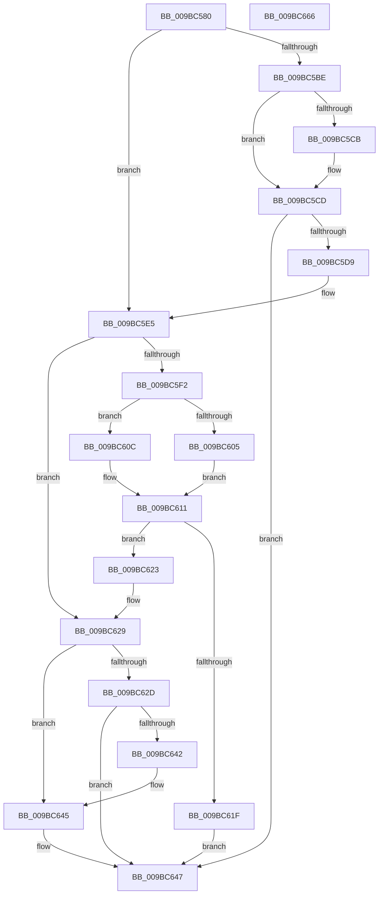

# MiDbgReadWriteEnclave

- RVA: `0x009BC580`–`0x009BC667` (길이 `231` bytes)
- VA: `0x00000001409BC580`
- 실행 섹션: `PAGE`
- PDB 이름 있음: `예`; PDB Function 태그: `아니요`
- unwind 정보 RVA: `0x0005FEF8`
- 디코드: `76`개 명령, `231/231` bytes 표시
- 미해석 바이트: `0` (있으면 어셈블리에 `.byte`로 보존)

> 이 문서는 커널 이미지의 기계어와 PDB 기호를 분석해 생성했습니다. 4번과 5번은 함수 원형과 자료형을 바이너리 사용 방식에서 추정한 C 해석이며 원본 소스 복구 결과는 아닙니다.

## 1. Dependencies

- 직접 호출 지점: **4**; 고유 호출 대상: **3**
- 직접 호출자로 확인된 함수: **1**
- RIP 상대 이미지 참조: **0**

### Outgoing calls
- `0x009BC5D0` → [MiDbgReadWriteEnclaveUnaligned](MiDbgReadWriteEnclaveUnaligned_function_009BC7CC.md) (function, `0x009BC7CC`)
- `0x009BC605` → [KeDebugWriteEnclaveMemory](../74/KeDebugWriteEnclaveMemory_function_00746310.md) (function, `0x00746310`)
- `0x009BC60C` → [KeDebugReadEnclaveMemory](KeDebugReadEnclaveMemory_function_009BC884.md) (function, `0x009BC884`)
- `0x009BC639` → [MiDbgReadWriteEnclaveUnaligned](MiDbgReadWriteEnclaveUnaligned_function_009BC7CC.md) (function, `0x009BC7CC`)

### Direct callers
- [MiCopyVirtualMemory](MiCopyVirtualMemory_function_009BBB50.md) at `0x009BBEB8`
- [MiCopyVirtualMemory](MiCopyVirtualMemory_function_009BBB50.md) at `0x009BC186`

### Static image references
- 디코드된 RIP-relative 메모리 참조가 없습니다.

## 2. Other-region calls and transfers

- 다른 실행 섹션으로 향하는 call: **0**
- 별도 외부 분기/꼬리 이동을 확인하지 못했습니다.

## 3. Assembly (complete function range)

```asm
009BC580  48 8B C4                        mov rax, rsp
009BC583  48 89 58 08                     mov qword ptr [rax + 8], rbx
009BC587  48 89 68 10                     mov qword ptr [rax + 0x10], rbp
009BC58B  48 89 70 18                     mov qword ptr [rax + 0x18], rsi
009BC58F  48 89 78 20                     mov qword ptr [rax + 0x20], rdi
009BC593  41 54                           push r12
009BC595  41 56                           push r14
009BC597  41 57                           push r15
009BC599  48 83 EC 20                     sub rsp, 0x20
009BC59D  4C 8B 74 24 60                  mov r14, qword ptr [rsp + 0x60]
009BC5A2  45 8B E1                        mov r12d, r9d
009BC5A5  48 83 60 28 00                  and qword ptr [rax + 0x28], 0
009BC5AA  49 8B D8                        mov rbx, r8
009BC5AD  8B C1                           mov eax, ecx
009BC5AF  48 8B EA                        mov rbp, rdx
009BC5B2  48 8B F1                        mov rsi, rcx
009BC5B5  49 83 26 00                     and qword ptr [r14], 0
009BC5B9  83 E0 07                        and eax, 7
009BC5BC  74 27                           je 0x1409bc5e5
009BC5BE  BF 08 00 00 00                  mov edi, 8
009BC5C3  48 2B F8                        sub rdi, rax
009BC5C6  48 3B DF                        cmp rbx, rdi
009BC5C9  73 02                           jae 0x1409bc5cd
009BC5CB  8B FB                           mov edi, ebx
009BC5CD  44 8B C7                        mov r8d, edi
009BC5D0  E8 F7 01 00 00                  call 0x1409bc7cc
009BC5D5  85 C0                           test eax, eax
009BC5D7  78 6E                           js 0x1409bc647
009BC5D9  48 03 F7                        add rsi, rdi
009BC5DC  49 89 3E                        mov qword ptr [r14], rdi
009BC5DF  48 03 EF                        add rbp, rdi
009BC5E2  48 2B DF                        sub rbx, rdi
009BC5E5  8B FB                           mov edi, ebx
009BC5E7  83 E7 07                        and edi, 7
009BC5EA  44 8B FF                        mov r15d, edi
009BC5ED  49 2B DF                        sub rbx, r15
009BC5F0  74 37                           je 0x1409bc629
009BC5F2  4C 8D 4C 24 60                  lea r9, [rsp + 0x60]
009BC5F7  4C 8B C3                        mov r8, rbx
009BC5FA  48 8B D5                        mov rdx, rbp
009BC5FD  48 8B CE                        mov rcx, rsi
009BC600  45 85 E4                        test r12d, r12d
009BC603  75 07                           jne 0x1409bc60c
009BC605  E8 06 9D D8 FF                  call 0x140746310
009BC60A  EB 05                           jmp 0x1409bc611
009BC60C  E8 73 02 00 00                  call 0x1409bc884
009BC611  8B C8                           mov ecx, eax
009BC613  48 8B 44 24 60                  mov rax, qword ptr [rsp + 0x60]
009BC618  49 01 06                        add qword ptr [r14], rax
009BC61B  85 C9                           test ecx, ecx
009BC61D  79 04                           jns 0x1409bc623
009BC61F  8B C1                           mov eax, ecx
009BC621  EB 24                           jmp 0x1409bc647
009BC623  48 03 F3                        add rsi, rbx
009BC626  48 03 EB                        add rbp, rbx
009BC629  85 FF                           test edi, edi
009BC62B  74 18                           je 0x1409bc645
009BC62D  45 8B CC                        mov r9d, r12d
009BC630  44 8B C7                        mov r8d, edi
009BC633  48 8B D5                        mov rdx, rbp
009BC636  48 8B CE                        mov rcx, rsi
009BC639  E8 8E 01 00 00                  call 0x1409bc7cc
009BC63E  85 C0                           test eax, eax
009BC640  78 05                           js 0x1409bc647
009BC642  4D 01 3E                        add qword ptr [r14], r15
009BC645  33 C0                           xor eax, eax
009BC647  48 8B 5C 24 40                  mov rbx, qword ptr [rsp + 0x40]
009BC64C  48 8B 6C 24 48                  mov rbp, qword ptr [rsp + 0x48]
009BC651  48 8B 74 24 50                  mov rsi, qword ptr [rsp + 0x50]
009BC656  48 8B 7C 24 58                  mov rdi, qword ptr [rsp + 0x58]
009BC65B  48 83 C4 20                     add rsp, 0x20
009BC65F  41 5F                           pop r15
009BC661  41 5E                           pop r14
009BC663  41 5C                           pop r12
009BC665  C3                              ret
009BC666  CC                              int3
```

## 4. C-style interpretation (structured pseudocode)

```c
__int64 __fastcall MiDbgReadWriteEnclave(__int64 a1, __int64 a2, __int64 a3, int a4, __int64 a5)
{
    __int64 result;
    __int64 v_rbp;
    __int64 v_rbx;
    __int64 v_rdi;
    __int64 v_rsi;
    __int64 v_rsp;
    unsigned __int64 v_stack_p10;
    unsigned __int64 v_stack_p18;
    unsigned __int64 v_stack_p20;
    unsigned __int64 v_stack_p8;

    *(unsigned __int64 *)(v_rsp + 8) = v_rbx;
    *(unsigned __int64 *)(v_rsp + 16) = v_rbp;
    *(unsigned __int64 *)(v_rsp + 24) = v_rsi;
    *(unsigned __int64 *)(v_rsp + 32) = v_rdi;
    v_rsp = (v_rsp) - (32);
    result = (unsigned int)(((unsigned int)((unsigned int)(a1))) & (7));
    if (condition_is_equal) goto loc_009BC5E5;
    v_rdi = (8) - (result);
    if (a3 < v_rdi) {
        v_rdi = (unsigned int)(a3);
    }
    result = MiDbgReadWriteEnclaveUnaligned(a1, a2, (unsigned int)((unsigned int)(v_rdi)), a4);
    if (sign_flag) goto loc_009BC647;
    v_rsi = (a1) + (v_rdi);
    *(unsigned __int64 *)(a5) = v_rdi;
    v_rbp = (a2) + (v_rdi);
    v_rbx = (a3) - (v_rdi);
loc_009BC5E5:
    v_rdi = (unsigned int)(((unsigned int)((unsigned int)(v_rbx))) & (7));
    v_rbx = (v_rbx) - ((unsigned int)((unsigned int)(v_rdi)));
    if (condition_is_equal) goto loc_009BC629;
    if ((unsigned int)((unsigned int)(a4)) != 0) goto loc_009BC60C;
    result = KeDebugWriteEnclaveMemory(v_rsi, v_rbp, v_rbx, a5);
    goto loc_009BC611;
loc_009BC60C:
    result = KeDebugReadEnclaveMemory(v_rsi, v_rbp, v_rbx, a5);
loc_009BC611:
    if (!sign_flag) goto loc_009BC623;
    goto loc_009BC647;
loc_009BC623:
    v_rsi = (v_rsi) + (v_rbx);
    v_rbp = (v_rbp) + (v_rbx);
loc_009BC629:
    if ((unsigned int)(v_rdi) == 0) goto loc_009BC645;
    result = MiDbgReadWriteEnclaveUnaligned(v_rsi, v_rbp, (unsigned int)((unsigned int)(v_rdi)), (unsigned int)((unsigned int)((unsigned int)(a4))));
    if (sign_flag) goto loc_009BC647;
loc_009BC645:
    result = 0;
loc_009BC647:
    v_rsp = (v_rsp) + (32);
    return result;
}
```

## 5. (Beta) C Style

```c
int64_t MiDbgReadWriteEnclave(int64_t Arg1, int64_t Arg2, int64_t Arg3, int32_t Arg4, void *Arg5)
{
    uint8_t *arg5 = (uint8_t *)Arg5;

    int64_t result;
    int64_t local_rbp;
    int64_t local_rbx;
    int64_t local_rdi;
    int64_t local_rsi;
    int64_t local_rsp;
    uint64_t v_stack_p10;
    uint64_t v_stack_p18;
    uint64_t v_stack_p20;
    uint64_t v_stack_p8;

    *(uint64_t *)(local_rsp + 0x8) = local_rbx;
    *(uint64_t *)(local_rsp + 0x10) = local_rbp;
    *(uint64_t *)(local_rsp + 0x18) = local_rsi;
    *(uint64_t *)(local_rsp + 0x20) = local_rdi;
    local_rsp = (local_rsp) - (32);
    result = (uint32_t)(((uint32_t)((uint32_t)(Arg1))) & (7));
    if (condition_is_equal) goto loc_009BC5E5;
    local_rdi = (8) - (result);
    if (Arg3 < local_rdi) {
        local_rdi = (uint32_t)(Arg3);
    }
    result = MiDbgReadWriteEnclaveUnaligned(Arg1, Arg2, (uint32_t)((uint32_t)(local_rdi)), Arg4);
    if (sign_flag) goto loc_009BC647;
    local_rsi = (Arg1) + (local_rdi);
    *(uint64_t *)(arg5) = local_rdi;
    local_rbp = (Arg2) + (local_rdi);
    local_rbx = (Arg3) - (local_rdi);
loc_009BC5E5:
    local_rdi = (uint32_t)(((uint32_t)((uint32_t)(local_rbx))) & (7));
    local_rbx = (local_rbx) - ((uint32_t)((uint32_t)(local_rdi)));
    if (condition_is_equal) goto loc_009BC629;
    if ((uint32_t)((uint32_t)(Arg4)) != 0) goto loc_009BC60C;
    result = KeDebugWriteEnclaveMemory(local_rsi, local_rbp, local_rbx, Arg5);
    goto loc_009BC611;
loc_009BC60C:
    result = KeDebugReadEnclaveMemory(local_rsi, local_rbp, local_rbx, Arg5);
loc_009BC611:
    if (!sign_flag) goto loc_009BC623;
    goto loc_009BC647;
loc_009BC623:
    local_rsi = (local_rsi) + (local_rbx);
    local_rbp = (local_rbp) + (local_rbx);
loc_009BC629:
    if ((uint32_t)(local_rdi) == 0) goto loc_009BC645;
    result = MiDbgReadWriteEnclaveUnaligned(local_rsi, local_rbp, (uint32_t)((uint32_t)(local_rdi)), (uint32_t)((uint32_t)((uint32_t)(Arg4))));
    if (sign_flag) goto loc_009BC647;
loc_009BC645:
    result = 0;
loc_009BC647:
    local_rsp = (local_rsp) + (32);
    return result;
}
```

### 관측된 메모리 오프셋

구조체 형식이 확인되지 않은 접근은 인자 기준의 오프셋으로만 기록했습니다.

| 기준 인자 | 오프셋 표현 | 폭 (bit) | 접근 |
|---|---:|---:|---|
| `Arg5` | `+ 0x0` | `64` | `R/W` |
| `Arg5` | `+ 0x0` | `64` | `W` |

## 6. Execution-region graph

[열기: 2D/3D 그래프와 함수 탐색 컨트롤 패널](../../../control-panel.html?section=page&rva=0x009BC580&view=graph)

- 2D 그래프는 위에서 아래로 흐르고, 3D 그래프는 빈 공간을 드래그해 회전합니다. Shift+드래그는 이동, 휠은 확대·축소, 함수 노드 선택은 대상 보고서 이동입니다.

### Static fallback


