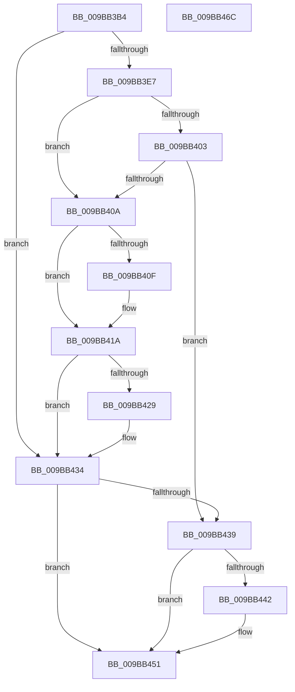

# MiFreeLargePageView

- RVA: `0x009BB3B4`–`0x009BB46D` (길이 `185` bytes)
- VA: `0x00000001409BB3B4`
- 실행 섹션: `PAGE`
- PDB 이름 있음: `예`; PDB Function 태그: `아니요`
- unwind 정보 RVA: `0x0005E6B4`
- 디코드: `52`개 명령, `185/185` bytes 표시
- 미해석 바이트: `0` (있으면 어셈블리에 `.byte`로 보존)

> 이 문서는 커널 이미지의 기계어와 PDB 기호를 분석해 생성했습니다. 4번과 5번은 함수 원형과 자료형을 바이너리 사용 방식에서 추정한 C 해석이며 원본 소스 복구 결과는 아닙니다.

## 1. Dependencies

- 직접 호출 지점: **4**; 고유 호출 대상: **4**
- 직접 호출자로 확인된 함수: **4**
- RIP 상대 이미지 참조: **0**

### Outgoing calls
- `0x009BB415` → [LOCK_ADDRESS_SPACE_SHARED](../../text/2A/LOCK_ADDRESS_SPACE_SHARED_function_002A8B3C.md) (function, `0x002A8B3C`)
- `0x009BB420` → [MiReturnFullProcessCommitment](../9E/MiReturnFullProcessCommitment_function_009E5D58.md) (function, `0x009E5D58`)
- `0x009BB42F` → [UNLOCK_ADDRESS_SPACE_SHARED](../../text/2A/UNLOCK_ADDRESS_SPACE_SHARED_function_002A8ACC.md) (function, `0x002A8ACC`)
- `0x009BB447` → [ObfDereferenceObjectWithTag](../../text/2F/ObfDereferenceObjectWithTag_function_002F78E0.md) (function, `0x002F78E0`)

### Direct callers
- [MiDeletePartialCloneVads](../81/MiDeletePartialCloneVads_function_008116E4.md) at `0x0081174B`
- [sub_009BB136](Unknown_function_009BB136.md) at `0x009BB17C`
- [sub_009BB26D](Unknown_function_009BB26D.md) at `0x009BB28F`
- [sub_00B190F2](../B1/Unknown_function_00B190F2.md) at `0x00B19126`

### Static image references
- 디코드된 RIP-relative 메모리 참조가 없습니다.

## 2. Other-region calls and transfers

- 다른 실행 섹션으로 향하는 call: **3**
  - `0x009BB415` → [LOCK_ADDRESS_SPACE_SHARED](../../text/2A/LOCK_ADDRESS_SPACE_SHARED_function_002A8B3C.md) (`PAGE` → `.text`)
  - `0x009BB42F` → [UNLOCK_ADDRESS_SPACE_SHARED](../../text/2A/UNLOCK_ADDRESS_SPACE_SHARED_function_002A8ACC.md) (`PAGE` → `.text`)
  - `0x009BB447` → [ObfDereferenceObjectWithTag](../../text/2F/ObfDereferenceObjectWithTag_function_002F78E0.md) (`PAGE` → `.text`)
- 별도 외부 분기/꼬리 이동을 확인하지 못했습니다.

## 3. Assembly (complete function range)

```asm
009BB3B4  48 8B C4                        mov rax, rsp
009BB3B7  48 89 58 08                     mov qword ptr [rax + 8], rbx
009BB3BB  48 89 68 10                     mov qword ptr [rax + 0x10], rbp
009BB3BF  48 89 70 18                     mov qword ptr [rax + 0x18], rsi
009BB3C3  48 89 78 20                     mov qword ptr [rax + 0x20], rdi
009BB3C7  41 56                           push r14
009BB3C9  48 83 EC 20                     sub rsp, 0x20
009BB3CD  44 8B 52 34                     mov r10d, dword ptr [rdx + 0x34]
009BB3D1  41 8B E9                        mov ebp, r9d
009BB3D4  0F B6 72 22                     movzx esi, byte ptr [rdx + 0x22]
009BB3D8  49 8B D8                        mov rbx, r8
009BB3DB  48 C1 E6 20                     shl rsi, 0x20
009BB3DF  48 8B F9                        mov rdi, rcx
009BB3E2  49 0B F2                        or rsi, r10
009BB3E5  74 4D                           je 0x1409bb434
009BB3E7  65 4C 8B 34 25 88 01 00 00      mov r14, qword ptr gs:[0x188]
009BB3F0  48 8B C6                        mov rax, rsi
009BB3F3  48 F7 D8                        neg rax
009BB3F6  F0 48 01 81 70 05 00 00         lock add qword ptr [rcx + 0x570], rax
009BB3FE  48 85 DB                        test rbx, rbx
009BB401  74 07                           je 0x1409bb40a
009BB403  49 83 78 18 00                  cmp qword ptr [r8 + 0x18], 0
009BB408  75 2F                           jne 0x1409bb439
009BB40A  83 E5 01                        and ebp, 1
009BB40D  75 0B                           jne 0x1409bb41a
009BB40F  48 8B D7                        mov rdx, rdi
009BB412  49 8B CE                        mov rcx, r14
009BB415  E8 22 D7 8E FF                  call 0x1402a8b3c
009BB41A  48 8B D6                        mov rdx, rsi
009BB41D  48 8B CF                        mov rcx, rdi
009BB420  E8 33 A9 02 00                  call 0x1409e5d58
009BB425  85 ED                           test ebp, ebp
009BB427  75 0B                           jne 0x1409bb434
009BB429  48 8B D7                        mov rdx, rdi
009BB42C  49 8B CE                        mov rcx, r14
009BB42F  E8 98 D6 8E FF                  call 0x1402a8acc
009BB434  48 85 DB                        test rbx, rbx
009BB437  74 18                           je 0x1409bb451
009BB439  48 8B 4B 18                     mov rcx, qword ptr [rbx + 0x18]
009BB43D  48 85 C9                        test rcx, rcx
009BB440  74 0F                           je 0x1409bb451
009BB442  BA 44 66 6C 74                  mov edx, 0x746c6644
009BB447  E8 94 C4 93 FF                  call 0x1402f78e0
009BB44C  48 83 63 18 00                  and qword ptr [rbx + 0x18], 0
009BB451  48 8B 5C 24 30                  mov rbx, qword ptr [rsp + 0x30]
009BB456  48 8B 6C 24 38                  mov rbp, qword ptr [rsp + 0x38]
009BB45B  48 8B 74 24 40                  mov rsi, qword ptr [rsp + 0x40]
009BB460  48 8B 7C 24 48                  mov rdi, qword ptr [rsp + 0x48]
009BB465  48 83 C4 20                     add rsp, 0x20
009BB469  41 5E                           pop r14
009BB46B  C3                              ret
009BB46C  CC                              int3
```

## 4. C-style interpretation (structured pseudocode)

```c
__int64 __fastcall MiFreeLargePageView(__int64 a1, __int64 a2, __int64 a3, int a4)
{
    __int64 result;
    __int64 v_rbp;
    __int64 v_rsi;
    __int64 v_rsp;
    unsigned __int64 v_stack_p10;
    unsigned __int64 v_stack_p18;
    unsigned __int64 v_stack_p20;
    unsigned __int64 v_stack_p8;

    *(unsigned __int64 *)(v_rsp + 8) = v_rbx;
    *(unsigned __int64 *)(v_rsp + 16) = v_rbp;
    *(unsigned __int64 *)(v_rsp + 24) = v_rsi;
    *(unsigned __int64 *)(v_rsp + 32) = v_rdi;
    v_rsp = (v_rsp) - (32);
    v_rsi = (*(unsigned __int8 *)(a2 + 34)) << (32);
    v_rsi = (v_rsi) | ((unsigned int)(*(unsigned int *)(a2 + 52)));
    if (condition_is_equal) goto loc_009BB434;
    result = -(v_rsi);
    if (a3 == 0) goto loc_009BB40A;
    if ((*(unsigned __int64 *)(a3 + 24)) != 0) goto loc_009BB439;
loc_009BB40A:
    v_rbp = (unsigned int)(((unsigned int)(a4)) & (1));
    if (!(condition_is_not_equal)) {
        a2 = a1;
        a1 = *(unsigned __int64 *)(gs_base + (0 + 392));
        result = LOCK_ADDRESS_SPACE_SHARED(a1, a2, a3, a4);
    }
    result = MiReturnFullProcessCommitment(a1, v_rsi, a3, a4);
    if ((unsigned int)(v_rbp) == 0) {
        a2 = a1;
        a1 = *(unsigned __int64 *)(gs_base + (0 + 392));
        result = UNLOCK_ADDRESS_SPACE_SHARED(a1, a2, a3, a4);
    }
    if (a3 == 0) goto loc_009BB451;
loc_009BB439:
    if (*(unsigned __int64 *)(a3 + 24) != 0) {
        a2 = 0x746C6644ULL;
        result = ObfDereferenceObjectWithTag(*(unsigned __int64 *)(a3 + 24), a2, a3, a4);
    }
    v_rsp = (v_rsp) + (32);
    return result;
}
```

## 5. (Beta) C Style

```c
int64_t MiFreeLargePageView(void *Arg1, void *Arg2, void *Arg3, int32_t Arg4)
{
    uint8_t *arg1 = (uint8_t *)Arg1;
    uint8_t *arg2 = (uint8_t *)Arg2;
    uint8_t *arg3 = (uint8_t *)Arg3;

    int64_t result;
    int64_t local_rbp;
    int64_t local_rsi;
    int64_t local_rsp;
    uint64_t v_stack_p10;
    uint64_t v_stack_p18;
    uint64_t v_stack_p20;
    uint64_t v_stack_p8;

    *(uint64_t *)(local_rsp + 0x8) = local_rbx;
    *(uint64_t *)(local_rsp + 0x10) = local_rbp;
    *(uint64_t *)(local_rsp + 0x18) = local_rsi;
    *(uint64_t *)(local_rsp + 0x20) = local_rdi;
    local_rsp = (local_rsp) - (32);
    local_rsi = (*(uint8_t *)(arg2 + 0x22)) << (32);
    local_rsi = (local_rsi) | ((uint32_t)(*(uint32_t *)(arg2 + 0x34)));
    if (condition_is_equal) goto loc_009BB434;
    result = -(local_rsi);
    if (Arg3 == NULL) goto loc_009BB40A;
    if ((*(uint64_t *)(arg3 + 0x18)) != 0) goto loc_009BB439;
loc_009BB40A:
    local_rbp = (uint32_t)(((uint32_t)(Arg4)) & (1));
    if (!(condition_is_not_equal)) {
        Arg2 = Arg1;
        Arg1 = *(uint64_t *)(gs_base + (0 + 0x188));
        result = LOCK_ADDRESS_SPACE_SHARED(Arg1, Arg2, Arg3, Arg4);
    }
    result = MiReturnFullProcessCommitment(Arg1, local_rsi, Arg3, Arg4);
    if ((uint32_t)(local_rbp) == 0) {
        Arg2 = Arg1;
        Arg1 = *(uint64_t *)(gs_base + (0 + 0x188));
        result = UNLOCK_ADDRESS_SPACE_SHARED(Arg1, Arg2, Arg3, Arg4);
    }
    if (Arg3 == NULL) goto loc_009BB451;
loc_009BB439:
    if (*(uint64_t *)(arg3 + 0x18) != 0) {
        Arg2 = 0x746C6644ULL;
        result = ObfDereferenceObjectWithTag(*(uint64_t *)(arg3 + 0x18), Arg2, Arg3, Arg4);
    }
    local_rsp = (local_rsp) + (32);
    return result;
}
```

### 관측된 메모리 오프셋

구조체 형식이 확인되지 않은 접근은 인자 기준의 오프셋으로만 기록했습니다.

| 기준 인자 | 오프셋 표현 | 폭 (bit) | 접근 |
|---|---:|---:|---|
| `Arg1` | `+ 0x570` | `64` | `R/W` |
| `Arg2` | `+ 0x22` | `8` | `R` |
| `Arg2` | `+ 0x34` | `32` | `R` |
| `Arg3` | `+ 0x18` | `64` | `R` |

## 6. Execution-region graph

[열기: 2D/3D 그래프와 함수 탐색 컨트롤 패널](../../../control-panel.html?section=page&rva=0x009BB3B4&view=graph)

- 2D 그래프는 위에서 아래로 흐르고, 3D 그래프는 빈 공간을 드래그해 회전합니다. Shift+드래그는 이동, 휠은 확대·축소, 함수 노드 선택은 대상 보고서 이동입니다.

### Static fallback


