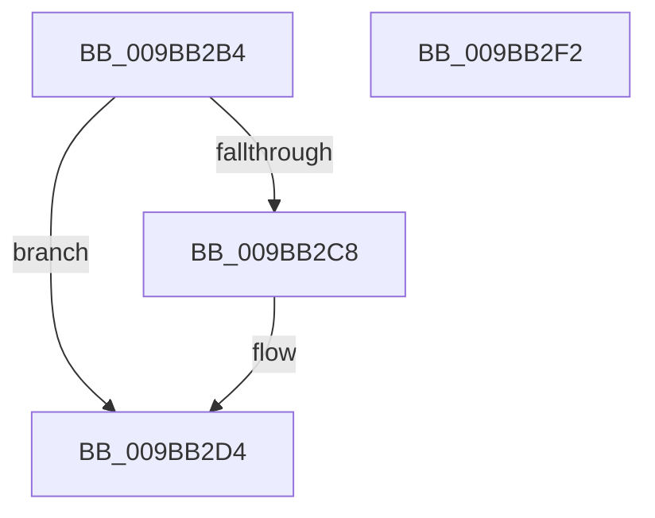

# MiFreePlaceholderVadEvent

- RVA: `0x009BB2B4`–`0x009BB2F3` (길이 `63` bytes)
- VA: `0x00000001409BB2B4`
- 실행 섹션: `PAGE`
- PDB 이름 있음: `예`; PDB Function 태그: `아니요`
- unwind 정보 RVA: `0x0005CF00`
- 디코드: `17`개 명령, `63/63` bytes 표시
- 미해석 바이트: `0` (있으면 어셈블리에 `.byte`로 보존)

> 이 문서는 커널 이미지의 기계어와 PDB 기호를 분석해 생성했습니다. 4번과 5번은 함수 원형과 자료형을 바이너리 사용 방식에서 추정한 C 해석이며 원본 소스 복구 결과는 아닙니다.

## 1. Dependencies

- 직접 호출 지점: **2**; 고유 호출 대상: **2**
- 직접 호출자로 확인된 함수: **2**
- RIP 상대 이미지 참조: **0**

### Outgoing calls
- `0x009BB2CF` → [ExFreePoolWithTag](../../poolcode/B8/ExFreePoolWithTag_function_00B82870.md) (function, `0x00B82870`)
- `0x009BB2E7` → [PsReturnProcessNonPagedPoolQuota](../../text/41/PsReturnProcessNonPagedPoolQuota_function_0041C200.md) (function, `0x0041C200`)

### Direct callers
- [sub_009BB189](Unknown_function_009BB189.md) at `0x009BB248`
- [MiFreePlaceholderStorage](../AA/MiFreePlaceholderStorage_function_00AAC868.md) at `0x00AAC88A`

### Static image references
- 디코드된 RIP-relative 메모리 참조가 없습니다.

## 2. Other-region calls and transfers

- 다른 실행 섹션으로 향하는 call: **2**
  - `0x009BB2CF` → [ExFreePoolWithTag](../../poolcode/B8/ExFreePoolWithTag_function_00B82870.md) (`PAGE` → `POOLCODE`)
  - `0x009BB2E7` → [PsReturnProcessNonPagedPoolQuota](../../text/41/PsReturnProcessNonPagedPoolQuota_function_0041C200.md) (`PAGE` → `.text`)
- 별도 외부 분기/꼬리 이동을 확인하지 못했습니다.

## 3. Assembly (complete function range)

```asm
009BB2B4  40 53                           push rbx
009BB2B6  48 83 EC 20                     sub rsp, 0x20
009BB2BA  48 8B 49 08                     mov rcx, qword ptr [rcx + 8]
009BB2BE  BB 58 00 00 00                  mov ebx, 0x58
009BB2C3  48 85 C9                        test rcx, rcx
009BB2C6  74 0C                           je 0x1409bb2d4
009BB2C8  33 D2                           xor edx, edx
009BB2CA  BB 98 00 00 00                  mov ebx, 0x98
009BB2CF  E8 9C 75 1C 00                  call 0x140b82870
009BB2D4  65 48 8B 0C 25 88 01 00 00      mov rcx, qword ptr gs:[0x188]
009BB2DD  48 8B D3                        mov rdx, rbx
009BB2E0  48 8B 89 B8 00 00 00            mov rcx, qword ptr [rcx + 0xb8]
009BB2E7  E8 14 0F A6 FF                  call 0x14041c200
009BB2EC  48 83 C4 20                     add rsp, 0x20
009BB2F0  5B                              pop rbx
009BB2F1  C3                              ret
009BB2F2  CC                              int3
```

## 4. C-style interpretation (structured pseudocode)

```c
__int64 __fastcall MiFreePlaceholderVadEvent(__int64 a1, int a2)
{
    __int64 result;
    __int64 v_rbx;
    __int64 v_rsp;

    v_rsp = (v_rsp) - (32);
    v_rbx = 88;
    if (*(unsigned __int64 *)(a1 + 8) != 0) {
        a2 = 0;
        v_rbx = 152;
        result = ExFreePoolWithTag(*(unsigned __int64 *)(a1 + 8), a2, a3, a4);
    }
    result = PsReturnProcessNonPagedPoolQuota(*(unsigned __int64 *)(*(unsigned __int64 *)(gs_base + (0 + 392)) + 184), v_rbx, a3, a4);
    v_rsp = (v_rsp) + (32);
    return result;
}
```

## 5. (Beta) C Style

```c
int64_t MiFreePlaceholderVadEvent(void *Arg1, int32_t Arg2)
{
    uint8_t *arg1 = (uint8_t *)Arg1;

    int64_t result;
    int64_t local_rbx;
    int64_t local_rsp;

    local_rsp = (local_rsp) - (32);
    local_rbx = 88;
    if (*(uint64_t *)(arg1 + 0x8) != 0) {
        Arg2 = 0;
        local_rbx = 152;
        result = ExFreePoolWithTag(*(uint64_t *)(arg1 + 0x8), Arg2, a3, a4);
    }
    result = PsReturnProcessNonPagedPoolQuota(*(uint64_t *)(*(uint64_t *)(gs_base + (0 + 0x188)) + 0xB8), local_rbx, a3, a4);
    local_rsp = (local_rsp) + (32);
    return result;
}
```

### 관측된 메모리 오프셋

구조체 형식이 확인되지 않은 접근은 인자 기준의 오프셋으로만 기록했습니다.

| 기준 인자 | 오프셋 표현 | 폭 (bit) | 접근 |
|---|---:|---:|---|
| `Arg1` | `+ 0x8` | `64` | `R` |

## 6. Execution-region graph

[열기: 2D/3D 그래프와 함수 탐색 컨트롤 패널](../../../control-panel.html?section=page&rva=0x009BB2B4&view=graph)

- 2D 그래프는 위에서 아래로 흐르고, 3D 그래프는 빈 공간을 드래그해 회전합니다. Shift+드래그는 이동, 휠은 확대·축소, 함수 노드 선택은 대상 보고서 이동입니다.

### Static fallback


