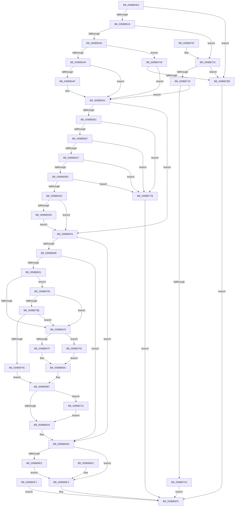

# MiReadWriteVirtualMemory

- RVA: `0x009BB4E0`–`0x009BB7C2` (길이 `738` bytes)
- VA: `0x00000001409BB4E0`
- 실행 섹션: `PAGE`
- PDB 이름 있음: `예`; PDB Function 태그: `아니요`
- unwind 정보 RVA: `0x0009EF40`
- 디코드: `170`개 명령, `738/738` bytes 표시
- 미해석 바이트: `0` (있으면 어셈블리에 `.byte`로 보존)

> 이 문서는 커널 이미지의 기계어와 PDB 기호를 분석해 생성했습니다. 4번과 5번은 함수 원형과 자료형을 바이너리 사용 방식에서 추정한 C 해석이며 원본 소스 복구 결과는 아닙니다.

## 1. Dependencies

- 직접 호출 지점: **5**; 고유 호출 대상: **5**
- 직접 호출자로 확인된 함수: **3**
- RIP 상대 이미지 참조: **1**

### Outgoing calls
- `0x009BB63B` → [ObpReferenceObjectByHandleWithTag](../86/ObpReferenceObjectByHandleWithTag_function_00869650.md) (function, `0x00869650`)
- `0x009BB6AB` → [MiCopyVirtualMemory](MiCopyVirtualMemory_function_009BBB50.md) (function, `0x009BBB50`)
- `0x009BB6C7` → [PsIsProcessLoggingEnabled](../../text/41/PsIsProcessLoggingEnabled_function_0041AF00.md) (function, `0x0041AF00`)
- `0x009BB6D8` → [ObfDereferenceObjectWithTag](../../text/2F/ObfDereferenceObjectWithTag_function_002F78E0.md) (function, `0x002F78E0`)
- `0x009BB74B` → [EtwTiLogReadWriteVm](EtwTiLogReadWriteVm_function_009BB7C8.md) (function, `0x009BB7C8`)

### Direct callers
- [NtReadVirtualMemoryEx](../../text/47/NtReadVirtualMemoryEx_function_00477E20.md) at `0x00477E3E`
- [NtWriteVirtualMemory](NtWriteVirtualMemory_function_009BB480.md) at `0x009BB49B`
- [NtReadVirtualMemory](NtReadVirtualMemory_function_009BB4B0.md) at `0x009BB4CE`

### Static image references
- `0x009BB60E` → RVA `0x00FC6A98` (`ALMOSTRO`; read)

## 2. Other-region calls and transfers

- 다른 실행 섹션으로 향하는 call: **2**
  - `0x009BB6C7` → [PsIsProcessLoggingEnabled](../../text/41/PsIsProcessLoggingEnabled_function_0041AF00.md) (`PAGE` → `.text`)
  - `0x009BB6D8` → [ObfDereferenceObjectWithTag](../../text/2F/ObfDereferenceObjectWithTag_function_002F78E0.md) (`PAGE` → `.text`)
- 별도 외부 분기/꼬리 이동을 확인하지 못했습니다.

## 3. Assembly (complete function range)

```asm
009BB4E0  48 89 5C 24 08                  mov qword ptr [rsp + 8], rbx
009BB4E5  48 89 74 24 20                  mov qword ptr [rsp + 0x20], rsi
009BB4EA  4C 89 44 24 18                  mov qword ptr [rsp + 0x18], r8
009BB4EF  48 89 54 24 10                  mov qword ptr [rsp + 0x10], rdx
009BB4F4  57                              push rdi
009BB4F5  41 54                           push r12
009BB4F7  41 55                           push r13
009BB4F9  41 56                           push r14
009BB4FB  41 57                           push r15
009BB4FD  48 83 EC 60                     sub rsp, 0x60
009BB501  4D 8B F9                        mov r15, r9
009BB504  4C 8B D1                        mov r10, rcx
009BB507  48 8B B4 24 B0 00 00 00         mov rsi, qword ptr [rsp + 0xb0]
009BB50F  8B BC 24 C0 00 00 00            mov edi, dword ptr [rsp + 0xc0]
009BB516  45 33 C9                        xor r9d, r9d
009BB519  4C 89 4C 24 48                  mov qword ptr [rsp + 0x48], r9
009BB51E  F7 C7 FC FF FF FF               test edi, 0xfffffffc
009BB524  0F 85 8E 02 00 00               jne 0x1409bb7b8
009BB52A  8B C7                           mov eax, edi
009BB52C  83 E0 02                        and eax, 2
009BB52F  40 F6 C7 01                     test dil, 1
009BB533  0F 85 D7 01 00 00               jne 0x1409bb710
009BB539  44 8B A4 24 B8 00 00 00         mov r12d, dword ptr [rsp + 0xb8]
009BB541  85 C0                           test eax, eax
009BB543  0F 85 65 02 00 00               jne 0x1409bb7ae
009BB549  41 83 FC 10                     cmp r12d, 0x10
009BB54D  75 03                           jne 0x1409bb552
009BB54F  83 CF 01                        or edi, 1
009BB552  65 4C 8B 2C 25 88 01 00 00      mov r13, qword ptr gs:[0x188]
009BB55B  45 0F B6 B5 32 02 00 00         movzx r14d, byte ptr [r13 + 0x232]
009BB563  45 84 F6                        test r14b, r14b
009BB566  0F 84 8A 00 00 00               je 0x1409bb5f6
009BB56C  49 8D 4F FF                     lea rcx, [r15 - 1]
009BB570  48 8D 42 FF                     lea rax, [rdx - 1]
009BB574  49 03 C7                        add rax, r15
009BB577  4D 85 FF                        test r15, r15
009BB57A  48 0F 44 C2                     cmove rax, rdx
009BB57E  48 3B C2                        cmp rax, rdx
009BB581  0F 82 F4 01 00 00               jb 0x1409bb77b
009BB587  48 8B C1                        mov rax, rcx
009BB58A  4D 85 FF                        test r15, r15
009BB58D  49 0F 44 C1                     cmove rax, r9
009BB591  48 03 C2                        add rax, rdx
009BB594  48 BA FF FF FE FF FF 7F 00 00   movabs rdx, 0x7ffffffeffff
009BB59E  48 3B C2                        cmp rax, rdx
009BB5A1  0F 87 D4 01 00 00               ja 0x1409bb77b
009BB5A7  49 8B C1                        mov rax, r9
009BB5AA  4D 85 FF                        test r15, r15
009BB5AD  48 0F 45 C1                     cmovne rax, rcx
009BB5B1  49 03 C0                        add rax, r8
009BB5B4  49 3B C0                        cmp rax, r8
009BB5B7  0F 82 BE 01 00 00               jb 0x1409bb77b
009BB5BD  49 8B C1                        mov rax, r9
009BB5C0  4D 85 FF                        test r15, r15
009BB5C3  48 0F 45 C1                     cmovne rax, rcx
009BB5C7  49 03 C0                        add rax, r8
009BB5CA  48 3B C2                        cmp rax, rdx
009BB5CD  0F 87 A8 01 00 00               ja 0x1409bb77b
009BB5D3  48 85 F6                        test rsi, rsi
009BB5D6  74 1E                           je 0x1409bb5f6
009BB5D8  48 B9 00 00 FF FF FF 7F 00 00   movabs rcx, 0x7fffffff0000
009BB5E2  48 3B F1                        cmp rsi, rcx
009BB5E5  48 0F 42 CE                     cmovb rcx, rsi
009BB5E9  48 8B 01                        mov rax, qword ptr [rcx]
009BB5EC  48 89 01                        mov qword ptr [rcx], rax
009BB5EF  EB 05                           jmp 0x1409bb5f6
009BB5F1  E9 FF 00 00 00                  jmp 0x1409bb6f5
009BB5F6  4C 89 4C 24 40                  mov qword ptr [rsp + 0x40], r9
009BB5FB  41 8B D9                        mov ebx, r9d
009BB5FE  89 9C 24 C0 00 00 00            mov dword ptr [rsp + 0xc0], ebx
009BB605  4D 85 FF                        test r15, r15
009BB608  0F 84 CF 00 00 00               je 0x1409bb6dd
009BB60E  4C 8B 05 83 B4 60 00            mov r8, qword ptr [rip + 0x60b483]
009BB615  4C 89 4C 24 38                  mov qword ptr [rsp + 0x38], r9
009BB61A  4C 89 4C 24 30                  mov qword ptr [rsp + 0x30], r9
009BB61F  48 8D 44 24 48                  lea rax, [rsp + 0x48]
009BB624  48 89 44 24 28                  mov qword ptr [rsp + 0x28], rax
009BB629  C7 44 24 20 4D 6D 56 6D         mov dword ptr [rsp + 0x20], 0x6d566d4d
009BB631  45 0F B6 CE                     movzx r9d, r14b
009BB635  41 8B D4                        mov edx, r12d
009BB638  49 8B CA                        mov rcx, r10
009BB63B  E8 10 E0 EA FF                  call 0x140869650
009BB640  8B D8                           mov ebx, eax
009BB642  89 84 24 C0 00 00 00            mov dword ptr [rsp + 0xc0], eax
009BB649  85 C0                           test eax, eax
009BB64B  0F 88 8C 00 00 00               js 0x1409bb6dd
009BB651  4D 8B 9D B8 00 00 00            mov r11, qword ptr [r13 + 0xb8]
009BB658  4C 89 5C 24 50                  mov qword ptr [rsp + 0x50], r11
009BB65D  4C 8B 6C 24 48                  mov r13, qword ptr [rsp + 0x48]
009BB662  41 F6 85 70 01 00 00 01         test byte ptr [r13 + 0x170], 1
009BB66A  0F 85 15 01 00 00               jne 0x1409bb785
009BB670  48 8D 44 24 40                  lea rax, [rsp + 0x40]
009BB675  41 83 FC 10                     cmp r12d, 0x10
009BB679  0F 85 D6 00 00 00               jne 0x1409bb755
009BB67F  89 7C 24 38                     mov dword ptr [rsp + 0x38], edi
009BB683  4C 8B 8C 24 A0 00 00 00         mov r9, qword ptr [rsp + 0xa0]
009BB68B  4D 8B C3                        mov r8, r11
009BB68E  48 8B BC 24 98 00 00 00         mov rdi, qword ptr [rsp + 0x98]
009BB696  48 8B D7                        mov rdx, rdi
009BB699  49 8B CD                        mov rcx, r13
009BB69C  48 89 44 24 30                  mov qword ptr [rsp + 0x30], rax
009BB6A1  44 88 74 24 28                  mov byte ptr [rsp + 0x28], r14b
009BB6A6  4C 89 7C 24 20                  mov qword ptr [rsp + 0x20], r15
009BB6AB  E8 A0 04 00 00                  call 0x1409bbb50
009BB6B0  8B D8                           mov ebx, eax
009BB6B2  4C 8B 5C 24 50                  mov r11, qword ptr [rsp + 0x50]
009BB6B7  89 9C 24 C0 00 00 00            mov dword ptr [rsp + 0xc0], ebx
009BB6BE  45 8B C4                        mov r8d, r12d
009BB6C1  49 8B D5                        mov rdx, r13
009BB6C4  49 8B CB                        mov rcx, r11
009BB6C7  E8 34 F8 A5 FF                  call 0x14041af00
009BB6CC  85 C0                           test eax, eax
009BB6CE  75 61                           jne 0x1409bb731
009BB6D0  BA 4D 6D 56 6D                  mov edx, 0x6d566d4d
009BB6D5  49 8B CD                        mov rcx, r13
009BB6D8  E8 03 C2 93 FF                  call 0x1402f78e0
009BB6DD  48 85 F6                        test rsi, rsi
009BB6E0  74 11                           je 0x1409bb6f3
009BB6E2  48 8B 44 24 40                  mov rax, qword ptr [rsp + 0x40]
009BB6E7  48 89 06                        mov qword ptr [rsi], rax
009BB6EA  EB 07                           jmp 0x1409bb6f3
009BB6EC  8B 9C 24 C0 00 00 00            mov ebx, dword ptr [rsp + 0xc0]
009BB6F3  8B C3                           mov eax, ebx
009BB6F5  4C 8D 5C 24 60                  lea r11, [rsp + 0x60]
009BB6FA  49 8B 5B 30                     mov rbx, qword ptr [r11 + 0x30]
009BB6FE  49 8B 73 48                     mov rsi, qword ptr [r11 + 0x48]
009BB702  49 8B E3                        mov rsp, r11
009BB705  41 5F                           pop r15
009BB707  41 5E                           pop r14
009BB709  41 5D                           pop r13
009BB70B  41 5C                           pop r12
009BB70D  5F                              pop rdi
009BB70E  C3                              ret
009BB70F  CC                              int3
009BB710  85 C0                           test eax, eax
009BB712  0F 85 A0 00 00 00               jne 0x1409bb7b8
009BB718  44 8B A4 24 B8 00 00 00         mov r12d, dword ptr [rsp + 0xb8]
009BB720  41 83 FC 10                     cmp r12d, 0x10
009BB724  0F 84 28 FE FF FF               je 0x1409bb552
009BB72A  B8 0D 00 00 C0                  mov eax, 0xc000000d
009BB72F  EB C4                           jmp 0x1409bb6f5
009BB731  48 8B 44 24 40                  mov rax, qword ptr [rsp + 0x40]
009BB736  48 89 44 24 28                  mov qword ptr [rsp + 0x28], rax
009BB73B  48 89 7C 24 20                  mov qword ptr [rsp + 0x20], rdi
009BB740  45 8B CC                        mov r9d, r12d
009BB743  4D 8B C5                        mov r8, r13
009BB746  49 8B D3                        mov rdx, r11
009BB749  8B CB                           mov ecx, ebx
009BB74B  E8 78 00 00 00                  call 0x1409bb7c8
009BB750  E9 7B FF FF FF                  jmp 0x1409bb6d0
009BB755  C7 44 24 38 00 00 00 00         mov dword ptr [rsp + 0x38], 0
009BB75D  48 8B BC 24 98 00 00 00         mov rdi, qword ptr [rsp + 0x98]
009BB765  4C 8B CF                        mov r9, rdi
009BB768  4D 8B C5                        mov r8, r13
009BB76B  48 8B 94 24 A0 00 00 00         mov rdx, qword ptr [rsp + 0xa0]
009BB773  49 8B CB                        mov rcx, r11
009BB776  E9 21 FF FF FF                  jmp 0x1409bb69c
009BB77B  B8 05 00 00 C0                  mov eax, 0xc0000005
009BB780  E9 70 FF FF FF                  jmp 0x1409bb6f5
009BB785  4D 3B DD                        cmp r11, r13
009BB788  0F 84 E2 FE FF FF               je 0x1409bb670
009BB78E  49 83 BD 08 03 00 00 00         cmp qword ptr [r13 + 0x308], 0
009BB796  0F 85 D4 FE FF FF               jne 0x1409bb670
009BB79C  BB 05 00 00 C0                  mov ebx, 0xc0000005
009BB7A1  48 8B BC 24 98 00 00 00         mov rdi, qword ptr [rsp + 0x98]
009BB7A9  E9 09 FF FF FF                  jmp 0x1409bb6b7
009BB7AE  41 83 FC 10                     cmp r12d, 0x10
009BB7B2  0F 84 9A FD FF FF               je 0x1409bb552
009BB7B8  B8 0D 00 00 C0                  mov eax, 0xc000000d
009BB7BD  E9 33 FF FF FF                  jmp 0x1409bb6f5
```

## 4. C-style interpretation (structured pseudocode)

```c
__int64 __fastcall MiReadWriteVirtualMemory(__int64 a1, __int64 a2, __int64 a3, __int64 a4, __int64 a5, unsigned int a6, unsigned int a7)
{
    __int64 result;
    __int64 v_rdi;
    __int64 v_rsp;
    unsigned __int64 v_stack_m20;
    unsigned __int64 v_stack_m28;
    unsigned __int64 v_stack_m38;
    unsigned __int64 v_stack_m40;
    unsigned __int64 v_stack_m48;
    unsigned __int64 v_stack_m50;
    unsigned __int64 v_stack_m58;
    unsigned __int64 v_stack_m60;
    unsigned int v_stack_m68;
    unsigned __int64 v_stack_p10;
    unsigned __int64 v_stack_p18;
    unsigned __int64 v_stack_p20;
    unsigned int v_stack_p38;
    unsigned __int64 v_stack_p40;
    unsigned __int64 v_stack_p8;

    v_stack_p8 = v_rbx;
    v_stack_p20 = v_rsi;
    v_stack_p18 = a3;
    v_stack_p10 = a2;
    v_rsp = (v_rsp) - (96);
    a4 = 0;
    v_stack_m40 = 0;
    if ((((unsigned int)((unsigned int)(a7))) & (0xFFFFFFFCULL)) != 0) goto loc_009BB7B8;
    result = (unsigned int)(((unsigned int)((unsigned int)((unsigned int)(a7)))) & (2));
    if ((((unsigned __int8)((unsigned int)(a7))) & (1)) != 0) goto loc_009BB710;
    if ((unsigned int)(result) != 0) goto loc_009BB7AE;
    v_rdi = (unsigned int)(a7);
    if (((unsigned int)((unsigned int)(a6))) == 16) {
        v_rdi = (unsigned int)(((unsigned int)(a7)) | (1));
    }
    if ((unsigned __int8)(*(unsigned __int8 *)(*(unsigned __int64 *)(gs_base + (0 + 392)) + 562)) == 0) goto loc_009BB5F6;
    result = (a2 - 1) + (0);
    if (0 == 0) { result = a2; }
    if (result < a2) goto loc_009BB77B;
    result = a4 - 1;
    if (0 == 0) { result = 0; }
    result = (result) + (a2);
    if (result > a2) goto loc_009BB77B;
    result = 0;
    if (0 != 0) { result = a4 - 1; }
    result = (result) + (a3);
    if (result < a3) goto loc_009BB77B;
    result = 0;
    if (0 != 0) { result = a4 - 1; }
    result = (result) + (a3);
    if (result > a2) goto loc_009BB77B;
    if (a5 == 0) goto loc_009BB5F6;
    a1 = a4 - 1;
    if (a5 < (a4 - 1)) { a1 = a5; }
    *(unsigned __int64 *)(a1) = *(unsigned __int64 *)(a1);
    goto loc_009BB5F6;
loc_009BB5F6:
    v_stack_m48 = 0;
    v_stack_p38 = 0;
    if (0 == 0) goto loc_009BB6DD;
    v_stack_m50 = 0;
    v_stack_m58 = 0;
    v_stack_m60 = v_stack_m40;
    v_stack_m68 = 0x6D566D4DULL;
    result = ObpReferenceObjectByHandleWithTag(a1, (unsigned int)((unsigned int)((unsigned int)(a6))), *(unsigned __int64 *)(v_rip + 6337667), (unsigned __int8)(*(unsigned __int8 *)(*(unsigned __int64 *)(gs_base + (0 + 392)) + 562)));
    v_stack_p38 = (unsigned int)(result);
    if (sign_flag) goto loc_009BB6DD;
    v_stack_m38 = *(unsigned __int64 *)(*(unsigned __int64 *)(gs_base + (0 + 392)) + 184);
    if (((*(unsigned __int8 *)(v_stack_m40 + 368)) & (1)) != 0) goto loc_009BB785;
loc_009BB670:
    if (((unsigned int)((unsigned int)(a6))) != 16) goto loc_009BB755;
    v_stack_m50 = (unsigned int)(v_rdi);
loc_009BB69C:
    v_stack_m58 = v_stack_m48;
    v_stack_m60 = (unsigned __int8)(*(unsigned __int8 *)(*(unsigned __int64 *)(gs_base + (0 + 392)) + 562));
    v_stack_m68 = 0;
    result = MiCopyVirtualMemory(v_stack_m40, v_stack_p10, *(unsigned __int64 *)(*(unsigned __int64 *)(gs_base + (0 + 392)) + 184), v_stack_p18);
loc_009BB6B7:
    v_stack_p38 = (unsigned int)((unsigned int)((unsigned int)(result)));
    result = PsIsProcessLoggingEnabled(v_stack_m38, v_stack_m40, (unsigned int)((unsigned int)((unsigned int)(a6))), v_stack_p18);
    if ((unsigned int)(result) != 0) goto loc_009BB731;
loc_009BB6D0:
    result = ObfDereferenceObjectWithTag(v_stack_m40, (unsigned int)(0x6D566D4DULL), (unsigned int)((unsigned int)((unsigned int)(a6))), v_stack_p18);
loc_009BB6DD:
    if (a5 == 0) goto loc_009BB6F3;
    *(unsigned __int64 *)(a5) = v_stack_m48;
    goto loc_009BB6F3;
loc_009BB6F3:
loc_009BB6F5:
    return (unsigned int)((unsigned int)((unsigned int)((unsigned int)(result))));
loc_009BB710:
    if ((unsigned int)((unsigned int)((unsigned int)((unsigned int)((unsigned int)(result))))) != 0) goto loc_009BB7B8;
    if (((unsigned int)((unsigned int)(a6))) == 16) goto loc_009BB552;
    goto loc_009BB6F5;
loc_009BB731:
    v_stack_m38 = v_stack_m20;
    v_stack_m40 = v_stack_p10;
    result = EtwTiLogReadWriteVm((unsigned int)((unsigned int)(*(unsigned __int64 *)(v_stack_m28 + 48))), v_stack_m28, v_stack_m40, (unsigned int)((unsigned int)((unsigned int)(a6))));
    goto loc_009BB6D0;
loc_009BB755:
    v_stack_m28 = 0;
    goto loc_009BB69C;
loc_009BB77B:
    goto loc_009BB6F5;
loc_009BB785:
    if (v_stack_m28 == v_stack_m40) goto loc_009BB670;
    if ((*(unsigned __int64 *)(v_stack_m40 + 776)) != 0) goto loc_009BB670;
    goto loc_009BB6B7;
loc_009BB7AE:
    if (((unsigned int)((unsigned int)(a6))) == 16) goto loc_009BB552;
loc_009BB7B8:
    goto loc_009BB6F5;
}
```

## 5. (Beta) C Style

```c
int64_t MiReadWriteVirtualMemory(int64_t Arg1, void *Arg2, int64_t Arg3, void *Arg4, int64_t Arg5, uint32_t Arg6, uint32_t Arg7)
{
    uint8_t *arg2 = (uint8_t *)Arg2;
    uint8_t *arg4 = (uint8_t *)Arg4;

    int64_t result;
    int64_t local_rdi;
    int64_t local_rsp;
    uint64_t v_stack_m20;
    uint64_t v_stack_m28;
    uint64_t v_stack_m38;
    uint64_t v_stack_m40;
    uint64_t v_stack_m48;
    uint64_t v_stack_m50;
    uint64_t v_stack_m58;
    uint64_t v_stack_m60;
    uint32_t v_stack_m68;
    uint64_t v_stack_p10;
    uint64_t v_stack_p18;
    uint64_t v_stack_p20;
    uint32_t v_stack_p38;
    uint64_t v_stack_p40;
    uint64_t v_stack_p8;

    v_stack_p8 = local_rbx;
    v_stack_p20 = local_rsi;
    v_stack_p18 = Arg3;
    v_stack_p10 = Arg2;
    local_rsp = (local_rsp) - (96);
    Arg4 = 0;
    v_stack_m40 = 0;
    if ((((uint32_t)((uint32_t)(Arg7))) & (0xFFFFFFFCULL)) != 0) goto loc_009BB7B8;
    result = (uint32_t)(((uint32_t)((uint32_t)((uint32_t)(Arg7)))) & (2));
    if ((((uint8_t)((uint32_t)(Arg7))) & (1)) != 0) goto loc_009BB710;
    if ((uint32_t)(result) != 0) goto loc_009BB7AE;
    local_rdi = (uint32_t)(Arg7);
    if (((uint32_t)((uint32_t)(Arg6))) == 16) {
        local_rdi = (uint32_t)(((uint32_t)(Arg7)) | (1));
    }
    if ((uint8_t)(*(uint8_t *)(*(uint64_t *)(gs_base + (0 + 0x188)) + 0x232)) == 0) goto loc_009BB5F6;
    result = (Arg2 - 1) + (0);
    if (0 == 0) { result = Arg2; }
    if (result < Arg2) goto loc_009BB77B;
    result = Arg4 - 1;
    if (0 == 0) { result = 0; }
    result = (result) + (Arg2);
    if (result > Arg2) goto loc_009BB77B;
    result = 0;
    if (0 != 0) { result = Arg4 - 1; }
    result = (result) + (Arg3);
    if (result < Arg3) goto loc_009BB77B;
    result = 0;
    if (0 != 0) { result = Arg4 - 1; }
    result = (result) + (Arg3);
    if (result > Arg2) goto loc_009BB77B;
    if (Arg5 == 0) goto loc_009BB5F6;
    Arg1 = Arg4 - 1;
    if (Arg5 < (Arg4 - 1)) { Arg1 = Arg5; }
    *(uint64_t *)(Arg1) = *(uint64_t *)(Arg1);
    goto loc_009BB5F6;
loc_009BB5F6:
    v_stack_m48 = 0;
    v_stack_p38 = 0;
    if (0 == 0) goto loc_009BB6DD;
    v_stack_m50 = 0;
    v_stack_m58 = 0;
    v_stack_m60 = v_stack_m40;
    v_stack_m68 = 0x6D566D4DULL;
    result = ObpReferenceObjectByHandleWithTag(Arg1, (uint32_t)((uint32_t)((uint32_t)(Arg6))), *(uint64_t *)(v_rip + 0x60B483), (uint8_t)(*(uint8_t *)(*(uint64_t *)(gs_base + (0 + 0x188)) + 0x232)));
    v_stack_p38 = (uint32_t)(result);
    if (sign_flag) goto loc_009BB6DD;
    v_stack_m38 = *(uint64_t *)(*(uint64_t *)(gs_base + (0 + 0x188)) + 0xB8);
    if (((*(uint8_t *)(v_stack_m40 + 0x170)) & (1)) != 0) goto loc_009BB785;
loc_009BB670:
    if (((uint32_t)((uint32_t)(Arg6))) != 16) goto loc_009BB755;
    v_stack_m50 = (uint32_t)(local_rdi);
loc_009BB69C:
    v_stack_m58 = v_stack_m48;
    v_stack_m60 = (uint8_t)(*(uint8_t *)(*(uint64_t *)(gs_base + (0 + 0x188)) + 0x232));
    v_stack_m68 = 0;
    result = MiCopyVirtualMemory(v_stack_m40, v_stack_p10, *(uint64_t *)(*(uint64_t *)(gs_base + (0 + 0x188)) + 0xB8), v_stack_p18);
loc_009BB6B7:
    v_stack_p38 = (uint32_t)((uint32_t)((uint32_t)(result)));
    result = PsIsProcessLoggingEnabled(v_stack_m38, v_stack_m40, (uint32_t)((uint32_t)((uint32_t)(Arg6))), v_stack_p18);
    if ((uint32_t)(result) != 0) goto loc_009BB731;
loc_009BB6D0:
    result = ObfDereferenceObjectWithTag(v_stack_m40, (uint32_t)(0x6D566D4DULL), (uint32_t)((uint32_t)((uint32_t)(Arg6))), v_stack_p18);
loc_009BB6DD:
    if (Arg5 == 0) goto loc_009BB6F3;
    *(uint64_t *)(Arg5) = v_stack_m48;
    goto loc_009BB6F3;
loc_009BB6F3:
loc_009BB6F5:
    return (uint32_t)((uint32_t)((uint32_t)((uint32_t)(result))));
loc_009BB710:
    if ((uint32_t)((uint32_t)((uint32_t)((uint32_t)((uint32_t)(result))))) != 0) goto loc_009BB7B8;
    if (((uint32_t)((uint32_t)(Arg6))) == 16) goto loc_009BB552;
    goto loc_009BB6F5;
loc_009BB731:
    v_stack_m38 = v_stack_m20;
    v_stack_m40 = v_stack_p10;
    result = EtwTiLogReadWriteVm((uint32_t)((uint32_t)(*(uint64_t *)(v_stack_m28 + 0x30))), v_stack_m28, v_stack_m40, (uint32_t)((uint32_t)((uint32_t)(Arg6))));
    goto loc_009BB6D0;
loc_009BB755:
    v_stack_m28 = 0;
    goto loc_009BB69C;
loc_009BB77B:
    goto loc_009BB6F5;
loc_009BB785:
    if (v_stack_m28 == v_stack_m40) goto loc_009BB670;
    if ((*(uint64_t *)(v_stack_m40 + 0x308)) != 0) goto loc_009BB670;
    goto loc_009BB6B7;
loc_009BB7AE:
    if (((uint32_t)((uint32_t)(Arg6))) == 16) goto loc_009BB552;
loc_009BB7B8:
    goto loc_009BB6F5;
}
```

### 관측된 메모리 오프셋

구조체 형식이 확인되지 않은 접근은 인자 기준의 오프셋으로만 기록했습니다.

| 기준 인자 | 오프셋 표현 | 폭 (bit) | 접근 |
|---|---:|---:|---|
| `Arg2` | `- 0x1` | `64` | `R` |
| `Arg4` | `- 0x1` | `64` | `R` |

## 6. Execution-region graph

[열기: 2D/3D 그래프와 함수 탐색 컨트롤 패널](../../../control-panel.html?section=page&rva=0x009BB4E0&view=graph)

- 2D 그래프는 위에서 아래로 흐르고, 3D 그래프는 빈 공간을 드래그해 회전합니다. Shift+드래그는 이동, 휠은 확대·축소, 함수 노드 선택은 대상 보고서 이동입니다.

### Static fallback


