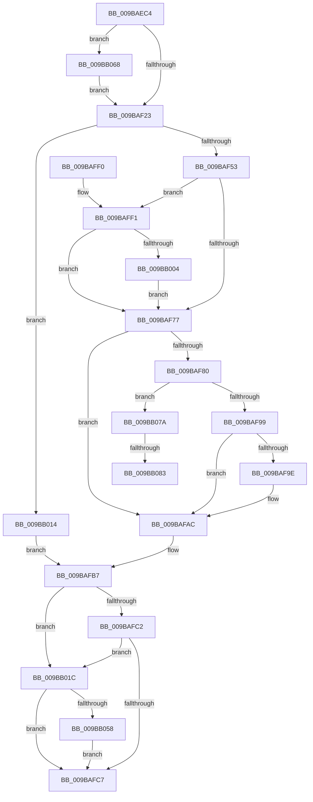

# MiRemoveVadCharges

- RVA: `0x009BAEC4`–`0x009BB090` (길이 `460` bytes)
- VA: `0x00000001409BAEC4`
- 실행 섹션: `PAGE`
- PDB 이름 있음: `예`; PDB Function 태그: `예`
- unwind 정보 RVA: `0x0009EBF8`
- 디코드: `125`개 명령, `460/460` bytes 표시
- 미해석 바이트: `0` (있으면 어셈블리에 `.byte`로 보존)

> 이 문서는 커널 이미지의 기계어와 PDB 기호를 분석해 생성했습니다. 4번과 5번은 함수 원형과 자료형을 바이너리 사용 방식에서 추정한 C 해석이며 원본 소스 복구 결과는 아닙니다.

## 1. Dependencies

- 직접 호출 지점: **9**; 고유 호출 대상: **9**
- 직접 호출자로 확인된 함수: **1**
- RIP 상대 이미지 참조: **0**

### Outgoing calls
- `0x009BAF05` → [MiGetProcessPartition](../../text/44/MiGetProcessPartition_function_00443B10.md) (function, `0x00443B10`)
- `0x009BAF12` → [MiIsVadLarge](../../text/3F/MiIsVadLarge_function_003F0190.md) (function, `0x003F0190`)
- `0x009BAF69` → [MiFillCommitReturnInfo](../../text/44/MiFillCommitReturnInfo_function_00447990.md) (function, `0x00447990`)
- `0x009BAF87` → [MiGetSharedVm](../../text/41/MiGetSharedVm_function_00414A20.md) (function, `0x00414A20`)
- `0x009BAFA7` → [MiReturnCommit](../../text/24/MiReturnCommit_function_00248410.md) (function, `0x00248410`)
- `0x009BAFCD` → [MiReleaseVadEventBlocks](MiReleaseVadEventBlocks_function_009BB0A0.md) (function, `0x009BB0A0`)
- `0x009BAFF7` → [MiReturnFullProcessCharges](../../text/2C/MiReturnFullProcessCharges_function_002C2E70.md) (function, `0x002C2E70`)
- `0x009BB04A` → [MiResidentPagesForSpan](MiResidentPagesForSpan_function_009BB300.md) (function, `0x009BB300`)
- `0x009BB05E` → [MiReturnResident](../../text/28/MiReturnResident_function_00286890.md) (function, `0x00286890`)

### Direct callers
- [MiFinishVadDeletion](../../text/43/MiFinishVadDeletion_function_00430ED0.md) at `0x00430F9C`

### Static image references
- 디코드된 RIP-relative 메모리 참조가 없습니다.

## 2. Other-region calls and transfers

- 다른 실행 섹션으로 향하는 call: **7**
  - `0x009BAF05` → [MiGetProcessPartition](../../text/44/MiGetProcessPartition_function_00443B10.md) (`PAGE` → `.text`)
  - `0x009BAF12` → [MiIsVadLarge](../../text/3F/MiIsVadLarge_function_003F0190.md) (`PAGE` → `.text`)
  - `0x009BAF69` → [MiFillCommitReturnInfo](../../text/44/MiFillCommitReturnInfo_function_00447990.md) (`PAGE` → `.text`)
  - `0x009BAF87` → [MiGetSharedVm](../../text/41/MiGetSharedVm_function_00414A20.md) (`PAGE` → `.text`)
  - `0x009BAFA7` → [MiReturnCommit](../../text/24/MiReturnCommit_function_00248410.md) (`PAGE` → `.text`)
  - `0x009BAFF7` → [MiReturnFullProcessCharges](../../text/2C/MiReturnFullProcessCharges_function_002C2E70.md) (`PAGE` → `.text`)
  - `0x009BB05E` → [MiReturnResident](../../text/28/MiReturnResident_function_00286890.md) (`PAGE` → `.text`)
- call이 아닌 외부 분기/꼬리 이동: **2**
  - `0x009BB07D` → [sub_00B2E67C](../B2/Unknown_function_00B2E67C.md) (`tail-transfer`)
  - `0x009BB08B` → [sub_00B2E67C + 0xA](../B2/Unknown_function_00B2E67C.md) (`tail-transfer`)

## 3. Assembly (complete function range)

```asm
009BAEC4  48 8B C4                        mov rax, rsp
009BAEC7  48 89 58 08                     mov qword ptr [rax + 8], rbx
009BAECB  48 89 70 10                     mov qword ptr [rax + 0x10], rsi
009BAECF  48 89 78 18                     mov qword ptr [rax + 0x18], rdi
009BAED3  4C 89 68 20                     mov qword ptr [rax + 0x20], r13
009BAED7  55                              push rbp
009BAED8  41 56                           push r14
009BAEDA  41 57                           push r15
009BAEDC  48 8B EC                        mov rbp, rsp
009BAEDF  48 83 EC 70                     sub rsp, 0x70
009BAEE3  0F 57 C0                        xorps xmm0, xmm0
009BAEE6  33 C0                           xor eax, eax
009BAEE8  48 8B D9                        mov rbx, rcx
009BAEEB  48 89 45 F0                     mov qword ptr [rbp - 0x10], rax
009BAEEF  48 8B CA                        mov rcx, rdx
009BAEF2  4C 8B F2                        mov r14, rdx
009BAEF5  0F 11 45 C0                     movups xmmword ptr [rbp - 0x40], xmm0
009BAEF9  0F 11 45 D0                     movups xmmword ptr [rbp - 0x30], xmm0
009BAEFD  0F 11 45 E0                     movups xmmword ptr [rbp - 0x20], xmm0
009BAF01  0F 11 45 B0                     movups xmmword ptr [rbp - 0x50], xmm0
009BAF05  E8 06 8C A8 FF                  call 0x140443b10
009BAF0A  48 8B CB                        mov rcx, rbx
009BAF0D  4C 8B F8                        mov r15, rax
009BAF10  33 FF                           xor edi, edi
009BAF12  E8 79 52 A3 FF                  call 0x1403f0190
009BAF17  44 8D 6F 01                     lea r13d, [rdi + 1]
009BAF1B  85 C0                           test eax, eax
009BAF1D  0F 85 45 01 00 00               jne 0x1409bb068
009BAF23  48 8B 43 08                     mov rax, qword ptr [rbx + 8]
009BAF27  8B 4B 34                        mov ecx, dword ptr [rbx + 0x34]
009BAF2A  0F B6 53 22                     movzx edx, byte ptr [rbx + 0x22]
009BAF2E  48 89 45 C8                     mov qword ptr [rbp - 0x38], rax
009BAF32  48 8B 03                        mov rax, qword ptr [rbx]
009BAF35  48 C1 E2 20                     shl rdx, 0x20
009BAF39  48 89 45 D0                     mov qword ptr [rbp - 0x30], rax
009BAF3D  48 0B D1                        or rdx, rcx
009BAF40  48 B8 FD FF FF FF 07 00 00 00   movabs rax, 0x7fffffffd
009BAF4A  48 3B D0                        cmp rdx, rax
009BAF4D  0F 83 C1 00 00 00               jae 0x1409bb014
009BAF53  8B 53 34                        mov edx, dword ptr [rbx + 0x34]
009BAF56  4C 8D 45 B0                     lea r8, [rbp - 0x50]
009BAF5A  0F B6 4B 22                     movzx ecx, byte ptr [rbx + 0x22]
009BAF5E  48 C1 E1 20                     shl rcx, 0x20
009BAF62  48 0B CA                        or rcx, rdx
009BAF65  48 8D 55 C0                     lea rdx, [rbp - 0x40]
009BAF69  E8 22 CA A8 FF                  call 0x140447990
009BAF6E  48 8B 75 B0                     mov rsi, qword ptr [rbp - 0x50]
009BAF72  48 85 F6                        test rsi, rsi
009BAF75  75 7A                           jne 0x1409baff1
009BAF77  4C 8B 4D B8                     mov r9, qword ptr [rbp - 0x48]
009BAF7B  4D 85 C9                        test r9, r9
009BAF7E  74 2C                           je 0x1409bafac
009BAF80  49 8D 8E 00 04 00 00            lea rcx, [r14 + 0x400]
009BAF87  E8 94 9A A5 FF                  call 0x140414a20
009BAF8C  48 8B 48 08                     mov rcx, qword ptr [rax + 8]
009BAF90  48 85 C9                        test rcx, rcx
009BAF93  0F 85 E1 00 00 00               jne 0x1409bb07a
009BAF99  4D 85 C9                        test r9, r9
009BAF9C  74 0E                           je 0x1409bafac
009BAF9E  45 33 C0                        xor r8d, r8d
009BAFA1  49 8B D1                        mov rdx, r9
009BAFA4  49 8B CF                        mov rcx, r15
009BAFA7  E8 64 D4 88 FF                  call 0x140248410
009BAFAC  C7 43 34 00 00 00 00            mov dword ptr [rbx + 0x34], 0
009BAFB3  C6 43 22 00                     mov byte ptr [rbx + 0x22], 0
009BAFB7  8B 43 30                        mov eax, dword ptr [rbx + 0x30]
009BAFBA  83 E0 70                        and eax, 0x70
009BAFBD  83 F8 10                        cmp eax, 0x10
009BAFC0  74 5A                           je 0x1409bb01c
009BAFC2  83 F8 40                        cmp eax, 0x40
009BAFC5  74 55                           je 0x1409bb01c
009BAFC7  41 8B D5                        mov edx, r13d
009BAFCA  48 8B CB                        mov rcx, rbx
009BAFCD  E8 CE 00 00 00                  call 0x1409bb0a0
009BAFD2  4C 8D 5C 24 70                  lea r11, [rsp + 0x70]
009BAFD7  49 8B 5B 20                     mov rbx, qword ptr [r11 + 0x20]
009BAFDB  49 8B 73 28                     mov rsi, qword ptr [r11 + 0x28]
009BAFDF  49 8B 7B 30                     mov rdi, qword ptr [r11 + 0x30]
009BAFE3  4D 8B 6B 38                     mov r13, qword ptr [r11 + 0x38]
009BAFE7  49 8B E3                        mov rsp, r11
009BAFEA  41 5F                           pop r15
009BAFEC  41 5E                           pop r14
009BAFEE  5D                              pop rbp
009BAFEF  C3                              ret
009BAFF0  CC                              int3
009BAFF1  48 8B D6                        mov rdx, rsi
009BAFF4  49 8B CE                        mov rcx, r14
009BAFF7  E8 74 7E 90 FF                  call 0x1402c2e70
009BAFFC  85 FF                           test edi, edi
009BAFFE  0F 84 73 FF FF FF               je 0x1409baf77
009BB004  48 F7 DE                        neg rsi
009BB007  F0 49 01 B6 70 05 00 00         lock add qword ptr [r14 + 0x570], rsi
009BB00F  E9 63 FF FF FF                  jmp 0x1409baf77
009BB014  8B 43 34                        mov eax, dword ptr [rbx + 0x34]
009BB017  8A 43 22                        mov al, byte ptr [rbx + 0x22]
009BB01A  EB 9B                           jmp 0x1409bafb7
009BB01C  8B 43 1C                        mov eax, dword ptr [rbx + 0x1c]
009BB01F  45 33 C0                        xor r8d, r8d
009BB022  0F B6 53 21                     movzx edx, byte ptr [rbx + 0x21]
009BB026  0F B6 4B 20                     movzx ecx, byte ptr [rbx + 0x20]
009BB02A  48 C1 E2 20                     shl rdx, 0x20
009BB02E  48 0B D0                        or rdx, rax
009BB031  48 C1 E1 20                     shl rcx, 0x20
009BB035  8B 43 18                        mov eax, dword ptr [rbx + 0x18]
009BB038  48 0B C8                        or rcx, rax
009BB03B  48 C1 E2 0C                     shl rdx, 0xc
009BB03F  48 C1 E1 0C                     shl rcx, 0xc
009BB043  48 81 CA FF 0F 00 00            or rdx, 0xfff
009BB04A  E8 B1 02 00 00                  call 0x1409bb300
009BB04F  48 85 C0                        test rax, rax
009BB052  0F 84 6F FF FF FF               je 0x1409bafc7
009BB058  48 8B D0                        mov rdx, rax
009BB05B  49 8B CF                        mov rcx, r15
009BB05E  E8 2D B8 8C FF                  call 0x140286890
009BB063  E9 5F FF FF FF                  jmp 0x1409bafc7
009BB068  8A 4B 30                        mov cl, byte ptr [rbx + 0x30]
009BB06B  80 E1 70                        and cl, 0x70
009BB06E  80 F9 50                        cmp cl, 0x50
009BB071  41 0F 45 FD                     cmovne edi, r13d
009BB075  E9 A9 FE FF FF                  jmp 0x1409baf23
009BB07A  4C 3B C9                        cmp r9, rcx
009BB07D  0F 86 F9 35 17 00               jbe 0x140b2e67c
009BB083  4C 2B C9                        sub r9, rcx
009BB086  48 83 60 08 00                  and qword ptr [rax + 8], 0
009BB08B  E9 F6 35 17 00                  jmp 0x140b2e686
```

## 4. C-style interpretation (structured pseudocode)

```c
__int64 __fastcall MiRemoveVadCharges(__int64 a1, __int64 a2)
{
    __int64 result;
    __int64 v_rdi;
    __int64 v_rsi;
    __int64 v_rsp;
    unsigned __int64 v_stack_m18;
    unsigned __int64 v_stack_m28;
    unsigned __int64 v_stack_m38;
    unsigned __int64 v_stack_m48;
    unsigned __int64 v_stack_m50;
    unsigned __int64 v_stack_m58;
    unsigned __int64 v_stack_m60;
    unsigned __int64 v_stack_m68;

    *(unsigned __int64 *)(v_rsp + 8) = v_rbx;
    *(unsigned __int64 *)(v_rsp + 16) = v_rsi;
    *(unsigned __int64 *)(v_rsp + 24) = v_rdi;
    *(unsigned __int64 *)(v_rsp + 32) = v_r13;
    v_rsp = (v_rsp) - (112);
    result = 0;
    v_stack_m28 = 0;
    v_stack_m58 = v_xmm0;
    v_stack_m48 = v_xmm0;
    v_stack_m38 = v_xmm0;
    v_stack_m68 = v_xmm0;
    result = MiGetProcessPartition(a2, a2, a3, a4);
    v_rdi = 0;
    result = MiIsVadLarge(a1, a2, a3, a4);
    if ((unsigned int)(result) != 0) goto loc_009BB068;
loc_009BAF23:
    v_stack_m50 = *(unsigned __int64 *)(a1 + 8);
    a2 = (*(unsigned __int8 *)(a1 + 34)) << (32);
    v_stack_m48 = *(unsigned __int64 *)(a1);
    a2 = (a2) | ((unsigned int)(*(unsigned int *)(a1 + 52)));
    if (a2 >= (*(unsigned __int64 *)(a1))) goto loc_009BB014;
    a1 = (*(unsigned __int8 *)(a1 + 34)) << (32);
    a1 = (a1) | ((unsigned int)(*(unsigned int *)(a1 + 52)));
    result = MiFillCommitReturnInfo(a1, v_stack_m58, v_stack_m68, a4);
    if (v_stack_m68 != 0) goto loc_009BAFF1;
loc_009BAF77:
    if (v_stack_m60 == 0) goto loc_009BAFAC;
    result = MiGetSharedVm(a2 + 1024, v_stack_m58, v_stack_m68, v_stack_m60);
    if (*(unsigned __int64 *)(result + 8) != 0) goto loc_009BB07A;
    if (v_stack_m60 != 0) {
        a3 = 0;
        a2 = v_stack_m60;
        a1 = result;
        result = MiReturnCommit(a1, a2, a3, v_stack_m60);
    }
    *(unsigned int *)(a1 + 52) = 0;
    *(unsigned __int8 *)(a1 + 34) = 0;
loc_009BAFB7:
    result = (unsigned int)(((unsigned int)(*(unsigned int *)(a1 + 48))) & (112));
    if (((unsigned int)(result)) == 16) goto loc_009BB01C;
    if (((unsigned int)(result)) == 64) goto loc_009BB01C;
loc_009BAFC7:
    result = MiReleaseVadEventBlocks(a1, (unsigned int)((unsigned int)(v_rdi + 1)), a3, v_stack_m60);
    return result;
loc_009BAFF1:
    result = MiReturnFullProcessCharges(a2, *(unsigned __int64 *)(v_stack_m18 + 40), a3, v_stack_m60);
    if ((unsigned int)(*(unsigned __int64 *)(v_stack_m18 + 48)) == 0) goto loc_009BAF77;
    v_rsi = -(*(unsigned __int64 *)(v_stack_m18 + 40));
    goto loc_009BAF77;
loc_009BB014:
    goto loc_009BAFB7;
loc_009BB01C:
    a3 = 0;
    a2 = (*(unsigned __int8 *)(*(unsigned __int64 *)(v_stack_m18 + 32) + 33)) << (32);
    a2 = (a2) | ((unsigned int)(*(unsigned int *)(*(unsigned __int64 *)(v_stack_m18 + 32) + 28)));
    a1 = (*(unsigned __int8 *)(*(unsigned __int64 *)(v_stack_m18 + 32) + 32)) << (32);
    a1 = (a1) | ((unsigned int)(*(unsigned int *)(*(unsigned __int64 *)(v_stack_m18 + 32) + 24)));
    a2 = (a2) << (12);
    a1 = (a1) << (12);
    a2 = (a2) | (0xFFFULL);
    result = MiResidentPagesForSpan(a1, a2, a3, v_stack_m60);
    if (result == 0) goto loc_009BAFC7;
    result = MiReturnResident(result, result, a3, v_stack_m60);
    goto loc_009BAFC7;
loc_009BB068:
    a1 = (unsigned __int8)((*(unsigned __int8 *)(*(unsigned __int64 *)(v_stack_m18 + 32) + 48)) & (112));
    v_rdi = *(unsigned __int64 *)(v_stack_m18 + 48);
    if (((unsigned __int8)(a1)) != 80) { v_rdi = (unsigned int)(*(unsigned __int64 *)(v_stack_m18 + 56)); }
    goto loc_009BAF23;
loc_009BB07A:
    a4 = (v_stack_m60) - (a1);
}
```

## 5. (Beta) C Style

```c
int64_t MiRemoveVadCharges(void *Arg1, void *Arg2)
{
    uint8_t *arg1 = (uint8_t *)Arg1;
    uint8_t *arg2 = (uint8_t *)Arg2;

    int64_t result;
    int64_t local_rdi;
    int64_t local_rsi;
    int64_t local_rsp;
    uint64_t v_stack_m18;
    uint64_t v_stack_m28;
    uint64_t v_stack_m38;
    uint64_t v_stack_m48;
    uint64_t v_stack_m50;
    uint64_t v_stack_m58;
    uint64_t v_stack_m60;
    uint64_t v_stack_m68;

    *(uint64_t *)(local_rsp + 0x8) = local_rbx;
    *(uint64_t *)(local_rsp + 0x10) = local_rsi;
    *(uint64_t *)(local_rsp + 0x18) = local_rdi;
    *(uint64_t *)(local_rsp + 0x20) = local_r13;
    local_rsp = (local_rsp) - (112);
    result = 0;
    v_stack_m28 = 0;
    v_stack_m58 = v_xmm0;
    v_stack_m48 = v_xmm0;
    v_stack_m38 = v_xmm0;
    v_stack_m68 = v_xmm0;
    result = MiGetProcessPartition(Arg2, Arg2, a3, a4);
    local_rdi = 0;
    result = MiIsVadLarge(Arg1, Arg2, a3, a4);
    if ((uint32_t)(result) != 0) goto loc_009BB068;
loc_009BAF23:
    v_stack_m50 = *(uint64_t *)(arg1 + 0x8);
    Arg2 = (*(uint8_t *)(arg1 + 0x22)) << (32);
    v_stack_m48 = *(uint64_t *)(arg1);
    Arg2 = (Arg2) | ((uint32_t)(*(uint32_t *)(arg1 + 0x34)));
    if (Arg2 >= (*(uint64_t *)(arg1))) goto loc_009BB014;
    Arg1 = (*(uint8_t *)(arg1 + 0x22)) << (32);
    Arg1 = (Arg1) | ((uint32_t)(*(uint32_t *)(arg1 + 0x34)));
    result = MiFillCommitReturnInfo(Arg1, v_stack_m58, v_stack_m68, a4);
    if (v_stack_m68 != 0) goto loc_009BAFF1;
loc_009BAF77:
    if (v_stack_m60 == 0) goto loc_009BAFAC;
    result = MiGetSharedVm(Arg2 + 1024, v_stack_m58, v_stack_m68, v_stack_m60);
    if (*(uint64_t *)(result + 0x8) != 0) goto loc_009BB07A;
    if (v_stack_m60 != 0) {
        a3 = 0;
        Arg2 = v_stack_m60;
        Arg1 = result;
        result = MiReturnCommit(Arg1, Arg2, a3, v_stack_m60);
    }
    *(uint32_t *)(arg1 + 0x34) = 0;
    *(uint8_t *)(arg1 + 0x22) = 0;
loc_009BAFB7:
    result = (uint32_t)(((uint32_t)(*(uint32_t *)(arg1 + 0x30))) & (112));
    if (((uint32_t)(result)) == 16) goto loc_009BB01C;
    if (((uint32_t)(result)) == 64) goto loc_009BB01C;
loc_009BAFC7:
    result = MiReleaseVadEventBlocks(Arg1, (uint32_t)((uint32_t)(local_rdi + 1)), a3, v_stack_m60);
    return result;
loc_009BAFF1:
    result = MiReturnFullProcessCharges(Arg2, *(uint64_t *)(v_stack_m18 + 0x28), a3, v_stack_m60);
    if ((uint32_t)(*(uint64_t *)(v_stack_m18 + 0x30)) == 0) goto loc_009BAF77;
    local_rsi = -(*(uint64_t *)(v_stack_m18 + 0x28));
    goto loc_009BAF77;
loc_009BB014:
    goto loc_009BAFB7;
loc_009BB01C:
    a3 = 0;
    Arg2 = (*(uint8_t *)(*(uint64_t *)(v_stack_m18 + 0x20) + 0x21)) << (32);
    Arg2 = (Arg2) | ((uint32_t)(*(uint32_t *)(*(uint64_t *)(v_stack_m18 + 0x20) + 0x1C)));
    Arg1 = (*(uint8_t *)(*(uint64_t *)(v_stack_m18 + 0x20) + 0x20)) << (32);
    Arg1 = (Arg1) | ((uint32_t)(*(uint32_t *)(*(uint64_t *)(v_stack_m18 + 0x20) + 0x18)));
    Arg2 = (Arg2) << (12);
    Arg1 = (Arg1) << (12);
    Arg2 = (Arg2) | (0xFFFULL);
    result = MiResidentPagesForSpan(Arg1, Arg2, a3, v_stack_m60);
    if (result == 0) goto loc_009BAFC7;
    result = MiReturnResident(result, result, a3, v_stack_m60);
    goto loc_009BAFC7;
loc_009BB068:
    Arg1 = (uint8_t)((*(uint8_t *)(*(uint64_t *)(v_stack_m18 + 0x20) + 0x30)) & (112));
    local_rdi = *(uint64_t *)(v_stack_m18 + 0x30);
    if (((uint8_t)(Arg1)) != 80) { local_rdi = (uint32_t)(*(uint64_t *)(v_stack_m18 + 0x38)); }
    goto loc_009BAF23;
loc_009BB07A:
    a4 = (v_stack_m60) - (Arg1);
}
```

### 관측된 메모리 오프셋

구조체 형식이 확인되지 않은 접근은 인자 기준의 오프셋으로만 기록했습니다.

| 기준 인자 | 오프셋 표현 | 폭 (bit) | 접근 |
|---|---:|---:|---|
| `Arg1` | `+ 0x0` | `64` | `R` |
| `Arg1` | `+ 0x8` | `64` | `R` |
| `Arg1` | `+ 0x18` | `32` | `R` |
| `Arg1` | `+ 0x1C` | `32` | `R` |
| `Arg1` | `+ 0x20` | `8` | `R` |
| `Arg1` | `+ 0x21` | `8` | `R` |
| `Arg1` | `+ 0x22` | `8` | `R` |
| `Arg1` | `+ 0x22` | `8` | `W` |
| `Arg1` | `+ 0x30` | `8` | `R` |
| `Arg1` | `+ 0x30` | `32` | `R` |
| `Arg1` | `+ 0x34` | `32` | `R` |
| `Arg1` | `+ 0x34` | `32` | `W` |
| `Arg2` | `+ 0x400` | `64` | `R` |
| `Arg2` | `+ 0x570` | `64` | `R/W` |

## 6. Execution-region graph

[열기: 2D/3D 그래프와 함수 탐색 컨트롤 패널](../../../control-panel.html?section=page&rva=0x009BAEC4&view=graph)

- 2D 그래프는 위에서 아래로 흐르고, 3D 그래프는 빈 공간을 드래그해 회전합니다. Shift+드래그는 이동, 휠은 확대·축소, 함수 노드 선택은 대상 보고서 이동입니다.

### Static fallback


