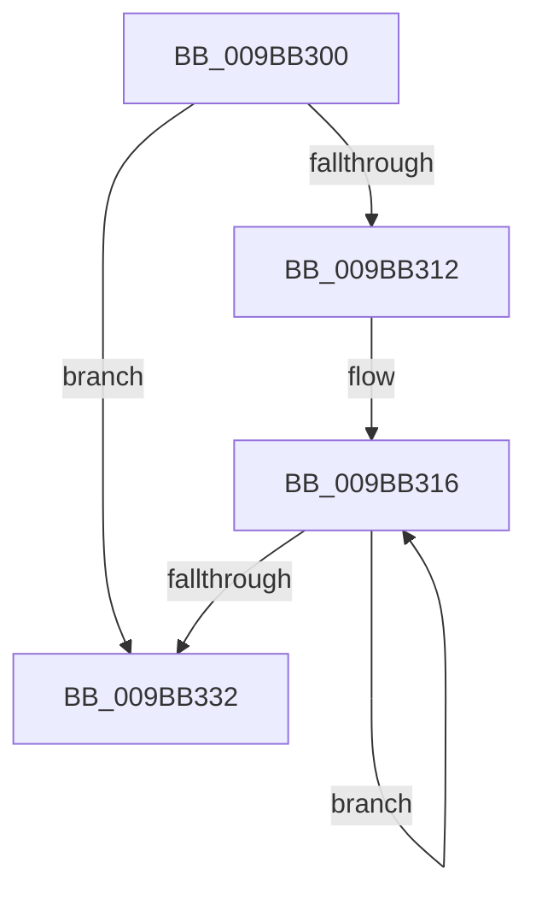

# MiResidentPagesForSpan

- RVA: `0x009BB300`–`0x009BB338` (길이 `56` bytes)
- VA: `0x00000001409BB300`
- 실행 섹션: `PAGE`
- PDB 이름 있음: `예`; PDB Function 태그: `아니요`
- unwind 정보 RVA: `0x0009ECDC`
- 디코드: `17`개 명령, `56/56` bytes 표시
- 미해석 바이트: `0` (있으면 어셈블리에 `.byte`로 보존)

> 이 문서는 커널 이미지의 기계어와 PDB 기호를 분석해 생성했습니다. 4번과 5번은 함수 원형과 자료형을 바이너리 사용 방식에서 추정한 C 해석이며 원본 소스 복구 결과는 아닙니다.

## 1. Dependencies

- 직접 호출 지점: **2**; 고유 호출 대상: **1**
- 직접 호출자로 확인된 함수: **3**
- RIP 상대 이미지 참조: **0**

### Outgoing calls
- `0x009BB319` → [MiGetPteAddress](../../text/43/MiGetPteAddress_function_0043E130.md) (function, `0x0043E130`)
- `0x009BB324` → [MiGetPteAddress](../../text/43/MiGetPteAddress_function_0043E130.md) (function, `0x0043E130`)

### Direct callers
- [MiComputeVadCharges](../../text/2C/MiComputeVadCharges_function_002C3348.md) at `0x002C343C`
- [MiComputeAweCharges](../6F/MiComputeAweCharges_function_006FE84C.md) at `0x006FE8C1`
- [MiRemoveVadCharges](MiRemoveVadCharges_function_009BAEC4.md) at `0x009BB04A`

### Static image references
- 디코드된 RIP-relative 메모리 참조가 없습니다.

## 2. Other-region calls and transfers

- 다른 실행 섹션으로 향하는 call: **2**
  - `0x009BB319` → [MiGetPteAddress](../../text/43/MiGetPteAddress_function_0043E130.md) (`PAGE` → `.text`)
  - `0x009BB324` → [MiGetPteAddress](../../text/43/MiGetPteAddress_function_0043E130.md) (`PAGE` → `.text`)
- call이 아닌 외부 분기/꼬리 이동: **1**
  - `0x009BB336` → [sub_009BB3A3](Unknown_function_009BB3A3.md) (`tail-transfer`)

## 3. Assembly (complete function range)

```asm
009BB300  48 83 EC 28                     sub rsp, 0x28
009BB304  45 33 D2                        xor r10d, r10d
009BB307  4C 8B DA                        mov r11, rdx
009BB30A  48 8B D1                        mov rdx, rcx
009BB30D  45 85 C0                        test r8d, r8d
009BB310  78 20                           js 0x1409bb332
009BB312  45 8D 48 01                     lea r9d, [r8 + 1]
009BB316  48 8B CA                        mov rcx, rdx
009BB319  E8 12 2E A8 FF                  call 0x14043e130
009BB31E  49 8B CB                        mov rcx, r11
009BB321  48 8B D0                        mov rdx, rax
009BB324  E8 07 2E A8 FF                  call 0x14043e130
009BB329  4C 8B D8                        mov r11, rax
009BB32C  49 83 E9 01                     sub r9, 1
009BB330  75 E4                           jne 0x1409bb316
009BB332  41 83 F8 03                     cmp r8d, 3
009BB336  7D 6B                           jge 0x1409bb3a3
```

## 4. C-style interpretation (structured pseudocode)

```c
__int64 __fastcall MiResidentPagesForSpan(__int64 a1, __int64 a2, __int64 a3)
{
    __int64 result;
    __int64 v_r10;
    __int64 v_rsp;

    v_rsp = (v_rsp) - (40);
    v_r10 = 0;
    if (sign_flag) goto loc_009BB332;
loc_009BB316:
    result = MiGetPteAddress(a1, a1, a3, a3 + 1);
    result = MiGetPteAddress(a2, result, a3, a3 + 1);
    a4 = (a3 + 1) - (1);
    if (condition_is_not_equal) goto loc_009BB316;
loc_009BB332:
}
```

## 5. (Beta) C Style

```c
int64_t MiResidentPagesForSpan(int64_t Arg1, int64_t Arg2, int64_t Arg3)
{
    int64_t result;
    int64_t local_r10;
    int64_t local_rsp;

    local_rsp = (local_rsp) - (40);
    local_r10 = 0;
    if (sign_flag) goto loc_009BB332;
loc_009BB316:
    result = MiGetPteAddress(Arg1, Arg1, Arg3, Arg3 + 1);
    result = MiGetPteAddress(Arg2, result, Arg3, Arg3 + 1);
    a4 = (Arg3 + 1) - (1);
    if (condition_is_not_equal) goto loc_009BB316;
loc_009BB332:
}
```

## 6. Execution-region graph

[열기: 2D/3D 그래프와 함수 탐색 컨트롤 패널](../../../control-panel.html?section=page&rva=0x009BB300&view=graph)

- 2D 그래프는 위에서 아래로 흐르고, 3D 그래프는 빈 공간을 드래그해 회전합니다. Shift+드래그는 이동, 휠은 확대·축소, 함수 노드 선택은 대상 보고서 이동입니다.

### Static fallback


