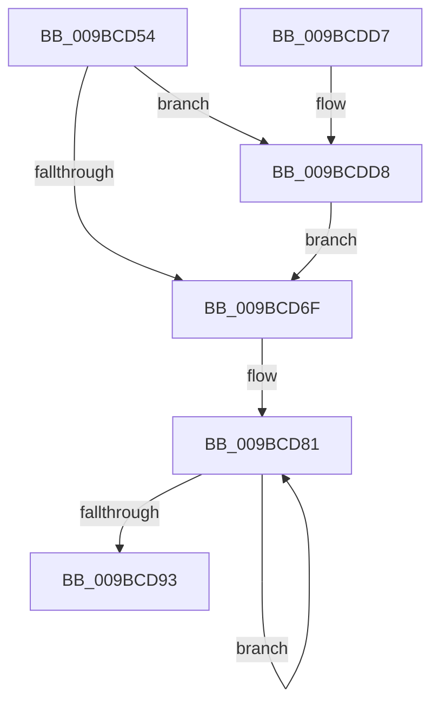

# PiDevCfgFreeDeviceMigrationNode

- RVA: `0x009BCD54`–`0x009BCDDF` (길이 `139` bytes)
- VA: `0x00000001409BCD54`
- 실행 섹션: `PAGE`
- PDB 이름 있음: `예`; PDB Function 태그: `아니요`
- unwind 정보 RVA: `0x0006383C`
- 디코드: `36`개 명령, `139/139` bytes 표시
- 미해석 바이트: `0` (있으면 어셈블리에 `.byte`로 보존)

> 이 문서는 커널 이미지의 기계어와 PDB 기호를 분석해 생성했습니다. 4번과 5번은 함수 원형과 자료형을 바이너리 사용 방식에서 추정한 C 해석이며 원본 소스 복구 결과는 아닙니다.

## 1. Dependencies

- 직접 호출 지점: **8**; 고유 호출 대상: **3**
- 직접 호출자로 확인된 함수: **3**
- RIP 상대 이미지 참조: **0**

### Outgoing calls
- `0x009BCD73` → [RtlFreeAnsiString](../9C/RtlFreeAnsiString_function_009C0800.md) (function, `0x009C0800`)
- `0x009BCD84` → [RtlFreeAnsiString](../9C/RtlFreeAnsiString_function_009C0800.md) (function, `0x009C0800`)
- `0x009BCD97` → [RtlFreeAnsiString](../9C/RtlFreeAnsiString_function_009C0800.md) (function, `0x009C0800`)
- `0x009BCDA0` → [RtlFreeAnsiString](../9C/RtlFreeAnsiString_function_009C0800.md) (function, `0x009C0800`)
- `0x009BCDAC` → [RtlFreeAnsiString](../9C/RtlFreeAnsiString_function_009C0800.md) (function, `0x009C0800`)
- `0x009BCDB8` → [RtlFreeAnsiString](../9C/RtlFreeAnsiString_function_009C0800.md) (function, `0x009C0800`)
- `0x009BCDC2` → [ExFreePoolWithTag](../../poolcode/B8/ExFreePoolWithTag_function_00B82870.md) (function, `0x00B82870`)
- `0x009BCDD8` → [ZwClose](../../text/6A/ZwClose_function_006AD2B0.md) (function, `0x006AD2B0`)

### Direct callers
- [PiDevCfgFindDeviceMigrationNode](../73/PiDevCfgFindDeviceMigrationNode_function_00732920.md) at `0x007332EC`
- [PiDevCfgMigrateDevice](../96/PiDevCfgMigrateDevice_function_00963E60.md) at `0x009642CF`
- [PiDevCfgQueryDeviceMigrationNode](PiDevCfgQueryDeviceMigrationNode_function_009BD328.md) at `0x009BD66A`

### Static image references
- 디코드된 RIP-relative 메모리 참조가 없습니다.

## 2. Other-region calls and transfers

- 다른 실행 섹션으로 향하는 call: **2**
  - `0x009BCDC2` → [ExFreePoolWithTag](../../poolcode/B8/ExFreePoolWithTag_function_00B82870.md) (`PAGE` → `POOLCODE`)
  - `0x009BCDD8` → [ZwClose](../../text/6A/ZwClose_function_006AD2B0.md) (`PAGE` → `.text`)
- 별도 외부 분기/꼬리 이동을 확인하지 못했습니다.

## 3. Assembly (complete function range)

```asm
009BCD54  48 89 5C 24 08                  mov qword ptr [rsp + 8], rbx
009BCD59  48 89 74 24 10                  mov qword ptr [rsp + 0x10], rsi
009BCD5E  57                              push rdi
009BCD5F  48 83 EC 20                     sub rsp, 0x20
009BCD63  48 8B D9                        mov rbx, rcx
009BCD66  48 8B 49 28                     mov rcx, qword ptr [rcx + 0x28]
009BCD6A  48 85 C9                        test rcx, rcx
009BCD6D  75 69                           jne 0x1409bcdd8
009BCD6F  48 8D 4B 18                     lea rcx, [rbx + 0x18]
009BCD73  E8 88 3A 00 00                  call 0x1409c0800
009BCD78  48 8D 7B 30                     lea rdi, [rbx + 0x30]
009BCD7C  BE 02 00 00 00                  mov esi, 2
009BCD81  48 8B CF                        mov rcx, rdi
009BCD84  E8 77 3A 00 00                  call 0x1409c0800
009BCD89  48 83 C7 10                     add rdi, 0x10
009BCD8D  48 83 EE 01                     sub rsi, 1
009BCD91  75 EE                           jne 0x1409bcd81
009BCD93  48 8D 4B 68                     lea rcx, [rbx + 0x68]
009BCD97  E8 64 3A 00 00                  call 0x1409c0800
009BCD9C  48 8D 4B 78                     lea rcx, [rbx + 0x78]
009BCDA0  E8 5B 3A 00 00                  call 0x1409c0800
009BCDA5  48 8D 8B 88 00 00 00            lea rcx, [rbx + 0x88]
009BCDAC  E8 4F 3A 00 00                  call 0x1409c0800
009BCDB1  48 8D 8B A0 00 00 00            lea rcx, [rbx + 0xa0]
009BCDB8  E8 43 3A 00 00                  call 0x1409c0800
009BCDBD  33 D2                           xor edx, edx
009BCDBF  48 8B CB                        mov rcx, rbx
009BCDC2  E8 A9 5A 1C 00                  call 0x140b82870
009BCDC7  48 8B 5C 24 30                  mov rbx, qword ptr [rsp + 0x30]
009BCDCC  48 8B 74 24 38                  mov rsi, qword ptr [rsp + 0x38]
009BCDD1  48 83 C4 20                     add rsp, 0x20
009BCDD5  5F                              pop rdi
009BCDD6  C3                              ret
009BCDD7  CC                              int3
009BCDD8  E8 D3 04 CF FF                  call 0x1406ad2b0
009BCDDD  EB 90                           jmp 0x1409bcd6f
```

## 4. C-style interpretation (structured pseudocode)

```c
__int64 __fastcall PiDevCfgFreeDeviceMigrationNode(__int64 a1, int a2)
{
    __int64 result;
    __int64 v_rdi;
    __int64 v_rsi;
    __int64 v_rsp;
    unsigned __int64 v_stack_p10;
    unsigned __int64 v_stack_p8;

    v_stack_p8 = v_rbx;
    v_stack_p10 = v_rsi;
    v_rsp = (v_rsp) - (32);
    if (*(unsigned __int64 *)(a1 + 40) != 0) goto loc_009BCDD8;
loc_009BCD6F:
    result = RtlFreeAnsiString(a1 + 24, a2, a3, a4);
loc_009BCD81:
    result = RtlFreeAnsiString(a1 + 48, a2, a3, a4);
    v_rdi = (a1 + 48) + (16);
    v_rsi = (2) - (1);
    if (condition_is_not_equal) goto loc_009BCD81;
    result = RtlFreeAnsiString(a1 + 104, a2, a3, a4);
    result = RtlFreeAnsiString(a1 + 120, a2, a3, a4);
    result = RtlFreeAnsiString(a1 + 136, a2, a3, a4);
    result = RtlFreeAnsiString(a1 + 160, a2, a3, a4);
    a2 = 0;
    result = ExFreePoolWithTag(a1, a2, a3, a4);
    v_rsp = (v_rsp) + (32);
    return result;
loc_009BCDD8:
    result = ZwClose(a1, a2, a3, a4);
    goto loc_009BCD6F;
}
```

## 5. (Beta) C Style

```c
int64_t PiDevCfgFreeDeviceMigrationNode(void *Arg1, int32_t Arg2)
{
    uint8_t *arg1 = (uint8_t *)Arg1;

    int64_t result;
    int64_t local_rdi;
    int64_t local_rsi;
    int64_t local_rsp;
    uint64_t v_stack_p10;
    uint64_t v_stack_p8;

    v_stack_p8 = local_rbx;
    v_stack_p10 = local_rsi;
    local_rsp = (local_rsp) - (32);
    if (*(uint64_t *)(arg1 + 0x28) != 0) goto loc_009BCDD8;
loc_009BCD6F:
    result = RtlFreeAnsiString(Arg1 + 24, Arg2, a3, a4);
loc_009BCD81:
    result = RtlFreeAnsiString(Arg1 + 48, Arg2, a3, a4);
    local_rdi = (Arg1 + 48) + (16);
    local_rsi = (2) - (1);
    if (condition_is_not_equal) goto loc_009BCD81;
    result = RtlFreeAnsiString(Arg1 + 104, Arg2, a3, a4);
    result = RtlFreeAnsiString(Arg1 + 120, Arg2, a3, a4);
    result = RtlFreeAnsiString(Arg1 + 136, Arg2, a3, a4);
    result = RtlFreeAnsiString(Arg1 + 160, Arg2, a3, a4);
    Arg2 = 0;
    result = ExFreePoolWithTag(Arg1, Arg2, a3, a4);
    local_rsp = (local_rsp) + (32);
    return result;
loc_009BCDD8:
    result = ZwClose(Arg1, Arg2, a3, a4);
    goto loc_009BCD6F;
}
```

### 관측된 메모리 오프셋

구조체 형식이 확인되지 않은 접근은 인자 기준의 오프셋으로만 기록했습니다.

| 기준 인자 | 오프셋 표현 | 폭 (bit) | 접근 |
|---|---:|---:|---|
| `Arg1` | `+ 0x18` | `64` | `R` |
| `Arg1` | `+ 0x28` | `64` | `R` |
| `Arg1` | `+ 0x30` | `64` | `R` |
| `Arg1` | `+ 0x68` | `64` | `R` |
| `Arg1` | `+ 0x78` | `64` | `R` |
| `Arg1` | `+ 0x88` | `64` | `R` |
| `Arg1` | `+ 0xA0` | `64` | `R` |

## 6. Execution-region graph

[열기: 2D/3D 그래프와 함수 탐색 컨트롤 패널](../../../control-panel.html?section=page&rva=0x009BCD54&view=graph)

- 2D 그래프는 위에서 아래로 흐르고, 3D 그래프는 빈 공간을 드래그해 회전합니다. Shift+드래그는 이동, 휠은 확대·축소, 함수 노드 선택은 대상 보고서 이동입니다.

### Static fallback


