# PiDevCfgQueryDeviceMigrationNode

- RVA: `0x009BD328`–`0x009BD74E` (길이 `1,062` bytes)
- VA: `0x00000001409BD328`
- 실행 섹션: `PAGE`
- PDB 이름 있음: `예`; PDB Function 태그: `아니요`
- unwind 정보 RVA: `0x0009F1E0`
- 디코드: `230`개 명령, `1,062/1,062` bytes 표시
- 미해석 바이트: `0` (있으면 어셈블리에 `.byte`로 보존)

> 이 문서는 커널 이미지의 기계어와 PDB 기호를 분석해 생성했습니다. 4번과 5번은 함수 원형과 자료형을 바이너리 사용 방식에서 추정한 C 해석이며 원본 소스 복구 결과는 아닙니다.

## 1. Dependencies

- 직접 호출 지점: **16**; 고유 호출 대상: **12**
- 직접 호출자로 확인된 함수: **2**
- RIP 상대 이미지 참조: **14**

### Outgoing calls
- `0x009BD3BA` → [_RegRtlOpenKeyTransacted](../8E/_RegRtlOpenKeyTransacted_function_008EF810.md) (function, `0x008EF810`)
- `0x009BD3D7` → [ExAllocatePool2](../../poolcode/B8/ExAllocatePool2_function_00B820F0.md) (function, `0x00B820F0`)
- `0x009BD400` → [RtlCreateUnicodeString](RtlCreateUnicodeString_function_009BD860.md) (function, `0x009BD860`)
- `0x009BD428` → [memset](../../text/6C/memset_function_006C6C40.md) (function, `0x006C6C40`)
- `0x009BD5BC` → [RtlpQueryRegistryValues](../8C/RtlpQueryRegistryValues_function_008C9050.md) (function, `0x008C9050`)
- `0x009BD5DF` → [RtlGUIDFromString](../8F/RtlGUIDFromString_function_008F1EF0.md) (function, `0x008F1EF0`)
- `0x009BD60F` → [RtlFreeAnsiString](../9C/RtlFreeAnsiString_function_009C0800.md) (function, `0x009C0800`)
- `0x009BD66A` → [PiDevCfgFreeDeviceMigrationNode](PiDevCfgFreeDeviceMigrationNode_function_009BCD54.md) (function, `0x009BCD54`)
- `0x009BD687` → [ExFreePool](../../poolcode/B8/ExFreePool_function_00B82850.md) (function, `0x00B82850`)
- `0x009BD698` → [_security_check_cookie](../../text/6A/_security_check_cookie_function_006AC640.md) (function, `0x006AC640`)
- `0x009BD6E1` → [RtlFreeAnsiString](../9C/RtlFreeAnsiString_function_009C0800.md) (function, `0x009C0800`)
- `0x009BD6FB` → [RtlFreeAnsiString](../9C/RtlFreeAnsiString_function_009C0800.md) (function, `0x009C0800`)
- `0x009BD710` → [PnpValidateMultiSzData](../../text/4B/PnpValidateMultiSzData_function_004BD294.md) (function, `0x004BD294`)
- `0x009BD720` → [RtlFreeAnsiString](../9C/RtlFreeAnsiString_function_009C0800.md) (function, `0x009C0800`)
- `0x009BD73A` → [RtlFreeAnsiString](../9C/RtlFreeAnsiString_function_009C0800.md) (function, `0x009C0800`)
- `0x009BD744` → [ZwClose](../../text/6A/ZwClose_function_006AD2B0.md) (function, `0x006AD2B0`)

### Direct callers
- [PiDevCfgFindDeviceMigrationNode](../73/PiDevCfgFindDeviceMigrationNode_function_00732920.md) at `0x00732B4C`
- [PiDevCfgMigrateDevice](../96/PiDevCfgMigrateDevice_function_00963E60.md) at `0x00964195`

### Static image references
- `0x009BD34C` → RVA `0x00E0A740` (`.data`; read)
- `0x009BD35D` → RVA `0x00E66398` (`.data`; read)
- `0x009BD42D` → RVA `0x00B4B610` (`PAGE`; read)
- `0x009BD435` → RVA `0x00AFF310` (` ?? ::NNGAKEGL::`string'`; read)
- `0x009BD442` → RVA `0x00013DE0` (`.rdata`; read)
- `0x009BD44E` → RVA `0x00013E00` (`.rdata`; read)
- `0x009BD45A` → RVA `0x00012290` (`.rdata`; read)
- `0x009BD48B` → RVA `0x00AFF330` (` ?? ::NNGAKEGL::`string'`; read)
- `0x009BD4AD` → RVA `0x00AFF350` (` ?? ::NNGAKEGL::`string'`; read)
- `0x009BD4B4` → RVA `0x00013DF0` (`.rdata`; read)
- `0x009BD4C0` → RVA `0x00AFF3F0` (` ?? ::NNGAKEGL::`string'`; read)
- `0x009BD4CB` → RVA `0x00AFD240` (` ?? ::NNGAKEGL::`string'`; read)
- `0x009BD4E7` → RVA `0x00AFF370` (` ?? ::NNGAKEGL::`string'`; read)
- `0x009BD4FE` → RVA `0x00AFF410` (` ?? ::NNGAKEGL::`string'`; read)

## 2. Other-region calls and transfers

- 다른 실행 섹션으로 향하는 call: **6**
  - `0x009BD3D7` → [ExAllocatePool2](../../poolcode/B8/ExAllocatePool2_function_00B820F0.md) (`PAGE` → `POOLCODE`)
  - `0x009BD428` → [memset](../../text/6C/memset_function_006C6C40.md) (`PAGE` → `.text`)
  - `0x009BD687` → [ExFreePool](../../poolcode/B8/ExFreePool_function_00B82850.md) (`PAGE` → `POOLCODE`)
  - `0x009BD698` → [_security_check_cookie](../../text/6A/_security_check_cookie_function_006AC640.md) (`PAGE` → `.text`)
  - `0x009BD710` → [PnpValidateMultiSzData](../../text/4B/PnpValidateMultiSzData_function_004BD294.md) (`PAGE` → `.text`)
  - `0x009BD744` → [ZwClose](../../text/6A/ZwClose_function_006AD2B0.md) (`PAGE` → `.text`)
- 별도 외부 분기/꼬리 이동을 확인하지 못했습니다.

## 3. Assembly (complete function range)

```asm
009BD328  48 8B C4                        mov rax, rsp
009BD32B  48 89 58 20                     mov qword ptr [rax + 0x20], rbx
009BD32F  55                              push rbp
009BD330  56                              push rsi
009BD331  57                              push rdi
009BD332  41 54                           push r12
009BD334  41 55                           push r13
009BD336  41 56                           push r14
009BD338  41 57                           push r15
009BD33A  48 8D A8 28 FE FF FF            lea rbp, [rax - 0x1d8]
009BD341  48 81 EC A0 02 00 00            sub rsp, 0x2a0
009BD348  0F 29 70 B8                     movaps xmmword ptr [rax - 0x48], xmm6
009BD34C  48 8B 05 ED D3 44 00            mov rax, qword ptr [rip + 0x44d3ed]
009BD353  48 33 C4                        xor rax, rsp
009BD356  48 89 85 80 01 00 00            mov qword ptr [rbp + 0x180], rax
009BD35D  48 8B 05 34 90 4A 00            mov rax, qword ptr [rip + 0x4a9034]
009BD364  45 33 F6                        xor r14d, r14d
009BD367  4C 8B 51 08                     mov r10, qword ptr [rcx + 8]
009BD36B  48 8B F2                        mov rsi, rdx
009BD36E  4C 89 44 24 48                  mov qword ptr [rsp + 0x48], r8
009BD373  4C 89 74 24 30                  mov qword ptr [rsp + 0x30], r14
009BD378  4C 89 74 24 38                  mov qword ptr [rsp + 0x38], r14
009BD37D  4C 89 74 24 40                  mov qword ptr [rsp + 0x40], r14
009BD382  48 85 C0                        test rax, rax
009BD385  0F 84 3A 03 00 00               je 0x1409bd6c5
009BD38B  48 8B 80 E0 00 00 00            mov rax, qword ptr [rax + 0xe0]
009BD392  48 85 C0                        test rax, rax
009BD395  0F 84 2A 03 00 00               je 0x1409bd6c5
009BD39B  48 8B 48 08                     mov rcx, qword ptr [rax + 8]
009BD39F  48 89 4C 24 28                  mov qword ptr [rsp + 0x28], rcx
009BD3A4  48 8D 44 24 30                  lea rax, [rsp + 0x30]
009BD3A9  49 8B CA                        mov rcx, r10
009BD3AC  48 89 44 24 20                  mov qword ptr [rsp + 0x20], rax
009BD3B1  41 B9 19 00 02 00               mov r9d, 0x20019
009BD3B7  45 33 C0                        xor r8d, r8d
009BD3BA  E8 51 24 F3 FF                  call 0x1408ef810
009BD3BF  8B F8                           mov edi, eax
009BD3C1  85 C0                           test eax, eax
009BD3C3  0F 88 A6 02 00 00               js 0x1409bd66f
009BD3C9  BA C0 00 00 00                  mov edx, 0xc0
009BD3CE  41 B8 50 70 64 63               mov r8d, 0x63647050
009BD3D4  8D 4A 40                        lea ecx, [rdx + 0x40]
009BD3D7  E8 14 4D 1C 00                  call 0x140b820f0
009BD3DC  48 8B D8                        mov rbx, rax
009BD3DF  66 48 0F 6E F0                  movq xmm6, rax
009BD3E4  66 0F 6C F6                     punpcklqdq xmm6, xmm6
009BD3E8  48 85 C0                        test rax, rax
009BD3EB  0F 84 DC 02 00 00               je 0x1409bd6cd
009BD3F1  48 83 88 B8 00 00 00 FF         or qword ptr [rax + 0xb8], 0xffffffffffffffff
009BD3F9  48 8D 48 18                     lea rcx, [rax + 0x18]
009BD3FD  48 8B D6                        mov rdx, rsi
009BD400  E8 5B 04 00 00                  call 0x1409bd860
009BD405  84 C0                           test al, al
009BD407  0F 84 55 02 00 00               je 0x1409bd662
009BD40D  48 8B 44 24 30                  mov rax, qword ptr [rsp + 0x30]
009BD412  48 8D 4C 24 50                  lea rcx, [rsp + 0x50]
009BD417  48 89 43 28                     mov qword ptr [rbx + 0x28], rax
009BD41B  33 D2                           xor edx, edx
009BD41D  41 B8 30 02 00 00               mov r8d, 0x230
009BD423  4C 89 74 24 30                  mov qword ptr [rsp + 0x30], r14
009BD428  E8 13 98 D0 FF                  call 0x1406c6c40
009BD42D  F3 0F 6F 05 DB E1 18 00         movdqu xmm0, xmmword ptr [rip + 0x18e1db]
009BD435  48 8D 05 D4 1E 14 00            lea rax, [rip + 0x141ed4]
009BD43C  41 B8 20 01 00 00               mov r8d, 0x120
009BD442  66 0F 6F 0D 96 69 65 FF         movdqa xmm1, xmmword ptr [rip - 0x9a966a]
009BD44A  4C 8D 63 68                     lea r12, [rbx + 0x68]
009BD44E  66 0F 6F 1D AA 69 65 FF         movdqa xmm3, xmmword ptr [rip - 0x9a9656]
009BD456  4C 8D 6B 78                     lea r13, [rbx + 0x78]
009BD45A  66 0F 6F 15 2E 4E 65 FF         movdqa xmm2, xmmword ptr [rip - 0x9ab1d2]
009BD462  4C 8D BB A0 00 00 00            lea r15, [rbx + 0xa0]
009BD469  48 89 45 D0                     mov qword ptr [rbp - 0x30], rax
009BD46D  B9 00 00 00 01                  mov ecx, 0x1000000
009BD472  66 0F D6 44 24 60               movq qword ptr [rsp + 0x60], xmm0
009BD478  48 8D 44 24 38                  lea rax, [rsp + 0x38]
009BD47D  48 89 45 D8                     mov qword ptr [rbp - 0x28], rax
009BD481  BA 00 00 00 04                  mov edx, 0x4000000
009BD486  66 0F 73 D8 08                  psrldq xmm0, 8
009BD48B  48 8D 05 9E 1E 14 00            lea rax, [rip + 0x141e9e]
009BD492  48 89 45 08                     mov qword ptr [rbp + 8], rax
009BD496  45 33 C9                        xor r9d, r9d
009BD499  48 8D 43 60                     lea rax, [rbx + 0x60]
009BD49D  66 0F D6 45 98                  movq qword ptr [rbp - 0x68], xmm0
009BD4A2  48 89 45 10                     mov qword ptr [rbp + 0x10], rax
009BD4A6  0F 57 C0                        xorps xmm0, xmm0
009BD4A9  66 0F 62 D0                     punpckldq xmm2, xmm0
009BD4AD  48 8D 05 9C 1E 14 00            lea rax, [rip + 0x141e9c]
009BD4B4  66 0F D4 15 34 69 65 FF         paddq xmm2, xmmword ptr [rip - 0x9a96cc]
009BD4BC  48 89 45 40                     mov qword ptr [rbp + 0x40], rax
009BD4C0  48 8D 05 29 1F 14 00            lea rax, [rip + 0x141f29]
009BD4C7  48 89 45 78                     mov qword ptr [rbp + 0x78], rax
009BD4CB  48 8D 05 6E FD 13 00            lea rax, [rip + 0x13fd6e]
009BD4D2  48 89 85 B0 00 00 00            mov qword ptr [rbp + 0xb0], rax
009BD4D9  48 8D 83 88 00 00 00            lea rax, [rbx + 0x88]
009BD4E0  48 89 85 B8 00 00 00            mov qword ptr [rbp + 0xb8], rax
009BD4E7  48 8D 05 82 1E 14 00            lea rax, [rip + 0x141e82]
009BD4EE  66 0F 73 F2 04                  psllq xmm2, 4
009BD4F3  48 89 85 E8 00 00 00            mov qword ptr [rbp + 0xe8], rax
009BD4FA  66 0F D4 D6                     paddq xmm2, xmm6
009BD4FE  48 8D 05 0B 1F 14 00            lea rax, [rip + 0x141f0b]
009BD505  66 0F 7E 4C 24 70               movd dword ptr [rsp + 0x70], xmm1
009BD50B  48 89 85 20 01 00 00            mov qword ptr [rbp + 0x120], rax
009BD512  48 8D 83 B0 00 00 00            lea rax, [rbx + 0xb0]
009BD519  66 0F D6 54 24 68               movq qword ptr [rsp + 0x68], xmm2
009BD51F  66 0F 7E 5C 24 58               movd dword ptr [rsp + 0x58], xmm3
009BD525  66 0F 73 D9 04                  psrldq xmm1, 4
009BD52A  66 0F 73 DA 08                  psrldq xmm2, 8
009BD52F  66 0F 73 DB 04                  psrldq xmm3, 4
009BD534  89 4D E0                        mov dword ptr [rbp - 0x20], ecx
009BD537  44 89 45 C8                     mov dword ptr [rbp - 0x38], r8d
009BD53B  89 55 18                        mov dword ptr [rbp + 0x18], edx
009BD53E  44 89 45 00                     mov dword ptr [rbp], r8d
009BD542  89 4D 50                        mov dword ptr [rbp + 0x50], ecx
009BD545  44 89 45 38                     mov dword ptr [rbp + 0x38], r8d
009BD549  89 8D 88 00 00 00               mov dword ptr [rbp + 0x88], ecx
009BD54F  44 89 45 70                     mov dword ptr [rbp + 0x70], r8d
009BD553  89 8D F8 00 00 00               mov dword ptr [rbp + 0xf8], ecx
009BD559  B9 00 00 00 C0                  mov ecx, 0xc0000000
009BD55E  44 89 85 E0 00 00 00            mov dword ptr [rbp + 0xe0], r8d
009BD565  89 95 30 01 00 00               mov dword ptr [rbp + 0x130], edx
009BD56B  48 8B 53 28                     mov rdx, qword ptr [rbx + 0x28]
009BD56F  44 89 85 18 01 00 00            mov dword ptr [rbp + 0x118], r8d
009BD576  4C 8D 44 24 50                  lea r8, [rsp + 0x50]
009BD57B  48 89 85 28 01 00 00            mov qword ptr [rbp + 0x128], rax
009BD582  66 0F 7E 4D A8                  movd dword ptr [rbp - 0x58], xmm1
009BD587  66 0F D6 55 A0                  movq qword ptr [rbp - 0x60], xmm2
009BD58C  66 0F 7E 5D 90                  movd dword ptr [rbp - 0x70], xmm3
009BD591  4C 89 65 48                     mov qword ptr [rbp + 0x48], r12
009BD595  4C 89 AD 80 00 00 00            mov qword ptr [rbp + 0x80], r13
009BD59C  C7 85 C0 00 00 00 00 00 00 07   mov dword ptr [rbp + 0xc0], 0x7000000
009BD5A6  C7 85 A8 00 00 00 30 01 00 00   mov dword ptr [rbp + 0xa8], 0x130
009BD5B0  4C 89 BD F0 00 00 00            mov qword ptr [rbp + 0xf0], r15
009BD5B7  C6 44 24 28 01                  mov byte ptr [rsp + 0x28], 1
009BD5BC  E8 8F BA F0 FF                  call 0x1408c9050
009BD5C1  8B F8                           mov edi, eax
009BD5C3  85 C0                           test eax, eax
009BD5C5  0F 88 9C 00 00 00               js 0x1409bd667
009BD5CB  4C 39 74 24 40                  cmp qword ptr [rsp + 0x40], r14
009BD5D0  0F 84 E8 00 00 00               je 0x1409bd6be
009BD5D6  48 8D 53 50                     lea rdx, [rbx + 0x50]
009BD5DA  48 8D 4C 24 38                  lea rcx, [rsp + 0x38]
009BD5DF  E8 0C 49 F3 FF                  call 0x1408f1ef0
009BD5E4  85 C0                           test eax, eax
009BD5E6  0F 88 D2 00 00 00               js 0x1409bd6be
009BD5EC  48 8D 73 38                     lea rsi, [rbx + 0x38]
009BD5F0  B8 02 00 00 00                  mov eax, 2
009BD5F5  66 39 46 F8                     cmp word ptr [rsi - 8], ax
009BD5F9  77 1E                           ja 0x1409bd619
009BD5FB  48 83 3E 00                     cmp qword ptr [rsi], 0
009BD5FF  74 18                           je 0x1409bd619
009BD601  41 8B CE                        mov ecx, r14d
009BD604  48 83 C1 03                     add rcx, 3
009BD608  48 C1 E1 04                     shl rcx, 4
009BD60C  48 03 CB                        add rcx, rbx
009BD60F  E8 EC 31 00 00                  call 0x1409c0800
009BD614  B8 02 00 00 00                  mov eax, 2
009BD619  41 FF C6                        inc r14d
009BD61C  48 83 C6 10                     add rsi, 0x10
009BD620  44 3B F0                        cmp r14d, eax
009BD623  72 D0                           jb 0x1409bd5f5
009BD625  45 33 F6                        xor r14d, r14d
009BD628  66 45 39 34 24                  cmp word ptr [r12], r14w
009BD62D  0F 84 A1 00 00 00               je 0x1409bd6d4
009BD633  66 45 39 75 00                  cmp word ptr [r13], r14w
009BD638  0F 84 AD 00 00 00               je 0x1409bd6eb
009BD63E  48 8B 8B 90 00 00 00            mov rcx, qword ptr [rbx + 0x90]
009BD645  48 85 C9                        test rcx, rcx
009BD648  0F 85 B7 00 00 00               jne 0x1409bd705
009BD64E  66 45 39 37                     cmp word ptr [r15], r14w
009BD652  0F 84 D2 00 00 00               je 0x1409bd72a
009BD658  48 8B 44 24 48                  mov rax, qword ptr [rsp + 0x48]
009BD65D  48 89 18                        mov qword ptr [rax], rbx
009BD660  EB 0D                           jmp 0x1409bd66f
009BD662  BF 9A 00 00 C0                  mov edi, 0xc000009a
009BD667  48 8B CB                        mov rcx, rbx
009BD66A  E8 E5 F6 FF FF                  call 0x1409bcd54
009BD66F  48 8B 4C 24 30                  mov rcx, qword ptr [rsp + 0x30]
009BD674  48 85 C9                        test rcx, rcx
009BD677  0F 85 C7 00 00 00               jne 0x1409bd744
009BD67D  48 8B 4C 24 40                  mov rcx, qword ptr [rsp + 0x40]
009BD682  48 85 C9                        test rcx, rcx
009BD685  74 05                           je 0x1409bd68c
009BD687  E8 C4 51 1C 00                  call 0x140b82850
009BD68C  8B C7                           mov eax, edi
009BD68E  48 8B 8D 80 01 00 00            mov rcx, qword ptr [rbp + 0x180]
009BD695  48 33 CC                        xor rcx, rsp
009BD698  E8 A3 EF CE FF                  call 0x1406ac640
009BD69D  4C 8D 9C 24 A0 02 00 00         lea r11, [rsp + 0x2a0]
009BD6A5  49 8B 5B 58                     mov rbx, qword ptr [r11 + 0x58]
009BD6A9  41 0F 28 73 F0                  movaps xmm6, xmmword ptr [r11 - 0x10]
009BD6AE  49 8B E3                        mov rsp, r11
009BD6B1  41 5F                           pop r15
009BD6B3  41 5E                           pop r14
009BD6B5  41 5D                           pop r13
009BD6B7  41 5C                           pop r12
009BD6B9  5F                              pop rdi
009BD6BA  5E                              pop rsi
009BD6BB  5D                              pop rbp
009BD6BC  C3                              ret
009BD6BD  CC                              int3
009BD6BE  BF 34 00 00 C0                  mov edi, 0xc0000034
009BD6C3  EB A2                           jmp 0x1409bd667
009BD6C5  49 8B CE                        mov rcx, r14
009BD6C8  E9 D2 FC FF FF                  jmp 0x1409bd39f
009BD6CD  BF 9A 00 00 C0                  mov edi, 0xc000009a
009BD6D2  EB 9B                           jmp 0x1409bd66f
009BD6D4  4C 39 73 70                     cmp qword ptr [rbx + 0x70], r14
009BD6D8  0F 84 55 FF FF FF               je 0x1409bd633
009BD6DE  49 8B CC                        mov rcx, r12
009BD6E1  E8 1A 31 00 00                  call 0x1409c0800
009BD6E6  E9 48 FF FF FF                  jmp 0x1409bd633
009BD6EB  4C 39 B3 80 00 00 00            cmp qword ptr [rbx + 0x80], r14
009BD6F2  0F 84 46 FF FF FF               je 0x1409bd63e
009BD6F8  49 8B CD                        mov rcx, r13
009BD6FB  E8 00 31 00 00                  call 0x1409c0800
009BD700  E9 39 FF FF FF                  jmp 0x1409bd63e
009BD705  4C 8D 8B 88 00 00 00            lea r9, [rbx + 0x88]
009BD70C  41 0F B7 11                     movzx edx, word ptr [r9]
009BD710  E8 7F FB AF FF                  call 0x1404bd294
009BD715  84 C0                           test al, al
009BD717  0F 85 31 FF FF FF               jne 0x1409bd64e
009BD71D  49 8B C9                        mov rcx, r9
009BD720  E8 DB 30 00 00                  call 0x1409c0800
009BD725  E9 24 FF FF FF                  jmp 0x1409bd64e
009BD72A  4C 39 B3 A8 00 00 00            cmp qword ptr [rbx + 0xa8], r14
009BD731  0F 84 21 FF FF FF               je 0x1409bd658
009BD737  49 8B CF                        mov rcx, r15
009BD73A  E8 C1 30 00 00                  call 0x1409c0800
009BD73F  E9 14 FF FF FF                  jmp 0x1409bd658
009BD744  E8 67 FB CE FF                  call 0x1406ad2b0
009BD749  E9 2F FF FF FF                  jmp 0x1409bd67d
```

## 4. C-style interpretation (structured pseudocode)

```c
__int64 __fastcall PiDevCfgQueryDeviceMigrationNode(__int64 a1, __int64 a2, __int64 a3)
{
    __int64 result;
    __int64 v_r14;
    __int64 v_rsi;
    __int64 v_rsp;
    unsigned int v_stack_m268;
    unsigned __int64 v_stack_m270;
    unsigned __int64 v_stack_m278;
    unsigned int v_stack_m280;
    unsigned __int64 v_stack_m288;
    unsigned __int64 v_stack_m290;
    unsigned __int64 v_stack_m298;
    unsigned __int64 v_stack_m2A0;
    unsigned __int64 v_stack_m2A8;
    unsigned __int64 v_stack_m2B0;
    unsigned __int64 v_stack_m2B8;
    unsigned __int64 v_stack_m38;

    *(unsigned __int64 *)(v_rsp + 32) = v_rbx;
    v_rsp = (v_rsp) - (672);
    *(unsigned __int64 *)(v_rsp - 72) = v_xmm6;
    result = (*(unsigned __int64 *)(v_rip + 4510701)) ^ (v_rsp);
    *(unsigned __int64 *)(v_rsp - 472 + 384) = result;
    v_r14 = 0;
    v_stack_m290 = a3;
    v_stack_m2A8 = 0;
    v_stack_m2A0 = 0;
    v_stack_m298 = 0;
    if (*(unsigned __int64 *)(v_rip + 4886580) == 0) goto loc_009BD6C5;
    if (*(unsigned __int64 *)(*(unsigned __int64 *)(v_rip + 4886580) + 224) == 0) goto loc_009BD6C5;
loc_009BD39F:
    v_stack_m2B0 = *(unsigned __int64 *)(*(unsigned __int64 *)(*(unsigned __int64 *)(v_rip + 4886580) + 224) + 8);
    v_stack_m2B8 = v_stack_m2A8;
    a3 = 0;
    result = _RegRtlOpenKeyTransacted(*(unsigned __int64 *)(a1 + 8), a2, a3, (unsigned int)(0x20019ULL));
    if (sign_flag) goto loc_009BD66F;
    result = ExAllocatePool2(192 + 64, 192, (unsigned int)(0x63647050ULL), (unsigned int)(0x20019ULL));
    if (result == 0) goto loc_009BD6CD;
    result = RtlCreateUnicodeString(result + 24, a2, (unsigned int)(0x63647050ULL), (unsigned int)(0x20019ULL));
    if ((unsigned __int8)(result) == 0) goto loc_009BD662;
    *(unsigned __int64 *)(result + 40) = v_stack_m2A8;
    a2 = 0;
    v_stack_m2A8 = 0;
    result = memset(v_stack_m288, a2, 560, (unsigned int)(0x20019ULL));
    *(unsigned __int64 *)(v_rsp - 472 - 48) = v_rip + 1318612;
    v_stack_m278 = v_xmm0;
    *(unsigned __int64 *)(v_rsp - 472 - 40) = v_stack_m2A0;
    *(unsigned __int64 *)(v_rsp - 472 + 8) = v_rip + 1318558;
    a4 = 0;
    *(unsigned __int64 *)(v_rsp - 472 - 104) = v_xmm0;
    *(unsigned __int64 *)(v_rsp - 472 + 16) = result + 96;
    *(unsigned __int64 *)(v_rsp - 472 + 64) = v_rip + 1318556;
    *(unsigned __int64 *)(v_rsp - 472 + 120) = v_rip + 1318697;
    *(unsigned __int64 *)(v_rsp - 472 + 176) = v_rip + 1310062;
    *(unsigned __int64 *)(v_rsp - 472 + 184) = result + 136;
    *(unsigned __int64 *)(v_rsp - 472 + 232) = v_rip + 1318530;
    v_stack_m268 = v_xmm1;
    *(unsigned __int64 *)(v_rsp - 472 + 288) = v_rip + 1318667;
    v_stack_m270 = v_xmm2;
    v_stack_m280 = v_xmm3;
    *(unsigned int *)(v_rsp - 472 - 32) = (unsigned int)((unsigned int)(0x1000000ULL));
    *(unsigned int *)(v_rsp - 472 - 56) = 288;
    *(unsigned int *)(v_rsp - 472 + 24) = (unsigned int)((unsigned int)(0x4000000ULL));
    *(unsigned int *)(v_rsp - 472) = 288;
    *(unsigned int *)(v_rsp - 472 + 80) = (unsigned int)((unsigned int)(0x1000000ULL));
    *(unsigned int *)(v_rsp - 472 + 56) = 288;
    *(unsigned int *)(v_rsp - 472 + 136) = (unsigned int)((unsigned int)(0x1000000ULL));
    *(unsigned int *)(v_rsp - 472 + 112) = 288;
    *(unsigned int *)(v_rsp - 472 + 248) = (unsigned int)((unsigned int)(0x1000000ULL));
    *(unsigned int *)(v_rsp - 472 + 224) = 288;
    *(unsigned int *)(v_rsp - 472 + 304) = (unsigned int)((unsigned int)(0x4000000ULL));
    *(unsigned int *)(v_rsp - 472 + 280) = 288;
    *(unsigned __int64 *)(v_rsp - 472 + 296) = result + 176;
    *(unsigned int *)(v_rsp - 472 - 88) = v_xmm1;
    *(unsigned __int64 *)(v_rsp - 472 - 96) = v_xmm2;
    *(unsigned int *)(v_rsp - 472 - 112) = v_xmm3;
    *(unsigned __int64 *)(v_rsp - 472 + 72) = result + 104;
    *(unsigned __int64 *)(v_rsp - 472 + 128) = result + 120;
    *(unsigned int *)(v_rsp - 472 + 192) = 0x7000000ULL;
    *(unsigned int *)(v_rsp - 472 + 168) = 304;
    *(unsigned __int64 *)(v_rsp - 472 + 240) = result + 160;
    v_stack_m2B0 = 1;
    result = RtlpQueryRegistryValues((unsigned int)(0xC0000000ULL), *(unsigned __int64 *)(result + 40), v_stack_m288, a4);
    if (sign_flag) goto loc_009BD667;
    if (v_stack_m298 == 0) goto loc_009BD6BE;
    result = RtlGUIDFromString(v_stack_m2A0, result + 80, v_stack_m288, a4);
    if (sign_flag) goto loc_009BD6BE;
loc_009BD5F5:
    if ((*(unsigned __int16 *)(result + 56 - 8)) > 2) goto loc_009BD619;
    result = 2;
    if ((*(unsigned __int64 *)(result + 56)) != 0) {
        a1 = 0;
        a1 = (a1) + (3);
        a1 = (a1) << (4);
        a1 = (a1) + (result);
        result = RtlFreeAnsiString(a1, result + 80, v_stack_m288, a4);
        result = 2;
    }
    v_r14 = (unsigned int)((v_r14) + 1);
    v_rsi = (result + 56) + (16);
    if (((unsigned int)(v_r14)) < ((unsigned int)(result))) goto loc_009BD5F5;
    v_r14 = 0;
    if ((*(unsigned __int16 *)(result + 104)) == 0) goto loc_009BD6D4;
loc_009BD633:
    if ((*(unsigned __int16 *)(result + 120)) == 0) goto loc_009BD6EB;
loc_009BD63E:
    if (*(unsigned __int64 *)(result + 144) != 0) goto loc_009BD705;
loc_009BD64E:
    if ((*(unsigned __int16 *)(result + 160)) == 0) goto loc_009BD72A;
loc_009BD658:
    *(unsigned __int64 *)(v_stack_m290) = result;
    goto loc_009BD66F;
loc_009BD662:
loc_009BD667:
    result = PiDevCfgFreeDeviceMigrationNode(result, result + 80, v_stack_m288, a4);
loc_009BD66F:
    if (v_stack_m2A8 != 0) goto loc_009BD744;
loc_009BD67D:
    if (v_stack_m298 != 0) {
        result = ExFreePool(v_stack_m298, result + 80, v_stack_m288, a4);
    }
    a1 = (*(unsigned __int64 *)(v_rsp - 472 + 384)) ^ (v_rsp);
    result = _security_check_cookie(a1, result + 80, v_stack_m288, a4);
    return result;
loc_009BD6BE:
    goto loc_009BD667;
loc_009BD6C5:
    goto loc_009BD39F;
loc_009BD6CD:
    goto loc_009BD66F;
loc_009BD6D4:
    if ((*(unsigned __int64 *)(*(unsigned __int64 *)(v_stack_m38 + 88) + 112)) == 0) goto loc_009BD633;
    result = RtlFreeAnsiString(result + 104, result + 80, v_stack_m288, a4);
    goto loc_009BD633;
loc_009BD6EB:
    if ((*(unsigned __int64 *)(*(unsigned __int64 *)(v_stack_m38 + 88) + 128)) == 0) goto loc_009BD63E;
    result = RtlFreeAnsiString(result + 120, result + 80, v_stack_m288, a4);
    goto loc_009BD63E;
loc_009BD705:
    result = PnpValidateMultiSzData(result + 120, *(unsigned __int16 *)(*(unsigned __int64 *)(v_stack_m38 + 88) + 136), v_stack_m288, *(unsigned __int64 *)(v_stack_m38 + 88) + 136);
    if ((unsigned __int8)(result) != 0) goto loc_009BD64E;
    result = RtlFreeAnsiString(*(unsigned __int64 *)(v_stack_m38 + 88) + 136, *(unsigned __int16 *)(*(unsigned __int64 *)(v_stack_m38 + 88) + 136), v_stack_m288, *(unsigned __int64 *)(v_stack_m38 + 88) + 136);
    goto loc_009BD64E;
loc_009BD72A:
    if ((*(unsigned __int64 *)(*(unsigned __int64 *)(v_stack_m38 + 88) + 168)) == 0) goto loc_009BD658;
    result = RtlFreeAnsiString(result + 160, *(unsigned __int16 *)(*(unsigned __int64 *)(v_stack_m38 + 88) + 136), v_stack_m288, *(unsigned __int64 *)(v_stack_m38 + 88) + 136);
    goto loc_009BD658;
loc_009BD744:
    result = ZwClose(result + 160, *(unsigned __int16 *)(*(unsigned __int64 *)(v_stack_m38 + 88) + 136), v_stack_m288, *(unsigned __int64 *)(v_stack_m38 + 88) + 136);
    goto loc_009BD67D;
}
```

## 5. (Beta) C Style

```c
int64_t PiDevCfgQueryDeviceMigrationNode(void *Arg1, int64_t Arg2, int64_t Arg3)
{
    uint8_t *arg1 = (uint8_t *)Arg1;

    int64_t result;
    int64_t local_r14;
    int64_t local_rsi;
    int64_t local_rsp;
    uint32_t v_stack_m268;
    uint64_t v_stack_m270;
    uint64_t v_stack_m278;
    uint32_t v_stack_m280;
    uint64_t v_stack_m288;
    uint64_t v_stack_m290;
    uint64_t v_stack_m298;
    uint64_t v_stack_m2A0;
    uint64_t v_stack_m2A8;
    uint64_t v_stack_m2B0;
    uint64_t v_stack_m2B8;
    uint64_t v_stack_m38;

    *(uint64_t *)(local_rsp + 0x20) = local_rbx;
    local_rsp = (local_rsp) - (672);
    *(uint64_t *)(local_rsp - 0x48) = v_xmm6;
    result = (*(uint64_t *)(v_rip + 0x44D3ED)) ^ (local_rsp);
    *(uint64_t *)(local_rsp - 0x1D8 + 0x180) = result;
    local_r14 = 0;
    v_stack_m290 = Arg3;
    v_stack_m2A8 = 0;
    v_stack_m2A0 = 0;
    v_stack_m298 = 0;
    if (*(uint64_t *)(v_rip + 0x4A9034) == 0) goto loc_009BD6C5;
    if (*(uint64_t *)(*(uint64_t *)(v_rip + 0x4A9034) + 0xE0) == 0) goto loc_009BD6C5;
loc_009BD39F:
    v_stack_m2B0 = *(uint64_t *)(*(uint64_t *)(*(uint64_t *)(v_rip + 0x4A9034) + 0xE0) + 0x8);
    v_stack_m2B8 = v_stack_m2A8;
    Arg3 = 0;
    result = _RegRtlOpenKeyTransacted(*(uint64_t *)(arg1 + 0x8), Arg2, Arg3, (uint32_t)(0x20019ULL));
    if (sign_flag) goto loc_009BD66F;
    result = ExAllocatePool2(192 + 64, 192, (uint32_t)(0x63647050ULL), (uint32_t)(0x20019ULL));
    if (result == 0) goto loc_009BD6CD;
    result = RtlCreateUnicodeString(result + 24, Arg2, (uint32_t)(0x63647050ULL), (uint32_t)(0x20019ULL));
    if ((uint8_t)(result) == 0) goto loc_009BD662;
    *(uint64_t *)(result + 0x28) = v_stack_m2A8;
    Arg2 = 0;
    v_stack_m2A8 = 0;
    result = memset(v_stack_m288, Arg2, 560, (uint32_t)(0x20019ULL));
    *(uint64_t *)(local_rsp - 0x1D8 - 0x30) = v_rip + 1318612;
    v_stack_m278 = v_xmm0;
    *(uint64_t *)(local_rsp - 0x1D8 - 0x28) = v_stack_m2A0;
    *(uint64_t *)(local_rsp - 0x1D8 + 0x8) = v_rip + 1318558;
    a4 = 0;
    *(uint64_t *)(local_rsp - 0x1D8 - 0x68) = v_xmm0;
    *(uint64_t *)(local_rsp - 0x1D8 + 0x10) = result + 96;
    *(uint64_t *)(local_rsp - 0x1D8 + 0x40) = v_rip + 1318556;
    *(uint64_t *)(local_rsp - 0x1D8 + 0x78) = v_rip + 1318697;
    *(uint64_t *)(local_rsp - 0x1D8 + 0xB0) = v_rip + 1310062;
    *(uint64_t *)(local_rsp - 0x1D8 + 0xB8) = result + 136;
    *(uint64_t *)(local_rsp - 0x1D8 + 0xE8) = v_rip + 1318530;
    v_stack_m268 = v_xmm1;
    *(uint64_t *)(local_rsp - 0x1D8 + 0x120) = v_rip + 1318667;
    v_stack_m270 = v_xmm2;
    v_stack_m280 = v_xmm3;
    *(uint32_t *)(local_rsp - 0x1D8 - 0x20) = (uint32_t)((uint32_t)(0x1000000ULL));
    *(uint32_t *)(local_rsp - 0x1D8 - 0x38) = 288;
    *(uint32_t *)(local_rsp - 0x1D8 + 0x18) = (uint32_t)((uint32_t)(0x4000000ULL));
    *(uint32_t *)(local_rsp - 0x1D8) = 288;
    *(uint32_t *)(local_rsp - 0x1D8 + 0x50) = (uint32_t)((uint32_t)(0x1000000ULL));
    *(uint32_t *)(local_rsp - 0x1D8 + 0x38) = 288;
    *(uint32_t *)(local_rsp - 0x1D8 + 0x88) = (uint32_t)((uint32_t)(0x1000000ULL));
    *(uint32_t *)(local_rsp - 0x1D8 + 0x70) = 288;
    *(uint32_t *)(local_rsp - 0x1D8 + 0xF8) = (uint32_t)((uint32_t)(0x1000000ULL));
    *(uint32_t *)(local_rsp - 0x1D8 + 0xE0) = 288;
    *(uint32_t *)(local_rsp - 0x1D8 + 0x130) = (uint32_t)((uint32_t)(0x4000000ULL));
    *(uint32_t *)(local_rsp - 0x1D8 + 0x118) = 288;
    *(uint64_t *)(local_rsp - 0x1D8 + 0x128) = result + 176;
    *(uint32_t *)(local_rsp - 0x1D8 - 0x58) = v_xmm1;
    *(uint64_t *)(local_rsp - 0x1D8 - 0x60) = v_xmm2;
    *(uint32_t *)(local_rsp - 0x1D8 - 0x70) = v_xmm3;
    *(uint64_t *)(local_rsp - 0x1D8 + 0x48) = result + 104;
    *(uint64_t *)(local_rsp - 0x1D8 + 0x80) = result + 120;
    *(uint32_t *)(local_rsp - 0x1D8 + 0xC0) = 0x7000000ULL;
    *(uint32_t *)(local_rsp - 0x1D8 + 0xA8) = 304;
    *(uint64_t *)(local_rsp - 0x1D8 + 0xF0) = result + 160;
    v_stack_m2B0 = 1;
    result = RtlpQueryRegistryValues((uint32_t)(0xC0000000ULL), *(uint64_t *)(result + 0x28), v_stack_m288, a4);
    if (sign_flag) goto loc_009BD667;
    if (v_stack_m298 == 0) goto loc_009BD6BE;
    result = RtlGUIDFromString(v_stack_m2A0, result + 80, v_stack_m288, a4);
    if (sign_flag) goto loc_009BD6BE;
loc_009BD5F5:
    if ((*(uint16_t *)(result + 0x38 - 0x8)) > 2) goto loc_009BD619;
    result = 2;
    if ((*(uint64_t *)(result + 0x38)) != 0) {
        Arg1 = 0;
        Arg1 = (Arg1) + (3);
        Arg1 = (Arg1) << (4);
        Arg1 = (Arg1) + (result);
        result = RtlFreeAnsiString(Arg1, result + 80, v_stack_m288, a4);
        result = 2;
    }
    local_r14 = (uint32_t)((local_r14) + 1);
    local_rsi = (result + 56) + (16);
    if (((uint32_t)(local_r14)) < ((uint32_t)(result))) goto loc_009BD5F5;
    local_r14 = 0;
    if ((*(uint16_t *)(result + 0x68)) == 0) goto loc_009BD6D4;
loc_009BD633:
    if ((*(uint16_t *)(result + 0x78)) == 0) goto loc_009BD6EB;
loc_009BD63E:
    if (*(uint64_t *)(result + 0x90) != 0) goto loc_009BD705;
loc_009BD64E:
    if ((*(uint16_t *)(result + 0xA0)) == 0) goto loc_009BD72A;
loc_009BD658:
    *(uint64_t *)(v_stack_m290) = result;
    goto loc_009BD66F;
loc_009BD662:
loc_009BD667:
    result = PiDevCfgFreeDeviceMigrationNode(result, result + 80, v_stack_m288, a4);
loc_009BD66F:
    if (v_stack_m2A8 != 0) goto loc_009BD744;
loc_009BD67D:
    if (v_stack_m298 != 0) {
        result = ExFreePool(v_stack_m298, result + 80, v_stack_m288, a4);
    }
    Arg1 = (*(uint64_t *)(local_rsp - 0x1D8 + 0x180)) ^ (local_rsp);
    result = _security_check_cookie(Arg1, result + 80, v_stack_m288, a4);
    return result;
loc_009BD6BE:
    goto loc_009BD667;
loc_009BD6C5:
    goto loc_009BD39F;
loc_009BD6CD:
    goto loc_009BD66F;
loc_009BD6D4:
    if ((*(uint64_t *)(*(uint64_t *)(v_stack_m38 + 0x58) + 0x70)) == 0) goto loc_009BD633;
    result = RtlFreeAnsiString(result + 104, result + 80, v_stack_m288, a4);
    goto loc_009BD633;
loc_009BD6EB:
    if ((*(uint64_t *)(*(uint64_t *)(v_stack_m38 + 0x58) + 0x80)) == 0) goto loc_009BD63E;
    result = RtlFreeAnsiString(result + 120, result + 80, v_stack_m288, a4);
    goto loc_009BD63E;
loc_009BD705:
    result = PnpValidateMultiSzData(result + 120, *(uint16_t *)(*(uint64_t *)(v_stack_m38 + 0x58) + 0x88), v_stack_m288, *(uint64_t *)(v_stack_m38 + 0x58) + 136);
    if ((uint8_t)(result) != 0) goto loc_009BD64E;
    result = RtlFreeAnsiString(*(uint64_t *)(v_stack_m38 + 0x58) + 136, *(uint16_t *)(*(uint64_t *)(v_stack_m38 + 0x58) + 0x88), v_stack_m288, *(uint64_t *)(v_stack_m38 + 0x58) + 136);
    goto loc_009BD64E;
loc_009BD72A:
    if ((*(uint64_t *)(*(uint64_t *)(v_stack_m38 + 0x58) + 0xA8)) == 0) goto loc_009BD658;
    result = RtlFreeAnsiString(result + 160, *(uint16_t *)(*(uint64_t *)(v_stack_m38 + 0x58) + 0x88), v_stack_m288, *(uint64_t *)(v_stack_m38 + 0x58) + 136);
    goto loc_009BD658;
loc_009BD744:
    result = ZwClose(result + 160, *(uint16_t *)(*(uint64_t *)(v_stack_m38 + 0x58) + 0x88), v_stack_m288, *(uint64_t *)(v_stack_m38 + 0x58) + 136);
    goto loc_009BD67D;
}
```

### 관측된 메모리 오프셋

구조체 형식이 확인되지 않은 접근은 인자 기준의 오프셋으로만 기록했습니다.

| 기준 인자 | 오프셋 표현 | 폭 (bit) | 접근 |
|---|---:|---:|---|
| `Arg1` | `+ 0x8` | `64` | `R` |

## 6. Execution-region graph

[열기: 2D/3D 그래프와 함수 탐색 컨트롤 패널](../../../control-panel.html?section=page&rva=0x009BD328&view=graph)

- 2D 그래프는 위에서 아래로 흐르고, 3D 그래프는 빈 공간을 드래그해 회전합니다. Shift+드래그는 이동, 휠은 확대·축소, 함수 노드 선택은 대상 보고서 이동입니다.

### Static fallback

```mermaid
flowchart TD
  bb_009BD328[BB_009BD328]
  bb_009BD38B[BB_009BD38B]
  bb_009BD39B[BB_009BD39B]
  bb_009BD39F[BB_009BD39F]
  bb_009BD3C9[BB_009BD3C9]
  bb_009BD3F1[BB_009BD3F1]
  bb_009BD40D[BB_009BD40D]
  bb_009BD5CB[BB_009BD5CB]
  bb_009BD5D6[BB_009BD5D6]
  bb_009BD5EC[BB_009BD5EC]
  bb_009BD5F5[BB_009BD5F5]
  bb_009BD5FB[BB_009BD5FB]
  bb_009BD601[BB_009BD601]
  bb_009BD619[BB_009BD619]
  bb_009BD625[BB_009BD625]
  bb_009BD633[BB_009BD633]
  bb_009BD63E[BB_009BD63E]
  bb_009BD64E[BB_009BD64E]
  bb_009BD658[BB_009BD658]
  bb_009BD662[BB_009BD662]
  bb_009BD667[BB_009BD667]
  bb_009BD66F[BB_009BD66F]
  bb_009BD67D[BB_009BD67D]
  bb_009BD687[BB_009BD687]
  bb_009BD68C[BB_009BD68C]
  bb_009BD6BD[BB_009BD6BD]
  bb_009BD6BE[BB_009BD6BE]
  bb_009BD6C5[BB_009BD6C5]
  bb_009BD6CD[BB_009BD6CD]
  bb_009BD6D4[BB_009BD6D4]
  bb_009BD6DE[BB_009BD6DE]
  bb_009BD6EB[BB_009BD6EB]
  bb_009BD6F8[BB_009BD6F8]
  bb_009BD705[BB_009BD705]
  bb_009BD71D[BB_009BD71D]
  bb_009BD72A[BB_009BD72A]
  bb_009BD737[BB_009BD737]
  bb_009BD744[BB_009BD744]
  bb_009BD328 -->|branch| bb_009BD6C5
  bb_009BD328 -->|fallthrough| bb_009BD38B
  bb_009BD38B -->|branch| bb_009BD6C5
  bb_009BD38B -->|fallthrough| bb_009BD39B
  bb_009BD39B -->|flow| bb_009BD39F
  bb_009BD39F -->|branch| bb_009BD66F
  bb_009BD39F -->|fallthrough| bb_009BD3C9
  bb_009BD3C9 -->|branch| bb_009BD6CD
  bb_009BD3C9 -->|fallthrough| bb_009BD3F1
  bb_009BD3F1 -->|branch| bb_009BD662
  bb_009BD3F1 -->|fallthrough| bb_009BD40D
  bb_009BD40D -->|branch| bb_009BD667
  bb_009BD40D -->|fallthrough| bb_009BD5CB
  bb_009BD5CB -->|branch| bb_009BD6BE
  bb_009BD5CB -->|fallthrough| bb_009BD5D6
  bb_009BD5D6 -->|branch| bb_009BD6BE
  bb_009BD5D6 -->|fallthrough| bb_009BD5EC
  bb_009BD5EC -->|flow| bb_009BD5F5
  bb_009BD5F5 -->|branch| bb_009BD619
  bb_009BD5F5 -->|fallthrough| bb_009BD5FB
  bb_009BD5FB -->|branch| bb_009BD619
  bb_009BD5FB -->|fallthrough| bb_009BD601
  bb_009BD601 -->|flow| bb_009BD619
  bb_009BD619 -->|branch| bb_009BD5F5
  bb_009BD619 -->|fallthrough| bb_009BD625
  bb_009BD625 -->|branch| bb_009BD6D4
  bb_009BD625 -->|fallthrough| bb_009BD633
  bb_009BD633 -->|branch| bb_009BD6EB
  bb_009BD633 -->|fallthrough| bb_009BD63E
  bb_009BD63E -->|branch| bb_009BD705
  bb_009BD63E -->|fallthrough| bb_009BD64E
  bb_009BD64E -->|branch| bb_009BD72A
  bb_009BD64E -->|fallthrough| bb_009BD658
  bb_009BD658 -->|branch| bb_009BD66F
  bb_009BD662 -->|flow| bb_009BD667
  bb_009BD667 -->|flow| bb_009BD66F
  bb_009BD66F -->|branch| bb_009BD744
  bb_009BD66F -->|fallthrough| bb_009BD67D
  bb_009BD67D -->|branch| bb_009BD68C
  bb_009BD67D -->|fallthrough| bb_009BD687
  bb_009BD687 -->|flow| bb_009BD68C
  bb_009BD6BD -->|flow| bb_009BD6BE
  bb_009BD6BE -->|branch| bb_009BD667
  bb_009BD6C5 -->|branch| bb_009BD39F
  bb_009BD6CD -->|branch| bb_009BD66F
  bb_009BD6D4 -->|branch| bb_009BD633
  bb_009BD6D4 -->|fallthrough| bb_009BD6DE
  bb_009BD6DE -->|branch| bb_009BD633
  bb_009BD6EB -->|branch| bb_009BD63E
  bb_009BD6EB -->|fallthrough| bb_009BD6F8
  bb_009BD6F8 -->|branch| bb_009BD63E
  bb_009BD705 -->|branch| bb_009BD64E
  bb_009BD705 -->|fallthrough| bb_009BD71D
  bb_009BD71D -->|branch| bb_009BD64E
  bb_009BD72A -->|branch| bb_009BD658
  bb_009BD72A -->|fallthrough| bb_009BD737
  bb_009BD737 -->|branch| bb_009BD658
  bb_009BD744 -->|branch| bb_009BD67D
```


