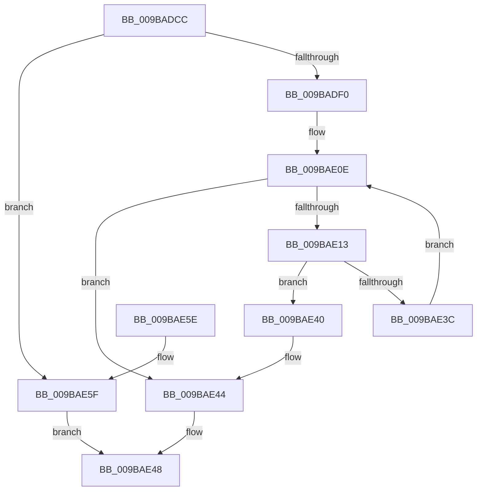

# PspSinglePrivCheck

- RVA: `0x009BADCC`–`0x009BAE66` (길이 `154` bytes)
- VA: `0x00000001409BADCC`
- 실행 섹션: `PAGE`
- PDB 이름 있음: `예`; PDB Function 태그: `아니요`
- unwind 정보 RVA: `0x0009EBD0`
- 디코드: `42`개 명령, `154/154` bytes 표시
- 미해석 바이트: `0` (있으면 어셈블리에 `.byte`로 보존)

> 이 문서는 커널 이미지의 기계어와 PDB 기호를 분석해 생성했습니다. 4번과 5번은 함수 원형과 자료형을 바이너리 사용 방식에서 추정한 C 해석이며 원본 소스 복구 결과는 아닙니다.

## 1. Dependencies

- 직접 호출 지점: **2**; 고유 호출 대상: **2**
- 직접 호출자로 확인된 함수: **1**
- RIP 상대 이미지 참조: **1**

### Outgoing calls
- `0x009BAE03` → [SeCaptureSubjectContext](../86/SeCaptureSubjectContext_function_0086B820.md) (function, `0x0086B820`)
- `0x009BAE33` → [SePrivilegeCheck](SePrivilegeCheck_function_009BAE70.md) (function, `0x009BAE70`)

### Direct callers
- [PspSetQuotaLimits](PspSetQuotaLimits_function_009BA8A8.md) at `0x009BAAFB`

### Static image references
- `0x009BAE13` → RVA `0x00B4BE78` (`PspWorkingSetPrivileges`; read)

## 2. Other-region calls and transfers

- 다른 실행 섹션으로 향하는 call: **0**
- 별도 외부 분기/꼬리 이동을 확인하지 못했습니다.

## 3. Assembly (complete function range)

```asm
009BADCC  48 89 5C 24 08                  mov qword ptr [rsp + 8], rbx
009BADD1  48 89 6C 24 10                  mov qword ptr [rsp + 0x10], rbp
009BADD6  48 89 74 24 18                  mov qword ptr [rsp + 0x18], rsi
009BADDB  41 56                           push r14
009BADDD  48 83 EC 20                     sub rsp, 0x20
009BADE1  45 88 41 34                     mov byte ptr [r9 + 0x34], r8b
009BADE5  49 8B D9                        mov rbx, r9
009BADE8  41 8A E8                        mov bpl, r8b
009BADEB  45 84 C0                        test r8b, r8b
009BADEE  74 6F                           je 0x1409bae5f
009BADF0  48 8B CB                        mov rcx, rbx
009BADF3  41 C7 41 20 01 00 00 00         mov dword ptr [r9 + 0x20], 1
009BADFB  41 C7 41 24 01 00 00 00         mov dword ptr [r9 + 0x24], 1
009BAE03  E8 18 0A EB FF                  call 0x14086b820
009BAE08  33 F6                           xor esi, esi
009BAE0A  C6 43 35 00                     mov byte ptr [rbx + 0x35], 0
009BAE0E  83 FE 02                        cmp esi, 2
009BAE11  73 31                           jae 0x1409bae44
009BAE13  48 8D 0D 5E 10 19 00            lea rcx, [rip + 0x19105e]
009BAE1A  44 8A C5                        mov r8b, bpl
009BAE1D  48 8B 04 F1                     mov rax, qword ptr [rcx + rsi*8]
009BAE21  48 8B D3                        mov rdx, rbx
009BAE24  48 8B 08                        mov rcx, qword ptr [rax]
009BAE27  83 63 30 00                     and dword ptr [rbx + 0x30], 0
009BAE2B  48 89 4B 28                     mov qword ptr [rbx + 0x28], rcx
009BAE2F  48 8D 4B 20                     lea rcx, [rbx + 0x20]
009BAE33  E8 38 00 00 00                  call 0x1409bae70
009BAE38  3C 01                           cmp al, 1
009BAE3A  74 04                           je 0x1409bae40
009BAE3C  FF C6                           inc esi
009BAE3E  EB CE                           jmp 0x1409bae0e
009BAE40  C6 43 35 01                     mov byte ptr [rbx + 0x35], 1
009BAE44  0F B6 43 35                     movzx eax, byte ptr [rbx + 0x35]
009BAE48  48 8B 5C 24 30                  mov rbx, qword ptr [rsp + 0x30]
009BAE4D  48 8B 6C 24 38                  mov rbp, qword ptr [rsp + 0x38]
009BAE52  48 8B 74 24 40                  mov rsi, qword ptr [rsp + 0x40]
009BAE57  48 83 C4 20                     add rsp, 0x20
009BAE5B  41 5E                           pop r14
009BAE5D  C3                              ret
009BAE5E  CC                              int3
009BAE5F  B8 01 00 00 00                  mov eax, 1
009BAE64  EB E2                           jmp 0x1409bae48
```

## 4. C-style interpretation (structured pseudocode)

```c
__int64 __fastcall PspSinglePrivCheck(__int64 a1, __int64 a2, unsigned __int8 a3, __int64 a4)
{
    __int64 result;
    __int64 v_rsi;
    __int64 v_rsp;
    unsigned __int64 v_stack_p10;
    unsigned __int64 v_stack_p18;
    unsigned __int64 v_stack_p8;

    v_stack_p8 = v_rbx;
    v_stack_p10 = v_rbp;
    v_stack_p18 = v_rsi;
    v_rsp = (v_rsp) - (32);
    *(unsigned __int8 *)(a4 + 52) = a3;
    if (a3 == 0) goto loc_009BAE5F;
    *(unsigned int *)(a4 + 32) = 1;
    *(unsigned int *)(a4 + 36) = 1;
    result = SeCaptureSubjectContext(a4, a2, a3, a4);
    v_rsi = 0;
    *(unsigned __int8 *)(a4 + 53) = 0;
loc_009BAE0E:
    if (0 >= 2) goto loc_009BAE44;
    *(unsigned __int64 *)(a4 + 40) = *(unsigned __int64 *)(*(unsigned __int64 *)(v_rip + 1642590 + v_rsi * 8));
    result = SePrivilegeCheck(a4 + 32, a4, a3, a4);
    if (((unsigned __int8)(result)) == 1) goto loc_009BAE40;
    v_rsi = (unsigned int)((v_rsi) + 1);
    goto loc_009BAE0E;
loc_009BAE40:
    *(unsigned __int8 *)(a4 + 53) = 1;
loc_009BAE44:
loc_009BAE48:
    v_rsp = (v_rsp) + (32);
    return *(unsigned __int8 *)(a4 + 53);
loc_009BAE5F:
    goto loc_009BAE48;
}
```

## 5. (Beta) C Style

```c
int64_t PspSinglePrivCheck(int64_t Arg1, int64_t Arg2, uint8_t Arg3, void *Arg4)
{
    uint8_t *arg4 = (uint8_t *)Arg4;

    int64_t result;
    int64_t local_rsi;
    int64_t local_rsp;
    uint64_t v_stack_p10;
    uint64_t v_stack_p18;
    uint64_t v_stack_p8;

    v_stack_p8 = local_rbx;
    v_stack_p10 = local_rbp;
    v_stack_p18 = local_rsi;
    local_rsp = (local_rsp) - (32);
    *(uint8_t *)(arg4 + 0x34) = Arg3;
    if (Arg3 == 0) goto loc_009BAE5F;
    *(uint32_t *)(arg4 + 0x20) = 1;
    *(uint32_t *)(arg4 + 0x24) = 1;
    result = SeCaptureSubjectContext(Arg4, Arg2, Arg3, Arg4);
    local_rsi = 0;
    *(uint8_t *)(arg4 + 0x35) = 0;
loc_009BAE0E:
    if (0 >= 2) goto loc_009BAE44;
    *(uint64_t *)(arg4 + 0x28) = *(uint64_t *)(*(uint64_t *)(v_rip + 0x19105E + local_rsi * 8));
    result = SePrivilegeCheck(Arg4 + 32, Arg4, Arg3, Arg4);
    if (((uint8_t)(result)) == 1) goto loc_009BAE40;
    local_rsi = (uint32_t)((local_rsi) + 1);
    goto loc_009BAE0E;
loc_009BAE40:
    *(uint8_t *)(arg4 + 0x35) = 1;
loc_009BAE44:
loc_009BAE48:
    local_rsp = (local_rsp) + (32);
    return *(uint8_t *)(arg4 + 0x35);
loc_009BAE5F:
    goto loc_009BAE48;
}
```

### 관측된 메모리 오프셋

구조체 형식이 확인되지 않은 접근은 인자 기준의 오프셋으로만 기록했습니다.

| 기준 인자 | 오프셋 표현 | 폭 (bit) | 접근 |
|---|---:|---:|---|
| `Arg4` | `+ 0x20` | `32` | `W` |
| `Arg4` | `+ 0x20` | `64` | `R` |
| `Arg4` | `+ 0x24` | `32` | `W` |
| `Arg4` | `+ 0x28` | `64` | `W` |
| `Arg4` | `+ 0x30` | `32` | `R/W` |
| `Arg4` | `+ 0x34` | `8` | `W` |
| `Arg4` | `+ 0x35` | `8` | `R` |
| `Arg4` | `+ 0x35` | `8` | `W` |

## 6. Execution-region graph

[열기: 2D/3D 그래프와 함수 탐색 컨트롤 패널](../../../control-panel.html?section=page&rva=0x009BADCC&view=graph)

- 2D 그래프는 위에서 아래로 흐르고, 3D 그래프는 빈 공간을 드래그해 회전합니다. Shift+드래그는 이동, 휠은 확대·축소, 함수 노드 선택은 대상 보고서 이동입니다.

### Static fallback


