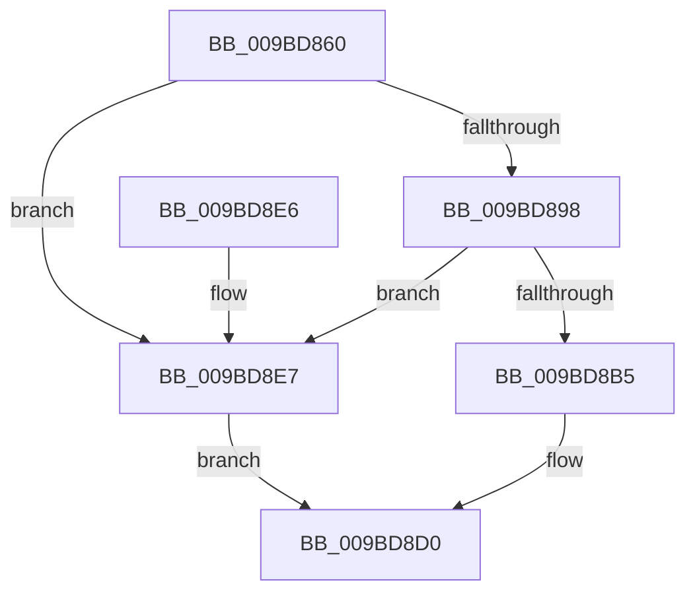

# RtlCreateUnicodeString

- RVA: `0x009BD860`–`0x009BD8EB` (길이 `139` bytes)
- VA: `0x00000001409BD860`
- 실행 섹션: `PAGE`
- PDB 이름 있음: `예`; PDB Function 태그: `아니요`
- unwind 정보 RVA: `0x0009F24C`
- 디코드: `40`개 명령, `139/139` bytes 표시
- 미해석 바이트: `0` (있으면 어셈블리에 `.byte`로 보존)

> 이 문서는 커널 이미지의 기계어와 PDB 기호를 분석해 생성했습니다. 4번과 5번은 함수 원형과 자료형을 바이너리 사용 방식에서 추정한 C 해석이며 원본 소스 복구 결과는 아닙니다.

## 1. Dependencies

- 직접 호출 지점: **3**; 고유 호출 대상: **3**
- 직접 호출자로 확인된 함수: **26**
- RIP 상대 이미지 참조: **0**

### Outgoing calls
- `0x009BD882` → [wcslen](../../text/50/wcslen_function_00501BA0.md) (function, `0x00501BA0`)
- `0x009BD8A7` → [ExAllocatePool2](../../poolcode/B8/ExAllocatePool2_function_00B820F0.md) (function, `0x00B820F0`)
- `0x009BD8C2` → [memcpy](../../text/6C/memcpy_function_006C6840.md) (function, `0x006C6840`)

### Direct callers
- [DifRtlCreateUnicodeStringWrapper](../../text/63/DifRtlCreateUnicodeStringWrapper_function_0063B7D0.md) at `0x0063B8A4`
- [IopCopyBootLogRegistryToFile](../71/IopCopyBootLogRegistryToFile_function_0071B19C.md) at `0x0071B344`
- [PiDevCfgQueryDriverNode](../73/PiDevCfgQueryDriverNode_function_0073435C.md) at `0x007345AF`
- [PiDevCfgQueryDriverNode](../73/PiDevCfgQueryDriverNode_function_0073435C.md) at `0x00734661`
- [PiDevCfgQueryDriverNode](../73/PiDevCfgQueryDriverNode_function_0073435C.md) at `0x0073467D`
- [PiDevCfgQueryIncludedDriverNode](../73/PiDevCfgQueryIncludedDriverNode_function_00734D88.md) at `0x00735083`
- [PiDevCfgQueryIncludedDriverNode](../73/PiDevCfgQueryIncludedDriverNode_function_00734D88.md) at `0x00735106`
- [PiDrvDbCreateNode](../74/PiDrvDbCreateNode_function_00740AFC.md) at `0x00740B6F`
- [PiDrvDbCreateNode](../74/PiDrvDbCreateNode_function_00740AFC.md) at `0x00740BB5`
- [PiDrvDbCreateNode](../74/PiDrvDbCreateNode_function_00740AFC.md) at `0x00740C2D`
- [PiDrvDbResolveNodeFilePaths](../74/PiDrvDbResolveNodeFilePaths_function_007433A4.md) at `0x0074344E`
- [EtwStartAutoLogger](../7B/EtwStartAutoLogger_function_007BD2F8.md) at `0x007BDF7F`
- [EtwpQueryRegistryCallback](../7B/EtwpQueryRegistryCallback_function_007BEA40.md) at `0x007BEAC3`
- [EtwpSavePersistedLogger](../7B/EtwpSavePersistedLogger_function_007BF374.md) at `0x007BF4C4`
- [CmpCreateHwProfileFriendlyName](../7E/CmpCreateHwProfileFriendlyName_function_007E3840.md) at `0x007E3AE8`
- [AslPathWildcardFindFirst](../81/AslPathWildcardFindFirst_function_0081B534.md) at `0x0081B5C9`
- [PnpCtxCreateNode](../82/PnpCtxCreateNode_function_00828BCC.md) at `0x00828C27`
- [DrvDbSetDriverDatabaseMappedProperty](../83/DrvDbSetDriverDatabaseMappedProperty_function_00834014.md) at `0x00834555`
- [DrvDbCreateDatabaseNode](../83/DrvDbCreateDatabaseNode_function_0083533C.md) at `0x00835509`
- [DrvDbCreateDatabaseNode](../83/DrvDbCreateDatabaseNode_function_0083533C.md) at `0x00835526`
- [sub_00927D81](../92/Unknown_function_00927D81.md) at `0x00927D89`
- [PiGetDefaultMessageString](../99/PiGetDefaultMessageString_function_0099A87C.md) at `0x0099A97B`
- [PiDevCfgQueryDeviceMigrationNode](PiDevCfgQueryDeviceMigrationNode_function_009BD328.md) at `0x009BD400`
- [EtwpCaptureString](EtwpCaptureString_function_009BD754.md) at `0x009BD848`
- [EtwpRealtimeCreateLogfile](EtwpRealtimeCreateLogfile_function_009BE96C.md) at `0x009BEABA`
- [PipGenerateContainerID](../A8/PipGenerateContainerID_function_00A87694.md) at `0x00A87841`
- [PipGenerateContainerID](../A8/PipGenerateContainerID_function_00A87694.md) at `0x00A87865`
- [EtwpStartLogger](../A9/EtwpStartLogger_function_00A99D80.md) at `0x00A9A2AA`
- [EtwpStartLogger](../A9/EtwpStartLogger_function_00A99D80.md) at `0x00A9A3A8`
- [EtwpStartLogger](../A9/EtwpStartLogger_function_00A99D80.md) at `0x00A9A408`
- [PiCreateDriverSwDeviceCallback](../AB/PiCreateDriverSwDeviceCallback_function_00ABB420.md) at `0x00ABBC96`
- [PiDevCfgLogDeviceConfigured](../AD/PiDevCfgLogDeviceConfigured_function_00ADCDD4.md) at `0x00ADDA5B`
- [sub_00B4387E](../B4/Unknown_function_00B4387E.md) at `0x00B438C4`
- [PipInitDeviceOverrideCache](../../init/C3/PipInitDeviceOverrideCache_function_00C312C8.md) at `0x00C314F5`
- [CmpOpenSystemDriverHiveContext](../../init/C7/CmpOpenSystemDriverHiveContext_function_00C73D90.md) at `0x00C73EB8`

### Static image references
- 디코드된 RIP-relative 메모리 참조가 없습니다.

## 2. Other-region calls and transfers

- 다른 실행 섹션으로 향하는 call: **3**
  - `0x009BD882` → [wcslen](../../text/50/wcslen_function_00501BA0.md) (`PAGE` → `.text`)
  - `0x009BD8A7` → [ExAllocatePool2](../../poolcode/B8/ExAllocatePool2_function_00B820F0.md) (`PAGE` → `POOLCODE`)
  - `0x009BD8C2` → [memcpy](../../text/6C/memcpy_function_006C6840.md) (`PAGE` → `.text`)
- 별도 외부 분기/꼬리 이동을 확인하지 못했습니다.

## 3. Assembly (complete function range)

```asm
009BD860  48 8B C4                        mov rax, rsp
009BD863  48 89 58 10                     mov qword ptr [rax + 0x10], rbx
009BD867  48 89 70 18                     mov qword ptr [rax + 0x18], rsi
009BD86B  48 89 78 20                     mov qword ptr [rax + 0x20], rdi
009BD86F  48 89 48 08                     mov qword ptr [rax + 8], rcx
009BD873  41 56                           push r14
009BD875  48 83 EC 20                     sub rsp, 0x20
009BD879  4C 8B F2                        mov r14, rdx
009BD87C  48 8B F9                        mov rdi, rcx
009BD87F  48 8B CA                        mov rcx, rdx
009BD882  E8 19 43 B4 FF                  call 0x140501ba0
009BD887  8D 34 45 02 00 00 00            lea esi, [rax*2 + 2]
009BD88E  8D 46 FF                        lea eax, [rsi - 1]
009BD891  3D FD FF 00 00                  cmp eax, 0xfffd
009BD896  77 4F                           ja 0x1409bd8e7
009BD898  8B DE                           mov ebx, esi
009BD89A  41 B8 53 74 72 67               mov r8d, 0x67727453
009BD8A0  8B D6                           mov edx, esi
009BD8A2  B9 00 01 00 00                  mov ecx, 0x100
009BD8A7  E8 44 48 1C 00                  call 0x140b820f0
009BD8AC  48 89 47 08                     mov qword ptr [rdi + 8], rax
009BD8B0  48 85 C0                        test rax, rax
009BD8B3  74 32                           je 0x1409bd8e7
009BD8B5  66 89 77 02                     mov word ptr [rdi + 2], si
009BD8B9  44 8B C3                        mov r8d, ebx
009BD8BC  49 8B D6                        mov rdx, r14
009BD8BF  48 8B C8                        mov rcx, rax
009BD8C2  E8 79 8F D0 FF                  call 0x1406c6840
009BD8C7  66 83 EB 02                     sub bx, 2
009BD8CB  66 89 1F                        mov word ptr [rdi], bx
009BD8CE  B0 01                           mov al, 1
009BD8D0  48 8B 5C 24 38                  mov rbx, qword ptr [rsp + 0x38]
009BD8D5  48 8B 74 24 40                  mov rsi, qword ptr [rsp + 0x40]
009BD8DA  48 8B 7C 24 48                  mov rdi, qword ptr [rsp + 0x48]
009BD8DF  48 83 C4 20                     add rsp, 0x20
009BD8E3  41 5E                           pop r14
009BD8E5  C3                              ret
009BD8E6  CC                              int3
009BD8E7  32 C0                           xor al, al
009BD8E9  EB E5                           jmp 0x1409bd8d0
```

## 4. C-style interpretation (structured pseudocode)

```c
__int64 __fastcall RtlCreateUnicodeString(__int64 a1, __int64 a2)
{
    __int64 result;
    __int64 v_rbx;
    __int64 v_rsp;
    unsigned __int64 v_stack_p10;
    unsigned __int64 v_stack_p18;
    unsigned __int64 v_stack_p20;

    *(unsigned __int64 *)(v_rsp + 16) = v_rbx;
    *(unsigned __int64 *)(v_rsp + 24) = v_rsi;
    *(unsigned __int64 *)(v_rsp + 32) = v_rdi;
    *(unsigned __int64 *)(v_rsp + 8) = a1;
    v_rsp = (v_rsp) - (32);
    result = wcslen(a2, a2, a3, a4);
    if (((unsigned int)(result * 2 + 2 - 1)) > 0xFFFDULL) goto loc_009BD8E7;
    result = ExAllocatePool2(256, (unsigned int)((unsigned int)(result * 2 + 2)), (unsigned int)(0x67727453ULL), a4);
    *(unsigned __int64 *)(a1 + 8) = result;
    if (result == 0) goto loc_009BD8E7;
    *(unsigned __int16 *)(a1 + 2) = (unsigned __int16)(result * 2 + 2);
    result = memcpy(result, a2, (unsigned int)((unsigned int)((unsigned int)((unsigned int)(result * 2 + 2)))), a4);
    v_rbx = (unsigned __int16)(((unsigned int)((unsigned int)(result * 2 + 2))) - (2));
    *(unsigned __int16 *)(a1) = (unsigned __int16)(v_rbx);
loc_009BD8D0:
    v_rsp = (v_rsp) + (32);
    return 1;
loc_009BD8E7:
    result = 0;
    goto loc_009BD8D0;
}
```

## 5. (Beta) C Style

```c
int64_t RtlCreateUnicodeString(void *Arg1, int64_t Arg2)
{
    uint8_t *arg1 = (uint8_t *)Arg1;

    int64_t result;
    int64_t local_rbx;
    int64_t local_rsp;
    uint64_t v_stack_p10;
    uint64_t v_stack_p18;
    uint64_t v_stack_p20;

    *(uint64_t *)(local_rsp + 0x10) = local_rbx;
    *(uint64_t *)(local_rsp + 0x18) = local_rsi;
    *(uint64_t *)(local_rsp + 0x20) = local_rdi;
    *(void **)(local_rsp + 0x8) = Arg1;
    local_rsp = (local_rsp) - (32);
    result = wcslen(Arg2, Arg2, a3, a4);
    if (((uint32_t)(result * 2 + 2 - 1)) > 0xFFFDULL) goto loc_009BD8E7;
    result = ExAllocatePool2(256, (uint32_t)((uint32_t)(result * 2 + 2)), (uint32_t)(0x67727453ULL), a4);
    *(uint64_t *)(arg1 + 0x8) = result;
    if (result == 0) goto loc_009BD8E7;
    *(uint16_t *)(arg1 + 0x2) = (uint16_t)(result * 2 + 2);
    result = memcpy(result, Arg2, (uint32_t)((uint32_t)((uint32_t)((uint32_t)(result * 2 + 2)))), a4);
    local_rbx = (uint16_t)(((uint32_t)((uint32_t)(result * 2 + 2))) - (2));
    *(uint16_t *)(arg1) = (uint16_t)(local_rbx);
loc_009BD8D0:
    local_rsp = (local_rsp) + (32);
    return 1;
loc_009BD8E7:
    result = 0;
    goto loc_009BD8D0;
}
```

### 관측된 메모리 오프셋

구조체 형식이 확인되지 않은 접근은 인자 기준의 오프셋으로만 기록했습니다.

| 기준 인자 | 오프셋 표현 | 폭 (bit) | 접근 |
|---|---:|---:|---|
| `Arg1` | `+ 0x0` | `16` | `W` |
| `Arg1` | `+ 0x2` | `16` | `W` |
| `Arg1` | `+ 0x8` | `64` | `W` |

## 6. Execution-region graph

[열기: 2D/3D 그래프와 함수 탐색 컨트롤 패널](../../../control-panel.html?section=page&rva=0x009BD860&view=graph)

- 2D 그래프는 위에서 아래로 흐르고, 3D 그래프는 빈 공간을 드래그해 회전합니다. Shift+드래그는 이동, 휠은 확대·축소, 함수 노드 선택은 대상 보고서 이동입니다.

### Static fallback


