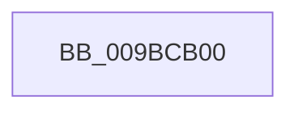

# RtlFindLowerBoundInSortedArray

- RVA: `0x009BCB00`–`0x009BCB28` (길이 `40` bytes)
- VA: `0x00000001409BCB00`
- 실행 섹션: `PAGE`
- PDB 이름 있음: `예`; PDB Function 태그: `아니요`
- unwind 정보 RVA: `0x0009F12C`
- 디코드: `15`개 명령, `40/40` bytes 표시
- 미해석 바이트: `0` (있으면 어셈블리에 `.byte`로 보존)

> 이 문서는 커널 이미지의 기계어와 PDB 기호를 분석해 생성했습니다. 4번과 5번은 함수 원형과 자료형을 바이너리 사용 방식에서 추정한 C 해석이며 원본 소스 복구 결과는 아닙니다.

## 1. Dependencies

- 직접 호출 지점: **0**; 고유 호출 대상: **0**
- 직접 호출자로 확인된 함수: **5**
- RIP 상대 이미지 참조: **0**

### Outgoing calls
- 직접 디코드된 call 명령이 없습니다.

### Direct callers
- [CmpFindSecurityCellCacheIndex](../../text/42/CmpFindSecurityCellCacheIndex_function_00428060.md) at `0x004280EA`
- [RtlpFcHasEffectiveStateInGovernedFeatureInfoTable](../79/RtlpFcHasEffectiveStateInGovernedFeatureInfoTable_function_0079A72C.md) at `0x0079A77D`
- [RtlpFcIsGovernedFeatureTableUpdateNeeded](../79/RtlpFcIsGovernedFeatureTableUpdateNeeded_function_0079A8C0.md) at `0x0079A960`
- [RtlpFcIsGovernedFeatureTableUpdateNeeded](../79/RtlpFcIsGovernedFeatureTableUpdateNeeded_function_0079A8C0.md) at `0x0079A99E`
- [RtlpFcQueryFeatureConfigurationFromBuffers](RtlpFcQueryFeatureConfigurationFromBuffers_function_009BC928.md) at `0x009BC981`
- [RtlpFcGetFeatureHasSubscriptionsFromBuffer](RtlpFcGetFeatureHasSubscriptionsFromBuffer_function_009BCA30.md) at `0x009BCA76`

### Static image references
- 디코드된 RIP-relative 메모리 참조가 없습니다.

## 2. Other-region calls and transfers

- 다른 실행 섹션으로 향하는 call: **0**
- call이 아닌 외부 분기/꼬리 이동: **1**
  - `0x009BCB26` → [sub_009BCBA1](Unknown_function_009BCBA1.md) (`tail-transfer`)

## 3. Assembly (complete function range)

```asm
009BCB00  40 55                           push rbp
009BCB02  57                              push rdi
009BCB03  41 55                           push r13
009BCB05  41 56                           push r14
009BCB07  41 57                           push r15
009BCB09  48 83 EC 20                     sub rsp, 0x20
009BCB0D  4D 8B F8                        mov r15, r8
009BCB10  4D 8B F1                        mov r14, r9
009BCB13  4D 0F AF F9                     imul r15, r9
009BCB17  49 8B E8                        mov rbp, r8
009BCB1A  48 8B FA                        mov rdi, rdx
009BCB1D  4C 03 FA                        add r15, rdx
009BCB20  4C 8B E9                        mov r13, rcx
009BCB23  49 3B D7                        cmp rdx, r15
009BCB26  73 79                           jae 0x1409bcba1
```

## 4. C-style interpretation (structured pseudocode)

```c
void __fastcall RtlFindLowerBoundInSortedArray(__int64 a1, __int64 a2, __int64 a3, __int64 a4)
{
    __int64 v_r15;
    __int64 v_rsp;

    v_rsp = (v_rsp) - (32);
    v_r15 = (a3) * (a4);
    v_r15 = (v_r15) + (a2);
}
```

## 5. (Beta) C Style

```c
void RtlFindLowerBoundInSortedArray(int64_t Arg1, int64_t Arg2, int64_t Arg3, int64_t Arg4)
{
    int64_t local_r15;
    int64_t local_rsp;

    local_rsp = (local_rsp) - (32);
    local_r15 = (Arg3) * (Arg4);
    local_r15 = (local_r15) + (Arg2);
}
```

## 6. Execution-region graph

[열기: 2D/3D 그래프와 함수 탐색 컨트롤 패널](../../../control-panel.html?section=page&rva=0x009BCB00&view=graph)

- 2D 그래프는 위에서 아래로 흐르고, 3D 그래프는 빈 공간을 드래그해 회전합니다. Shift+드래그는 이동, 휠은 확대·축소, 함수 노드 선택은 대상 보고서 이동입니다.

### Static fallback


