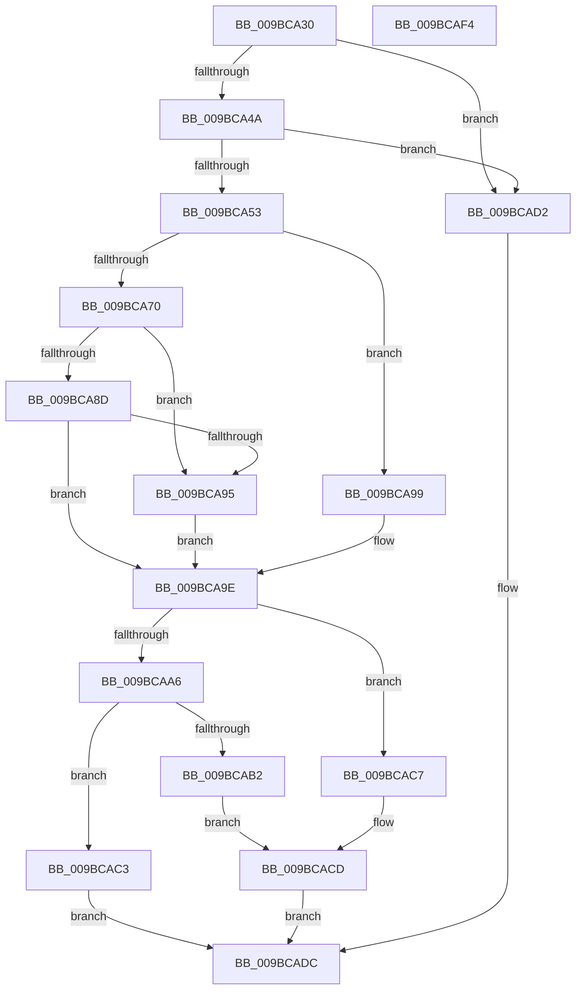

# RtlpFcGetFeatureHasSubscriptionsFromBuffer

- RVA: `0x009BCA30`–`0x009BCAF5` (길이 `197` bytes)
- VA: `0x00000001409BCA30`
- 실행 섹션: `PAGE`
- PDB 이름 있음: `예`; PDB Function 태그: `아니요`
- unwind 정보 RVA: `0x0009F11C`
- 디코드: `62`개 명령, `197/197` bytes 표시
- 미해석 바이트: `0` (있으면 어셈블리에 `.byte`로 보존)

> 이 문서는 커널 이미지의 기계어와 PDB 기호를 분석해 생성했습니다. 4번과 5번은 함수 원형과 자료형을 바이너리 사용 방식에서 추정한 C 해석이며 원본 소스 복구 결과는 아닙니다.

## 1. Dependencies

- 직접 호출 지점: **2**; 고유 호출 대상: **2**
- 직접 호출자로 확인된 함수: **2**
- RIP 상대 이미지 참조: **1**

### Outgoing calls
- `0x009BCA76` → [RtlFindLowerBoundInSortedArray](RtlFindLowerBoundInSortedArray_function_009BCB00.md) (function, `0x009BCB00`)
- `0x009BCA99` → [RtlpFcLinearSearchInSortedArray](../AD/RtlpFcLinearSearchInSortedArray_function_00AD16F8.md) (function, `0x00AD16F8`)

### Direct callers
- [RtlpFcHasEffectiveStateInGovernedFeatureInfoTable](../79/RtlpFcHasEffectiveStateInGovernedFeatureInfoTable_function_0079A72C.md) at `0x0079A87D`
- [RtlpFcQueryFeatureConfigurationFromBuffers](RtlpFcQueryFeatureConfigurationFromBuffers_function_009BC928.md) at `0x009BC9EC`

### Static image references
- `0x009BCA56` → RVA `0x00A99210` (`RtlFcpCompareFeatureIdToFeatureUsageSubscription`; read)

## 2. Other-region calls and transfers

- 다른 실행 섹션으로 향하는 call: **0**
- 별도 외부 분기/꼬리 이동을 확인하지 못했습니다.

## 3. Assembly (complete function range)

```asm
009BCA30  48 89 5C 24 10                  mov qword ptr [rsp + 0x10], rbx
009BCA35  89 4C 24 08                     mov dword ptr [rsp + 8], ecx
009BCA39  57                              push rdi
009BCA3A  48 83 EC 30                     sub rsp, 0x30
009BCA3E  49 8B D8                        mov rbx, r8
009BCA41  48 85 D2                        test rdx, rdx
009BCA44  0F 84 88 00 00 00               je 0x1409bcad2
009BCA4A  48 8B 7A 08                     mov rdi, qword ptr [rdx + 8]
009BCA4E  48 85 FF                        test rdi, rdi
009BCA51  74 7F                           je 0x1409bcad2
009BCA53  44 8B 07                        mov r8d, dword ptr [rdi]
009BCA56  48 8D 05 B3 C7 0D 00            lea rax, [rip + 0xdc7b3]
009BCA5D  48 89 44 24 20                  mov qword ptr [rsp + 0x20], rax
009BCA62  48 8D 57 04                     lea rdx, [rdi + 4]
009BCA66  48 8D 4C 24 40                  lea rcx, [rsp + 0x40]
009BCA6B  45 85 C0                        test r8d, r8d
009BCA6E  74 29                           je 0x1409bca99
009BCA70  41 B9 10 00 00 00               mov r9d, 0x10
009BCA76  E8 85 00 00 00                  call 0x1409bcb00
009BCA7B  8B 0F                           mov ecx, dword ptr [rdi]
009BCA7D  48 C1 E1 04                     shl rcx, 4
009BCA81  48 83 C1 04                     add rcx, 4
009BCA85  48 03 CF                        add rcx, rdi
009BCA88  48 3B C1                        cmp rax, rcx
009BCA8B  74 08                           je 0x1409bca95
009BCA8D  8B 4C 24 40                     mov ecx, dword ptr [rsp + 0x40]
009BCA91  39 08                           cmp dword ptr [rax], ecx
009BCA93  74 09                           je 0x1409bca9e
009BCA95  33 C0                           xor eax, eax
009BCA97  EB 05                           jmp 0x1409bca9e
009BCA99  E8 5A 4C 11 00                  call 0x140ad16f8
009BCA9E  8B 4B 04                        mov ecx, dword ptr [rbx + 4]
009BCAA1  48 85 C0                        test rax, rax
009BCAA4  74 21                           je 0x1409bcac7
009BCAA6  0F BA E9 07                     bts ecx, 7
009BCAAA  89 4B 04                        mov dword ptr [rbx + 4], ecx
009BCAAD  F6 C1 40                        test cl, 0x40
009BCAB0  75 11                           jne 0x1409bcac3
009BCAB2  0F B7 40 06                     movzx eax, word ptr [rax + 6]
009BCAB6  83 E1 BF                        and ecx, 0xffffffbf
009BCAB9  83 E0 01                        and eax, 1
009BCABC  C1 E0 06                        shl eax, 6
009BCABF  0B C1                           or eax, ecx
009BCAC1  EB 0A                           jmp 0x1409bcacd
009BCAC3  8B C1                           mov eax, ecx
009BCAC5  EB 15                           jmp 0x1409bcadc
009BCAC7  8B C1                           mov eax, ecx
009BCAC9  0F BA F0 07                     btr eax, 7
009BCACD  89 43 04                        mov dword ptr [rbx + 4], eax
009BCAD0  EB 0A                           jmp 0x1409bcadc
009BCAD2  41 0F BA 70 04 07               btr dword ptr [r8 + 4], 7
009BCAD8  41 8B 40 04                     mov eax, dword ptr [r8 + 4]
009BCADC  48 8B 5C 24 48                  mov rbx, qword ptr [rsp + 0x48]
009BCAE1  24 80                           and al, 0x80
009BCAE3  F6 D8                           neg al
009BCAE5  1B C0                           sbb eax, eax
009BCAE7  F7 D0                           not eax
009BCAE9  25 25 02 00 C0                  and eax, 0xc0000225
009BCAEE  48 83 C4 30                     add rsp, 0x30
009BCAF2  5F                              pop rdi
009BCAF3  C3                              ret
009BCAF4  CC                              int3
```

## 4. C-style interpretation (structured pseudocode)

```c
__int64 __fastcall RtlpFcGetFeatureHasSubscriptionsFromBuffer(int a1, __int64 a2, __int64 a3)
{
    __int64 result;
    __int64 v_rsp;
    unsigned __int64 v_stack_m18;
    unsigned __int64 v_stack_p10;
    unsigned int v_stack_p8;

    v_stack_p10 = v_rbx;
    v_stack_p8 = a1;
    v_rsp = (v_rsp) - (48);
    if (a2 == 0) goto loc_009BCAD2;
    if (*(unsigned __int64 *)(a2 + 8) == 0) goto loc_009BCAD2;
    v_stack_m18 = v_rip + 903091;
    if ((unsigned int)((unsigned int)(*(unsigned int *)(*(unsigned __int64 *)(a2 + 8)))) == 0) goto loc_009BCA99;
    result = RtlFindLowerBoundInSortedArray(v_stack_p8, *(unsigned __int64 *)(a2 + 8) + 4, (unsigned int)(*(unsigned int *)(*(unsigned __int64 *)(a2 + 8))), 16);
    a1 = ((unsigned int)(*(unsigned int *)(*(unsigned __int64 *)(a2 + 8)))) << (4);
    a1 = (a1) + (4);
    a1 = (a1) + (*(unsigned __int64 *)(a2 + 8));
    if (result == a1) goto loc_009BCA95;
    if ((*(unsigned int *)(result)) == ((unsigned int)((unsigned int)(v_stack_p8)))) goto loc_009BCA9E;
loc_009BCA95:
    result = 0;
    goto loc_009BCA9E;
loc_009BCA99:
    result = RtlpFcLinearSearchInSortedArray((unsigned int)(v_stack_p8), *(unsigned __int64 *)(a2 + 8) + 4, (unsigned int)(*(unsigned int *)(*(unsigned __int64 *)(a2 + 8))), 16);
loc_009BCA9E:
    if (result == 0) goto loc_009BCAC7;
    *(unsigned int *)(a3 + 4) = (unsigned int)((unsigned int)(*(unsigned int *)(a3 + 4)));
    if ((((unsigned __int8)((unsigned int)(*(unsigned int *)(a3 + 4)))) & (64)) != 0) goto loc_009BCAC3;
    a1 = (unsigned int)(((unsigned int)(*(unsigned int *)(a3 + 4))) & (0xFFFFFFBFULL));
    result = (unsigned int)((*(unsigned __int16 *)(result + 6)) & (1));
    result = (unsigned int)((result) << (6));
    result = (unsigned int)((result) | (a1));
    goto loc_009BCACD;
loc_009BCAC3:
    goto loc_009BCADC;
loc_009BCAC7:
loc_009BCACD:
    *(unsigned int *)(a3 + 4) = (unsigned int)((unsigned int)(a1));
    goto loc_009BCADC;
loc_009BCAD2:
loc_009BCADC:
    result = (unsigned __int8)(((unsigned int)(*(unsigned int *)((unsigned int)(*(unsigned int *)(*(unsigned __int64 *)(a2 + 8))) + 4))) & (128));
    result = (unsigned __int8)(-(result));
    result = (unsigned int)(~(result));
    result = (unsigned int)((result) & (0xC0000225ULL));
    v_rsp = (v_rsp) + (48);
    return result;
}
```

## 5. (Beta) C Style

```c
int64_t RtlpFcGetFeatureHasSubscriptionsFromBuffer(int32_t Arg1, int64_t Arg2, void *Arg3)
{
    uint8_t *arg3 = (uint8_t *)Arg3;

    int64_t result;
    int64_t local_rsp;
    uint64_t v_stack_m18;
    uint64_t v_stack_p10;
    uint32_t v_stack_p8;

    v_stack_p10 = local_rbx;
    v_stack_p8 = Arg1;
    local_rsp = (local_rsp) - (48);
    if (Arg2 == 0) goto loc_009BCAD2;
    if (*(uint64_t *)(Arg2 + 0x8) == 0) goto loc_009BCAD2;
    v_stack_m18 = v_rip + 903091;
    if ((uint32_t)((uint32_t)(*(uint32_t *)(*(uint64_t *)(Arg2 + 0x8)))) == 0) goto loc_009BCA99;
    result = RtlFindLowerBoundInSortedArray(v_stack_p8, *(uint64_t *)(Arg2 + 0x8) + 4, (uint32_t)(*(uint32_t *)(*(uint64_t *)(Arg2 + 0x8))), 16);
    Arg1 = ((uint32_t)(*(uint32_t *)(*(uint64_t *)(Arg2 + 0x8)))) << (4);
    Arg1 = (Arg1) + (4);
    Arg1 = (Arg1) + (*(uint64_t *)(Arg2 + 0x8));
    if (result == Arg1) goto loc_009BCA95;
    if ((*(uint32_t *)(result)) == ((uint32_t)((uint32_t)(v_stack_p8)))) goto loc_009BCA9E;
loc_009BCA95:
    result = 0;
    goto loc_009BCA9E;
loc_009BCA99:
    result = RtlpFcLinearSearchInSortedArray((uint32_t)(v_stack_p8), *(uint64_t *)(Arg2 + 0x8) + 4, (uint32_t)(*(uint32_t *)(*(uint64_t *)(Arg2 + 0x8))), 16);
loc_009BCA9E:
    if (result == 0) goto loc_009BCAC7;
    *(uint32_t *)(arg3 + 0x4) = (uint32_t)((uint32_t)(*(uint32_t *)(arg3 + 0x4)));
    if ((((uint8_t)((uint32_t)(*(uint32_t *)(arg3 + 0x4)))) & (64)) != 0) goto loc_009BCAC3;
    Arg1 = (uint32_t)(((uint32_t)(*(uint32_t *)(arg3 + 0x4))) & (0xFFFFFFBFULL));
    result = (uint32_t)((*(uint16_t *)(result + 0x6)) & (1));
    result = (uint32_t)((result) << (6));
    result = (uint32_t)((result) | (Arg1));
    goto loc_009BCACD;
loc_009BCAC3:
    goto loc_009BCADC;
loc_009BCAC7:
loc_009BCACD:
    *(uint32_t *)(arg3 + 0x4) = (uint32_t)((uint32_t)(Arg1));
    goto loc_009BCADC;
loc_009BCAD2:
loc_009BCADC:
    result = (uint8_t)(((uint32_t)(*(uint32_t *)((uint32_t)(*(uint32_t *)(*(uint64_t *)(Arg2 + 0x8))) + 0x4))) & (128));
    result = (uint8_t)(-(result));
    result = (uint32_t)(~(result));
    result = (uint32_t)((result) & (0xC0000225ULL));
    local_rsp = (local_rsp) + (48);
    return result;
}
```

### 관측된 메모리 오프셋

구조체 형식이 확인되지 않은 접근은 인자 기준의 오프셋으로만 기록했습니다.

| 기준 인자 | 오프셋 표현 | 폭 (bit) | 접근 |
|---|---:|---:|---|
| `Arg3` | `+ 0x4` | `32` | `R` |
| `Arg3` | `+ 0x4` | `32` | `R/W` |
| `Arg3` | `+ 0x4` | `32` | `W` |

## 6. Execution-region graph

[열기: 2D/3D 그래프와 함수 탐색 컨트롤 패널](../../../control-panel.html?section=page&rva=0x009BCA30&view=graph)

- 2D 그래프는 위에서 아래로 흐르고, 3D 그래프는 빈 공간을 드래그해 회전합니다. Shift+드래그는 이동, 휠은 확대·축소, 함수 노드 선택은 대상 보고서 이동입니다.

### Static fallback


