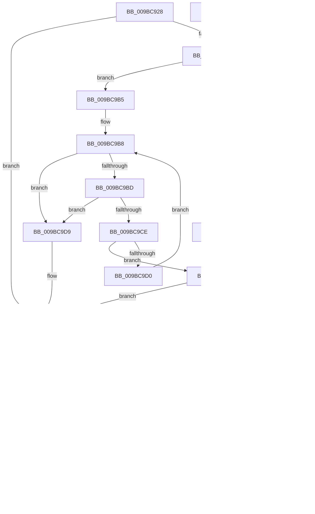

# RtlpFcQueryFeatureConfigurationFromBuffers

- RVA: `0x009BC928`–`0x009BCA29` (길이 `257` bytes)
- VA: `0x00000001409BC928`
- 실행 섹션: `PAGE`
- PDB 이름 있음: `예`; PDB Function 태그: `아니요`
- unwind 정보 RVA: `0x0009F100`
- 디코드: `86`개 명령, `257/257` bytes 표시
- 미해석 바이트: `0` (있으면 어셈블리에 `.byte`로 보존)

> 이 문서는 커널 이미지의 기계어와 PDB 기호를 분석해 생성했습니다. 4번과 5번은 함수 원형과 자료형을 바이너리 사용 방식에서 추정한 C 해석이며 원본 소스 복구 결과는 아닙니다.

## 1. Dependencies

- 직접 호출 지점: **3**; 고유 호출 대상: **3**
- 직접 호출자로 확인된 함수: **2**
- RIP 상대 이미지 참조: **1**

### Outgoing calls
- `0x009BC981` → [RtlFindLowerBoundInSortedArray](RtlFindLowerBoundInSortedArray_function_009BCB00.md) (function, `0x009BCB00`)
- `0x009BC9C5` → [RtlFcpCompareFeatureIdToFeature](../A9/RtlFcpCompareFeatureIdToFeature_function_00A96B80.md) (function, `0x00A96B80`)
- `0x009BC9EC` → [RtlpFcGetFeatureHasSubscriptionsFromBuffer](RtlpFcGetFeatureHasSubscriptionsFromBuffer_function_009BCA30.md) (function, `0x009BCA30`)

### Direct callers
- [RtlQueryFeatureConfigurationFromBuffers](../../text/5E/RtlQueryFeatureConfigurationFromBuffers_function_005E7414.md) at `0x005E74BB`
- [RtlpFcQueryFeatureConfigurationFromBufferSet](../70/RtlpFcQueryFeatureConfigurationFromBufferSet_function_007035C4.md) at `0x00703655`

### Static image references
- `0x009BC968` → RVA `0x00A96B80` (`RtlFcpCompareFeatureIdToFeature`; read)

## 2. Other-region calls and transfers

- 다른 실행 섹션으로 향하는 call: **0**
- 별도 외부 분기/꼬리 이동을 확인하지 못했습니다.

## 3. Assembly (complete function range)

```asm
009BC928  4C 8B DC                        mov r11, rsp
009BC92B  49 89 5B 10                     mov qword ptr [r11 + 0x10], rbx
009BC92F  49 89 6B 18                     mov qword ptr [r11 + 0x18], rbp
009BC933  89 4C 24 08                     mov dword ptr [rsp + 8], ecx
009BC937  56                              push rsi
009BC938  57                              push rdi
009BC939  41 54                           push r12
009BC93B  41 56                           push r14
009BC93D  41 57                           push r15
009BC93F  48 83 EC 30                     sub rsp, 0x30
009BC943  4C 8B 72 08                     mov r14, qword ptr [rdx + 8]
009BC947  33 DB                           xor ebx, ebx
009BC949  49 8B F1                        mov rsi, r9
009BC94C  4D 8B E0                        mov r12, r8
009BC94F  8B E9                           mov ebp, ecx
009BC951  8B FB                           mov edi, ebx
009BC953  4D 85 F6                        test r14, r14
009BC956  0F 84 80 00 00 00               je 0x1409bc9dc
009BC95C  45 8B 3E                        mov r15d, dword ptr [r14]
009BC95F  49 8D 7E 04                     lea rdi, [r14 + 4]
009BC963  45 85 FF                        test r15d, r15d
009BC966  74 4D                           je 0x1409bc9b5
009BC968  48 8D 05 11 A2 0D 00            lea rax, [rip + 0xda211]
009BC96F  45 8B C7                        mov r8d, r15d
009BC972  44 8D 4B 10                     lea r9d, [rbx + 0x10]
009BC976  49 89 43 C8                     mov qword ptr [r11 - 0x38], rax
009BC97A  48 8B D7                        mov rdx, rdi
009BC97D  49 8D 4B 08                     lea rcx, [r11 + 8]
009BC981  E8 7A 01 00 00                  call 0x1409bcb00
009BC986  41 8B 0E                        mov ecx, dword ptr [r14]
009BC989  48 8B F8                        mov rdi, rax
009BC98C  8B 6C 24 60                     mov ebp, dword ptr [rsp + 0x60]
009BC990  48 C1 E1 04                     shl rcx, 4
009BC994  48 83 C1 04                     add rcx, 4
009BC998  49 03 CE                        add rcx, r14
009BC99B  48 3B C1                        cmp rax, rcx
009BC99E  74 04                           je 0x1409bc9a4
009BC9A0  39 28                           cmp dword ptr [rax], ebp
009BC9A2  74 03                           je 0x1409bc9a7
009BC9A4  48 8B FB                        mov rdi, rbx
009BC9A7  48 85 FF                        test rdi, rdi
009BC9AA  74 30                           je 0x1409bc9dc
009BC9AC  0F 10 07                        movups xmm0, xmmword ptr [rdi]
009BC9AF  F3 0F 7F 06                     movdqu xmmword ptr [rsi], xmm0
009BC9B3  EB 2F                           jmp 0x1409bc9e4
009BC9B5  4C 8B F3                        mov r14, rbx
009BC9B8  4D 3B F7                        cmp r14, r15
009BC9BB  73 1C                           jae 0x1409bc9d9
009BC9BD  48 8B D7                        mov rdx, rdi
009BC9C0  48 8D 4C 24 60                  lea rcx, [rsp + 0x60]
009BC9C5  E8 B6 A1 0D 00                  call 0x140a96b80
009BC9CA  85 C0                           test eax, eax
009BC9CC  78 0B                           js 0x1409bc9d9
009BC9CE  74 D7                           je 0x1409bc9a7
009BC9D0  49 FF C6                        inc r14
009BC9D3  48 83 C7 10                     add rdi, 0x10
009BC9D7  EB DF                           jmp 0x1409bc9b8
009BC9D9  48 8B FB                        mov rdi, rbx
009BC9DC  0F 57 C0                        xorps xmm0, xmm0
009BC9DF  0F 11 06                        movups xmmword ptr [rsi], xmm0
009BC9E2  89 2E                           mov dword ptr [rsi], ebp
009BC9E4  4C 8B C6                        mov r8, rsi
009BC9E7  49 8B D4                        mov rdx, r12
009BC9EA  8B CD                           mov ecx, ebp
009BC9EC  E8 3F 00 00 00                  call 0x1409bca30
009BC9F1  48 85 FF                        test rdi, rdi
009BC9F4  75 19                           jne 0x1409bca0f
009BC9F6  8B 46 04                        mov eax, dword ptr [rsi + 4]
009BC9F9  A8 40                           test al, 0x40
009BC9FB  75 12                           jne 0x1409bca0f
009BC9FD  24 80                           and al, 0x80
009BC9FF  F6 D8                           neg al
009BCA01  1B DB                           sbb ebx, ebx
009BCA03  81 E3 F2 FE FF 3F               and ebx, 0x3ffffef2
009BCA09  81 C3 25 02 00 C0               add ebx, 0xc0000225
009BCA0F  48 8B 6C 24 70                  mov rbp, qword ptr [rsp + 0x70]
009BCA14  8B C3                           mov eax, ebx
009BCA16  48 8B 5C 24 68                  mov rbx, qword ptr [rsp + 0x68]
009BCA1B  48 83 C4 30                     add rsp, 0x30
009BCA1F  41 5F                           pop r15
009BCA21  41 5E                           pop r14
009BCA23  41 5C                           pop r12
009BCA25  5F                              pop rdi
009BCA26  5E                              pop rsi
009BCA27  C3                              ret
009BCA28  CC                              int3
```

## 4. C-style interpretation (structured pseudocode)

```c
__int64 __fastcall RtlpFcQueryFeatureConfigurationFromBuffers(int a1, __int64 a2, __int64 a3, __int64 a4)
{
    __int64 result;
    __int64 v_r14;
    __int64 v_rbx;
    __int64 v_rdi;
    __int64 v_rsp;
    unsigned __int64 v_stack_p10;
    unsigned __int64 v_stack_p18;
    unsigned int v_stack_p8;

    *(unsigned __int64 *)(v_rsp + 16) = v_rbx;
    *(unsigned __int64 *)(v_rsp + 24) = v_rbp;
    v_stack_p8 = a1;
    v_rsp = (v_rsp) - (48);
    v_rbx = 0;
    if (*(unsigned __int64 *)(a2 + 8) == 0) goto loc_009BC9DC;
    if ((unsigned int)((unsigned int)(*(unsigned int *)(*(unsigned __int64 *)(a2 + 8)))) == 0) goto loc_009BC9B5;
    *(unsigned __int64 *)(v_rsp - 56) = v_rip + 893457;
    result = RtlFindLowerBoundInSortedArray(v_rsp + 8, *(unsigned __int64 *)(a2 + 8) + 4, (unsigned int)((unsigned int)((unsigned int)(*(unsigned int *)(*(unsigned __int64 *)(a2 + 8))))), v_rbx + 16);
    a1 = ((unsigned int)(*(unsigned int *)(*(unsigned __int64 *)(a2 + 8)))) << (4);
    a1 = (a1) + (4);
    a1 = (a1) + (*(unsigned __int64 *)(a2 + 8));
    if (result == a1) goto loc_009BC9A4;
    v_rdi = result;
    if ((*(unsigned int *)(result)) != ((unsigned int)((unsigned int)(v_stack_p8)))) {
        v_rdi = 0;
    }
    if (v_rdi == 0) goto loc_009BC9DC;
    *(unsigned __int64 *)(a4) = v_xmm0;
    goto loc_009BC9E4;
loc_009BC9B5:
loc_009BC9B8:
    if (0 >= ((unsigned int)(*(unsigned int *)(*(unsigned __int64 *)(a2 + 8))))) goto loc_009BC9D9;
    result = RtlFcpCompareFeatureIdToFeature(v_stack_p8, v_rdi, (unsigned int)((unsigned int)((unsigned int)(*(unsigned int *)(*(unsigned __int64 *)(a2 + 8))))), v_rbx + 16);
    if (sign_flag) goto loc_009BC9D9;
    if ((unsigned int)(result) == 0) goto loc_009BC9A7;
    v_r14 = (0) + 1;
    v_rdi = (v_rdi) + (16);
    goto loc_009BC9B8;
loc_009BC9D9:
loc_009BC9DC:
    *(unsigned __int64 *)(a4) = v_xmm0;
    *(unsigned int *)(a4) = (unsigned int)((unsigned int)(v_stack_p8));
loc_009BC9E4:
    result = RtlpFcGetFeatureHasSubscriptionsFromBuffer((unsigned int)((unsigned int)((unsigned int)(v_stack_p8))), a3, a4, v_rbx + 16);
    if (0 != 0) goto loc_009BCA0F;
    result = (unsigned int)(*(unsigned int *)(a4 + 4));
    if ((((unsigned __int8)((unsigned int)(*(unsigned int *)(a4 + 4)))) & (64)) == 0) {
        result = (unsigned __int8)(((unsigned int)(*(unsigned int *)(a4 + 4))) & (128));
        result = (unsigned __int8)(-(result));
        v_rbx = (unsigned int)((v_rbx) & (0x3FFFFEF2ULL));
        v_rbx = (unsigned int)((v_rbx) + (0xC0000225ULL));
    }
    v_rsp = (v_rsp) + (48);
    return (unsigned int)((unsigned int)(v_rbx));
}
```

## 5. (Beta) C Style

```c
int64_t RtlpFcQueryFeatureConfigurationFromBuffers(int32_t Arg1, void *Arg2, int64_t Arg3, void *Arg4)
{
    uint8_t *arg2 = (uint8_t *)Arg2;
    uint8_t *arg4 = (uint8_t *)Arg4;

    int64_t result;
    int64_t local_r14;
    int64_t local_rbx;
    int64_t local_rdi;
    int64_t local_rsp;
    uint64_t v_stack_p10;
    uint64_t v_stack_p18;
    uint32_t v_stack_p8;

    *(uint64_t *)(local_rsp + 0x10) = local_rbx;
    *(uint64_t *)(local_rsp + 0x18) = local_rbp;
    v_stack_p8 = Arg1;
    local_rsp = (local_rsp) - (48);
    local_rbx = 0;
    if (*(uint64_t *)(arg2 + 0x8) == 0) goto loc_009BC9DC;
    if ((uint32_t)((uint32_t)(*(uint32_t *)(*(uint64_t *)(arg2 + 0x8)))) == 0) goto loc_009BC9B5;
    *(uint64_t *)(local_rsp - 0x38) = v_rip + 893457;
    result = RtlFindLowerBoundInSortedArray(local_rsp + 8, *(uint64_t *)(arg2 + 0x8) + 4, (uint32_t)((uint32_t)((uint32_t)(*(uint32_t *)(*(uint64_t *)(arg2 + 0x8))))), local_rbx + 16);
    Arg1 = ((uint32_t)(*(uint32_t *)(*(uint64_t *)(arg2 + 0x8)))) << (4);
    Arg1 = (Arg1) + (4);
    Arg1 = (Arg1) + (*(uint64_t *)(arg2 + 0x8));
    if (result == Arg1) goto loc_009BC9A4;
    local_rdi = result;
    if ((*(uint32_t *)(result)) != ((uint32_t)((uint32_t)(v_stack_p8)))) {
        local_rdi = 0;
    }
    if (local_rdi == 0) goto loc_009BC9DC;
    *(uint64_t *)(arg4) = v_xmm0;
    goto loc_009BC9E4;
loc_009BC9B5:
loc_009BC9B8:
    if (0 >= ((uint32_t)(*(uint32_t *)(*(uint64_t *)(arg2 + 0x8))))) goto loc_009BC9D9;
    result = RtlFcpCompareFeatureIdToFeature(v_stack_p8, local_rdi, (uint32_t)((uint32_t)((uint32_t)(*(uint32_t *)(*(uint64_t *)(arg2 + 0x8))))), local_rbx + 16);
    if (sign_flag) goto loc_009BC9D9;
    if ((uint32_t)(result) == 0) goto loc_009BC9A7;
    local_r14 = (0) + 1;
    local_rdi = (local_rdi) + (16);
    goto loc_009BC9B8;
loc_009BC9D9:
loc_009BC9DC:
    *(uint64_t *)(arg4) = v_xmm0;
    *(uint32_t *)(arg4) = (uint32_t)((uint32_t)(v_stack_p8));
loc_009BC9E4:
    result = RtlpFcGetFeatureHasSubscriptionsFromBuffer((uint32_t)((uint32_t)((uint32_t)(v_stack_p8))), Arg3, Arg4, local_rbx + 16);
    if (0 != 0) goto loc_009BCA0F;
    result = (uint32_t)(*(uint32_t *)(arg4 + 0x4));
    if ((((uint8_t)((uint32_t)(*(uint32_t *)(arg4 + 0x4)))) & (64)) == 0) {
        result = (uint8_t)(((uint32_t)(*(uint32_t *)(arg4 + 0x4))) & (128));
        result = (uint8_t)(-(result));
        local_rbx = (uint32_t)((local_rbx) & (0x3FFFFEF2ULL));
        local_rbx = (uint32_t)((local_rbx) + (0xC0000225ULL));
    }
    local_rsp = (local_rsp) + (48);
    return (uint32_t)((uint32_t)(local_rbx));
}
```

### 관측된 메모리 오프셋

구조체 형식이 확인되지 않은 접근은 인자 기준의 오프셋으로만 기록했습니다.

| 기준 인자 | 오프셋 표현 | 폭 (bit) | 접근 |
|---|---:|---:|---|
| `Arg2` | `+ 0x8` | `64` | `R` |
| `Arg4` | `+ 0x0` | `32` | `W` |
| `Arg4` | `+ 0x0` | `128` | `R` |
| `Arg4` | `+ 0x0` | `128` | `W` |
| `Arg4` | `+ 0x4` | `32` | `R` |

## 6. Execution-region graph

[열기: 2D/3D 그래프와 함수 탐색 컨트롤 패널](../../../control-panel.html?section=page&rva=0x009BC928&view=graph)

- 2D 그래프는 위에서 아래로 흐르고, 3D 그래프는 빈 공간을 드래그해 회전합니다. Shift+드래그는 이동, 휠은 확대·축소, 함수 노드 선택은 대상 보고서 이동입니다.

### Static fallback


