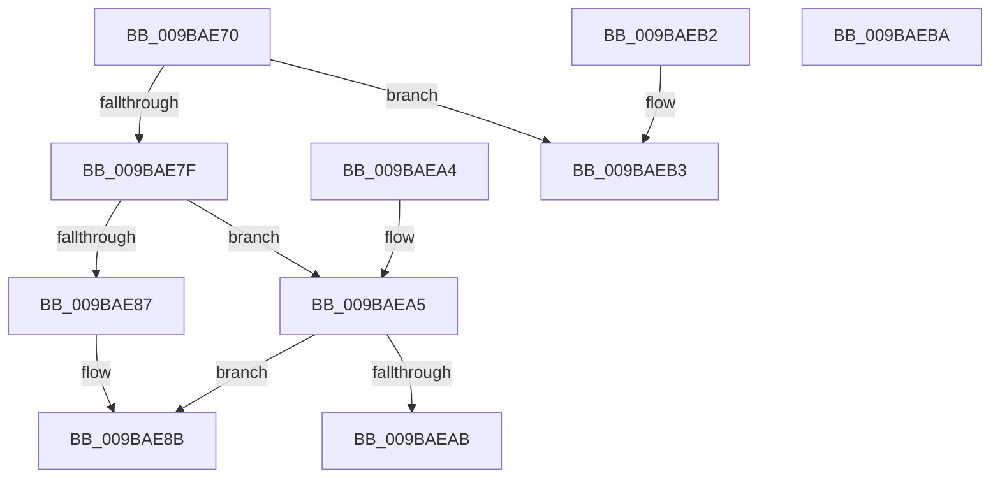

# SePrivilegeCheck

- RVA: `0x009BAE70`–`0x009BAEBB` (길이 `75` bytes)
- VA: `0x00000001409BAE70`
- 실행 섹션: `PAGE`
- PDB 이름 있음: `예`; PDB Function 태그: `아니요`
- unwind 정보 RVA: `0x0009EBE8`
- 디코드: `27`개 명령, `75/75` bytes 표시
- 미해석 바이트: `0` (있으면 어셈블리에 `.byte`로 보존)

> 이 문서는 커널 이미지의 기계어와 PDB 기호를 분석해 생성했습니다. 4번과 5번은 함수 원형과 자료형을 바이너리 사용 방식에서 추정한 C 해석이며 원본 소스 복구 결과는 아닙니다.

## 1. Dependencies

- 직접 호출 지점: **1**; 고유 호출 대상: **1**
- 직접 호출자로 확인된 함수: **5**
- RIP 상대 이미지 참조: **0**

### Outgoing calls
- `0x009BAE9A` → [SepPrivilegeCheck](../../text/40/SepPrivilegeCheck_function_0040B6B0.md) (function, `0x0040B6B0`)

### Direct callers
- [FsRtlpOplockTryPrepForAckTimeout](../71/FsRtlpOplockTryPrepForAckTimeout_function_007156C0.md) at `0x00715795`
- [CMFCheckAccess](../7D/CMFCheckAccess_function_007D28B4.md) at `0x007D2A25`
- [RtlpNewSecurityObject](../92/RtlpNewSecurityObject_function_0092AB50.md) at `0x0092C80C`
- [RtlpNewSecurityObject](../92/RtlpNewSecurityObject_function_0092AB50.md) at `0x0092CA36`
- [PspSinglePrivCheck](PspSinglePrivCheck_function_009BADCC.md) at `0x009BAE33`
- [NtSetInformationJobObject](../9F/NtSetInformationJobObject_function_009F84C0.md) at `0x009F8FFB`
- [NtSetInformationJobObject](../9F/NtSetInformationJobObject_function_009F84C0.md) at `0x009F981D`

### Static image references
- 디코드된 RIP-relative 메모리 참조가 없습니다.

## 2. Other-region calls and transfers

- 다른 실행 섹션으로 향하는 call: **1**
  - `0x009BAE9A` → [SepPrivilegeCheck](../../text/40/SepPrivilegeCheck_function_0040B6B0.md) (`PAGE` → `.text`)
- 별도 외부 분기/꼬리 이동을 확인하지 못했습니다.

## 3. Assembly (complete function range)

```asm
009BAE70  48 83 EC 38                     sub rsp, 0x38
009BAE74  41 0F B6 C0                     movzx eax, r8b
009BAE78  4C 8B C1                        mov r8, rcx
009BAE7B  84 C0                           test al, al
009BAE7D  74 34                           je 0x1409baeb3
009BAE7F  48 8B 0A                        mov rcx, qword ptr [rdx]
009BAE82  48 85 C9                        test rcx, rcx
009BAE85  75 1E                           jne 0x1409baea5
009BAE87  48 8B 4A 10                     mov rcx, qword ptr [rdx + 0x10]
009BAE8B  45 8B 48 04                     mov r9d, dword ptr [r8 + 4]
009BAE8F  49 8D 50 08                     lea rdx, [r8 + 8]
009BAE93  45 8B 00                        mov r8d, dword ptr [r8]
009BAE96  88 44 24 20                     mov byte ptr [rsp + 0x20], al
009BAE9A  E8 11 08 A5 FF                  call 0x14040b6b0
009BAE9F  48 83 C4 38                     add rsp, 0x38
009BAEA3  C3                              ret
009BAEA4  CC                              int3
009BAEA5  83 7A 08 02                     cmp dword ptr [rdx + 8], 2
009BAEA9  7D E0                           jge 0x1409bae8b
009BAEAB  32 C0                           xor al, al
009BAEAD  48 83 C4 38                     add rsp, 0x38
009BAEB1  C3                              ret
009BAEB2  CC                              int3
009BAEB3  B0 01                           mov al, 1
009BAEB5  48 83 C4 38                     add rsp, 0x38
009BAEB9  C3                              ret
009BAEBA  CC                              int3
```

## 4. C-style interpretation (structured pseudocode)

```c
__int64 __fastcall SePrivilegeCheck(__int64 a1, __int64 a2, unsigned __int8 a3)
{
    __int64 result;
    __int64 v_rsp;
    unsigned __int8 v_stack_m18;

    v_rsp = (v_rsp) - (56);
    if (a3 == 0) goto loc_009BAEB3;
    if (*(unsigned __int64 *)(a2) != 0) goto loc_009BAEA5;
loc_009BAE8B:
    v_stack_m18 = a3;
    result = SepPrivilegeCheck(*(unsigned __int64 *)(a2 + 16), a1 + 8, (unsigned int)(*(unsigned int *)(a1)), (unsigned int)(*(unsigned int *)(a1 + 4)));
    v_rsp = (v_rsp) + (56);
    return result;
loc_009BAEA5:
    if ((*(unsigned int *)(a1 + 8 + 8)) >= 2) goto loc_009BAE8B;
    result = 0;
    v_rsp = (v_rsp) + (56);
    return result;
loc_009BAEB3:
    v_rsp = (v_rsp) + (56);
    return 1;
}
```

## 5. (Beta) C Style

```c
int64_t SePrivilegeCheck(void *Arg1, void *Arg2, uint8_t Arg3)
{
    uint8_t *arg1 = (uint8_t *)Arg1;
    uint8_t *arg2 = (uint8_t *)Arg2;

    int64_t result;
    int64_t local_rsp;
    uint8_t v_stack_m18;

    local_rsp = (local_rsp) - (56);
    if (Arg3 == 0) goto loc_009BAEB3;
    if (*(uint64_t *)(arg2) != 0) goto loc_009BAEA5;
loc_009BAE8B:
    v_stack_m18 = Arg3;
    result = SepPrivilegeCheck(*(uint64_t *)(arg2 + 0x10), Arg1 + 8, (uint32_t)(*(uint32_t *)(arg1)), (uint32_t)(*(uint32_t *)(arg1 + 0x4)));
    local_rsp = (local_rsp) + (56);
    return result;
loc_009BAEA5:
    if ((*(uint32_t *)(arg1 + 0x8 + 0x8)) >= 2) goto loc_009BAE8B;
    result = 0;
    local_rsp = (local_rsp) + (56);
    return result;
loc_009BAEB3:
    local_rsp = (local_rsp) + (56);
    return 1;
}
```

### 관측된 메모리 오프셋

구조체 형식이 확인되지 않은 접근은 인자 기준의 오프셋으로만 기록했습니다.

| 기준 인자 | 오프셋 표현 | 폭 (bit) | 접근 |
|---|---:|---:|---|
| `Arg1` | `+ 0x0` | `32` | `R` |
| `Arg1` | `+ 0x4` | `32` | `R` |
| `Arg1` | `+ 0x8` | `64` | `R` |
| `Arg2` | `+ 0x0` | `64` | `R` |
| `Arg2` | `+ 0x8` | `32` | `R` |
| `Arg2` | `+ 0x10` | `64` | `R` |

## 6. Execution-region graph

[열기: 2D/3D 그래프와 함수 탐색 컨트롤 패널](../../../control-panel.html?section=page&rva=0x009BAE70&view=graph)

- 2D 그래프는 위에서 아래로 흐르고, 3D 그래프는 빈 공간을 드래그해 회전합니다. Shift+드래그는 이동, 휠은 확대·축소, 함수 노드 선택은 대상 보고서 이동입니다.

### Static fallback


