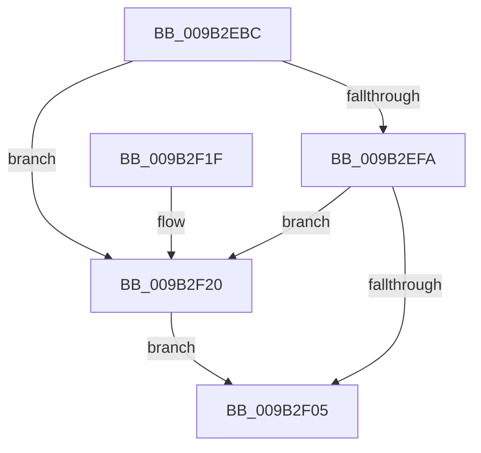

# UNLOCK_HIVE_LOAD

- RVA: `0x009B2EBC`–`0x009B2F2E` (길이 `114` bytes)
- VA: `0x00000001409B2EBC`
- 실행 섹션: `PAGE`
- PDB 이름 있음: `예`; PDB Function 태그: `아니요`
- unwind 정보 RVA: `0x000704F4`
- 디코드: `27`개 명령, `114/114` bytes 표시
- 미해석 바이트: `0` (있으면 어셈블리에 `.byte`로 보존)

> 이 문서는 커널 이미지의 기계어와 PDB 기호를 분석해 생성했습니다. 4번과 5번은 함수 원형과 자료형을 바이너리 사용 방식에서 추정한 C 해석이며 원본 소스 복구 결과는 아닙니다.

## 1. Dependencies

- 직접 호출 지점: **3**; 고유 호출 대상: **3**
- 직접 호출자로 확인된 함수: **14**
- RIP 상대 이미지 참조: **2**

### Outgoing calls
- `0x009B2F0C` → [KeAbPostRelease](../../text/2E/KeAbPostRelease_function_002E1600.md) (function, `0x002E1600`)
- `0x009B2F14` → [KiLeaveCriticalRegionUnsafe](../../text/25/KiLeaveCriticalRegionUnsafe_function_0025F010.md) (function, `0x0025F010`)
- `0x009B2F27` → [ExfReleasePushLock](../../text/26/ExfReleasePushLock_function_002638D0.md) (function, `0x002638D0`)

### Direct callers
- [CmpTryToRundownHive](../../text/2A/CmpTryToRundownHive_function_002A4A60.md) at `0x002A4AB5`
- [CmpTryToRundownHive](../../text/2A/CmpTryToRundownHive_function_002A4A60.md) at `0x002A4B9F`
- [CmpTryToRundownHive](../../text/2A/CmpTryToRundownHive_function_002A4A60.md) at `0x002A4C0A`
- [CmpLoadKeyCommon](../../text/46/CmpLoadKeyCommon_function_0046E9F8.md) at `0x0046EBF0`
- [CmpLoadKeyCommon](../../text/46/CmpLoadKeyCommon_function_0046E9F8.md) at `0x0046ED09`
- [CmpLoadKeyCommon](../../text/46/CmpLoadKeyCommon_function_0046E9F8.md) at `0x0046ED54`
- [CmShutdownSystem1](../../text/66/CmShutdownSystem1_function_0066A5B0.md) at `0x0066A627`
- [CmShutdownSystem1](../../text/66/CmShutdownSystem1_function_0066A5B0.md) at `0x0066A717`
- [CmShutdownSystem2](../../text/66/CmShutdownSystem2_function_0066A7FC.md) at `0x0066A927`
- [CmpLazyCommitWorker](../7E/CmpLazyCommitWorker_function_007EE030.md) at `0x007EE1CB`
- [CmpDoFlushNextHive](../84/CmpDoFlushNextHive_function_0084C7C0.md) at `0x0084C874`
- [CmLoadAppKey](../87/CmLoadAppKey_function_00876FFC.md) at `0x00877838`
- [CmLoadAppKey](../87/CmLoadAppKey_function_00876FFC.md) at `0x00877A79`
- [CmLoadAppKey](../87/CmLoadAppKey_function_00876FFC.md) at `0x00877A98`
- [CmLoadAppKey](../87/CmLoadAppKey_function_00876FFC.md) at `0x00877AAE`
- [CmLoadAppKey](../87/CmLoadAppKey_function_00876FFC.md) at `0x00877AEC`
- [CmLoadAppKey](../87/CmLoadAppKey_function_00876FFC.md) at `0x00877B23`
- [CmLoadAppKey](../87/CmLoadAppKey_function_00876FFC.md) at `0x00877B3F`
- [CmLoadAppKey](../87/CmLoadAppKey_function_00876FFC.md) at `0x00877C4B`
- [CmpPerformUnloadKey](../9A/CmpPerformUnloadKey_function_009AFA28.md) at `0x009AFC6C`
- [CmpPerformUnloadKey](../9A/CmpPerformUnloadKey_function_009AFA28.md) at `0x009AFDF9`
- [CmpPerformUnloadKey](../9A/CmpPerformUnloadKey_function_009AFA28.md) at `0x009AFE4F`
- [CmpPerformUnloadKey](../9A/CmpPerformUnloadKey_function_009AFA28.md) at `0x009AFEB5`
- [CmpPerformUnloadKey](../9A/CmpPerformUnloadKey_function_009AFA28.md) at `0x009AFF24`
- [CmpPerformUnloadKey](../9A/CmpPerformUnloadKey_function_009AFA28.md) at `0x009B0139`
- [CmKtmNotification](CmKtmNotification_function_009B1950.md) at `0x009B1B22`
- [CmKtmNotification](CmKtmNotification_function_009B1950.md) at `0x009B1D8A`
- [CmpLateUnloadHiveWorker](CmpLateUnloadHiveWorker_function_009B20D0.md) at `0x009B22DB`
- [CmpCompleteUnloadKey](CmpCompleteUnloadKey_function_009B32FC.md) at `0x009B341B`
- [sub_00B179DA](../B1/Unknown_function_00B179DA.md) at `0x00B17A6F`
- [sub_00B17CD8](../B1/Unknown_function_00B17CD8.md) at `0x00B17CE2`
- [sub_00B49062](../B4/Unknown_function_00B49062.md) at `0x00B491C3`

### Static image references
- `0x009B2ECE` → RVA `0x00FD8220` (`PAGEDATA`; write)
- `0x009B2ED5` → RVA `0x00EF7C78` (`.data`; read)

## 2. Other-region calls and transfers

- 다른 실행 섹션으로 향하는 call: **3**
  - `0x009B2F0C` → [KeAbPostRelease](../../text/2E/KeAbPostRelease_function_002E1600.md) (`PAGE` → `.text`)
  - `0x009B2F14` → [KiLeaveCriticalRegionUnsafe](../../text/25/KiLeaveCriticalRegionUnsafe_function_0025F010.md) (`PAGE` → `.text`)
  - `0x009B2F27` → [ExfReleasePushLock](../../text/26/ExfReleasePushLock_function_002638D0.md) (`PAGE` → `.text`)
- 별도 외부 분기/꼬리 이동을 확인하지 못했습니다.

## 3. Assembly (complete function range)

```asm
009B2EBC  40 53                           push rbx
009B2EBE  48 83 EC 20                     sub rsp, 0x20
009B2EC2  65 48 8B 1C 25 88 01 00 00      mov rbx, qword ptr gs:[0x188]
009B2ECB  45 33 C0                        xor r8d, r8d
009B2ECE  4C 89 05 4B 53 62 00            mov qword ptr [rip + 0x62534b], r8
009B2ED5  0F 0D 0D 9C 4D 54 00            prefetchw byte ptr [rip + 0x544d9c]
009B2EDC  48 8B 05 95 4D 54 00            mov rax, qword ptr [rip + 0x544d95]
009B2EE3  48 8B C8                        mov rcx, rax
009B2EE6  48 83 E1 F0                     and rcx, 0xfffffffffffffff0
009B2EEA  48 83 F9 10                     cmp rcx, 0x10
009B2EEE  48 8D 50 F0                     lea rdx, [rax - 0x10]
009B2EF2  49 0F 46 D0                     cmovbe rdx, r8
009B2EF6  A8 02                           test al, 2
009B2EF8  75 26                           jne 0x1409b2f20
009B2EFA  F0 48 0F B1 15 75 4D 54 00      lock cmpxchg qword ptr [rip + 0x544d75], rdx
009B2F03  75 1B                           jne 0x1409b2f20
009B2F05  48 8D 0D 6C 4D 54 00            lea rcx, [rip + 0x544d6c]
009B2F0C  E8 EF E6 92 FF                  call 0x1402e1600
009B2F11  48 8B CB                        mov rcx, rbx
009B2F14  E8 F7 C0 8A FF                  call 0x14025f010
009B2F19  48 83 C4 20                     add rsp, 0x20
009B2F1D  5B                              pop rbx
009B2F1E  C3                              ret
009B2F1F  CC                              int3
009B2F20  48 8D 0D 51 4D 54 00            lea rcx, [rip + 0x544d51]
009B2F27  E8 A4 09 8B FF                  call 0x1402638d0
009B2F2C  EB D7                           jmp 0x1409b2f05
```

## 4. C-style interpretation (structured pseudocode)

```c
__int64 __fastcall UNLOCK_HIVE_LOAD(__int64 a1, __int64 a2, int a3)
{
    __int64 result;
    __int64 v_rsp;

    v_rsp = (v_rsp) - (32);
    a3 = 0;
    *(unsigned __int64 *)(v_rip + 6443851) = 0;
    a1 = (*(unsigned __int64 *)(v_rip + 5524885)) & (-16);
    a2 = *(unsigned __int64 *)(v_rip + 5524885) - 16;
    if (a1 <= 16) { a2 = 0; }
    if ((((unsigned __int8)(*(unsigned __int64 *)(v_rip + 5524885))) & (2)) != 0) goto loc_009B2F20;
    if ((((unsigned __int8)(*(unsigned __int64 *)(v_rip + 5524885))) & (2)) != 0) goto loc_009B2F20;
loc_009B2F05:
    result = KeAbPostRelease(v_rip + 5524844, a2, a3, a4);
    result = KiLeaveCriticalRegionUnsafe(*(unsigned __int64 *)(gs_base + (0 + 392)), a2, a3, a4);
    v_rsp = (v_rsp) + (32);
    return result;
loc_009B2F20:
    result = ExfReleasePushLock(v_rip + 5524817, a2, a3, a4);
    goto loc_009B2F05;
}
```

## 5. (Beta) C Style

```c
int64_t UNLOCK_HIVE_LOAD(int64_t Arg1, int64_t Arg2, int32_t Arg3)
{
    int64_t result;
    int64_t local_rsp;

    local_rsp = (local_rsp) - (32);
    Arg3 = 0;
    *(uint64_t *)(v_rip + 0x62534B) = 0;
    Arg1 = (*(uint64_t *)(v_rip + 0x544D95)) & (-16);
    Arg2 = *(uint64_t *)(v_rip + 0x544D95) - 16;
    if (Arg1 <= 16) { Arg2 = 0; }
    if ((((uint8_t)(*(uint64_t *)(v_rip + 0x544D95))) & (2)) != 0) goto loc_009B2F20;
    if ((((uint8_t)(*(uint64_t *)(v_rip + 0x544D95))) & (2)) != 0) goto loc_009B2F20;
loc_009B2F05:
    result = KeAbPostRelease(v_rip + 5524844, Arg2, Arg3, a4);
    result = KiLeaveCriticalRegionUnsafe(*(uint64_t *)(gs_base + (0 + 0x188)), Arg2, Arg3, a4);
    local_rsp = (local_rsp) + (32);
    return result;
loc_009B2F20:
    result = ExfReleasePushLock(v_rip + 5524817, Arg2, Arg3, a4);
    goto loc_009B2F05;
}
```

## 6. Execution-region graph

[열기: 2D/3D 그래프와 함수 탐색 컨트롤 패널](../../../control-panel.html?section=page&rva=0x009B2EBC&view=graph)

- 2D 그래프는 위에서 아래로 흐르고, 3D 그래프는 빈 공간을 드래그해 회전합니다. Shift+드래그는 이동, 휠은 확대·축소, 함수 노드 선택은 대상 보고서 이동입니다.

### Static fallback


