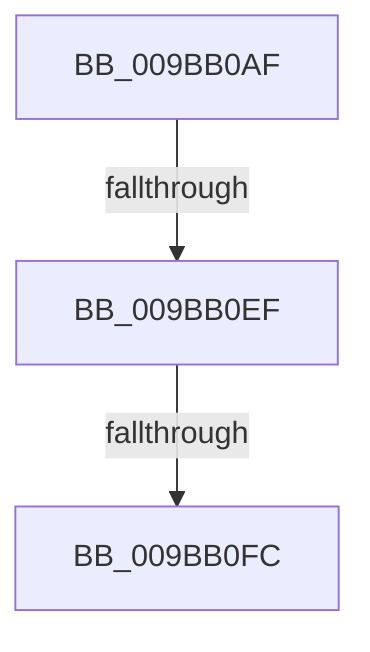

# sub_009BB0AF

- RVA: `0x009BB0AF`–`0x009BB119` (길이 `106` bytes)
- VA: `0x00000001409BB0AF`
- 실행 섹션: `PAGE`
- PDB 이름 있음: `아니요`; PDB Function 태그: `아니요`
- unwind 정보 RVA: `0x0009EC30`
- 디코드: `26`개 명령, `106/106` bytes 표시
- 미해석 바이트: `0` (있으면 어셈블리에 `.byte`로 보존)

> 이 문서는 커널 이미지의 기계어와 PDB 기호를 분석해 생성했습니다. 4번과 5번은 함수 원형과 자료형을 바이너리 사용 방식에서 추정한 C 해석이며 원본 소스 복구 결과는 아닙니다.

## 1. Dependencies

- 직접 호출 지점: **1**; 고유 호출 대상: **1**
- 직접 호출자로 확인된 함수: **0**
- RIP 상대 이미지 참조: **0**

### Outgoing calls
- `0x009BB0DE` → [MiGetVadWakeList](../../text/43/MiGetVadWakeList_function_00431134.md) (function, `0x00431134`)

### Direct callers
- 이 함수 시작 RVA로 연결되는 직접 call은 확인되지 않았습니다. 간접 호출은 완전히 역산할 수 없습니다.

### Static image references
- 디코드된 RIP-relative 메모리 참조가 없습니다.

## 2. Other-region calls and transfers

- 다른 실행 섹션으로 향하는 call: **1**
  - `0x009BB0DE` → [MiGetVadWakeList](../../text/43/MiGetVadWakeList_function_00431134.md) (`PAGE` → `.text`)
- call이 아닌 외부 분기/꼬리 이동: **3**
  - `0x009BB0E9` → [sub_009BB189](Unknown_function_009BB189.md) (`tail-transfer`)
  - `0x009BB0FA` → [sub_009BB136](Unknown_function_009BB136.md) (`tail-transfer`)
  - `0x009BB117` → [sub_009BB119 + 0x16](Unknown_function_009BB119.md) (`tail-transfer`)

## 3. Assembly (complete function range)

```asm
009BB0AF  48 89 5C 24 40                  mov qword ptr [rsp + 0x40], rbx
009BB0B4  48 8B D9                        mov rbx, rcx
009BB0B7  48 89 6C 24 48                  mov qword ptr [rsp + 0x48], rbp
009BB0BC  33 ED                           xor ebp, ebp
009BB0BE  48 89 74 24 50                  mov qword ptr [rsp + 0x50], rsi
009BB0C3  8B F2                           mov esi, edx
009BB0C5  48 8B B8 B8 00 00 00            mov rdi, qword ptr [rax + 0xb8]
009BB0CC  BA DE FD FF FF                  mov edx, 0xfffffdde
009BB0D1  4C 89 74 24 28                  mov qword ptr [rsp + 0x28], r14
009BB0D6  4C 89 7C 24 20                  mov qword ptr [rsp + 0x20], r15
009BB0DB  44 8B FD                        mov r15d, ebp
009BB0DE  E8 51 60 A7 FF                  call 0x140431134
009BB0E3  4C 8B F0                        mov r14, rax
009BB0E6  48 85 C0                        test rax, rax
009BB0E9  0F 85 9A 00 00 00               jne 0x1409bb189
009BB0EF  8B 53 30                        mov edx, dword ptr [rbx + 0x30]
009BB0F2  48 8D 4B 30                     lea rcx, [rbx + 0x30]
009BB0F6  0F BA E2 15                     bt edx, 0x15
009BB0FA  72 3A                           jb 0x1409bb136
009BB0FC  4C 8B 7C 24 20                  mov r15, qword ptr [rsp + 0x20]
009BB101  85 F6                           test esi, esi
009BB103  48 8B 74 24 50                  mov rsi, qword ptr [rsp + 0x50]
009BB108  4C 8B 74 24 28                  mov r14, qword ptr [rsp + 0x28]
009BB10D  48 8B 6C 24 48                  mov rbp, qword ptr [rsp + 0x48]
009BB112  48 8B 5C 24 40                  mov rbx, qword ptr [rsp + 0x40]
009BB117  74 16                           je 0x1409bb12f
```

## 4. C-style interpretation (structured pseudocode)

```c
__int64 __fastcall sub_009BB0AF(__int64 a1, int a2, __int64 a3, __int64 a4, __int64 a5, __int64 a6, __int64 a7, __int64 a8, __int64 a9, __int64 a10)
{
    __int64 result;
    __int64 v_rbp;
    unsigned __int64 v_stack_p20;
    unsigned __int64 v_stack_p28;
    unsigned __int64 v_stack_p40;
    unsigned __int64 v_stack_p48;
    unsigned __int64 v_stack_p50;

    v_stack_p40 = v_rbx;
    v_stack_p48 = v_rbp;
    v_rbp = 0;
    v_stack_p50 = v_rsi;
    v_stack_p28 = v_r14;
    v_stack_p20 = v_r15;
    result = MiGetVadWakeList(a1, (unsigned int)(0xFFFFFDDEULL), a3, a4);
}
```

## 5. (Beta) C Style

```c
int64_t sub_009BB0AF(void *Arg1, int32_t Arg2, int64_t Arg3, int64_t Arg4, int64_t Arg5, uint64_t Arg6, uint64_t Arg7, int64_t Arg8, int64_t Arg9, int64_t Arg10)
{
    uint8_t *arg1 = (uint8_t *)Arg1;

    int64_t result;
    int64_t local_rbp;
    uint64_t v_stack_p20;
    uint64_t v_stack_p28;
    uint64_t v_stack_p40;
    uint64_t v_stack_p48;
    uint64_t v_stack_p50;

    v_stack_p40 = local_rbx;
    v_stack_p48 = local_rbp;
    local_rbp = 0;
    v_stack_p50 = local_rsi;
    v_stack_p28 = local_r14;
    v_stack_p20 = local_r15;
    result = MiGetVadWakeList(Arg1, (uint32_t)(0xFFFFFDDEULL), Arg3, Arg4);
}
```

### 관측된 메모리 오프셋

구조체 형식이 확인되지 않은 접근은 인자 기준의 오프셋으로만 기록했습니다.

| 기준 인자 | 오프셋 표현 | 폭 (bit) | 접근 |
|---|---:|---:|---|
| `Arg1` | `+ 0x30` | `32` | `R` |
| `Arg1` | `+ 0x30` | `64` | `R` |

## 6. Execution-region graph

[열기: 2D/3D 그래프와 함수 탐색 컨트롤 패널](../../../control-panel.html?section=page&rva=0x009BB0AF&view=graph)

- 2D 그래프는 위에서 아래로 흐르고, 3D 그래프는 빈 공간을 드래그해 회전합니다. Shift+드래그는 이동, 휠은 확대·축소, 함수 노드 선택은 대상 보고서 이동입니다.

### Static fallback


