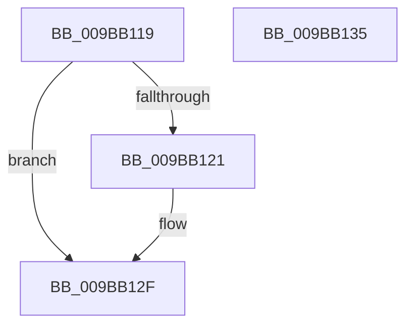

# sub_009BB119

- RVA: `0x009BB119`–`0x009BB136` (길이 `29` bytes)
- VA: `0x00000001409BB119`
- 실행 섹션: `PAGE`
- PDB 이름 있음: `아니요`; PDB Function 태그: `아니요`
- unwind 정보 RVA: `0x0009EC54`
- 디코드: `10`개 명령, `29/29` bytes 표시
- 미해석 바이트: `0` (있으면 어셈블리에 `.byte`로 보존)

> 이 문서는 커널 이미지의 기계어와 PDB 기호를 분석해 생성했습니다. 4번과 5번은 함수 원형과 자료형을 바이너리 사용 방식에서 추정한 C 해석이며 원본 소스 복구 결과는 아닙니다.

## 1. Dependencies

- 직접 호출 지점: **0**; 고유 호출 대상: **0**
- 직접 호출자로 확인된 함수: **0**
- RIP 상대 이미지 참조: **0**

### Outgoing calls
- 직접 디코드된 call 명령이 없습니다.

### Direct callers
- 이 함수 시작 RVA로 연결되는 직접 call은 확인되지 않았습니다. 간접 호출은 완전히 역산할 수 없습니다.

### Static image references
- 디코드된 RIP-relative 메모리 참조가 없습니다.

## 2. Other-region calls and transfers

- 다른 실행 섹션으로 향하는 call: **0**
- 별도 외부 분기/꼬리 이동을 확인하지 못했습니다.

## 3. Assembly (complete function range)

```asm
009BB119  8B 01                           mov eax, dword ptr [rcx]
009BB11B  24 70                           and al, 0x70
009BB11D  3C 10                           cmp al, 0x10
009BB11F  75 0E                           jne 0x1409bb12f
009BB121  48 8B 87 10 04 00 00            mov rax, qword ptr [rdi + 0x410]
009BB128  48 FF 88 F8 03 00 00            dec qword ptr [rax + 0x3f8]
009BB12F  48 83 C4 30                     add rsp, 0x30
009BB133  5F                              pop rdi
009BB134  C3                              ret
009BB135  CC                              int3
```

## 4. C-style interpretation (structured pseudocode)

```c
__int64 __fastcall sub_009BB119(__int64 a1)
{
    __int64 result;
    __int64 v_rsp;

    result = (unsigned __int8)(((unsigned int)(*(unsigned int *)(a1))) & (112));
    if (((unsigned __int8)(result)) == 16) {
        result = *(unsigned __int64 *)(v_rdi + 1040);
    }
    v_rsp = (v_rsp) + (48);
    return result;
}
```

## 5. (Beta) C Style

```c
int64_t sub_009BB119(void *Arg1)
{
    uint8_t *arg1 = (uint8_t *)Arg1;

    int64_t result;
    int64_t local_rsp;

    result = (uint8_t)(((uint32_t)(*(uint32_t *)(arg1))) & (112));
    if (((uint8_t)(result)) == 16) {
        result = *(uint64_t *)(local_rdi + 0x410);
    }
    local_rsp = (local_rsp) + (48);
    return result;
}
```

### 관측된 메모리 오프셋

구조체 형식이 확인되지 않은 접근은 인자 기준의 오프셋으로만 기록했습니다.

| 기준 인자 | 오프셋 표현 | 폭 (bit) | 접근 |
|---|---:|---:|---|
| `Arg1` | `+ 0x0` | `32` | `R` |

## 6. Execution-region graph

[열기: 2D/3D 그래프와 함수 탐색 컨트롤 패널](../../../control-panel.html?section=page&rva=0x009BB119&view=graph)

- 2D 그래프는 위에서 아래로 흐르고, 3D 그래프는 빈 공간을 드래그해 회전합니다. Shift+드래그는 이동, 휠은 확대·축소, 함수 노드 선택은 대상 보고서 이동입니다.

### Static fallback


