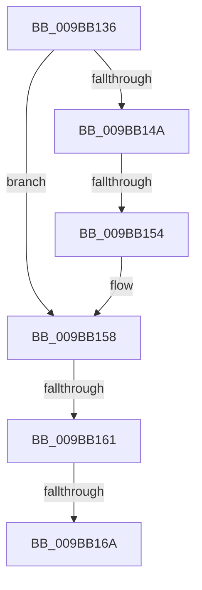

# sub_009BB136

- RVA: `0x009BB136`–`0x009BB189` (길이 `83` bytes)
- VA: `0x00000001409BB136`
- 실행 섹션: `PAGE`
- PDB 이름 있음: `아니요`; PDB Function 태그: `아니요`
- unwind 정보 RVA: `0x0009EC68`
- 디코드: `24`개 명령, `83/83` bytes 표시
- 미해석 바이트: `0` (있으면 어셈블리에 `.byte`로 보존)

> 이 문서는 커널 이미지의 기계어와 PDB 기호를 분석해 생성했습니다. 4번과 5번은 함수 원형과 자료형을 바이너리 사용 방식에서 추정한 C 해석이며 원본 소스 복구 결과는 아닙니다.

## 1. Dependencies

- 직접 호출 지점: **1**; 고유 호출 대상: **1**
- 직접 호출자로 확인된 함수: **0**
- RIP 상대 이미지 참조: **0**

### Outgoing calls
- `0x009BB17C` → [MiFreeLargePageView](MiFreeLargePageView_function_009BB3B4.md) (function, `0x009BB3B4`)

### Direct callers
- 이 함수 시작 RVA로 연결되는 직접 call은 확인되지 않았습니다. 간접 호출은 완전히 역산할 수 없습니다.

### Static image references
- 디코드된 RIP-relative 메모리 참조가 없습니다.

## 2. Other-region calls and transfers

- 다른 실행 섹션으로 향하는 call: **0**
- call이 아닌 외부 분기/꼬리 이동: **4**
  - `0x009BB152` → [sub_009BB0AF + 0x4D](Unknown_function_009BB0AF.md) (`tail-transfer`)
  - `0x009BB15F` → [sub_009BB0AF + 0x4D](Unknown_function_009BB0AF.md) (`tail-transfer`)
  - `0x009BB168` → [sub_009BB0AF + 0x4D](Unknown_function_009BB0AF.md) (`tail-transfer`)
  - `0x009BB184` → [sub_009BB0AF + 0x4D](Unknown_function_009BB0AF.md) (`tail-transfer`)

## 3. Assembly (complete function range)

```asm
009BB136  8B CA                           mov ecx, edx
009BB138  4C 8D 73 30                     lea r14, [rbx + 0x30]
009BB13C  81 E1 00 00 18 00               and ecx, 0x180000
009BB142  81 F9 00 00 10 00               cmp ecx, 0x100000
009BB148  73 0E                           jae 0x1409bb158
009BB14A  48 8D 4B 30                     lea rcx, [rbx + 0x30]
009BB14E  0F BA E2 17                     bt edx, 0x17
009BB152  73 A8                           jae 0x1409bb0fc
009BB154  4C 8D 73 30                     lea r14, [rbx + 0x30]
009BB158  48 8D 4B 30                     lea rcx, [rbx + 0x30]
009BB15C  F6 C2 70                        test dl, 0x70
009BB15F  75 9B                           jne 0x1409bb0fc
009BB161  48 8D 4B 30                     lea rcx, [rbx + 0x30]
009BB165  45 85 FF                        test r15d, r15d
009BB168  75 92                           jne 0x1409bb0fc
009BB16A  85 F6                           test esi, esi
009BB16C  48 8B D3                        mov rdx, rbx
009BB16F  48 8B CF                        mov rcx, rdi
009BB172  40 0F 95 C5                     setne bpl
009BB176  45 33 C0                        xor r8d, r8d
009BB179  44 8B CD                        mov r9d, ebp
009BB17C  E8 33 02 00 00                  call 0x1409bb3b4
009BB181  49 8B CE                        mov rcx, r14
009BB184  E9 73 FF FF FF                  jmp 0x1409bb0fc
```

## 4. C-style interpretation (structured pseudocode)

```c
__int64 __fastcall sub_009BB136(__int64 a1, int a2, int a3)
{
    __int64 result;
    __int64 v_rbp;

    a1 = (unsigned int)(((unsigned int)(a2)) & (0x180000ULL));
    if (((unsigned int)(a1)) >= 0x100000ULL) goto loc_009BB158;
loc_009BB158:
    v_rbp = ((unsigned int)(v_rsi) != 0) ? 1 : 0;
    a3 = 0;
    result = MiFreeLargePageView(v_rdi, v_rbx, a3, (unsigned int)((unsigned int)(v_rbp)));
}
```

## 5. (Beta) C Style

```c
int64_t sub_009BB136(int64_t Arg1, int32_t Arg2, int32_t Arg3)
{
    int64_t result;
    int64_t local_rbp;

    Arg1 = (uint32_t)(((uint32_t)(Arg2)) & (0x180000ULL));
    if (((uint32_t)(Arg1)) >= 0x100000ULL) goto loc_009BB158;
loc_009BB158:
    local_rbp = ((uint32_t)(local_rsi) != 0) ? 1 : 0;
    Arg3 = 0;
    result = MiFreeLargePageView(local_rdi, local_rbx, Arg3, (uint32_t)((uint32_t)(local_rbp)));
}
```

## 6. Execution-region graph

[열기: 2D/3D 그래프와 함수 탐색 컨트롤 패널](../../../control-panel.html?section=page&rva=0x009BB136&view=graph)

- 2D 그래프는 위에서 아래로 흐르고, 3D 그래프는 빈 공간을 드래그해 회전합니다. Shift+드래그는 이동, 휠은 확대·축소, 함수 노드 선택은 대상 보고서 이동입니다.

### Static fallback


