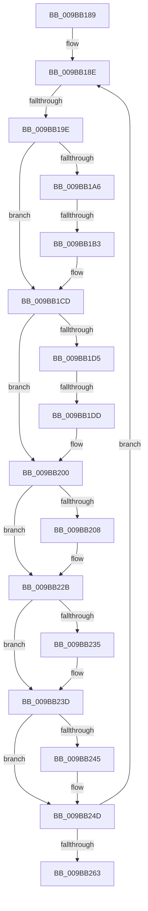

# sub_009BB189

- RVA: `0x009BB189`–`0x009BB26D` (길이 `228` bytes)
- VA: `0x00000001409BB189`
- 실행 섹션: `PAGE`
- PDB 이름 있음: `아니요`; PDB Function 태그: `아니요`
- unwind 정보 RVA: `0x0009EC8C`
- 디코드: `60`개 명령, `228/228` bytes 표시
- 미해석 바이트: `0` (있으면 어셈블리에 `.byte`로 보존)

> 이 문서는 커널 이미지의 기계어와 PDB 기호를 분석해 생성했습니다. 4번과 5번은 함수 원형과 자료형을 바이너리 사용 방식에서 추정한 C 해석이며 원본 소스 복구 결과는 아닙니다.

## 1. Dependencies

- 직접 호출 지점: **6**; 고유 호출 대상: **4**
- 직접 호출자로 확인된 함수: **0**
- RIP 상대 이미지 참조: **0**

### Outgoing calls
- `0x009BB1C8` → [PsReturnProcessNonPagedPoolQuota](../../text/41/PsReturnProcessNonPagedPoolQuota_function_0041C200.md) (function, `0x0041C200`)
- `0x009BB1FB` → [PsReturnProcessNonPagedPoolQuota](../../text/41/PsReturnProcessNonPagedPoolQuota_function_0041C200.md) (function, `0x0041C200`)
- `0x009BB226` → [PsReturnProcessNonPagedPoolQuota](../../text/41/PsReturnProcessNonPagedPoolQuota_function_0041C200.md) (function, `0x0041C200`)
- `0x009BB238` → [MiFreeAweView](../6F/MiFreeAweView_function_006FE7A4.md) (function, `0x006FE7A4`)
- `0x009BB248` → [MiFreePlaceholderVadEvent](MiFreePlaceholderVadEvent_function_009BB2B4.md) (function, `0x009BB2B4`)
- `0x009BB252` → [ExFreePoolWithTag](../../poolcode/B8/ExFreePoolWithTag_function_00B82870.md) (function, `0x00B82870`)

### Direct callers
- 이 함수 시작 RVA로 연결되는 직접 call은 확인되지 않았습니다. 간접 호출은 완전히 역산할 수 없습니다.

### Static image references
- 디코드된 RIP-relative 메모리 참조가 없습니다.

## 2. Other-region calls and transfers

- 다른 실행 섹션으로 향하는 call: **4**
  - `0x009BB1C8` → [PsReturnProcessNonPagedPoolQuota](../../text/41/PsReturnProcessNonPagedPoolQuota_function_0041C200.md) (`PAGE` → `.text`)
  - `0x009BB1FB` → [PsReturnProcessNonPagedPoolQuota](../../text/41/PsReturnProcessNonPagedPoolQuota_function_0041C200.md) (`PAGE` → `.text`)
  - `0x009BB226` → [PsReturnProcessNonPagedPoolQuota](../../text/41/PsReturnProcessNonPagedPoolQuota_function_0041C200.md) (`PAGE` → `.text`)
  - `0x009BB252` → [ExFreePoolWithTag](../../poolcode/B8/ExFreePoolWithTag_function_00B82870.md) (`PAGE` → `POOLCODE`)
- call이 아닌 외부 분기/꼬리 이동: **4**
  - `0x009BB198` → [sub_009BB26D + 0xA](Unknown_function_009BB26D.md) (`tail-transfer`)
  - `0x009BB1AD` → [sub_009BB26D](Unknown_function_009BB26D.md) (`tail-transfer`)
  - `0x009BB1D7` → [sub_009BB26D + 0x2C](Unknown_function_009BB26D.md) (`tail-transfer`)
  - `0x009BB268` → [sub_009BB0AF + 0x40](Unknown_function_009BB0AF.md) (`tail-transfer`)

## 3. Assembly (complete function range)

```asm
009BB189  4C 89 64 24 58                  mov qword ptr [rsp + 0x58], r12
009BB18E  41 8B 4E 50                     mov ecx, dword ptr [r14 + 0x50]
009BB192  4D 8B 26                        mov r12, qword ptr [r14]
009BB195  F6 C1 10                        test cl, 0x10
009BB198  0F 85 D9 00 00 00               jne 0x1409bb277
009BB19E  41 8B 46 50                     mov eax, dword ptr [r14 + 0x50]
009BB1A2  A8 08                           test al, 8
009BB1A4  74 27                           je 0x1409bb1cd
009BB1A6  49 8B 4E 08                     mov rcx, qword ptr [r14 + 8]
009BB1AA  48 85 C9                        test rcx, rcx
009BB1AD  0F 85 BA 00 00 00               jne 0x1409bb26d
009BB1B3  65 48 8B 0C 25 88 01 00 00      mov rcx, qword ptr gs:[0x188]
009BB1BC  BA 18 02 00 00                  mov edx, 0x218
009BB1C1  48 8B 89 B8 00 00 00            mov rcx, qword ptr [rcx + 0xb8]
009BB1C8  E8 33 10 A6 FF                  call 0x14041c200
009BB1CD  41 8B 46 50                     mov eax, dword ptr [r14 + 0x50]
009BB1D1  A8 04                           test al, 4
009BB1D3  74 2B                           je 0x1409bb200
009BB1D5  A8 40                           test al, 0x40
009BB1D7  0F 84 BC 00 00 00               je 0x1409bb299
009BB1DD  49 8B 46 08                     mov rax, qword ptr [r14 + 8]
009BB1E1  A8 3F                           test al, 0x3f
009BB1E3  48 8B D5                        mov rdx, rbp
009BB1E6  48 8B CF                        mov rcx, rdi
009BB1E9  0F 95 C2                        setne dl
009BB1EC  48 C1 E8 06                     shr rax, 6
009BB1F0  48 83 C2 0B                     add rdx, 0xb
009BB1F4  48 03 D0                        add rdx, rax
009BB1F7  48 C1 E2 03                     shl rdx, 3
009BB1FB  E8 00 10 A6 FF                  call 0x14041c200
009BB200  41 8B 46 50                     mov eax, dword ptr [r14 + 0x50]
009BB204  A8 40                           test al, 0x40
009BB206  74 23                           je 0x1409bb22b
009BB208  49 8B 46 08                     mov rax, qword ptr [r14 + 8]
009BB20C  48 8B D5                        mov rdx, rbp
009BB20F  A8 3F                           test al, 0x3f
009BB211  48 8B CF                        mov rcx, rdi
009BB214  0F 95 C2                        setne dl
009BB217  48 C1 E8 06                     shr rax, 6
009BB21B  48 83 C2 0B                     add rdx, 0xb
009BB21F  48 03 D0                        add rdx, rax
009BB222  48 C1 E2 03                     shl rdx, 3
009BB226  E8 D5 0F A6 FF                  call 0x14041c200
009BB22B  41 F7 46 50 00 01 00 00         test dword ptr [r14 + 0x50], 0x100
009BB233  74 08                           je 0x1409bb23d
009BB235  49 8B CE                        mov rcx, r14
009BB238  E8 67 35 D4 FF                  call 0x1406fe7a4
009BB23D  41 8B 46 50                     mov eax, dword ptr [r14 + 0x50]
009BB241  84 C0                           test al, al
009BB243  79 08                           jns 0x1409bb24d
009BB245  49 8B CE                        mov rcx, r14
009BB248  E8 67 00 00 00                  call 0x1409bb2b4
009BB24D  33 D2                           xor edx, edx
009BB24F  49 8B CE                        mov rcx, r14
009BB252  E8 19 76 1C 00                  call 0x140b82870
009BB257  4D 8B F4                        mov r14, r12
009BB25A  4D 85 E4                        test r12, r12
009BB25D  0F 85 2B FF FF FF               jne 0x1409bb18e
009BB263  4C 8B 64 24 58                  mov r12, qword ptr [rsp + 0x58]
009BB268  E9 82 FE FF FF                  jmp 0x1409bb0ef
```

## 4. C-style interpretation (structured pseudocode)

```c
__int64 __fastcall sub_009BB189(__int64 a1, __int64 a2, __int64 a3, __int64 a4, __int64 a5, __int64 a6, __int64 a7, __int64 a8, __int64 a9, __int64 a10, __int64 a11)
{
    __int64 result;
    unsigned __int64 v_stack_p58;

    v_stack_p58 = v_r12;
loc_009BB18E:
    if ((((unsigned __int8)((unsigned int)(*(unsigned int *)(v_r14 + 80)))) & (8)) == 0) goto loc_009BB1CD;
    result = PsReturnProcessNonPagedPoolQuota(*(unsigned __int64 *)(*(unsigned __int64 *)(gs_base + (0 + 392)) + 184), 536, a3, a4);
loc_009BB1CD:
    if ((((unsigned __int8)((unsigned int)(*(unsigned int *)(v_r14 + 80)))) & (4)) == 0) goto loc_009BB200;
    a2 = ((((unsigned __int8)(*(unsigned __int64 *)(v_r14 + 8))) & (63)) != 0) ? 1 : 0;
    result = (*(unsigned __int64 *)(v_r14 + 8)) >> (6);
    a2 = (a2) + (11);
    a2 = (a2) + (result);
    a2 = (a2) << (3);
    result = PsReturnProcessNonPagedPoolQuota(v_rdi, a2, a3, a4);
loc_009BB200:
    result = (unsigned int)(*(unsigned int *)(v_r14 + 80));
    if ((((unsigned __int8)((unsigned int)(*(unsigned int *)(v_r14 + 80)))) & (64)) != 0) {
        result = *(unsigned __int64 *)(v_r14 + 8);
        a2 = v_rbp;
        a1 = v_rdi;
        a2 = ((((unsigned __int8)(result)) & (63)) != 0) ? 1 : 0;
        result = (result) >> (6);
        a2 = (a2) + (11);
        a2 = (a2) + (result);
        a2 = (a2) << (3);
        result = PsReturnProcessNonPagedPoolQuota(a1, a2, a3, a4);
    }
    if (((*(unsigned int *)(v_r14 + 80)) & (256)) != 0) {
        a1 = v_r14;
        result = MiFreeAweView(a1, a2, a3, a4);
    }
    result = (unsigned int)(*(unsigned int *)(v_r14 + 80));
    if (sign_flag) {
        a1 = v_r14;
        result = MiFreePlaceholderVadEvent(a1, a2, a3, a4);
    }
    a2 = 0;
    result = ExFreePoolWithTag(v_r14, a2, a3, a4);
    if (*(unsigned __int64 *)(v_r14) != 0) goto loc_009BB18E;
}
```

## 5. (Beta) C Style

```c
int64_t sub_009BB189(int64_t Arg1, int64_t Arg2, int64_t Arg3, int64_t Arg4, uint64_t Arg5, uint64_t Arg6, uint64_t Arg7, uint64_t Arg8, uint64_t Arg9, uint64_t Arg10, int64_t Arg11)
{
    int64_t result;
    uint64_t v_stack_p58;

    v_stack_p58 = local_r12;
loc_009BB18E:
    if ((((uint8_t)((uint32_t)(*(uint32_t *)(local_r14 + 0x50)))) & (8)) == 0) goto loc_009BB1CD;
    result = PsReturnProcessNonPagedPoolQuota(*(uint64_t *)(*(uint64_t *)(gs_base + (0 + 0x188)) + 0xB8), 536, Arg3, Arg4);
loc_009BB1CD:
    if ((((uint8_t)((uint32_t)(*(uint32_t *)(local_r14 + 0x50)))) & (4)) == 0) goto loc_009BB200;
    Arg2 = ((((uint8_t)(*(uint64_t *)(local_r14 + 0x8))) & (63)) != 0) ? 1 : 0;
    result = (*(uint64_t *)(local_r14 + 0x8)) >> (6);
    Arg2 = (Arg2) + (11);
    Arg2 = (Arg2) + (result);
    Arg2 = (Arg2) << (3);
    result = PsReturnProcessNonPagedPoolQuota(local_rdi, Arg2, Arg3, Arg4);
loc_009BB200:
    result = (uint32_t)(*(uint32_t *)(local_r14 + 0x50));
    if ((((uint8_t)((uint32_t)(*(uint32_t *)(local_r14 + 0x50)))) & (64)) != 0) {
        result = *(uint64_t *)(local_r14 + 0x8);
        Arg2 = local_rbp;
        Arg1 = local_rdi;
        Arg2 = ((((uint8_t)(result)) & (63)) != 0) ? 1 : 0;
        result = (result) >> (6);
        Arg2 = (Arg2) + (11);
        Arg2 = (Arg2) + (result);
        Arg2 = (Arg2) << (3);
        result = PsReturnProcessNonPagedPoolQuota(Arg1, Arg2, Arg3, Arg4);
    }
    if (((*(uint32_t *)(local_r14 + 0x50)) & (256)) != 0) {
        Arg1 = local_r14;
        result = MiFreeAweView(Arg1, Arg2, Arg3, Arg4);
    }
    result = (uint32_t)(*(uint32_t *)(local_r14 + 0x50));
    if (sign_flag) {
        Arg1 = local_r14;
        result = MiFreePlaceholderVadEvent(Arg1, Arg2, Arg3, Arg4);
    }
    Arg2 = 0;
    result = ExFreePoolWithTag(local_r14, Arg2, Arg3, Arg4);
    if (*(uint64_t *)(local_r14) != 0) goto loc_009BB18E;
}
```

## 6. Execution-region graph

[열기: 2D/3D 그래프와 함수 탐색 컨트롤 패널](../../../control-panel.html?section=page&rva=0x009BB189&view=graph)

- 2D 그래프는 위에서 아래로 흐르고, 3D 그래프는 빈 공간을 드래그해 회전합니다. Shift+드래그는 이동, 휠은 확대·축소, 함수 노드 선택은 대상 보고서 이동입니다.

### Static fallback


