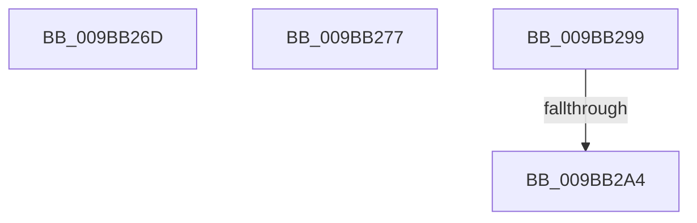

# sub_009BB26D

- RVA: `0x009BB26D`–`0x009BB2AD` (길이 `64` bytes)
- VA: `0x00000001409BB26D`
- 실행 섹션: `PAGE`
- PDB 이름 있음: `아니요`; PDB Function 태그: `아니요`
- unwind 정보 RVA: `0x0009ECA0`
- 디코드: `15`개 명령, `64/64` bytes 표시
- 미해석 바이트: `0` (있으면 어셈블리에 `.byte`로 보존)

> 이 문서는 커널 이미지의 기계어와 PDB 기호를 분석해 생성했습니다. 4번과 5번은 함수 원형과 자료형을 바이너리 사용 방식에서 추정한 C 해석이며 원본 소스 복구 결과는 아닙니다.

## 1. Dependencies

- 직접 호출 지점: **2**; 고유 호출 대상: **2**
- 직접 호출자로 확인된 함수: **0**
- RIP 상대 이미지 참조: **0**

### Outgoing calls
- `0x009BB26D` → [MiFreeInPageSupportBlock](../../text/2B/MiFreeInPageSupportBlock_function_002B5900.md) (function, `0x002B5900`)
- `0x009BB28F` → [MiFreeLargePageView](MiFreeLargePageView_function_009BB3B4.md) (function, `0x009BB3B4`)

### Direct callers
- 이 함수 시작 RVA로 연결되는 직접 call은 확인되지 않았습니다. 간접 호출은 완전히 역산할 수 없습니다.

### Static image references
- 디코드된 RIP-relative 메모리 참조가 없습니다.

## 2. Other-region calls and transfers

- 다른 실행 섹션으로 향하는 call: **1**
  - `0x009BB26D` → [MiFreeInPageSupportBlock](../../text/2B/MiFreeInPageSupportBlock_function_002B5900.md) (`PAGE` → `.text`)
- call이 아닌 외부 분기/꼬리 이동: **4**
  - `0x009BB272` → [sub_009BB189 + 0x2A](Unknown_function_009BB189.md) (`tail-transfer`)
  - `0x009BB294` → [sub_009BB189 + 0x15](Unknown_function_009BB189.md) (`tail-transfer`)
  - `0x009BB29E` → [sub_00B2E690](../B2/Unknown_function_00B2E690.md) (`tail-transfer`)
  - `0x009BB2A8` → [sub_009BB189 + 0x58](Unknown_function_009BB189.md) (`tail-transfer`)

## 3. Assembly (complete function range)

```asm
009BB26D  E8 8E A6 8F FF                  call 0x1402b5900
009BB272  E9 3C FF FF FF                  jmp 0x1409bb1b3
009BB277  85 F6                           test esi, esi
009BB279  44 8B CD                        mov r9d, ebp
009BB27C  4D 8B C6                        mov r8, r14
009BB27F  48 8B D3                        mov rdx, rbx
009BB282  41 0F 95 C1                     setne r9b
009BB286  48 8B CF                        mov rcx, rdi
009BB289  41 BF 01 00 00 00               mov r15d, 1
009BB28F  E8 20 01 00 00                  call 0x1409bb3b4
009BB294  E9 05 FF FF FF                  jmp 0x1409bb19e
009BB299  3D 00 01 00 00                  cmp eax, 0x100
009BB29E  0F 85 EC 33 17 00               jne 0x140b2e690
009BB2A4  49 8B 46 38                     mov rax, qword ptr [r14 + 0x38]
009BB2A8  E9 34 FF FF FF                  jmp 0x1409bb1e1
```

## 4. C-style interpretation (structured pseudocode)

```c
__int64 __fastcall sub_009BB26D(void)
{
    __int64 result;

    result = MiFreeInPageSupportBlock(a1, a2, a3, a4);
}
```

## 5. (Beta) C Style

```c
void sub_009BB26D(void)
{
    int64_t result;

    result = MiFreeInPageSupportBlock(a1, a2, a3, a4);
}
```

## 6. Execution-region graph

[열기: 2D/3D 그래프와 함수 탐색 컨트롤 패널](../../../control-panel.html?section=page&rva=0x009BB26D&view=graph)

- 2D 그래프는 위에서 아래로 흐르고, 3D 그래프는 빈 공간을 드래그해 회전합니다. Shift+드래그는 이동, 휠은 확대·축소, 함수 노드 선택은 대상 보고서 이동입니다.

### Static fallback


