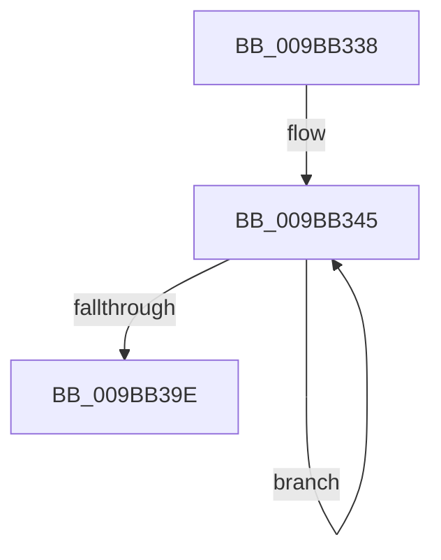

# sub_009BB338

- RVA: `0x009BB338`–`0x009BB3A3` (길이 `107` bytes)
- VA: `0x00000001409BB338`
- 실행 섹션: `PAGE`
- PDB 이름 있음: `아니요`; PDB Function 태그: `아니요`
- unwind 정보 RVA: `0x0009ECE4`
- 디코드: `26`개 명령, `107/107` bytes 표시
- 미해석 바이트: `0` (있으면 어셈블리에 `.byte`로 보존)

> 이 문서는 커널 이미지의 기계어와 PDB 기호를 분석해 생성했습니다. 4번과 5번은 함수 원형과 자료형을 바이너리 사용 방식에서 추정한 C 해석이며 원본 소스 복구 결과는 아닙니다.

## 1. Dependencies

- 직접 호출 지점: **2**; 고유 호출 대상: **1**
- 직접 호출자로 확인된 함수: **0**
- RIP 상대 이미지 참조: **0**

### Outgoing calls
- `0x009BB385` → [MiGetPteAddress](../../text/43/MiGetPteAddress_function_0043E130.md) (function, `0x0043E130`)
- `0x009BB390` → [MiGetPteAddress](../../text/43/MiGetPteAddress_function_0043E130.md) (function, `0x0043E130`)

### Direct callers
- 이 함수 시작 RVA로 연결되는 직접 call은 확인되지 않았습니다. 간접 호출은 완전히 역산할 수 없습니다.

### Static image references
- 디코드된 RIP-relative 메모리 참조가 없습니다.

## 2. Other-region calls and transfers

- 다른 실행 섹션으로 향하는 call: **2**
  - `0x009BB385` → [MiGetPteAddress](../../text/43/MiGetPteAddress_function_0043E130.md) (`PAGE` → `.text`)
  - `0x009BB390` → [MiGetPteAddress](../../text/43/MiGetPteAddress_function_0043E130.md) (`PAGE` → `.text`)
- 별도 외부 분기/꼬리 이동을 확인하지 못했습니다.

## 3. Assembly (complete function range)

```asm
009BB338  48 89 5C 24 20                  mov qword ptr [rsp + 0x20], rbx
009BB33D  BB 03 00 00 00                  mov ebx, 3
009BB342  41 2B D8                        sub ebx, r8d
009BB345  4C 8B C2                        mov r8, rdx
009BB348  49 8B C3                        mov rax, r11
009BB34B  48 2B C2                        sub rax, rdx
009BB34E  41 81 E0 FF 0F 00 00            and r8d, 0xfff
009BB355  48 C1 F8 03                     sar rax, 3
009BB359  4C 8D 0C C5 08 00 00 00         lea r9, [rax*8 + 8]
009BB361  49 8B C9                        mov rcx, r9
009BB364  49 C1 E9 0C                     shr r9, 0xc
009BB368  81 E1 FF 0F 00 00               and ecx, 0xfff
009BB36E  4D 03 D1                        add r10, r9
009BB371  48 81 C1 FF 0F 00 00            add rcx, 0xfff
009BB378  4C 03 C1                        add r8, rcx
009BB37B  48 8B CA                        mov rcx, rdx
009BB37E  49 C1 E8 0C                     shr r8, 0xc
009BB382  4D 03 D0                        add r10, r8
009BB385  E8 A6 2D A8 FF                  call 0x14043e130
009BB38A  49 8B CB                        mov rcx, r11
009BB38D  48 8B D0                        mov rdx, rax
009BB390  E8 9B 2D A8 FF                  call 0x14043e130
009BB395  4C 8B D8                        mov r11, rax
009BB398  48 83 EB 01                     sub rbx, 1
009BB39C  75 A7                           jne 0x1409bb345
009BB39E  48 8B 5C 24 20                  mov rbx, qword ptr [rsp + 0x20]
```

## 4. C-style interpretation (structured pseudocode)

```c
__int64 __fastcall sub_009BB338(__int64 a1, __int64 a2, int a3)
{
    __int64 result;
    __int64 v_r10;
    __int64 v_rbx;
    unsigned __int64 v_stack_p20;

    v_stack_p20 = v_rbx;
    v_rbx = (unsigned int)((3) - (a3));
loc_009BB345:
    result = (v_r11) - (a2);
    a3 = (unsigned int)((a2) & (0xFFFULL));
    result = (result) >> (3);
    a4 = (result * 8 + 8) >> (12);
    a1 = (unsigned int)((result * 8 + 8) & (0xFFFULL));
    v_r10 = (v_r10) + (a4);
    a1 = (a1) + (0xFFFULL);
    a3 = (a3) + (a1);
    a3 = (a3) >> (12);
    v_r10 = (v_r10) + (a3);
    result = MiGetPteAddress(a2, a2, a3, a4);
    result = MiGetPteAddress(v_r11, result, a3, a4);
    v_rbx = (v_rbx) - (1);
    if (condition_is_not_equal) goto loc_009BB345;
    return result;
}
```

## 5. (Beta) C Style

```c
int64_t sub_009BB338(int64_t Arg1, int64_t Arg2, int32_t Arg3)
{
    int64_t result;
    int64_t local_r10;
    int64_t local_rbx;
    uint64_t v_stack_p20;

    v_stack_p20 = local_rbx;
    local_rbx = (uint32_t)((3) - (Arg3));
loc_009BB345:
    result = (local_r11) - (Arg2);
    Arg3 = (uint32_t)((Arg2) & (0xFFFULL));
    result = (result) >> (3);
    a4 = (result * 8 + 8) >> (12);
    Arg1 = (uint32_t)((result * 8 + 8) & (0xFFFULL));
    local_r10 = (local_r10) + (a4);
    Arg1 = (Arg1) + (0xFFFULL);
    Arg3 = (Arg3) + (Arg1);
    Arg3 = (Arg3) >> (12);
    local_r10 = (local_r10) + (Arg3);
    result = MiGetPteAddress(Arg2, Arg2, Arg3, a4);
    result = MiGetPteAddress(local_r11, result, Arg3, a4);
    local_rbx = (local_rbx) - (1);
    if (condition_is_not_equal) goto loc_009BB345;
    return result;
}
```

## 6. Execution-region graph

[열기: 2D/3D 그래프와 함수 탐색 컨트롤 패널](../../../control-panel.html?section=page&rva=0x009BB338&view=graph)

- 2D 그래프는 위에서 아래로 흐르고, 3D 그래프는 빈 공간을 드래그해 회전합니다. Shift+드래그는 이동, 휠은 확대·축소, 함수 노드 선택은 대상 보고서 이동입니다.

### Static fallback


