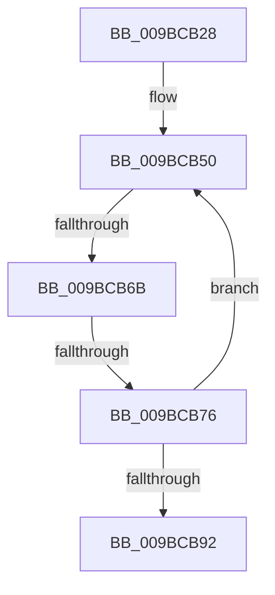

# sub_009BCB28

- RVA: `0x009BCB28`–`0x009BCBA1` (길이 `121` bytes)
- VA: `0x00000001409BCB28`
- 실행 섹션: `PAGE`
- PDB 이름 있음: `아니요`; PDB Function 태그: `아니요`
- unwind 정보 RVA: `0x0009F13C`
- 디코드: `31`개 명령, `121/121` bytes 표시
- 미해석 바이트: `0` (있으면 어셈블리에 `.byte`로 보존)

> 이 문서는 커널 이미지의 기계어와 PDB 기호를 분석해 생성했습니다. 4번과 5번은 함수 원형과 자료형을 바이너리 사용 방식에서 추정한 C 해석이며 원본 소스 복구 결과는 아닙니다.

## 1. Dependencies

- 직접 호출 지점: **1**; 고유 호출 대상: **1**
- 직접 호출자로 확인된 함수: **0**
- RIP 상대 이미지 참조: **1**

### Outgoing calls
- `0x009BCB6B` → [CmpSearchSecurityCellCache](../../text/43/CmpSearchSecurityCellCache_function_0043D6F0.md) (function, `0x0043D6F0`)

### Direct callers
- 이 함수 시작 RVA로 연결되는 직접 call은 확인되지 않았습니다. 간접 호출은 완전히 역산할 수 없습니다.

### Static image references
- `0x009BCB2D` → RVA `0x0043D6F0` (`CmpSearchSecurityCellCache`; read)

## 2. Other-region calls and transfers

- 다른 실행 섹션으로 향하는 call: **1**
  - `0x009BCB6B` → [CmpSearchSecurityCellCache](../../text/43/CmpSearchSecurityCellCache_function_0043D6F0.md) (`PAGE` → `.text`)
- call이 아닌 외부 분기/꼬리 이동: **2**
  - `0x009BCB69` → [sub_009BCBB2 + 0xF](Unknown_function_009BCBB2.md) (`tail-transfer`)
  - `0x009BCB74` → [sub_009BCBB2](Unknown_function_009BCBB2.md) (`tail-transfer`)

## 3. Assembly (complete function range)

```asm
009BCB28  48 89 5C 24 50                  mov qword ptr [rsp + 0x50], rbx
009BCB2D  48 8D 05 BC 0B A8 FF            lea rax, [rip - 0x57f444]
009BCB34  48 89 74 24 58                  mov qword ptr [rsp + 0x58], rsi
009BCB39  4C 89 64 24 60                  mov qword ptr [rsp + 0x60], r12
009BCB3E  4C 8B 64 24 70                  mov r12, qword ptr [rsp + 0x70]
009BCB43  0F 1F 40 00                     nop dword ptr [rax]
009BCB47  66 0F 1F 84 00 00 00 00 00      nop word ptr [rax + rax]
009BCB50  48 8B F5                        mov rsi, rbp
009BCB53  49 8B CD                        mov rcx, r13
009BCB56  48 D1 EE                        shr rsi, 1
009BCB59  48 8B DE                        mov rbx, rsi
009BCB5C  49 0F AF DE                     imul rbx, r14
009BCB60  48 03 DF                        add rbx, rdi
009BCB63  48 8B D3                        mov rdx, rbx
009BCB66  4C 3B E0                        cmp r12, rax
009BCB69  75 56                           jne 0x1409bcbc1
009BCB6B  E8 80 0B A8 FF                  call 0x14043d6f0
009BCB70  8B D0                           mov edx, eax
009BCB72  85 C0                           test eax, eax
009BCB74  7F 3C                           jg 0x1409bcbb2
009BCB76  48 8B EE                        mov rbp, rsi
009BCB79  4C 8B FB                        mov r15, rbx
009BCB7C  85 D2                           test edx, edx
009BCB7E  4A 8D 0C 33                     lea rcx, [rbx + r14]
009BCB82  48 8D 05 67 0B A8 FF            lea rax, [rip - 0x57f499]
009BCB89  48 0F 4F F9                     cmovg rdi, rcx
009BCB8D  49 3B FF                        cmp rdi, r15
009BCB90  72 BE                           jb 0x1409bcb50
009BCB92  4C 8B 64 24 60                  mov r12, qword ptr [rsp + 0x60]
009BCB97  48 8B 74 24 58                  mov rsi, qword ptr [rsp + 0x58]
009BCB9C  48 8B 5C 24 50                  mov rbx, qword ptr [rsp + 0x50]
```

## 4. C-style interpretation (structured pseudocode)

```c
__int64 __fastcall sub_009BCB28(__int64 a1, __int64 a2, __int64 a3, __int64 a4, __int64 a5, __int64 a6, __int64 a7, __int64 a8, __int64 a9, __int64 a10, __int64 a11, __int64 a12, __int64 a13, __int64 a14)
{
    __int64 result;
    __int64 v_rbx;
    __int64 v_rdi;
    __int64 v_rsi;
    unsigned __int64 v_stack_p50;
    unsigned __int64 v_stack_p58;
    unsigned __int64 v_stack_p60;

    v_stack_p50 = v_rbx;
    v_stack_p58 = v_rsi;
    v_stack_p60 = v_r12;
loc_009BCB50:
    v_rsi = (v_rbp) >> (1);
    v_rbx = (v_rsi) * (v_r14);
    v_rbx = (v_rbx) + (v_rdi);
    result = CmpSearchSecurityCellCache(v_r13, v_rbx, a3, a4);
    if (condition_is_greater) { v_rdi = v_rbx + v_r14 * 1; }
    if (v_rdi < v_rbx) goto loc_009BCB50;
    return v_rip - 5764249;
}
```

## 5. (Beta) C Style

```c
int64_t sub_009BCB28(int64_t Arg1, int64_t Arg2, int64_t Arg3, int64_t Arg4, uint64_t Arg5, uint64_t Arg6, uint64_t Arg7, uint64_t Arg8, uint64_t Arg9, int64_t Arg10, int64_t Arg11, int64_t Arg12, uint64_t Arg13, int64_t Arg14)
{
    int64_t result;
    int64_t local_rbx;
    int64_t local_rdi;
    int64_t local_rsi;
    uint64_t v_stack_p50;
    uint64_t v_stack_p58;
    uint64_t v_stack_p60;

    v_stack_p50 = local_rbx;
    v_stack_p58 = local_rsi;
    v_stack_p60 = local_r12;
loc_009BCB50:
    local_rsi = (local_rbp) >> (1);
    local_rbx = (local_rsi) * (local_r14);
    local_rbx = (local_rbx) + (local_rdi);
    result = CmpSearchSecurityCellCache(local_r13, local_rbx, Arg3, Arg4);
    if (condition_is_greater) { local_rdi = local_rbx + local_r14 * 1; }
    if (local_rdi < local_rbx) goto loc_009BCB50;
    return v_rip - 5764249;
}
```

## 6. Execution-region graph

[열기: 2D/3D 그래프와 함수 탐색 컨트롤 패널](../../../control-panel.html?section=page&rva=0x009BCB28&view=graph)

- 2D 그래프는 위에서 아래로 흐르고, 3D 그래프는 빈 공간을 드래그해 회전합니다. Shift+드래그는 이동, 휠은 확대·축소, 함수 노드 선택은 대상 보고서 이동입니다.

### Static fallback


